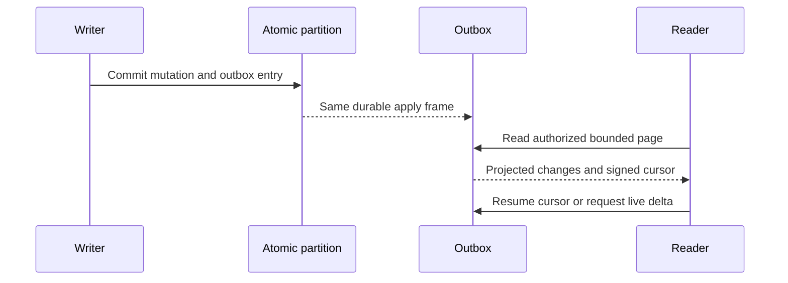
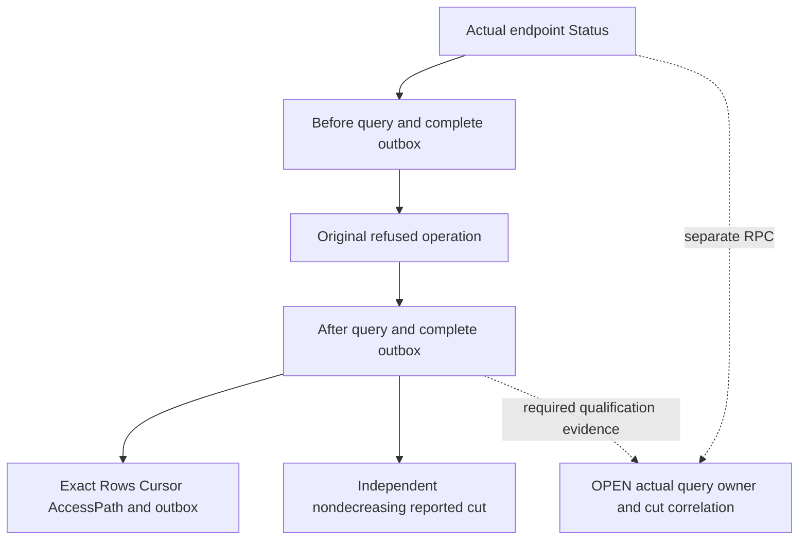

# ChangeFeeds

Status: in progress after a later Linux live-page regression. Original KL-079 acceptance passed48/48 at `b1f57eb8d487270983b428d835c922701dd14ed7`; [original evidence and subsequent regression](../implementation/qualification-stage57-kl035-kl079.md) remain separate. Repair and current-source qualification are open. Cross-partition coverage, richer subscriptions and external-index publication remain planned.

## Purpose, actors, and entry points

ChangeFeeds exposes committed document mutations to authorized readers and bounded scalar live queries, and provides a system outbox for in-partition projections. Actors are database clients, projection workers, and query clients. Current HTTP/.NET entry points are `POST /v1/changes/read`, `POST /v1/query/live/start`, `POST /v1/query/live/read`, and administrator projection operations under `/v1/admin/projections/*`; their contracts are in `src/KeyLoad.Abstractions/Features/ChangeFeeds/Contracts/ChangeFeeds.cs`, implementation in `src/KeyLoad.Core/Features/ChangeFeeds/Execution/ChangeFeeds.cs`, `ProjectionOutbox.cs`, and `src/KeyLoad.Query/Features/ChangeFeeds/Queries/LiveQueryExecutor.cs`, and SDK methods in `src/KeyLoad.Client/KeyLoadClient.cs`. These are existing routes, not a proposal for additional endpoints.

## Canonical slice map and boundaries

| Surface | Current source | Target owner |
|---|---|---|
| Contracts | `src/KeyLoad.Abstractions/Features/ChangeFeeds/Contracts/ChangeFeeds.cs` | `src/KeyLoad.Abstractions/Features/ChangeFeeds/` |
| Outbox and public feed | `src/KeyLoad.Core/Features/ChangeFeeds/Execution/ProjectionOutbox.cs`, `ChangeFeeds.cs` | `src/KeyLoad.Core/Features/ChangeFeeds/` |
| Scalar live query | `src/KeyLoad.Query/Features/ChangeFeeds/Queries/LiveQueryExecutor.cs`; public facade `LiveQueries.cs` | Slice-local private owner borrowing the existing database/query engine; same single read cut |
| HTTP/.NET SDK | `src/KeyLoad.Server/Features/ClientApi/Transport/ApiEndpoints.cs`, `src/KeyLoad.Client/KeyLoadClient.cs` | Shared entry points; behavior remains in this slice |
| Tests | `tests/KeyLoad.UnitTests/Features/ChangeFeeds/` feed/projection suites, `LiveQueryTests.cs`; `tests/KeyLoad.RecoveryTests/Features/EventStreams/Cases/ProjectionRecoveryTests.cs`; `tests/KeyLoad.IntegrationTests/Features/ClusterReplication/Cases/ClusterTests.cs`; new `Features/ChangeFeeds/Cases/FeedLiveRf3Tests.cs` | Unit feed/projection source is slice-local; remaining layout debt targets matching `Features/ChangeFeeds/` folders |
| Durable design | `../design/change-feeds.md` | Detailed design reference; this file owns feature acceptance |
| Frontend | None | N/A: polling and query results are database/client contracts, with no independent UI |
| Official MCP / SQL Q1 CALL | Existing `keyload_changes_read`, `keyload_query_live_start`, `keyload_query_live_read` in the native ClientApi read catalog | Real official MCP SDK invokes the same native operations; exact-source RF3 qualification remains required |

Current root-level source locations are migration debt under [ADR-032](../ADR/ADR-032-mcaf-governance.md). ChangeFeeds does not own the private redo journal, business event streams, message leases, replica placement, or external search-index files. A per-partition outbox is not a cross-partition CDC guarantee.

## Accepted TASK-MP-007D read-work repair

[ADR-035](../ADR/ADR-035-memory-performance.md) adds REQ-FEED-006, mapped to
AC-FEED-004/005 and AC-MP-006/012: carry actual stored outbox byte length and owned
lookup key alongside the decoded entry instead of copying/rereading its payload
for quota subtraction during purge. One canonical point-reader decodes borrowed
bytes and validates sequence/partition before yielding an owned entry. Existing
feed/projection iteration reuses it; purge mutates only between point reads, not
from a range callback. Producer, wire/signatures, filters, checkpoint pins,
contiguous progress and exact response serialization budgets stay. Raw stored
length cannot replace response size without a separate compatibility proof.

Purge passes `min(head.Tail, ThroughSequence)` as the reader's inclusive upper
position. It neither decodes nor validates a retained entry beyond that requested
cut; a no-op or already-reclaimed prefix reads no entries. Gaps and invalid
sequence/partition metadata inside the requested prefix still fail atomically.
Prepare the partition identity once per iterator, rather than hashing it for each
entry. This changes read work only, not committed purge outcomes or retention pins.

Worker owns only ProjectionOutbox.cs range-reader/purge regions and new
Core/UnitTests Features/ChangeFeeds helpers/tests. Shared contracts, ChangeFeeds.cs,
live queries, other producer/consumer methods, docs and CI remain lead-owned.
Real-store tests first prove stored-byte reclamation across large/Unicode entries,
pinned/partial purge, rollback on missing/wrong-sequence/partition records, reopen
and a healthy subsequent producer. A corrupt next retained entry proves that no-op
and prefix purge do not inspect it; restoring that real-store entry allows the
next projection batch to consume it. GitHub executes TUnit/recovery/RF3; source and
development builds do not establish reduced physical I/O.

Projection batch reads reuse their already-loaded outbox head and pass its tail
to the shared entry reader, avoiding a second metadata lookup. Per-entry byte
accounting uses the captured stored length only after a real-store test proves
that `JsonDefaults` round-trips a large Unicode outbox entry byte-for-byte. Exact
and one-byte-too-small batch limits retain their previous result/error semantics;
one single-entry batch performs exactly one lookup each for the principal,
consumer, head and outbox entry.

## Current behavior and accepted target

- Canonical mutations and their outbox entries are committed together. A failed batch exposes no partial entries; a retry with the same command does not append duplicates. Outbox positions are partition-local and monotonically increasing.
- Projection consumers persist an immutable filter/generation, contiguous checkpoint, signed batch token, replay receipt, and retention pin. Effects and checkpoint commit atomically in the same atomic partition. Failed effects do not advance the checkpoint; stale generation tokens are rejected.
- Public document feeds require `ChangesRead | DocumentsRead`. Signed cursors bind the principal, policy/schema/visibility epochs, partition, collection, database incarnation, and position. Bounded pages project before/after images through row and field policy; deletion metadata has no after payload.
- Scalar live queries capture a bounded initial Q1 snapshot and outbox cut together, then return bounded upsert/remove deltas. Unsupported ordering, top-k, aggregation, joins, graph, or ANN subscriptions are rejected by the current profile.
- Current source does not establish external-file atomic publication, automatic retention scheduling, multi-partition merge, or all event/topic/group feed semantics. Those remain planned and require their own contracts and evidence.

## Requirements and acceptance

| Requirement | Measurable acceptance | Existing or planned evidence |
|---|---|---|
| REQ-FEED-001: publish canonical changes and projection effects atomically | AC-FEED-001 passes when a failed producer/effect batch changes neither canonical state nor visible outbox/checkpoint, and replay of the same command/batch returns its prior outcome without duplicate effects. | Existing `ChangeFeedTests.EveryCanonicalMutationAndItsCommitShareThePartitionOutbox`, `FailedBatchAndSameCommandRetryCannotPublishPartialOrDuplicateChanges`, `FailedProjectionEffectsDoNotAdvanceTheCheckpointAndDuplicateDeliveryIsSafe`; recovery `ProjectionCrashRecoversEffectsOutboxReceiptOutcomeAndCheckpointTogether`. |
| REQ-FEED-002: expose resumable, bounded, authorized document changes | AC-FEED-002 passes when a page returns only currently and historically visible, safely projected changes; its signed cursor resumes within retention, and byte/position bounds preserve the first undelivered entry. Stale policy/ACL/incarnation or reclaimed history returns an explicit error. | Existing `ChangeFeedTests.FeedAndProjectionByteBoundariesPreserveTheFirstUndeliveredPosition`, `FeedResumesAnEmptyTailProjectsPiiAndRetainsDeletionMetadata`, `FeedNeverReturnsFormerOwnersDataAndAclChangesFenceOldCursors`, `FeedRevocationHistoryLossAndScopeMismatchAreExplicit`. |
| REQ-FEED-003: make scalar live snapshot plus tail gap-free | AC-FEED-003 passes when a concurrent committed write is present either in the initial snapshot or a later delta, and replayed authorized deltas match the ordinary query oracle. Unsupported query profiles fail explicitly. | Existing `LiveQueryTests.ScalarLiveDeltasMatchTheSharedQueryOracleAcrossSeededMutationsAndReplay`, `ConcurrentInitialSnapshotAndTailNeverLoseACommittedDocument`, `UnsupportedRankingIncompleteSnapshotsAndDifferentQueryCursorsAreRejected`. |
| REQ-FEED-004: advance projection checkpoints contiguously under pinned retention | AC-FEED-004 passes when filtered positions advance contiguously, no checkpoint crosses a pending effect, and purge cannot pass the lowest active generation checkpoint. | Existing `ChangeFeedTests.RetentionPinsProtectUnprocessedAndRebuildHistory`, `FilteredProjectionPositionsAdvanceContiguouslyWithoutPublishingForeignResources`, `AReleasedGenerationRejectsOldBatchesAndCachedCommandReceipts`; planned real multi-partition coverage tests. |
| REQ-FEED-005: recover retained feed state without silent gaps | AC-FEED-005 passes when reopen/compaction and the declared RF3 snapshot-install path preserve outbox/checkpoint/receipt state or explicitly invalidate old cursors; history loss requires resynchronization. | Existing `OutboxAndConsumerReceiptsRecoverAfterReopenAndCompaction`, `ProjectionRecoveryTests.ProjectionCrashRecoversEffectsOutboxReceiptOutcomeAndCheckpointTogether`; current-source GitHub qualification and broader leader-loss cases remain pending. |
| REQ-FEED-006: bound projection read work without changing byte-budget behavior | AC-FEED-006 passes when persisted entry bytes equal `JsonDefaults` serialization after decode, exact and one-byte-short limits preserve success/rejection, and an isolated one-entry batch performs exactly four borrowed point lookups. | `ProjectionReadWorkTests.AcMp006ProjectionBatchReusesHeadAndStoredEntryBytes`; real ZoneTree counters; TUnit execution remains GitHub Actions only. |

## Error, edge, and security flows

Empty-tail cursors are valid. Filtered partition positions may produce an empty page with `HasMore`; callers continue until caught up. A first item larger than the byte budget fails with `BudgetExceeded` without moving past it. Missing authorization fails before reading payloads. Principal revocation or policy/schema/row-visibility changes fence old cursors. A cursor behind a reclaimed prefix returns `HistoryUnavailable`, requiring a fresh snapshot. A deleted change preserves revision/deletion metadata and has no `After` payload; its `Before` image may be present only when historical and current row authorization allow it, and it is safely projected. Public readers never receive raw system-outbox entries or unrelated resource identities.

## ADRs and verification boundary

Related decisions: [ADR-017](../ADR/ADR-017-ownership-session-tokens.md), [ADR-022](../ADR/ADR-022-policy-epoch-revocation.md), [ADR-023](../ADR/ADR-023-journal-authority.md), [ADR-024](../ADR/ADR-024-transaction-domain-binding.md), [ADR-025](../ADR/ADR-025-event-revision-feed-positions.md), [ADR-027](../ADR/ADR-027-contiguous-subscription-checkpoints.md), [ADR-029](../ADR/ADR-029-event-message-classification.md), and [ADR-030](../ADR/ADR-030-retention-paused-restore.md). Cluster routing follows the accepted [ADR-036](../ADR/ADR-036-orleans-foundation.md). The operational distinction among redo journal, business streams, queue state, and outbox is in [change-feed design](../design/change-feeds.md).

TUnit unit, process-recovery, and Docker/Aspire RF3 cases execute through GitHub Actions only. The current source/test names above are traceability, not a passing result for the current checkout. Required external-index manifests, multi-partition semantics, official MCP calls, and delivered-source CI evidence remain pending. Tests use the real ZoneTree store and real cluster/client path; no mock-only acceptance is permitted.

Original KL-016 task acceptance is complete on the source-bound Linux Stage VII
cohort documented in [the canonical task status](../implementation/status.json).
Crash between commit and delivery loses no event; duplicate delivery is safe; checkpoint does not skip a failed event. The receipt retains all original full-suite failures;
this task closure does not mark the complete feature or later source qualified.

## Live delta retained output composition, TASK-QUERY-RESULT-CAP-LIVE-002

REQ-QUERY-001/003, AC-MP-003/012 and REQ/AC-FEED-002/003 under ADR-004/010/013/022/118 require the existing constrained result budget to admit each retained selected live delta before retention. Core keeps its existing public ReadChangeFeedView signature and adds an internal synchronous before-retain overload, invoked only after original request.MaxBytes admits the change and before changes.Add/checkpoint advancement. LiveQueryResultByteAdmission uses exact original budget.MeasureResult and cumulative MaximumResultBytes; overflow is existing QueryEngine.ResultLimitExceeded BudgetExceeded, not partial success. Full wrapper serializer check remains. No operation clock/token/read grants/admission/read cut reset or new request/serialization/persistence field. Install this additional callback only for an explicit configured result cap; null/default preserves old feed behavior.

LiveQueryResultCompositionTests use actual ZoneTree Start->multirow mutation->Read, individually fitting changes whose combined output exceeds4096, exact terminal error/noPartial/fullnative store bytes and position invariance, healthy smaller literal projection and complete checkpoint/cut/receipt/row metadata. A separate original request.MaxBytes page/resume flow proves candidates excluded by original pagination are not charged against retained query cap. Root owns discovery/native normal/scalar/full RF3 proof; source-only packet is unexecuted. Rollback removes internal callback, live admission helper and matching cases together; R2 default cap/native journal/auth contracts remain unchanged.

## KL031 exact-through native projection boundary (accepted root direction 2026-10-08)

REQ-PROJECTION-PREFIX-001 / AC-PROJECTION-PREFIX-001: optional ReadProjectionBatchRequest ThroughSequence native Id3 limits the existing administrative signed projection batch to the exact retained source prefix U. JSON omits null and existing null behavior remains latesthead. Fresh persisted ClusterAdministrator and actual current consumer/released-generation checks precede U validation. Current checkpoint<=U<=retainedhead is required, including an empty U=checkpoint batch. Out-of-range U is TokenInvalidated with exact safe detail `The projection upper sequence is outside the current consumer checkpoint and retained head.`; no read mutation/checkpoint effect. Returned and signed ThroughSequence never exceed U; HasMore refers to remaining range through U, not later head. Limit/MaxBytes/ordering/checksum/signature/expiry/replay/receipt semantics remain unchanged. Existing SDK/MCP/SQL request paths forward the actual typed option through their unique request grain; no new dispatcher/admin role. ADR019 owns the ANN consumer use; existing changefeed projection authority contracts remain mandatory.

TASK-ANN-R2-PREFIX tests use actual persisted consumer pin and native canonical vectors, capture seedU then append a later vector, native/JSON request roundtrip, exact bounded original Mutation bytes, signed empty-effect checkpoint+sameID full native receipt replay/no new effects, next latesthead healthyread, inclusive emptyU and invalidlow/high no-effect followedhealthy. Revoked/nonadministrator/obsoleteconsumer must fail under original persisted checks rather than trusting suppliedU. Source authored, not qualification.

The AC-ANN-007 exact-prefix owner pins the existing native `applyVectorProjection` mutation discriminator as well as putDocument/patchDocument/deleteDocument/putVector. Consumer filter admission must accept this actual canonical mutation; its native Target, dependency lineage and canonical receipt remain unchanged. Unsupported discriminators still fail before effects. The ANN replay test must exercise a real projected vector and a source-document revision transition, not only direct PutVector. Null StartAfter retains the original first-available-minus-one checkpoint semantics; it does not silently jump to the current head.

## TASK-KL079-NATIVE-FEED-LIVE-001

REQ/AC-FEED-002/003/005 and REQ/AC-QUERY-001/003, AC-MP-003/012 retain one native owner read cut, persisted current/historical authorization, signed original cursors, gap-free snapshot/tail and no raw PII. ReadChangeFeed's existing two-argument API deliberately delegates to its new original-cancellation overload; no legacy path or schema. Original DatabaseEngine clock owns cursor expiry and operation deadline. One existing ReadExecutionBudget and read grant charge all actual raw storage bytes/record attempts before decode/copy, projected result retention and the complete final response. Request.MaxBytes still bounds change payload and preserves the first undelivered entry; it does not replace complete wrapper/read-work limits. Feed cancellation produces no returned partial page. Existing live reader/view budget and profile stay unchanged.

Order: this contract and canonical ChangeFeeds/ADR010 appendices precede source. Core owns public feed same-cut operation; Orleans forwards exact original token through existing native CQRS/unique request grain. Tests: native observed point-read cancellation/deadline -> original error/no partial/full canonical cut unchanged -> independent complete literal healthy feed/empty continuation; genuine Aspire RF3 SDK/official MCP reconnect, replay, historic/current row+field redaction, persisted revoke/token invalidation -> exact grant repair/fresh cursor -> healthy; live initial snapshot/concurrent committed writes/deltas/delete/current revocation -> ordinary query literal parity/healthy fresh subscription. Cold feed continuity is exercised by the RF3 reconnect case. SQL Q1 CALL uses existing tools/decoder, no new dialect/operation.

Ownership: existing Core ChangeFeeds.cs, existing Orleans GrainCoreReadCapabilities.cs, feature-local Unit and Integration ChangeFeeds roles, docs/Features/ChangeFeeds.md and ADR010 appendices. No shared fixture mutation, new option/quota/provider, alias/Id/default/deadline/protocol change. Root joins source and owns compiler/census/native normal+scalar/recovery/Linux RF3 qualification; source-authored arguments are not observed native counts or PASS. Original KL079 full criteria and mandatory full product/fault/endurance/coverage gates stay open. Rollback source stage only, no persisted migration.

## TASK-KL079-FULL-LIVE-PAGE-002

### TASK-KL079-LIVE-HIDDEN-READ-WORK-001

REQ/AC-FEED-002/003 and TASK-KL079-NATIVE-FEED-LIVE-001 require the live continuation to pass the same original ReadExecutionBudget-wrapped owner view into the native outbox reader. Nonmatching and foreign-collection retained records consume cumulative raw key/value read bytes and record attempts before native decoding, even when they produce no live change. Page payload MaxBytes does not waive this work bound. No API, storage format, cursor identity, configured ceiling or timeout changes.

The independent whole-operation regression starts an empty orders snapshot, acknowledges two large hidden-collection writes and one visible orders write, then requests the original cursor. A cumulative read-byte refusal must return no partial page and preserve the entire canonical image, position and identity. Repair through the existing Limit=1 paging contract consumes both hidden positions as full literal empty pages with hasMore=true, returns the complete independently authored visible change and receipt, replays that original input cursor and consumes the healthy terminal cursor. Every page retains its independently known cut/horizon and full serialized fields; actual cursor bytes are only checked nonempty and consumed. This is source implementation evidence; Root-owned compiler, native census and Linux RF3 qualification remain required. The authenticated run38255628305 live/feed cases passed, while its empty-replica snapshot scenario timed out; this read-work defect is source-proven and is not attributed as that timeout's cause.

REQ/AC-FEED-002/003/005 and AC-MP-003/012 retain the existing six-field LiveQueryChange and five-field LiveQueryPage. Independent upsert revision2 and native tombstone revision3 come from the original stored document mutation, not a constructor overload. Complete SDK/official MCP/Q1 tail pages compare literal changes, through sequence, hasMore and the actual unchanged owning read cut. Each returned opaque cursor is nonempty and is consumed through the same real route; the complete empty continuation preserves through sequence, hasMore=false and the same unchanged cut. Cursor bytes are never fabricated or required to equal independently issued tokens. Current persisted revocation and obsolete-policy token failures cover SDK, official MCP and both Q1 routes, with no partial result, bracketed by existing full canonical no-effect checks; exact policy repair leads to a fresh healthy full page on all routes.

Order: feature/ADR contract, native constructor/delete semantic proof, bounded assertion helpers, unchanged two genuine RF3 case identities. No production schema/alias/Id, runtime option, timeout, topology or authorization change. Root owns fresh compiler/native census/Linux operations; this fixture correction alone does not qualify the whole task. Rollback removes only these fixture assertions and appendix together.

## TASK-KL079-COMPLETE-PAGE-COLD-003

REQ/AC-FEED-002/003/005 retain the same bounded polling/retention, current persisted privacy and six-field LiveQueryChange (original upsert revision2/delete revision3) contracts. The existing RF3 feed case must assert all seven page fields: complete independent literal changes, actual opaque cursor, exact through/tail/firstAvailable/hasMore, and actual read cut bounded by the original successful receipt. Fixture tail2 includes its hidden second row; updated tail3 follows only the actual acknowledged replacement. Each SDK, official MCP and both Q1 route consumes its own returned opaque cursor; the next page is the independently known hidden position or complete empty tail. Different issued cursor bytes/read cuts are not fabricated or required equal. Every original assertion remains.

The existing live RF3 case closes its actual original reader/administrator before genuine all-three fixture kill/restart, recreates fresh callers from the same persisted credentials and verifies original physical owner/incarnation and monotone observed generation (no +1/positive-initial assumption). The original pre-cold subscription cursor is then consumed for the actual fresh delete, exact native revision3/receipt/Remove and full page/empty continuation on all four routes, followed by persisted revocation, obsolete-policy token refusal, exact policy repair and fresh healthy snapshot/tail. This is continuation of the real original subscription, not resynchronizing under a replacement token. No connection-grain, public schema, limit/deadline, clock, topology or production behavior change.

Existing two `FeedLiveRf3Tests` identities are unchanged. Native discovery/source/PE/PDB and Linux normal/scalar outcomes plus actual owned resource/reader cleanup remain required; source review and local prior15 cases do not close the task. Existing Unit/projection process/native snapshot-install paths remain mandatory, with full product/endurance gates separate and open. Rollback removes only this fixture oracle/cold extension coherently; no state/format migration.

### TASK-KL079-COLD-NATIVE-COHORT-ACQUISITION-001

REQ/AC-FEED-005, REQ/AC-REP-004 and REQ/AC-TEST-007: catalog prerequisite must actively obtain missing/expired genuine signed native cohort observations rather than waiting for unrelated outbound replica work. Catalog startup currently precedes RuntimeJournalStartup acquisition; incoming replica RPC does not fill the private discovery cache. A current cold follower may therefore materialize leader heartbeats while its own cache is empty. This is a source-proven liveness counterexample; original b392 seventeen RoleFollower/cohortFalse observations do not identify the historical branch and remain failed/unknown.

At the same original cohort short circuit, after all existing native consensus guards, await the existing owned signed EnsureCompatibleCohortAsync with the original readiness token/RPC deadline/current-contract/MAC/fixed-voter/TTL checks. Only its exact existing OwnershipLost/NoLeader maps to an insufficient-ready value for the unchanged heartbeat poll; all other original errors and cancellation propagate. After actual acquisition/work settlement, evaluate the same closed predicate/status, which remains mandatory before admin auth/catalog bootstrap/admission. No cache injection, extra loop/retry, new provider/endpoint/option, relaxed majority, changed clock/deadline or persisted/public schema.

RequestCqrsColdStartupAcquisitionTests.ColdFollowerAcquiresItsOwnSignedCurrentCohortWithoutUnrelatedOutboundWork and OriginalUnavailableAndIncompatibleRefusalsAndCallerCancellationPrecedeHealthyAdmission execute genuine existing3-silo/Kestrel nonce/native-MAC operations with complete original identity/address and refusal→healthy assertions, zero-request cancellation, all counts and joined client/endpoint/signer cleanup. Supporting native tests do not replace original exact-source Linux KL079 full SDK/official MCP/Q1 snapshot/tail/privacy/reconnect/revocation/cold operation or KL042 whole restore gates. Selectors/old b392 TRX identities are retained separately; fresh current native UID/image/runtime outcomes are required. Join discriminator13 → signed-cohort5 → this guarded successor; no source declaration is qualification.

## TASK-KL079-SNAPSHOT-INSTALL-CURSOR-001

REQ/AC-FEED-002/005 and AC-REP-004 require the original public feed cursor across genuine empty-follower snapshot installation plus ordered tail and cold reopen. Extend the existing EmptyReplicaSnapshotScenario only with bounded read operations: after the original configuration/processing and denied-principal admission, before erase, capture a caught-up Start.Now cursor from the selected actual follower. Preserve that exact signed cursor, partition, incarnation and original outbox position. After the existing verified snapshot checksum, native ordered-tail entry and same installed-owner cold reopen, consume it through SDK, official MCP and both Q1 routes. Independently reconstruct all forty doc payloads plus the ordered-tail literal and revision1; validate sequence, current cut, authority, nondefault committed timestamps, original last-doc and tail receipts, complete seven-field pages and each route's empty continuation. No token bytes equality across separately issued responses.

Read-only additions do not change snapshot threshold16, suffix headroom, write cadence, existing three-minute deadline, membership, erase paths, grants, or startup. Native verification checks incarnation/current persisted policy/schema/visibility/expiry; NodeId is not a feed claim, so the genuine replacement follower must preserve this original cursor under unchanged authority. Any actual refusal is retained as a failure, never converted into resynchronization success. Existing revoke/redaction/history loss and live subscription cold controls remain mandatory. Implementation order: these docs and ADR010; fixture-only ChangeFeeds assertion; additive capture/verification calls in the existing erase/install case. Exact-source Linux normal/scalar, native UID/image/source and all cleanup gates remain unqualified. Rollback removes only these fixture assertions, no format/API/product change.

## TASK-KL079-REPAIRED-LIVE-COLD-004

REQ/AC-FEED-002/003/005: the same original ConcurrentSnapshotAndCommittedTailRemainGapFreePrivateAndRevocable RF3 case must retain its freshly authorized repaired-policy snapshot cursor, genuinely resurrect its original deleted row with original private payload/owner (previous native revision3, new revision4, outbox sequence5), and receive the full independent redacted upsert plus complete empty continuation through SDK, official MCP and both Q1 routes. The hidden row remains excluded. Preserve the actual new command and complete acknowledged receipt; same-ID replay under fresh persisted administrator authorization leaves the complete outbox state unchanged.

Close original callers and use the existing actual all-three same-root cold restart. Require the same NodeId/incarnation and nondecreasing generation via the original owner helper. The SAME repaired pre-write cursor must return that complete revision4/sequence5 delta after cold; independently issued cursor bytes are not required equal. The earlier old-policy subscription remains TokenInvalidated with no protected result/effects across all four routes, and the repaired current caller ends with a fresh full literal snapshot and healthy empty tail. No new product/schema/alias/Id/clock/quota/deadline/transport/connection policy. Original test declarations and every prior concurrent/delete/revoke/repair assertion stay.

Order/owners: append this feature/ADR010 contract before private source; existing LiveTailRf3Trial returns its actual repaired snapshot and delegates the added phase to bounded feature-local LiveRepairedRf3Continuation/Assertions. FeedLiveRf3Protocol owns only independent semantic revision/sequence constants. FeedLiveRf3Connections owns every original/fresh SDK+official client and preserves original initiating/cleanup ledger. Runtime/discovery/source-image/normal+scalar RF3 and complete Unit/recovery remain root-owned authentic gates; this packet claims no PASS or task closure. Rollback removes only this extension and its contract together.

## TASK-KL079-PUBLIC-FIRST-ENTRY-BACKPRESSURE-005

REQ/AC-FEED-002/003/005 and the original KL079 delivery/backpressure criteria retain the existing OriginalCursorReconnectsAcrossColdRf3AndRechecksRevokedPersistedAccess identity. Native PrepareChangeRead accepts MaxBytes=1 as a positive bound; native ProjectChangePage measures the complete authorized DocumentChange and refuses before retaining or advancing its first undelivered visible entry. The independently fixed first projected JSON {"number":1,"status":"open"} alone exceeds one UTF8 byte, and the original full literal healthy page proves this actual first entry/ref/revision/receipt/redaction. The visible original first entry precedes the hidden second row; the request is not an empty/hidden-only tail or invalid zero-bound control.

Before the original first page, issue that SAME positive one-byte request through actual SDK, official MCP, Q1 SDK and Q1 MCP and require exactly BudgetExceeded with no protected returned page. Existing complete QueryAst/outbox-status comparison brackets all refusals. Immediately continue the original unmodified full literal page and its actual own hidden-gap resume. Preserve its actual cursor across original caller close/all-three same-root cold, original acknowledged update, full receipt replay, current persisted revoke/repair/obsolete-token no-effect and healthy continuation. No new case/declaration/UID, copied token, producer effect, clock, topology, resource/operation deadline/default or product contract.

Ordered implementation: this feature/ADR010 append; only the existing FeedReconnectRf3Trial call and semantic test payload-bound constant in FeedLiveRf3Protocol; root coherent compiler/discovery and complete Linux normal/scalar Unit/projection process/RF3 SDK+official MCP+both Q1 qualification. Existing observed native read cancel/deadline controls, complete live-result cumulative cap, projection pins/backpressure/checkpoint/recovery and follower snapshot-install cursor41 remain mandatory. Source presence is not PASS or complete feature/cross-partition qualification. Rollback removes only this additive refusal call and named fixture bound together.

## TASK-KL079-NATIVE-TASK-QUALIFICATION-006

REQ/AC-FEED-001..006 and the original KL079 bounded delivery/live-query criteria require actual current-source Linux normal/scalar native qualification. Source candidates are admission descriptors, not compiled UIDs, discovered case counts, execution or acceptance. Preserve the twelve preceding task objects byte-for-byte, native50 ordinary TUnit slots, existing exclusive heavy RF3 ownership, all original deadlines/Args/receipts/privacy/cold oracles and every full-suite/coverage gate. Benchmarks and Website remain separate.

Ordered stages: append this feature/TestInfrastructure/ADR117 contract; add only KL079 to the canonical selected-task dispatch and existing census-only allowlist; root compiles the unchanged canonical images/source receipt; isolated Linux normal/scalar jobs retain original native discovery, before/after DLL/PDB/source images, source verification, process settlement and owned Docker ledgers. Census retains every candidate result and intentionally refuses execution/acceptance until authenticated exact binding exists. Missing, duplicate, unexpected, typed-parameter/source/assembly/image drift or unsettled discovery never admits execution. No source scanning is a correctness test, and no native UID/display name is synthesized.

The complete native-source mapping is:

| Original criterion | Existing complete operation owners admitted for native census |
| --- | --- |
| AC-FEED-001 atomic producer/effect/outbox/checkpoint and original replay | ChangeFeedTests; ProjectionProcessRecoveryTests; ClusterTests.ReplicatedAtomicBatchSurvivesLeaderContainerKillAndMinorityRejectsWrites and RetainedReplicaCatchesUpThroughNativeSnapshotAndKeepsCommandOutcomes |
| AC-FEED-002 protected/resumable pages, retention, byte backpressure, cancel/deadline and no partial effects | ChangeFeedReadTests; ChangeFeedObservedWorkTests (both original Args); NativeChangeFeedCursorTests; OutboxPurgeTests; FeedLiveRf3Tests original reconnect/revoke/repair/cold case |
| AC-FEED-003 gap-free scalar snapshot/tail, predicate privacy, unsupported profiles and cumulative result bound | LiveQueryTests; LiveQueryResultCompositionTests; FeedLiveRf3Tests original concurrent/delete/revoke/repair/cold case |
| AC-FEED-004 contiguous filtered effects/checkpoints, generation fences/pins and bounded reserve | ChangeFeedTests; ProjectionProgressTests; original projection process and leader-loss/retained-follower flows |
| AC-FEED-005 exact reopen/compaction/history/cursor fences and installed snapshot recovery | ChangeFeedReadTests; OutboxPurgeTests; ProjectionProgressTests; all seven original ProjectionProcessRecoveryTests Args; both FeedLiveRf3Tests; EmptyReplicaSnapshotRf3Tests.ErasedFollowerInstallsNativeSnapshotAndOrderedTailBeforeCompletePublicReplayAndHealthyContinuation; original retained-follower and leader-loss flows |
| AC-FEED-006 real stored-byte/read-work boundary | ProjectionReadWorkTests.AcMp006ProjectionBatchReusesHeadAndStoredEntryBytes plus bounded projection/read/refusal cases above |

RF3 public reconnect/live/erased-follower flows preserve real SDK, official MCP and both Q1 routes, independently literal full pages, original receipt/no-effect replay, current persisted privacy and original cold/cursor identity. Supporting leader-loss/retained-follower operations remain their actual SDK contracts; their presence does not manufacture four-route or full-literal coverage.

After both authenticated original census artifacts exist, retain API run/attempt/source/job/artifact identity and ZIP digest, exact native class/method/display/UID/typed parameters/source span and identical prepared/before/after compiled images. A separately reviewed guarded successor replaces only KL079 censusSelections with exact strict cases derived from these originals; no arithmetic source-count promotion. Existing strict verifier then requires every declared native discovered/executed case, exact successful TRX, unchanged source/images and joined cleanup. The same normal/scalar mapped operations must execute through canonical run-tests.mjs, including fixture-owned Aspire RF3 and real process kill/reopen. Scalar caller environment is not a claim that Docker server hardware intrinsics were disabled.

Functional coverage remains an additional mandatory gate under the canonical complete coverage producer/verifier. Current strict Unit inventory maps eight listed Unit classes but not ChangeFeedObservedWorkTests; current product-contributors has no KL079 mapping. Do not edit those authenticated strict inventories from source declarations. Fresh native discovery/source-image binding must support an independently reviewed coverage mapping, actual covered execution and successful unchanged final coverage verification before task closure. This discovery packet generates no acceptance.json and claims no build/runtime/coverage PASS. Cross-partition subscriptions, top-k/ANN, endurance, power-loss and performance gates are not inferred from scalar feed qualification.

Ownership/integration: scripts/CodeQuality owns candidate admission, strict original intake/binding and verification; workflow owns isolated Linux jobs/source/image/artifact cleanup; current C# fixtures retain all operation/resource lifetimes. Root alone joins/builds/tests/pushes; KL079 owner follows the authentic normal/scalar artifacts through binding, actual execution failures and final coverage evidence. Rollback removes only this additive task entry/allowlist/workflow dispatch and appendices, preserving twelve original task objects and immutable discovery originals; no product/transport/format/authority change.

## TASK-KL079-STRICT-ORIGINAL-EXECUTION-008

REQ/AC-FEED-001..006 retain TASK-KL079-NATIVE-TASK-QUALIFICATION-006 and TASK-KL079-AUTHENTIC-NATIVE-BINDING-GRADUATION-007. The original own-main push run 38046690429, attempt1, source c67d4dac7600d9e314b169970e2cfb1934208c0e supplies normal job114197543997/artifact11667862602 (ZIP SHA256794991c9dfb66e5eaa6f9594f3a24f21246ae0f9587e7145b68644f47862df78) and scalar job114197543839/artifact11667069448 (ZIP SHA25651cb279342401541ab4e5fb65255819df7934cf565d9b9283c4474ecda838752). Authenticated REST metadata, provider archive digest/size, confined extraction, unchanged original source/compiled images and all settled native discovery processes are retained separately. Both jobs intentionally failed before execution under the predecessor census contract.

The canonical native binder actually passed on both originals and produced one identical strict union:14 selections,41 methods,48 native instances across13 original case sources;36 Unit,7 real process-recovery and5 genuine RF3 instances. This is discovery, not operation acceptance. Ordered implementation: append this contract and CodeQuality/ADR033/ADR117; replace ONLY the final KL079 task object with the exact reviewed binder proposal (SHA256ab8f22c6126ead5cafb2de5b6780bcc572a1945ac5984e47b162dddd683583e9), preserving all preceding twelve objects byte-for-byte; remove KL079 from the census-only allowlist; retire the now-completed one-time task-acceptance.kl079-binding.ps1 and remove only that literal from the shared closed source-script admission and its existing independent native C# oracle. The remaining exact three task artifacts are task-acceptance.ps1, task-acceptance.verify.ps1 and task-acceptance.contract.json; unknown prefix names still fail closed. Native Unit source preparation/refusal/restoration and healthy controls must exercise the coherent admission change after the current image is rebuilt. No original evidence is deleted.

The unchanged strict task producer/verifier must freshly discover, execute and settle all48 mapped instances in both Linux profiles through run-tests.mjs, including fixture-owned Aspire RF3, real SDK/official MCP/Q1 callers and original process-kill/reopen. Actual UID/source/parameters/DLL/PDB/compiled-source verification, full literal results, authorization/refusal/repair/cold/replay, original timeouts and native50 ordinary/exclusive-heavy scheduling remain required. The complete current-source native Unit census is independently retained before admitting the two observed-work coverage rows to existing group02 and all48 source-bound product mappings; selectors must be regenerated against that full observed universe. Coverage execution and unchanged final complete verifier remain additional mandatory gates. Missing or failed whole-flow, Linux, RF3 or coverage evidence keeps KL079 in_progress. Root integrates/builds/tests/commits/pushes; other owners continue their disjoint tasks. Rollback keeps the strict task/admission/oracle coherent and never reintroduces a legacy runtime or synthesizes an original result.

## TASK-KL079-FRESH-CONTINUATION-CUT-009

REQ/AC-FEED-002/005 and AC-REP-004 preserve every original41-event reference/revision/payload/sequence/receipt/cursor and all four SDK/official MCP/Q1 routes in the erased-follower snapshot-install flow. Original Linux scalar run38046690429/attempt1/c67 job114197543648 fails the complete empty continuation at SnapshotInstallFeedAssertions.RouteAsync line80 after all original event checks; later cleanup errors are retained separately. Native ReadChangeFeed creates a fresh Store.Read per call; PrepareChangeRead validates the cursor's original scope/incarnation/current principal-policy/schema/visibility/expiry and resumes After. ProjectChangePage returns that invocation's current Store.Position. The signed cursor has no frozen CutPosition, and ReadChangeFeedRequest has no as-of field. The existing IntegrationTests policy explicitly permits distinct committed cuts across separate calls.

Correct only the unsupported cross-call cut equality: the complete empty continuation must retain exact known through/tail/first/hasMore/changes and a nonempty actually consumed cursor, and its fresh cut must independently include the original acknowledged tail receipt. Do not infer a cross-node monotone cut beyond that receipt, copy a cursor, synthesize metadata or accept missing events. Strengthen both existing ChangeFeedObservedWorkTests Args without changing their native case identity: after actual observed cancellation/deadline, no-partial/no-effects and complete original literal healthy two-event page, perform a genuine canonical ConfigurePrincipal for an unrelated principal. Compare its complete original result; require the independently captured store position to advance without adding an outbox event or changing root/collection authority. Resume the SAME healthy cursor and compare all seven page fields against literal empty changes/through2/tail2/first1/hasMore=false, its opaque returned cursor and the independent actual new store position. The resumed read must leave the complete canonical image/cut unchanged. An incorrectly frozen old cut fails this control.

Ordered ownership: append this feature/ADR010 contract; native-preview/apply only existing SnapshotInstallFeedAssertions and ChangeFeedObservedWorkTests, with bounded feature-local ChangeFeedReadCutAssertions. No product/public contract, format/alias/Id, deadline, quota, topology, signed operation or fixture readiness change. Root joins once after the prior immutable image tests settle, builds affected images, retains native discovery/source/PE/PDB and executes full36 Unit normal/scalar plus all original7 process and5 RF3/Linux scopes. Strict48 task qualification, complete product coverage and all other acceptance gates remain mandatory and OPEN. Rollback removes only this coherent oracle/control extension; the original Linux failure remains immutable.

## TASK-FEED-COLD-VOTER-START-001

REQ/AC-FEED-005 and REQ/AC-TEST-007 preserve the original complete cursor/revocation and live snapshot/tail flows. Authenticated Linux run38054816445 at source1c28e failed the unchanged two-minute cold reconnect in FeedLiveRf3Cold.RestartAsync. The native source kills all three original Aspire voters, then asks the first restart to reach full health before either remaining voter receives its Start. This ordering prevents the stopped majority from joining that health barrier; the historical timeout and subsequent routing failure remain failed evidence.

Under [ADR-117](../ADR/ADR-117-native-tunit-ci-entry.md#task-feed-cold-voter-start-001) and ADR-125, first freeze this contract, then change only IntegrationTests/ChangeFeeds/Helpers/FeedLiveRf3Cold.cs: serially accept BeginContainerRestartAsync for all three original killed voters before the existing serial RestartContainerAsync/health stages. Those calls reuse the same ContainerRestartOwnership, accepted replacement identities and original receipt/image/source checks. Keep every kill, failure observation, health predicate, deadline and joined shutdown. Root owns the guarded native patch, compiler, original-case execution and Git/Linux delivery; the other task owners continue independently.

The original OriginalCursorReconnectsAcrossColdRf3AndRechecksRevokedPersistedAccess and ConcurrentSnapshotAndCommittedTailRemainGapFreePrivateAndRevocable identities must exercise their actual fixture-owned Aspire RF3, SDK/official MCP/both Q1 callers, same-volume recovery, original cursors, complete literal pages/receipts, persisted revocation/repair and healthy continuation under unchanged bounds. A startup failure or partial case is not a cold-flow pass. Backend production, frontend, public contracts and storage formats are N/A because this changes only the existing test-owned restart ordering. Existing full Unit/process/Linux/RF3/coverage gates remain required and OPEN. Reversal removes only this undelivered ordering change and its additive trace while retaining original failures; no migration or compatibility path is added.

## TASK-KL079-FEED-COORDINATE-DOMAINS-010

REQ/AC-FEED-002/005 and AC-REP-004 keep the original erased-follower snapshot installation, all 41 original document changes, exact original receipt authorities, native snapshot checksum and strictly later ordered tail, current persisted authorization, SDK/official MCP/both Q1 routes, same installed-owner cold reopen and complete seven-field continuation.

Authenticated Linux run 38079749196, attempt 1, source 98c5949b7a11d51d045700eaa761d9d0593b670c, normal job 114294033580 retained 48 passing cases and one actual failed erased-follower case: SnapshotInstallFeedAssertions compared the first replica Commit.Position to original ChangeFeedPage.CutPosition and observed 30 versus 31. Scalar job 114294033468 completed all 49 cases successfully; scalar success does not remove the normal failure. Preserve both original ZIP artifacts, source/image receipts, TRX and cleanup.

Native NodeAdministration.StatusAsync reports consensus MaterializedPosition as NodeStatus.Applied; DocumentChange.Commit and the original CommitReceipt.Token use that replica position domain. Native ProjectChangePage reports the invocation's local Store.Position. QueryEngine.ResolveCursor also captures local Store.Position for a new query. These are separate coordinates and must never be numerically compared or translated without a defined mapping.

AC-FEED-COORDINATE-DOMAINS-001 passes when the same original fixture captures a real follower NodeStatus after its original caught-up feed cursor and before erase/producer commands. Check the actual original follower identity/incarnation, readiness, voters/durability and nondecreasing applied position against its real previous status; retain the complete observed status. Every returned change's replica position must be strictly ordered after that real applied witness, bounded by the original tail receipt and in the same incarnation/atomic partition/ownership epoch; original final document and tail commits still byte-match their original receipts.

AC-FEED-COORDINATE-DOMAINS-002 passes when every complete feed page and its own empty continuation are bracketed by independently executed, complete literal point-query pages through the same installed follower SDK endpoint. Before each point query, the ordinary minimum-token Get operation must return the exact acknowledged ordered-tail document/revision/body under the original tail token. Query pages must contain exactly that known row, null cursor and native point access path. Compare each feed cut only with these before/after local Store.Position cuts. Current cuts may advance between calls; do not demand cross-call equality, use a replica token as a storage cut, synthesize metadata or weaken any event/cursor/receipt assertion. The original physical owner is checked around the bracket against the actually reopened status.

Implementation order: freeze this contract in ChangeFeeds and ADR010 before source; add only a bounded feature-local ChangeFeeds assertion helper, adjust existing SnapshotInstallFeedAssertions and additive real status capture/pass-through in EmptyReplicaSnapshotScenario. Preserve original test declaration/native identity, deadlines, thresholds, grants, topology, failure ledger and every existing fault/cold/healthy operation. Root owns this independent fix while three other owners continue their own tasks. No product, protocol, serialized alias/Id, stored format, quota, fixture readiness or clock change; migration/rollout/rollback are N/A for persisted data, and rollback removes only these coherent test-oracle changes while retaining the original failures.

Verify canonical solution/analyzers/formatter, same original native discovery, real local fixture-owned Aspire RF3 operation and authenticated exact-source Linux normal/scalar KL03549 and KL07948 scopes. Existing observed cancellation/deadline -> no effects -> actual unrelated principal commit -> original-cursor fresh local-cut continuation controls remain required. Full functional coverage and other task/fault/endurance gates remain open; a source packet, prior scalar success or local build is not task completion.

## TASK-KL079-LIVE-FRESH-CUT-011

REQ/AC-FEED-002/003/005 retain the original ConcurrentSnapshotAndCommittedTailRemainGapFreePrivateAndRevocable RF3 scenario, its concurrent snapshot/write fence, literal ordered events and original receipt tokens, privacy, persisted revoke/restore, original command replay, two joined cold RF3 restarts and all SDK/official MCP/Q1 SDK/Q1 MCP paths. Original Linux run38143183124/job114481041255 failed full-page equality at LivePageRf3Assertions line17. The original log does not identify the unequal field; retain it unchanged and do not claim a runtime-confirmed field diagnosis. Native LiveQueryExecutor opens a fresh database query view and maps ProjectChangePage's current Store.Position; the signed resume cursor contains no frozen local cut. This is the existing fresh-call contract, not a new product behavior.

AC-FEED-LIVE-FRESH-CUT-001: independently bracket each first live page and its consumed-cursor empty continuation with actual complete ordinary AST query pages through the same route and installed physical endpoint. Compare only inclusive before-local-cut <= live-local-cut <= after-local-cut. Require exact literal ordinary rows, null ordinary cursor and native bounded-full-scan access path. Require the actual same owner/node/incarnation/process, RF3 membership/readiness/durability and nondecreasing read generation around observation. A minimum-token Get must return the exact current authorized document or tombstone; compare replica Applied only with that genuine receipt token. Never numerically compare a replication token position with a local query/live cut or make copied actual.CutPosition the sole oracle. Full live-page equality retains literal changes/through/hasMore and actual nonempty opaque cursors, with its cut independently bounded.

AC-FEED-LIVE-FRESH-CUT-002: after the original acknowledged deletion page, commit a genuine unrelated no-grants principal via the administrator's native public API. Require its complete literal result, unchanged complete outbox status, exact empty authorized ordinary query and strictly advancing local cut on the original endpoint. Resume the SAME original live request through all four routes and consume each returned cursor; neither unrelated authorization state nor the hidden row becomes a live event. Preserve the existing restoration, fresh acknowledged work, complete original receipt replay and second cold flow.

Scope is Core0: bounded feature-local integration assertions/control and the existing trial callsites only. No product hooks, cursor/public/storage format changes, deadline/clock/limit/topology/readiness changes or inferred native PASS. Canonical formatter/analyzers, original native discovery, actual fixture-owned Aspire RF3 and exact-source Linux qualification remain pending; source evidence cannot replace runtime proof. Rollback removes this coherent oracle/control change, retaining original failure receipts.

## TASK-KL079-REFUSAL-FRESH-CUT-012

REQ-FEED-REFUSAL-CUT-001: the original refused live/cursor operation preserves the complete authorized logical query output and complete outbox status. Independent uncursored AST queries report fresh cuts; comparing their complete QueryPage objects must not require equal cuts or normalize an expected result using the actual result. Maps to AC-FEED-REFUSAL-CUT-001 and AC-FEED-REFUSAL-AUTHORITY-002.

AC-FEED-REFUSAL-CUT-001: FeedLiveRf3NoEffects.RequireAsync compares complete Rows through SqlRf3Protocol.EqualAsync, Cursor and AccessPath exactly, complete OutboxStatus exactly, and separately requires the later reported CutPosition to be greater than or equal to the earlier reported cut. Actual administrator Status observations require unchanged NodeId, ProcessId and Incarnation, RoutingReady, three voters, QuorumProcessDurable, and nondecreasing Applied and ReadGeneration. These observations describe the selected public endpoint and its reported RF3 readiness; they do not prove the physical owner of either separately routed query. Preserve the genuine persisted revocation/restoration refusals, original SDK and official MCP/Q1 paths, original cursor, concurrent operation, receipt replay, two cold restarts and healthy continuation.

AC-FEED-REFUSAL-AUTHORITY-002 — OPEN: qualification must correlate each returned query cut with its actual activation/node-local database owner, incarnation, read generation and current persisted authorization at that query's native read. QueryPage currently exposes only Rows, Cursor, CutPosition and AccessPath; Status is a separate request and ConnectionGrain uses PreferLocalPlacement rather than guaranteed endpoint-local execution. Existing probe markers do not carry the query cut and native store owner, and this fixture does not enable that probe. The actual read chain reloads persisted authority and validates Query plus DocumentsRead at the native query view, but the public observations cannot independently establish the required owner/cut correlation. No forced placement, synthesized owner evidence or new diagnostic/product hook is admitted by this source correction.

Canonical map: tests/KeyLoad.IntegrationTests/Features/ChangeFeeds/Assertions/FeedLiveRf3NoEffects.cs owns the public refusal oracle; existing ChangeFeeds trial callers retain operation, authorization and resource ownership. KeyLoad.Clustering ConnectionReadExecution/ConnectionReadCapabilities and KeyLoad.Query QueryEngine retain the existing production authority/read-cut path; they are unchanged.

Original Linux run 38180879404/job 114592983420 failed the complete QueryPage equality assertion. Its retained failure does not identify which field differed. Source review confirms the frozen-cut assumption conflicts with uncursored QueryEngine.ResolveCursor; this is a source oracle correction, not a verified historical runtime cause or full native no-effects proof. Exact-source compiler, genuine Aspire RF3 runtime and owner/cut correlation gates remain OPEN.

## TASK-KL079-LIVE-RETENTION-RESYNC-001

Test-only closure of REQ/AC-FEED-003/004/005 under ADR010. Preserve the original NonMatchingChangesAdvanceTheCursorAndHistoryLossRequiresResynchronization declaration, all existing assertions and original deadlines/native50. R41 RF3 diagnostic packet is disjoint and untouched. No server-retained materialized view, storage/public format, product seam or policy change.

After the original real nonmatching commit and acknowledged purge, capture a genuinely fresh empty live snapshot at logical horizon1. Commit an original bounded command replacing a with literal number7/statusopen at revision2; require its complete receipt, same-ID full receipt replay and unchanged complete native key/value image. Resume the fresh snapshot into the complete literal Upsert at sequence2 with actual original receipt token, partition/entity/revision, full JSON/redaction/source fields, false HasMore and independently observed current local cut. Repeating original cursor has identical complete changes and no effects. Original pre-purge cursor remains HistoryUnavailable.

Join the original store, open that same directory with its original validated options, validate actual NodeId/incarnation/current physical position and complete native bytes, then use the fixture's original configured DatabaseEngine factory. No bootstrap/repaired signing authority. Replay the same original command returns its complete original receipt without effects. Both original-history refusal and fresh-snapshot resume remain correct. Consume that page then commit an actual delete at revision2: original receipt yields sequence3 Remove revision3 with null Row; complete ordinary authorized query is empty and consumed continuation has no changes. Every read/refusal/replay bracket preserves full native bytes/current cut. Cold owner closes before fixture cleanup.

Validation remains OPEN: native previews/NS and reconstruction are source evidence only. Root performs current compilation/analyzers/format, actual original native UID discovery and normal SIMD TUnit50 operation; complete Linux/process/RF3/coverage gates remain mandatory. No scalar execution.

## TASK-KL079-LIVE-INDEPENDENT-PERMUTATION-001

REQ/AC-FEED-003 with REQ/AC-FEED-002/005 retains the original ScalarLiveDeltasMatchTheSharedQueryOracleAcrossSeededMutationsAndReplay declaration/UID, all100 acknowledged mutations, original permutation and identity/transition coverage, query oracle, deadline and bounds. The separate test-input model must independently require complete literal materialized rows: known order identity, round-derived revision, original trial number/open JSON, Redacted=false, empty redacted fields and absent Sources. Do not derive expected rows from ExecuteAst or returned deltas. Preserve the original production-query comparison as an additional oracle.

Each original Put/Delete returns its actual acknowledged receipt. Before any reads capture complete bounded native bytes and local store position. Require the full independent zero/one change with original receipt token, sequence trial+1, known kind/reference/revision and literal row/null; full replay and actual consumed-cursor empty continuation retain that horizon, HasMore=false and unchanged original local cut/native image. Each issued opaque cursor must be nonempty; distinct issued token bytes are not required equal. Snapshot starts independently empty at logical horizon0. Extract only unchanged Apply/Same/full-round visitation responsibilities into the feature-owned oracle so method/class bounds stay intact; every original mutation/assertion remains. No production/cursor/storage/provider/clock/deadline/limit/authority or scheduling changes, no Test/Args/new UID and no disabled-SIMD profile.

Original8e4 full-page failure is retained without an identified unequal field. Current public fresh-cut brackets, R41 failure-only diagnostics, live retention/resynchronization, persisted revoke/repair, cancellation/native producer joins and real cold operations remain distinct mandatory cases. This new independent permutation oracle is not evidence those public gates passed. Root executes exact current compiler/format/native50 SIMD/compiled discovery and Linux/process/RF3/coverage gates; all remain OPEN until genuine receipts.

## TASK-KL079-REFUSAL-LITERAL-013

REQ-FEED-REFUSAL-CUT-001 / AC-FEED-REFUSAL-CUT-001 require both genuine administrator queries to match an independently authored complete phase oracle, in addition to complete before/after parity. Initial budget refusal expects raw a/b revision1 and tail2; reconnect revoke/restoration expects raw a revision2 plus b revision1 and tail3; live tombstone revoke/restoration expects only raw b revision1 and tail4; repaired obsolete-cursor refusal expects raw a revision4 plus b revision1 and tail5. Preserve the full known JSON, EntityId, revision, Redacted=false, empty redaction fields and absent Sources. Each ordinary page has null Cursor and bounded-full-scan AccessPath. Never build these expected rows from a returned page or derive phase from the actual outbox.

Both complete outbox statuses must have the independently known phase Tail, FirstAvailable=1, StoredRecords=Tail and no consumers. StoredBytes must be positive and exactly preserved before/after; server timestamp-dependent serialization is not represented as an independently known byte length. Preserve every original refusal, healthy continuation, exact receipt replay, four caller routes, two cold restarts and joined cleanup. Six existing helper calls explicitly supply their original phase literals; no new test declaration or altered UID is introduced.

Canonical map extends the existing Assertions/FeedLiveRf3NoEffects with Rows/LiteralAsync and the existing Helpers/FeedReconnectRf3Trial, LiveTailRf3Trial and LiveRepairedRf3Continuation pass-throughs. Current persisted-auth and native cut-owner correlation remain separately required; this public result oracle is not a full raw canonical snapshot. Compiler, Linux native discovery and actual Aspire RF3 gates remain OPEN. Rollback removes this additive literal oracle coherently with its callsites; original operation coverage and historical failures remain.

## TASK-FEED-CURRENT-CANONICAL-AUTHORITY-001

REQ-FEED-002/005 and AC-FEED-002/005 require the current document used to authorize a historical change to match its selected canonical partition, collection and entity ID before consuming its ACL. VisibleChange currently decodes that key's DocumentRecord and consumes current.Access without validating current.Reference. A foreign Reference under the selected key must return the existing Corruption code, not authorize or silently suppress the historical payload using another entity's authority. Missing current rows retain their existing filtered behavior. Preserve historical grants, fresh persisted permissions, field projection, signed cursor epochs, native read grants, result limits and the unchanged public/internal serializers.

The genuine ZoneTree complete operation starts an empty feed and live snapshot, commits independent literal a/b documents and retains the entire original command/receipt. A foreign current Reference for b must refuse BOTH the original feed and original live-tail requests after the valid first change would otherwise be accumulated; no partial result, native row mutation or position advance is allowed. The first cold owner must reproduce the full raw image/cut and exact refusal. Repair restores only the originally owned serialized document row, advances the native repair transaction by exactly one, then the SAME original cursors return complete independent two-change fields and empty-tail continuation. Original receipt replay has no effect. A fresh c command produces the independent third change and full receipt; the second cold owner preserves all three complete changes, original cursors, both full receipts and raw image/cut. CommittedAt literals come from the existing explicit ReplicatedOperation input through native Apply, not from the returned page; read operations retain the actual test token. Cold bodies capture initiating failures before lexical store disposal and join disposal plus outer fixture cleanup.

Canonical ownership: Core ChangeFeeds/Execution/ChangeFeeds.VisibleChange; Unit ChangeFeeds Models/FeedVertexAuthorityState, Fixtures/FeedVertexAuthorityFixture, Assertions/FeedVertexAuthorityAssertions, Helpers/FeedVertexAuthorityFlow and Cases/FeedVertexAuthorityWholeFlowTests. Existing cases/Args/UIDs remain unchanged; the new NoArgs full-operation member requires actual compiled native discovery before any identity/count or execution claim. This source N is not compilation, Linux RF3, recovery, numerical coverage or whole KL-079 acceptance. The original Linux erased-follower/election failure and current physical owner/read-cut correlation gate remain OPEN. Rollback removes only this canonical-current-row guard and its cohesive doc/test packet; no retry, deadline, quorum, storage format, policy or quota is widened.

## TASK-FEED-HISTORICAL-CANONICAL-AUTHORITY-002

REQ-FEED-002/005 and AC-FEED-002/005 also require a selected historical document change to bind its After Reference to the requested partition, collection and mutation-receipt entity ID, and its optional Before Reference to the same After entity. StoredOutboxReader already validates sequence and commit partition; it does not establish this separate document tuple. Native Put produces exactly that tuple and AppendOutbox persists it unchanged. VisibleChange must reject a contradictory tuple with Corruption before any historical ACL/payload projection or current-row lookup, including the otherwise filtered missing-current-row branch. Existing legitimate missing current rows, unrelated resource entries, tombstones, historical/current grants, field privacy, cursor epochs, byte/read bounds and generated-native wire contracts retain their behavior.

Four separate declared complete operations cover historical After partition, After collection, After ID and Before Reference corruption. Each starts the original empty feed/live cursors, acknowledges literal a1/b1 and a genuine explicit b2 replacement, then corrupts only the third retained native outbox row. Both original readers must refuse the whole result after valid prefix changes, with the exact full raw image/position unchanged. The dirty first cold owner repeats both refusals. Restore the original serialized row only, observe exactly one repair-position increment, and use the same cursors to compare every independent ordered change field, including b1 Before/b2 After and their original native tokens/timestamps. Preserve full seed and update receipt replay/no effects. A fresh c command adds the independently known fourth change and literal full receipt; the second cold owner preserves complete source pages, empty-tail continuations, all three original receipts and raw image/cut. Primary, lexical native-store disposal and outer fixture cleanup remain joined.

This coherent successor reuses the five current-authority roles; it retains ForeignCurrentDocumentAuthorityRefusesWholeFeedAndLiveTailThenExactRepairReceiptsSurviveTwoColdCuts as NoArgs and appends HistoricalDocumentIdentityRefusesWholeFeedAndLiveTailThenRawEntryRepairReceiptsSurviveTwoColdCuts with literal int Args0/1/2/3. No original case identity is replaced, no compiled UID/count is invented, and prospective source signatures are not runtime proof. Together the guards establish current-row and historical-row authority before projection; they do not qualify physical endpoint ownership, Linux RF3, whole KL-079 or resolve the retained erased-follower election failure. Rollback removes only this additional historical-tuple guard and its declared fullflow profiles, preserving the separately reviewed current-row guard/case.

## TASK-FEED-RETAINED-HEAD-AUTHORITY-003 — canonical retention accounting

REQ/AC-FEED-001/004/005 require the committed outbox head to describe one contiguous retained range before producer admission, feed reads or purge. Tail must be nonnegative; FirstAvailable must lie between1 and Tail+1 without overflowing arithmetic; StoredRecords must equal the retained range length. StoredBytes must be nonnegative, zero exactly for an empty retained range. Existing empty/uninitialized and completely reclaimed states remain valid. Configured quota values do not redefine persisted validity, and legitimate quota exhaustion remains the original ResourceExhausted outcome.

Purge validates subtraction against the actual borrowed entry length before deleting that entry: the remaining final record must account for exactly its stored bytes, and an earlier record cannot consume all remaining bytes. A mismatch throws Corruption through the existing atomic rollback boundary, retaining no successful result, command outcome or partial deletion. No entry beyond the requested cut is scanned to manufacture a total.

OutboxHeadAuthorityWholeFlowTests preserves complete literal a/b documents and original successful producer receipt, fills the unchanged two-record quota, and retains the exact original ResourceExhausted failure. Literal fault arguments0/1/2/3/6/7 corrupt negative/empty bytes, range count, first position or tail; arguments4/5 retain a structurally valid head with insufficient/excess stored byte accounting. Whole producer/purge refusals preserve all raw records and position. A genuine dirty first cold repeats the original refusal; exact raw-head repair permits the same refused purge GUID to succeed, reclaims both entries, and leaves the independently expected empty retained head(2,3,0,0). The original quota failure replays unchanged after capacity release while a fresh GUID creates literal c/revision1. A second native ZoneTree cold preserves full documents, head, all original success/failure outcomes and complete replay/no-effects. Native failure observers retain initiating and disposal failures, and own store/directory cleanup joins.

This is a functional original acceptance regression, not a getter-only control or current Linux/RF3 qualification. Native UIDs remain UNKNOWN before genuine compiled discovery; process recovery, snapshot install, exact-source Linux and real Aspire RF3 gates remain OPEN. No serializer, wire contract, retention pin, generation, retry policy, resource limit or placement contract changes.

## TASK-FEED-PROJECTION-CONSUMER-IDENTITY-004 — contiguous scope authority

REQ/AC-FEED-001/004/005 require a persisted projection consumer to match the complete canonical consumer reference selected by its native storage key before a signed batch, existing configuration, receipt, checkpoint or retention pin uses that record. Point reads compare the complete consumer ref. Partition scans compare the persisted partition and complete encoded consumer key without another storage lookup. A different name or partition is Corruption through the existing atomic refusal boundary; no foreign checkpoint/effect/receipt may become authoritative. Existing filters, generation/released diagnostics, administrator permissions, progress reserve and signed-token lifetime remain unchanged.

ProjectionConsumerIdentityWholeFlowTests has literal false/true arguments for a foreign name versus a foreign partition in the same persisted row. A genuine configured generation1 first captures a complete independently authored two-entry a/b batch and original producer/configuration results. Damage changes only the stored Consumer reference. Batch read, outbox retention status, original captured-batch commit and a fresh same-definition configuration must all refuse with exact Corruption and preserve the full raw image/cut, absent derived effect and original source documents. The dirty first cold repeats these operations. Exact original raw-row repair lets the same original commit GUID and signed batch produce one literal derived effect, checkpoint2 and the full native receipt. A filtered next batch must contain no delivered source entries yet independently advance through the actual third derived outbox position; its empty-effect commit advances checkpoint3. The second native cold preserves complete literal source/effect documents, empty resumed batch, original successful producer/effect/filter outcomes and byte-identical replay/no-effects. Primary operation and lexical disposal failures remain in the original ordered observer ledger; all owned storage/directory cleanup joins.

These complete flows extend the original contiguous projection acceptance, not a per-field getter gate or current runtime claim. Native case UID remains UNKNOWN before compiled full discovery. Exact-source Linux, genuine RF3 caller, recovery and snapshot qualification remain OPEN. This does not broaden grants, skip foreign entries, silently reset a checkpoint, change serializer IDs/aliases or relax limits.

## TASK-FEED-EMPTY-TAIL-CONTINUATION-005 — empty-batch operation boundary

REQ/AC-FEED-001/004/005 and the existing system projection lifecycle require an empty signed batch to produce no effects or checkpoint advancement beyond its original cut. A later real producer does not retroactively make that original batch nonempty. This adds a complete operation regression for existing behavior, not a new product primitive or generation contract.

ProjectionEmptyTailWholeFlowTests first configures persisted generation1, captures an independently empty batch and saves its original successful empty-effect native result/receipt. A real producer then publishes literal input/revision1. Replaying that exact empty command must return its full original result while preserving the complete raw image, source entry and checkpoint0. A fresh GUID attempting literal effects through the old empty token must retain exact Validation detail and no derived document/checkpoint/outbox effects. Its original failure remains immutable. A genuine fresh batch independently contains the full original input mutation, native receipt/token, original operation timestamp and before/after image; it permits one literal derived effect and checkpoint1. A filtered next batch advances contiguously through derived position2 with empty effects to checkpoint2. Original empty/source/refusal/effect/filter results replay byte-for-byte with complete canonical no-effects; both native ZoneTree cold opens retain the full independently known documents, head accounting, consumer state, empty resumed tail and all saved outcomes. The original observer ledger keeps operation and lexical disposal failures and joins owned directory cleanup.

All calls remain subject to the existing signed-token lifetime, current administrator authorization, generation/release and expiry checks. There is no changed clock, wait, lifetime exemption, quota or serializer. The named case has NoArgs and native UID UNKNOWN until genuine compiled discovery. Source N and native creation refusal do not qualify runtime, Linux, RF3, process recovery or snapshot gates.

## TASK-KL079-PROJECTION-PUBLIC-017

Test-only whole-operation closure candidate for existing REQ-FEED-001/004/005 and AC-FEED-001/004/005. ProjectionPublicColdTests uses the existing Aspire-owned RF3 fixture, real .NET SDK and official MCP callers, and a genuinely persisted scoped administrator. Configure generation1, consume a complete literal original document outbox entry, commit the same-partition derived effect/checkpoint atomically, replay the exact native outcome, and advance over the filtered derived position. The original server-minted timestamp/token are retained as opaque authority rather than fabricated independent clocks.

Persisted administrator epoch1→2 removal→3 restoration must deny current projection access and fence old command outcomes; a fresh current-epoch GUID may return the already-completed projection receipt. Release generation1, prove its current-epoch saved batch is invalidated, and reclaim the full processed history. Through two actual all-three-node cold restarts retain complete literal source/effect document reads with their genuine minimum tokens, consumer/head state, original source receipt and exact epoch/terminal refusals. Then perform a genuine generation2 source/effect operation and filtered contiguous advance, through both public clients, with complete literal documents, receipts and head/consumer inventory.

Public before/after equality describes only the explicit document/outbox/consumer operation results; it does not establish physical raw storage, native owner/read-cut correlation, power loss, or unexecuted Linux qualification. No new fixture, grants from callers, API, format, deadline, quota, retry policy, or placement rule is added. New case UID remains UNKNOWN until the sole actual native compiled discovery. The exact closed local-image admission and original Linux/Aspire RF3 execution remain required Root-owned future gates. Native N/creation refusal is preparation, not passing acceptance. Rollback removes these additive roles and this criterion together; all original declarations and historical results remain.

## TASK-KL079-DOCUMENT-OUTBOX-MUTATION-018

REQ-FEED-001/002/004 and AC-FEED-001/002/004 require each retained document operation exposed by a feed/projection read to agree with its canonical mutation receipt before filtering or contiguous advancement. StoredOutboxReader already verifies sequence and atomic partition. It must additionally compare the existing Put/Patch/Delete document collection, inherited mutation resource, document ID and existing producer kind to the full receipt resource/ID/kind, and throw exact Corruption before returning a contradictory entry. Other mutation families and their distinct receipts remain unchanged; no new serialized field, discriminator, key, budget, read or lifetime is introduced.

OutboxDocumentMutationWholeFlowTests retains two genuinely committed source documents and the original captured batch/command receipts. Three independent corruptions alter only the second retained Put mutation resource, its ID, or its receipt kind. Both real projection and change-feed reads must fail the complete operation without advancing any position or changing any ordered raw canonical family; a valid first entry must not leak as a partial result, and changed receipt kind must not silently become a filtered advancement. Original producer result bytes and complete source documents remain unchanged. Dirty cold repeats the same exact refusal; exact original raw row restoration then permits the original captured effect GUID to commit its literal result/checkpoint. Filtered derived advancement, full source/effect documents, immutable producer/effect/empty-advance results and all raw families survive the second cold cut.

The native regression intentionally exercises three distinct corruptions of an actual Put producer; Patch/Delete descriptors are supported by the same existing producer-kind contract but receive no invented runtime coverage. This source packet composes with TASK-FEED-PROJECTION-CONSUMER-IDENTITY-004 helper roles, retaining that packet and all original cases. New native Args/UIDs remain unexecuted until the sole actual compiled discovery. Corruption escapes atomic command staging instead of becoming a retained normal error outcome. Compiler, Linux native operation and fault qualification remain OPEN; rollback removes the additive reader guard and these tests/doc criterion coherently.

## TASK-FEED-OUTBOX-REVISION-AUTHORITY-007 — complete retained document image/receipt pair

REQ-FEED-001/002/004 and AC-FEED-001/002/004 require the document revision exposed by the retained outbox image to equal its original mutation receipt revision before feed projection or consumer filtering/advancement. Actual Put/Patch/Delete producers return a nonnull resulting document and its exact revision together; ApplyMutations persists that pair in one outbox entry. A missing resulting image or contradictory receipt/image revision is Corruption through the unchanged reader boundary. No additional storage read, serialized field, identity digest, permission, resource limit or token lifetime is introduced.

The original OutboxDocumentMutationWholeFlowTests method and its literal Args0/1/2 remain unchanged. A distinct complete-operation method adds literal Args3/4/5 for changed receipt revision, changed resulting-image revision and missing resulting image. Each reuses the genuine two-source/captured-batch flow: valid first entry followed by the damaged second must yield no partial feed or projection, no checkpoint/effect/outcome and no raw family or cut changes. Dirty first cold repeats the exact Corruption; exact original raw entry repair permits the original captured effect GUID and full literal receipt/checkpoint, filtered contiguous advance and healthy continuation. Second native cold retains complete source/effect documents, original producer/effect/filter result bytes and full raw image with immutable replay/no effects. Existing ordered operation/disposal failures and store/directory cleanup remain.

This is a source-proven authority repair and unexecuted source regression. New member/native UID remains UNKNOWN until actual compiled discovery; no passing runtime, Linux RF3, physical owner/read-cut, power-loss or qualification gate is inferred. Existing original failure evidence and every original case are preserved. Rollback removes this narrow reader guard, the distinct method/faults and criterion together.

## TASK-FEED-EMPTY-TAIL-OUTCOME-LOCATOR-011 — complete retained refusal metadata

REQ/AC-FEED-001/004/005 preserves the original empty-tail whole operation and native Validation/detail when later effects are offered to the historically empty batch. A normal refused admitted command atomically retains its complete scoped outcome plus the canonical scoped locator whose exact raw value is the independently expected outcome key. Before invocation both selected rows must be absent; afterward exactly one row of each exact key exists, the full retained result is the original literal failure, and every other ordered raw family/byte remains unchanged. Store position advances exactly once. Do not suppress all outcomes or locator families, treat this metadata as a derived effect, or drop the full original image comparison. The authored-clock consistency correction keeps the original committed clock unchanged through this refusal.

Original full empty/history/source/effect/filter outcomes, no-effect replay, independent documents/checkpoint/head/cursor controls, healthy continuation and two cold owners remain. Immutable R36 image-mismatch evidence remains failed until a real fresh-image run; this N preview changes no product API or persisted/public format and provides no Linux/fault qualification.

## TASK-FEED-AUTHORITY-CLOCK-CONSISTENCY-009 — one authored operation timeline

REQ/AC-FEED-001/002/004/005 whole-flow controls must bootstrap and configure their genuine native owner on the same authored UTC timeline used by seed, original receipts, healthy writes, queries and both cold engines. The immutable FeedAuthorityClock uses the existing literal 2026-10-13T00:00:00Z before TestDatabase construction. It overrides UTC only: original native monotonic timestamps, timers, operation budgets, TestContext cancellation and all product ClockUncertain checks remain unchanged. The same captured EvaluationClock is supplied to each cold storage owner; TestDatabase already retains that clock in its native engine factory.

The original current/historical vertex, outbox-head, consumer-identity, empty-tail and document-mutation methods, literal Args and assertions remain unchanged. Empty-tail's source producer uses the same authored Epoch rather than a separate wall-clock timestamp. Full original native results, complete independent payload/event/receipt oracles, dirty refusal, exact raw repair, original-GUID replay, filtered checkpoints, healthy continuation, full images/cuts and two cold cuts remain mandatory. This repairs a test timeline inconsistency: actual ClockUncertain originated when an explicit old seed followed a wall-clock bootstrap. Immutable original failed runtime evidence remains retained; a guarded N preview is neither a passing rerun nor Linux/fault qualification.

## TASK-FEED-CANCELLED-PROJECTION-COMMIT — unchanged admission and original GUID recovery

REQ/AC-FEED-001/004/005 require a cancelled projection completion to publish no effect, retained command result or checkpoint advance. The existing ApplyCore checks the original cancellation token inside the genuine atomic Store.Commit before command admission. Existing observed feed-read cancellation remains a distinct operation; this additive regression exercises a real complete signed projection batch and its unchanged original GUID. No product defect or new cancellation primitive is claimed.

ProjectionCancelledCommitWholeFlowTests genuinely configures generation1 and commits a1/b1, compares the complete independent original batch and receipts, then invokes the actual CommitProjectionBatch with a linked cancelled token. Exact OperationCanceledException and original token, no partial OperationResult, complete original raw image/cut, unchanged literal batch/checkpoint0, full source documents and absent effect are mandatory. First same-volume cold preserves that image and repeats the original cancellation; the SAME command GUID then succeeds with the independent full effect receipt/checkpoint2, proving cancellation did not poison retained history. Original seed/configure/complete outcomes replay with whole no-effects, and filtered position3 advances contiguously.

Second native cold retains complete raw families/cut, full effect/source documents, checkpoint3 and original outcomes. A fresh source c produces literal event4; the complete original outbox entry, minimum-token document and receipt match independent authored values. Its real no-effect batch advances checkpoint4; complete empty tail and original healthy outcome replays preserve the entire image. Every store and directory owner joins initiating/disposal cleanup. FeedAuthorityClock is installed before bootstrap and its same EvaluationClock reaches both cold stores; no clock, deadline, policy, quota or receipt contract changes.

This is an unexecuted additive functional control for the original acceptance criteria. Original declarations/Args/UIDs and immutable failed results remain unchanged. New UID is UNKNOWN until actual compiled discovery; Linux RF3, recovery/fault/endurance and physical-owner qualification remain OPEN. Rollback removes the three additive roles and this appendix together.

## TASK-FEED-CONCURRENT-BATCH-COMMANDS-008 — one atomic effect under competing native requests

Existing REQ/AC-FEED-001/004/005 require one signed consumer batch to settle contiguously once when two distinct command GUIDs reach the same native atomic owner concurrently. This closes a missing whole-operation regression rather than claiming a production defect: the existing receipt key binds consumer/generation/after/through, excludes ordinary command GUID and compares the complete effects fingerprint. Matching effects return the original full receipt with AlreadyProcessed=true; changed effects retain the exact existing Conflict without an alternative effect or additional outbox position.

ProjectionConcurrentCommitWholeFlowTests has literal false/true for matching effects versus a distinct alternative document ID. Two real original native ApplyEmbedded tasks share a release gate, preserve the original cancellation token, and both are joined even when one fails. Independently fixed alternatives require exactly one complete effect receipt, one full literal canonical document, absence of its alternative, source a/b and exactly one new outbox position. Matching competitor result preserves the winner's full receipt/checkpoint; changed competitor retains the complete original Conflict result/detail. A genuine filtered continuation advances checkpoint2 through derived position3 without new effects. Every original source/configuration/competitor/filtered outcome replays with full canonical bytes and position unchanged.

Two same-volume native ZoneTree cold owners retain the complete frozen image, source/effect results and original outcomes. After the second cold, a fresh literal source c produces position4, a real fresh projection effect produces position5 and the filtered batch advances contiguously to5; complete minimum-token document results, independent full outbox batch fields and original receipt replay are asserted. Primary task/operation and lexical disposal failures remain in original order, both competitor tasks settle, and owned store/directory cleanup joins. No public schema, authorization, token lifetime, clock, deadline, quota, scheduling option or persistence format is changed.

New roles/native UID remain uncompiled/UNKNOWN until the sole genuine compiled census. This native-store concurrency control does not substitute for Linux Aspire RF3 scheduling/fault/endurance, power-loss or physical-owner qualification. All original case declarations/Args and immutable failed runs remain. Rollback removes the additive roles and this criterion together.

## TASK-FEED-HISTORICAL-REVISION-CHAIN-009 — canonical before/after sequence

Existing REQ-FEED-001/002/004/005 and AC-FEED-001/002/004/005 require a retained document Before/After pair to describe the original native producer transition before feed projection or projection-consumer filtering. Put creates revision1 when no previous document exists; replacement, Patch and Delete increment the previous positive revision by exactly one. AtomicMutationApplication retains the actual previous record, including a deleted tombstone before a later Put resurrection. A contradictory missing/zero/nonadjacent/maximal Before cannot be treated as a valid historical change merely because After matches the receipt.

StoredOutboxReader adds one in-memory closed document-producer check before yield: positive After; if Before exists, positive nonmaximal Before and exactly adjacent After; if Before is absent, only original Put creation at revision1 is valid. The existing Corruption code and exact committed-document-mutation detail are retained. No additional lookup, serialized field, revision policy, current/historical permission, read cut, byte/read bound, cursor or token lifetime changes. Long overflow is prevented before addition; legitimate initial creation, replacement, tombstone delete and resurrection preserve the native transition contract.

The existing FeedVertexAuthorityWholeFlowTests adds a DISTINCT historical revision-chain method with literal arguments4/5/6/7: Before revision0, Before revision2 against literal resulting revision2, Before long.MaxValue, and missing Before for genuine revision2 replacement. All original current-identity NoArgs and historical identity arguments0/1/2/3 remain unchanged. Each new operation genuinely acknowledges a1/b1 and b2, compares the full healthy original feed/live pages, corrupts only the third retained row, refuses both complete original feed/live reads after the valid prefix, and preserves the complete canonical raw image and position. The dirty first same-volume cold repeats original Corruption. Repair writes only the byte-identical original row and increments the native repair position exactly once, restores complete independent ordered a1/b1/b2 pages and empty tails, and retains full original seed/update receipt replays without effects. A fresh c producer and full literal receipt precede the second cold; all original pages, full receipts, byte image and position survive, with primary/disposal/cleanup failures joined.

The new fault cases exercise real Put replacement; no separate runtime coverage for Patch/Delete/resurrection is invented from shared product code. Existing genuine producer controls remain required. Source preview is unexecuted; new native UIDs stay UNKNOWN until the one genuine compiled census. Linux RF3/recovery/snapshot/physical-owner and endurance qualification remain OPEN. Rollback removes the narrow revision-chain check, additive case and fault branches, exact-detail overload and this criterion together.

## TASK-FEED-ACTIVE-CHECKPOINT-RETENTION-010 — refuse destructive reclaim under contradictory persisted pin

REQ/AC-FEED-001/004/005 already require an active generation checkpoint to pin every unprocessed retained entry. Native configuration admits its checkpoint through CheckOutboxPosition; native completion advances it only to a signed retained batch boundary. PurgeOutbox currently reads the valid head but uses the persisted active minimum directly. A corrupted checkpoint above Tail therefore permits reclaim of genuinely unprocessed acknowledged source history.

Before purge writes, validate each already scanned persisted consumer against the already read head: checkpoint is nonnegative and no greater than Tail; active checkpoints must also be at least FirstAvailable minus one. A released generation may legitimately trail reclaimed history, so its lower retained boundary is deliberately exempt. Outbox status validates the same retained tuple before returning its complete result. Existing fresh administrator admission, canonical consumer-key identity, generation, pin conflict, limits and atomic boundary retain their order. No extra point lookup, scan, persistence field, token/clock/limit or configured four-read projection behavior is introduced. The original Corruption boundary throws the exact safe detail The committed projection checkpoint is outside its retained outbox range. Normal valid pin refusal remains the original Conflict and its full saved outcome.

ProjectionCheckpointRetentionWholeFlowTests has literal false/true for persisted checkpoint minus1 versus3 against the genuine two-entry head. Seed/configure complete independent a/b batch and receipts; save the original pinned purge Conflict under its original GUID, then damage only the existing consumer row. Fresh status and distinct purge must throw exact Corruption with complete canonical raw image and position unchanged, source documents intact and derived effect absent. The dirty first cold reproduces both refusals. Restore only original consumer bytes, prove the one repair-position increment and original full batch; the SAME corrupt-purge GUID now reaches the genuine normal pinned Conflict, demonstrating no poisoned result was retained. Consume the original batch into literal derived effect/checkpoint2, advance the filtered position3, and reclaim exactly three entries to independent head(3,4,0,0).

Original failed pin commands remain exact failures after capacity release; all original seed/configure/effect/filter/purge command outcomes replay fully with entire canonical no-effects. A genuine new c source produces retained sequence4, a complete independently literal batch and minimum-token document; stored byte accounting is compared to the independently read original raw entry length, never a freshly serialized synthetic wire graph. The second same-volume cold preserves full raw image/cut, all full source/effect/document fields, checkpoint3 and every original outcome. Native task/store/directory owners retain initiating and disposal failures in order. The normal freshly retained failure result is captured before no-effect replay comparisons; Corruption itself leaves no retained outcome or source mutation.

This is a source-proven guard plus unexecuted whole-operation regression. The new negative cases do not invent executed released-generation, Linux Aspire RF3, recovery/snapshot, physical-owner or endurance evidence; genuine existing released-generation producer controls remain required. Original case declarations and native UIDs remain untouched; new UIDs remain UNKNOWN before actual compiled discovery. Rollback removes the existing-head validation, additive roles and this criterion together.

## TASK-FEED-DELETE-CLASSIFICATION-008 — retained deletion remains a deletion

REQ-FEED-002/005 and AC-FEED-002/005 require a committed DeleteDocument to remain a tombstone through complete feed and live-query projection. The stored resulting document has Deleted=true; Put/Patch results have Deleted=false. The existing receipt/resource/revision authority check must reject a contradictory stored flag as Corruption before projection. Public DocumentChange exposes Deleted=true and After=null for the tombstone, while the retained original native outbox bytes preserve its resulting revision and tombstone image. This guard introduces no extra storage read, permission, serialization field, cursor format or resource bound.

The additive FeedDeleteClassificationWholeFlowTests operation starts from the genuine original a1/b1/b2 producer history and its immutable receipts, then performs a real expected-revision Delete of b. It compares the full independent retained entry and ordered four-event feed/live results, changes only the retained deletion flag, and requires complete feed/live Corruption with unchanged full raw image and position. Dirty first cold repeats refusal; exact original raw entry repair restores all four original events and receipts. A fresh expected-revision Put resurrects b as revision4 and the fifth event, with full independent payload, minimum-token document, feed Upsert, complete original replay and no effects. The second native cold retains the full five-event source, original native receipt bytes, complete raw families/cut and healthy continuation. Joined primary/disposal failures and store/directory cleanup remain mandatory.

This is a source-proven read-authority repair and N-only whole-operation regression. The new native UID remains UNKNOWN until actual compiled discovery; build, runtime, Linux RF3 and fault qualification remain OPEN. Existing cases and immutable original failures are retained. Rollback removes the narrow flag guard, additive roles and this criterion together.

## TASK-FEED-PARTITION-PIN-ISOLATION-010 — same-named consumers in distinct atomic partitions

REQ/AC-FEED-001/004/005 explicitly requires genuine multi-partition projection and retention coverage. The additive operation creates the same consumer name and generation with identical literal source rows in two distinct native atomic partitions on one genuine owner. A signed batch from the first cannot authorize effects in the second: exact TokenInvalidated scope failure, full selected original source/outbox/head/consumer bytes and absent target effect are checked. The ordinary retained refusal outcome is legitimate metadata, not falsely described as a completely unchanged global image. The second partition's pinned purge returns its exact original Conflict.

Release and full bounded reclaim in the first leave every selected second-partition row byte-identical and its complete independent captured batch unchanged. The second's original failure GUID still replays its immutable refusal. Its own full effect/checkpoint, filtered contiguous advance and fresh reclaim succeed independently. Full source/effect literals, statuses, original operation results and raw whole-owner image survive first cold. A fresh second-partition source/event4 and derived effect/event5 advance contiguously, with full independent entry/payload/receipt and native stored-byte head accounting. The second cold retains both partitions' literal statuses, immutable original failures/successes and all raw families/cut without replay effects. Original configure success is compared while its first-partition generation is active; release retains that original result but does not falsely claim active-generation success afterward. Joined operation/disposal/directory cleanup and the authored clock dependency remain.

This is a test-only original acceptance gap closure candidate, not a newly found product defect. The new native UID remains UNKNOWN; source N, discovery, Linux RF3, fault and physical-owner qualification remain distinct and open. Existing cases and immutable failed evidence are untouched.

## TASK-FEED-NATIVE-HEALTHY-TOKEN-011 — real replicated authority for healthy minimum-token continuations

The existing REQ/AC-FEED-001/004/005 whole-operation scenarios retain genuine embedded atomic cancellation, corruption, repair, checkpoint, retention and partition-isolation controls. Their healthy continuations must obtain receipt tokens from the actual durable replica journal and ordered canonical materializer before asserting minimum-token document reads. An embedded local store position is not a replicated applied index.

The seven original R37 failures across FeedDeleteClassificationWholeFlowTests, ProjectionCheckpointRetentionWholeFlowTests, ProjectionCancelledCommitWholeFlowTests, ProjectionConcurrentCommitWholeFlowTests and ProjectionPartitionIsolationWholeFlowTests are retained unchanged. Their healthy source and effect submissions use the existing TestDatabaseReplicaAdmission over the actual cold canonical owner, original directory and native replica log. The immutable authored evaluation clock, original operation GUID/payload, explicit-time choice and original cancellation token are preserved. No canonical AppliedBytes value, replication index or successful outcome is fabricated, and no token check is removed.

All original complete source/effect/outbox/checkpoint literals, failed outcome replay, byte-identical image/cut, exact repair, independent partition accounting and two-cold checks remain. Native admission disposal joins its materializer/log/store before the enclosing canonical owner closes; initiating and disposal exceptions retain their original identity and order. Original class/method/Args identities remain unchanged. Native source preview is unexecuted; runtime and Linux RF3 qualification remain OPEN.

## TASK-KL079-DOCUMENT-LIVE-PROFILE-013

The accepted scalar live-query profile is document-only. Structurally valid Events, QueueMessages and TopicEvents model sources must return UnsupportedCapability from both Start and Read after existing AST normalization, before any document candidate/cursor effects. They must never silently execute as a document live query. Ordinary authorized bounded document polling retains its complete snapshot, signed cursor, literal delta/byte-limit/retry, fresh persisted field/row authority and cold-recovery contracts. [Complete operation and evidence boundary](ChangeFeeds/DocumentModelProfile.md) defines this regression and keeps native-owner/public-cut correlation, actual runtime and broad KL079 qualification OPEN.
