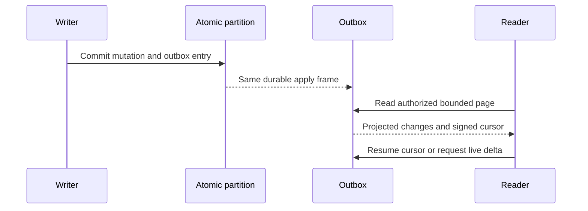

# ChangeFeeds

Status: committed document feeds, projection outbox and scalar live queries are present in source; current-source qualification remains open. Cross-partition coverage, richer subscriptions and external-index publication remain planned.

## Purpose, actors, and entry points

ChangeFeeds exposes committed document mutations to authorized readers and bounded scalar live queries, and provides a system outbox for in-partition projections. Actors are database clients, projection workers, and query clients. Current HTTP/.NET entry points are `POST /v1/changes/read`, `POST /v1/query/live/start`, `POST /v1/query/live/read`, and administrator projection operations under `/v1/admin/projections/*`; their contracts are in `src/KeyLoad.Abstractions/ChangeFeeds/Contracts/ChangeFeeds.cs`, implementation in `src/KeyLoad.Core/ChangeFeeds/Execution/ChangeFeeds.cs`, `ProjectionOutbox.cs`, and `src/KeyLoad.Query/ChangeFeeds/Queries/LiveQueryExecutor.cs`, and SDK methods in `src/KeyLoad.Client/ChangeFeeds/Transport/ChangeFeedClientExtensions.cs`. These are existing routes, not a proposal for additional endpoints.

## Canonical slice map and boundaries

| Surface | Current source | Target owner |
|---|---|---|
| Contracts | `src/KeyLoad.Abstractions/ChangeFeeds/Contracts/ChangeFeeds.cs` | `src/KeyLoad.Abstractions/ChangeFeeds/` |
| Outbox and public feed | `src/KeyLoad.Core/ChangeFeeds/Execution/ProjectionOutbox.cs`, `ChangeFeeds.cs` | `src/KeyLoad.Core/ChangeFeeds/` |
| Scalar live query | `src/KeyLoad.Query/ChangeFeeds/Queries/LiveQueryExecutor.cs`; public facade `LiveQueries.cs` | Slice-local private owner borrowing the existing database/query engine; same single read cut |
| HTTP/.NET SDK | `src/KeyLoad.Server/ClientApi/Transport/ApiEndpoints.cs`, `src/KeyLoad.Client/ChangeFeeds/Transport/ChangeFeedClientExtensions.cs` | Shared entry points; behavior remains in this slice |
| Tests | `tests/KeyLoad.UnitTests/ChangeFeeds/` feed/projection suites, `LiveQueryTests.cs`; `tests/KeyLoad.RecoveryTests/EventStreams/Cases/ProjectionRecoveryTests.cs`; `tests/KeyLoad.IntegrationTests/ClusterReplication/Cases/Cluster/ClusterTests.cs`; new `Features/ChangeFeeds/Cases/FeedLiveClusterTests.cs` | Unit feed/projection source is slice-local; remaining layout debt targets matching `Features/ChangeFeeds/` folders |
| Durable design | `../design/change-feeds.md` | Detailed design reference; this file owns feature acceptance |
| Frontend | None | N/A: polling and query results are database/client contracts, with no independent UI |
| Official MCP / SQL Q1 CALL | Existing `keyload_changes_read`, `keyload_query_live_start`, `keyload_query_live_read` in the native ClientApi read catalog | Real official MCP SDK invokes the same native operations; exact-source cluster qualification remains required |

ChangeFeeds does not own the private redo journal, business event streams, message leases, or external search-index files. A per-partition outbox is not a cross-partition CDC guarantee.

## Current behavior and accepted target

- Canonical mutations and their outbox entries are committed together. A failed batch exposes no partial entries; a retry with the same command does not append duplicates. Outbox positions are partition-local and monotonically increasing.
- Projection consumers persist an immutable filter/generation, contiguous checkpoint, signed batch token, replay receipt, and retention pin. Effects and checkpoint commit atomically in the same atomic partition. Failed effects do not advance the checkpoint; stale generation tokens are rejected.
- Public document feeds require `ChangesRead | DocumentsRead`. Signed cursors bind the principal, policy/schema/visibility epochs, partition, collection, database incarnation, and position. Bounded pages project before/after images through row and field policy; deletion metadata has no after payload.
- Scalar live queries capture a bounded initial Q1 snapshot and outbox cut together, then return bounded upsert/remove deltas. Unsupported ordering, top-k, aggregation, joins, graph, or ANN subscriptions are rejected by the current profile.
- Current source does not establish external-file atomic publication, automatic retention scheduling, multi-partition merge, or all event/topic/group feed semantics. Those remain planned and require their own contracts and evidence.

## Requirements and acceptance

| Requirement | Measurable acceptance | Existing or planned evidence |
|---|---|---|
| REQ-FEED-001: publish canonical changes and projection effects atomically | AC-FEED-001 passes when a failed producer/effect batch changes neither canonical state nor visible outbox/checkpoint, and replay of the same command/batch returns its prior outcome without duplicate effects. | Existing `ChangeFeedTests.EveryCanonicalMutationAndItsCommitShareThePartitionOutbox`, `FailedBatchAndSameCommandRetryCannotPublishPartialOrDuplicateChanges`, `FailedProjectionEffectsDoNotAdvanceTheCheckpointAndDuplicateDeliveryIsSafe`; recovery `ProjectionCrashRecoversEffectsOutboxReceiptOutcomeAndCheckpointTogether`. |
| REQ-FEED-002: expose resumable, bounded, authorized document changes | AC-FEED-002 passes when a page returns only currently and historically visible, safely projected changes; its signed cursor resumes within retention, and byte/position bounds preserve the first undelivered entry. Stale policy/ACL/incarnation or reclaimed history returns an explicit error. | Existing `ChangeFeedTests.FeedAndProjectionByteBoundariesPreserveTheFirstUndeliveredPosition`, `FeedResumesAnEmptyTailProjectsPiiAndRetainsDeletionMetadata`, `FeedNeverReturnsFormerOwnersDataAndAclChangesFenceOldCursors`, `FeedRevocationHistoryLossAndScopeMismatchAreExplicit`. |
| REQ-FEED-003: make scalar live snapshot plus tail gap-free | AC-FEED-003 passes when a concurrent committed write is present either in the initial snapshot or a later delta, and replayed authorized deltas match the ordinary query oracle. Unsupported query profiles fail explicitly. | Existing `LiveQueryTests.ScalarLiveDeltasMatchTheSharedQueryOracleAcrossSeededMutationsAndReplay`, `ConcurrentInitialSnapshotAndTailNeverLoseACommittedDocument`, `UnsupportedRankingIncompleteSnapshotsAndDifferentQueryCursorsAreRejected`. |
| REQ-FEED-004: advance projection checkpoints contiguously under pinned retention | AC-FEED-004 passes when filtered positions advance contiguously, no checkpoint crosses a pending effect, and purge cannot pass the lowest active generation checkpoint. | Existing `ChangeFeedTests.RetentionPinsProtectUnprocessedAndRebuildHistory`, `FilteredProjectionPositionsAdvanceContiguouslyWithoutPublishingForeignResources`, `AReleasedGenerationRejectsOldBatchesAndCachedCommandReceipts`; planned real multi-partition coverage tests. |
| REQ-FEED-005: recover retained feed state without silent gaps | AC-FEED-005 passes when reopen/compaction and a replica catching up from a snapshot preserve outbox/checkpoint/receipt state or explicitly invalidate old cursors; history loss requires resynchronization. | Existing `OutboxAndConsumerReceiptsRecoverAfterReopenAndCompaction`, `ProjectionRecoveryTests.ProjectionCrashRecoversEffectsOutboxReceiptOutcomeAndCheckpointTogether`; current-source GitHub qualification remains pending. |
| REQ-FEED-006: bound projection read work without changing byte-budget behavior | AC-FEED-006 passes when persisted entry bytes equal `JsonDefaults` serialization after decode, exact and one-byte-short limits preserve success/rejection, and an isolated one-entry batch performs exactly four borrowed point lookups. | `ProjectionReadWorkTests.AcMp006ProjectionBatchReusesHeadAndStoredEntryBytes`; real ZoneTree counters; TUnit execution remains GitHub Actions only. |

## Error, edge, and security flows

Empty-tail cursors are valid. Filtered partition positions may produce an empty page with `HasMore`; callers continue until caught up. A first item larger than the byte budget fails with `BudgetExceeded` without moving past it. Missing authorization fails before reading payloads. Principal revocation or policy/schema/row-visibility changes fence old cursors. A cursor behind a reclaimed prefix returns `HistoryUnavailable`, requiring a fresh snapshot. A deleted change preserves revision/deletion metadata and has no `After` payload; its `Before` image may be present only when historical and current row authorization allow it, and it is safely projected. Public readers never receive raw system-outbox entries or unrelated resource identities.

## ADRs and verification boundary

Related decisions: [ADR-022](../ADR/ADR-022-policy-epoch-revocation.md), [ADR-023](../ADR/ADR-023-journal-authority.md), [ADR-024](../ADR/ADR-024-transaction-domain-binding.md), [ADR-025](../ADR/ADR-025-event-revision-feed-positions.md), [ADR-027](../ADR/ADR-027-contiguous-subscription-checkpoints.md), [ADR-029](../ADR/ADR-029-event-message-classification.md), and [ADR-030](../ADR/ADR-030-retention-paused-restore.md). Cluster routing follows the accepted [ADR-036](../ADR/ADR-036-orleans-foundation.md). The operational distinction among redo journal, business streams, queue state, and outbox is in [change-feed design](../design/change-feeds.md).

Crash between commit and delivery loses no event; duplicate delivery is safe; checkpoint does not skip a failed event.

## Live delta retained output composition

REQ-QUERY-001/003, AC-MP-003/012 and REQ/AC-FEED-002/003 under ADR-004/010/013/022/118 require the existing constrained result budget to admit each retained selected live delta before retention. Core keeps its existing public ReadChangeFeedView signature and adds an internal synchronous before-retain overload, invoked only after original request.MaxBytes admits the change and before changes.Add/checkpoint advancement. LiveQueryResultByteAdmission uses exact original budget.MeasureResult and cumulative MaximumResultBytes; overflow is existing QueryEngine.ResultLimitExceeded BudgetExceeded, not partial success. Full wrapper serializer check remains. No operation clock/token/read grants/admission/read cut reset or new request/serialization/persistence field. Install this additional callback only for an explicit configured result cap; null/default preserves old feed behavior.

## Exact-through native projection boundary

REQ-PROJECTION-PREFIX-001 / AC-PROJECTION-PREFIX-001: optional ReadProjectionBatchRequest ThroughSequence native Id3 limits the existing administrative signed projection batch to the exact retained source prefix U. JSON omits null and existing null behavior remains latesthead. Fresh persisted ClusterAdministrator and actual current consumer/released-generation checks precede U validation. Current checkpoint<=U<=retainedhead is required, including an empty U=checkpoint batch. Out-of-range U is TokenInvalidated with exact safe detail `The projection upper sequence is outside the current consumer checkpoint and retained head.`; no read mutation/checkpoint effect. Returned and signed ThroughSequence never exceed U; HasMore refers to remaining range through U, not later head. Limit/MaxBytes/ordering/checksum/signature/expiry/replay/receipt semantics remain unchanged. Existing SDK/MCP/SQL request paths forward the actual typed option through the client connection grain; no new dispatcher/admin role. ADR019 owns the ANN consumer use; existing changefeed projection authority contracts remain mandatory.

## Native feed live

REQ/AC-FEED-002/003/005 and REQ/AC-QUERY-001/003, AC-MP-003/012 retain one native owner read cut, persisted current/historical authorization, signed original cursors, gap-free snapshot/tail and no raw PII. ReadChangeFeed's existing two-argument API deliberately delegates to its new original-cancellation overload; no legacy path or schema. Original DatabaseEngine clock owns cursor expiry and operation deadline. One existing ReadExecutionBudget and read grant charge all actual raw storage bytes/record attempts before decode/copy, projected result retention and the complete final response. Request.MaxBytes still bounds change payload and preserves the first undelivered entry; it does not replace complete wrapper/read-work limits. Feed cancellation produces no returned partial page. Existing live reader/view budget and profile stay unchanged.

### Live hidden read work

REQ/AC-FEED-002/003 require the live continuation to pass the same original ReadExecutionBudget-wrapped owner view into the native outbox reader. Nonmatching and foreign-collection retained records consume cumulative raw key/value read bytes and record attempts before native decoding, even when they produce no live change. Page payload MaxBytes does not waive this work bound. No API, storage format, cursor identity, configured ceiling or timeout changes.

REQ/AC-FEED-002/003/005 and AC-MP-003/012 retain the existing six-field LiveQueryChange and five-field LiveQueryPage. Independent upsert revision2 and native tombstone revision3 come from the original stored document mutation, not a constructor overload. Complete SDK/official MCP/Q1 tail pages compare literal changes, through sequence, hasMore and the actual unchanged owning read cut. Each returned opaque cursor is nonempty and is consumed through the same real route; the complete empty continuation preserves through sequence, hasMore=false and the same unchanged cut. Cursor bytes are never fabricated or required to equal independently issued tokens. Current persisted revocation and obsolete-policy token failures cover SDK, official MCP and both Q1 routes, with no partial result, bracketed by existing full canonical no-effect checks; exact policy repair leads to a fresh healthy full page on all routes.

## Complete page cold

REQ/AC-FEED-002/003/005 retain the same bounded polling/retention, current persisted privacy and six-field LiveQueryChange (original upsert revision2/delete revision3) contracts. The existing cluster feed case must assert all seven page fields: complete independent literal changes, actual opaque cursor, exact through/tail/firstAvailable/hasMore, and actual read cut bounded by the original successful receipt. Fixture tail2 includes its hidden second row; updated tail3 follows only the actual acknowledged replacement. Each SDK, official MCP and both Q1 route consumes its own returned opaque cursor; the next page is the independently known hidden position or complete empty tail. Different issued cursor bytes/read cuts are not fabricated or required equal. Every original assertion remains.

## Repaired live cold

REQ/AC-FEED-002/003/005: the same original ConcurrentSnapshotAndCommittedTailRemainGapFreePrivateAndRevocable cluster case must retain its freshly authorized repaired-policy snapshot cursor, genuinely resurrect its original deleted row with original private payload/owner (previous native revision3, new revision4, outbox sequence5), and receive the full independent redacted upsert plus complete empty continuation through SDK, official MCP and both Q1 routes. The hidden row remains excluded. Preserve the actual new command and complete acknowledged receipt; same-ID replay under fresh persisted administrator authorization leaves the complete outbox state unchanged.

## Public first entry backpressure

REQ/AC-FEED-002/003/005 and the original delivery/backpressure criteria retain the existing OriginalCursorReconnectsAcrossColdClusterAndRechecksRevokedPersistedAccess identity. Native PrepareChangeRead accepts MaxBytes=1 as a positive bound; native ProjectChangePage measures the complete authorized DocumentChange and refuses before retaining or advancing its first undelivered visible entry. The independently fixed first projected JSON {"number":1,"status":"open"} alone exceeds one UTF8 byte, and the original full literal healthy page proves this actual first entry/ref/revision/receipt/redaction. The visible original first entry precedes the hidden second row; the request is not an empty/hidden-only tail or invalid zero-bound control.

## Native task qualification

REQ/AC-FEED-001..006 and the bounded delivery/live-query criteria require current-source Linux normal/scalar native qualification. Each original criterion maps to its complete operation owners:

| Original criterion | Existing complete operation owners admitted for native census |
| --- | --- |
| AC-FEED-001 atomic producer/effect/outbox/checkpoint and original replay | ChangeFeedTests; ProjectionProcessRecoveryTests |
| AC-FEED-002 protected/resumable pages, retention, byte backpressure, cancel/deadline and no partial effects | ChangeFeedReadTests; ChangeFeedObservedWorkTests (both original Args); NativeChangeFeedCursorTests; OutboxPurgeTests; FeedLiveClusterTests original reconnect/revoke/repair/cold case |
| AC-FEED-003 gap-free scalar snapshot/tail, predicate privacy, unsupported profiles and cumulative result bound | LiveQueryTests; LiveQueryResultCompositionTests; FeedLiveClusterTests original concurrent/delete/revoke/repair/cold case |
| AC-FEED-006 real stored-byte/read-work boundary | ProjectionReadWorkTests.AcMp006ProjectionBatchReusesHeadAndStoredEntryBytes plus bounded projection/read/refusal cases above |

## Live fresh cut

REQ/AC-FEED-002/003/005 retain the original ConcurrentSnapshotAndCommittedTailRemainGapFreePrivateAndRevocable cluster scenario, its concurrent snapshot/write fence, literal ordered events and original receipt tokens, privacy, persisted revoke/restore, original command replay, two joined cold cluster restarts and all SDK/official MCP/Q1 SDK/Q1 MCP paths. Native LiveQueryExecutor opens a fresh database query view and maps ProjectChangePage's current Store.Position; the signed resume cursor contains no frozen local cut. This is the existing fresh-call contract, not a new product behavior.

AC-FEED-LIVE-FRESH-CUT-002: after the original acknowledged deletion page, commit a genuine unrelated no-grants principal via the administrator's native public API. Require its complete literal result, unchanged complete outbox status, exact empty authorized ordinary query and strictly advancing local cut on the original endpoint. Resume the SAME original live request through all four routes and consume each returned cursor; neither unrelated authorization state nor the hidden row becomes a live event. Preserve the existing restoration, fresh acknowledged work, complete original receipt replay and second cold flow.

## Refusal fresh cut

REQ-FEED-REFUSAL-CUT-001: the original refused live/cursor operation preserves the complete authorized logical query output and complete outbox status. Independent uncursored AST queries report fresh cuts; comparing their complete QueryPage objects must not require equal cuts or normalize an expected result using the actual result. Maps to AC-FEED-REFUSAL-CUT-001.

## Live independent permutation

REQ/AC-FEED-003 with REQ/AC-FEED-002/005 retains the original ScalarLiveDeltasMatchTheSharedQueryOracleAcrossSeededMutationsAndReplay declaration/UID, all100 acknowledged mutations, original permutation and identity/transition coverage, query oracle, deadline and bounds. The separate test-input model must independently require complete literal materialized rows: known order identity, round-derived revision, original trial number/open JSON, Redacted=false, empty redacted fields and absent Sources. Do not derive expected rows from ExecuteAst or returned deltas. Preserve the original production-query comparison as an additional oracle.

## Refusal literal

REQ-FEED-REFUSAL-CUT-001 / AC-FEED-REFUSAL-CUT-001 require both genuine administrator queries to match an independently authored complete phase oracle, in addition to complete before/after parity. Initial budget refusal expects raw a/b revision1 and tail2; reconnect revoke/restoration expects raw a revision2 plus b revision1 and tail3; live tombstone revoke/restoration expects only raw b revision1 and tail4; repaired obsolete-cursor refusal expects raw a revision4 plus b revision1 and tail5. Preserve the full known JSON, EntityId, revision, Redacted=false, empty redaction fields and absent Sources. Each ordinary page has null Cursor and bounded-full-scan AccessPath. Never build these expected rows from a returned page or derive phase from the actual outbox.

## Feed current canonical authority

REQ-FEED-002/005 and AC-FEED-002/005 require the current document used to authorize a historical change to match its selected canonical partition, collection and entity ID before consuming its ACL. VisibleChange currently decodes that key's DocumentRecord and consumes current.Access without validating current.Reference. A foreign Reference under the selected key must return the existing Corruption code, not authorize or silently suppress the historical payload using another entity's authority. Missing current rows retain their existing filtered behavior. Preserve historical grants, fresh persisted permissions, field projection, signed cursor epochs, native read grants, result limits and the unchanged public/internal serializers.

## Feed historical canonical authority

REQ-FEED-002/005 and AC-FEED-002/005 also require a selected historical document change to bind its After Reference to the requested partition, collection and mutation-receipt entity ID, and its optional Before Reference to the same After entity. StoredOutboxReader already validates sequence and commit partition; it does not establish this separate document tuple. Native Put produces exactly that tuple and AppendOutbox persists it unchanged. VisibleChange must reject a contradictory tuple with Corruption before any historical ACL/payload projection or current-row lookup, including the otherwise filtered missing-current-row branch. Existing legitimate missing current rows, unrelated resource entries, tombstones, historical/current grants, field privacy, cursor epochs, byte/read bounds and generated-native wire contracts retain their behavior.

## Canonical retention accounting

REQ/AC-FEED-001/004/005 require the committed outbox head to describe one contiguous retained range before producer admission, feed reads or purge. Tail must be nonnegative; FirstAvailable must lie between1 and Tail+1 without overflowing arithmetic; StoredRecords must equal the retained range length. StoredBytes must be nonnegative, zero exactly for an empty retained range. Existing empty/uninitialized and completely reclaimed states remain valid. Configured quota values do not redefine persisted validity, and legitimate quota exhaustion remains the original ResourceExhausted outcome.

## Contiguous scope authority

REQ/AC-FEED-001/004/005 require a persisted projection consumer to match the complete canonical consumer reference selected by its native storage key before a signed batch, existing configuration, receipt, checkpoint or retention pin uses that record. Point reads compare the complete consumer ref. Partition scans compare the persisted partition and complete encoded consumer key without another storage lookup. A different name or partition is Corruption through the existing atomic refusal boundary; no foreign checkpoint/effect/receipt may become authoritative. Existing filters, generation/released diagnostics, administrator permissions, progress reserve and signed-token lifetime remain unchanged.

## Empty-batch operation boundary

REQ/AC-FEED-001/004/005 and the existing system projection lifecycle require an empty signed batch to produce no effects or checkpoint advancement beyond its original cut. A later real producer does not retroactively make that original batch nonempty. This adds a complete operation regression for existing behavior, not a new product primitive or generation contract.

## Document outbox mutation

REQ-FEED-001/002/004 and AC-FEED-001/002/004 require each retained document operation exposed by a feed/projection read to agree with its canonical mutation receipt before filtering or contiguous advancement. StoredOutboxReader already verifies sequence and atomic partition. It must additionally compare the existing Put/Patch/Delete document collection, inherited mutation resource, document ID and existing producer kind to the full receipt resource/ID/kind, and throw exact Corruption before returning a contradictory entry. Other mutation families and their distinct receipts remain unchanged; no new serialized field, discriminator, key, budget, read or lifetime is introduced.

## Complete retained document image/receipt pair

REQ-FEED-001/002/004 and AC-FEED-001/002/004 require the document revision exposed by the retained outbox image to equal its original mutation receipt revision before feed projection or consumer filtering/advancement. Actual Put/Patch/Delete producers return a nonnull resulting document and its exact revision together; ApplyMutations persists that pair in one outbox entry. A missing resulting image or contradictory receipt/image revision is Corruption through the unchanged reader boundary. No additional storage read, serialized field, identity digest, permission, resource limit or token lifetime is introduced.

## Complete retained refusal metadata

REQ/AC-FEED-001/004/005 preserves the original empty-tail whole operation and native Validation/detail when later effects are offered to the historically empty batch. A normal refused admitted command atomically retains its complete scoped outcome plus the canonical scoped locator whose exact raw value is the independently expected outcome key. Before invocation both selected rows must be absent; afterward exactly one row of each exact key exists, the full retained result is the original literal failure, and every other ordered raw family/byte remains unchanged. Store position advances exactly once. Do not suppress all outcomes or locator families, treat this metadata as a derived effect, or drop the full original image comparison. The authored-clock consistency correction keeps the original committed clock unchanged through this refusal.

## One authored operation timeline

REQ/AC-FEED-001/002/004/005 whole-flow controls must bootstrap and configure their genuine native owner on the same authored UTC timeline used by seed, original receipts, healthy writes, queries and both cold engines. The immutable FeedAuthorityClock uses the existing literal 2026-10-13T00:00:00Z before TestDatabase construction. It overrides UTC only: original native monotonic timestamps, timers, operation budgets, TestContext cancellation and all product ClockUncertain checks remain unchanged. The same captured EvaluationClock is supplied to each cold storage owner; TestDatabase already retains that clock in its native engine factory.

## Unchanged admission and original GUID recovery

REQ/AC-FEED-001/004/005 require a cancelled projection completion to publish no effect, retained command result or checkpoint advance. The existing ApplyCore checks the original cancellation token inside the genuine atomic Store.Commit before command admission. No product defect or new cancellation primitive is claimed.

## Refuse destructive reclaim under contradictory persisted pin

REQ/AC-FEED-001/004/005 already require an active generation checkpoint to pin every unprocessed retained entry. Native configuration admits its checkpoint through CheckOutboxPosition; native completion advances it only to a signed retained batch boundary. PurgeOutbox currently reads the valid head but uses the persisted active minimum directly. A corrupted checkpoint above Tail therefore permits reclaim of genuinely unprocessed acknowledged source history.

## Retained deletion remains a deletion

REQ-FEED-002/005 and AC-FEED-002/005 require a committed DeleteDocument to remain a tombstone through complete feed and live-query projection. The stored resulting document has Deleted=true; Put/Patch results have Deleted=false. The existing receipt/resource/revision authority check must reject a contradictory stored flag as Corruption before projection. Public DocumentChange exposes Deleted=true and After=null for the tombstone, while the retained original native outbox bytes preserve its resulting revision and tombstone image. This guard introduces no extra storage read, permission, serialization field, cursor format or resource bound.

## Same-named consumers in distinct atomic partitions

REQ/AC-FEED-001/004/005 explicitly requires genuine multi-partition projection and retention coverage. The additive operation creates the same consumer name and generation with identical literal source rows in two distinct native atomic partitions on one genuine owner. A signed batch from the first cannot authorize effects in the second: exact TokenInvalidated scope failure, full selected original source/outbox/head/consumer bytes and absent target effect are checked. The ordinary retained refusal outcome is legitimate metadata, not falsely described as a completely unchanged global image. The second partition's pinned purge returns its exact original Conflict.
