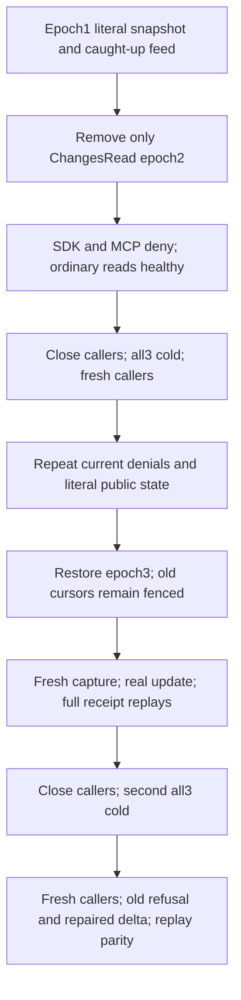

# ChangeFeeds captured current capability across cold cluster

Source-N only. Compiler, discovery/UID, runtime, Linux cluster and fault/endurance qualification remain OPEN.

REQ-FEED-CAPTURED-CAPABILITY-001 maps to REQ-FEED-002/003/005 and AC-FEED-CAPTURED-CAPABILITY-001: an epoch1 captured feed/live cursor conveys no authority after only ChangesRead is removed at persisted epoch2. Query and DocumentsRead remain granted, the original API key remains non-revoked, and independent literal ordinary query/document operations stay healthy. Fresh live start and captured feed/live reads must independently refuse PermissionDenied through SDK and official MCP before and after a real all-three same-root cold restart.

At epoch3 restore the original grants. Every old captured cursor remains TokenInvalidated; fresh live snapshot and caught-up feed capture require full literal safely projected rows/horizon and nonempty actually issued cursors. A real revision2 update yields the complete literal sequence3 live delta and safely projected feed before/after image plus its genuine original receipt; consuming each returned cursor yields the complete empty continuation. The public commit timestamp is required nondefault and byte-identical across the actual SDK/MCP retained change and the independently retained original pre-cold change after second cold; the public command receipt does not expose an independently authored server evaluation timestamp, so this is not clock qualification. Original producer/update receipt replays each independently preserve complete public literal documents/query rows and complete observed outbox state. A second real all-three cold restart creates fresh callers and repeats old-token refusals, the repaired pre-update feed/live cursors' delta/empty continuations and every full original receipt replay.

Each SDK/MCP refusal and replay is immediately bracketed, not hidden by a later operation. Complete typed snapshot/live/feed wrappers retain all fields. Opaque cursor bytes and each invocation's reported nonnegative local cut are genuine outputs, never fabricated, equated across calls or compared to replica token position. Separately routed public QueryPage/Status cannot independently correlate the read cut; this case proves public observable rows/outbox parity, not raw journal/full owner image no-effects.

Existing FeedLiveClusterTests revoke ALL grants; their cold phases occur before revocation or after repair. This additive case specifically keeps ordinary reads authorized and cold-reopens revoked ChangesRead. No resource schema/visibility change, copied cursor, unsupported stale success, provider hook, clock, timer, timeout, quota, protocol or new library is introduced.

| Role | Canonical source |
|---|---|
| Case | IntegrationTests/Features/ChangeFeeds/Cases/CapturedPolicyClusterTests |
| Flow / replay | Same slice Helpers/CapturedPolicyClusterFlow and CapturedPolicyClusterReplay |
| Complete literal current observations | Same slice Assertions/CapturedPolicyClusterCurrent |
| Cursor/page and exact refusals | Same slice Assertions/CapturedPolicyClusterPages and CapturedPolicyClusterRefusals |
| existing admission | Core CaptureChangeFeedCursor/PrepareChangeRead; Query LiveQueryExecutor |
| Owned lifecycle | Existing FeedLiveClusterConnections, LiveSubscriptionClusterCold, FeedLiveClusterCold and McpCallerDeadline |

The fixture owns genuine Aspire Docker cluster endpoints and shutdown. Callers close before each original all-three kill/begin/restart and health join; initiating/disposal failures remain ordered through the existing owner ledger. Same credential is reused, no trusted roles come from clients. UI/production change is N/A; all product APIs are existing. Rollback removes this additive case/roles/spec only and retains original cases/failures.

