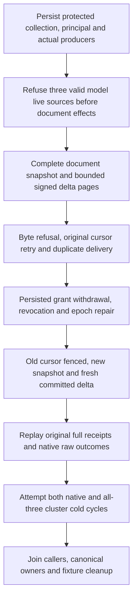

# Bounded live-query document source

Canonical slice: ChangeFeeds. Refines REQ/AC-FEED-002/003/005 and the accepted scalar live-query profile. A non-null model source is unsupported for both live start and live read. The current implementation normalizes and validates the actual AST first, then refuses with `UnsupportedCapability` and the existing live-profile detail before opening its document query view or capturing/reading a change cursor. Ordinary model queries remain owned by ModelQueryExecutor. This does not add event, queue or topic subscriptions, a parallel query engine or a new AST/cursor version.

The confirmed defect is an advertised/executable profile mismatch: native QueryValidation accepts structurally valid Events, QueueMessages and TopicEvents sources, while the live executor borrows the document candidate reader and document before/after delta mapper. A model source on an actual configured Collection previously fell through to those document operations. Valid source generation1, queue/topic matching item and explicit full-scan consent distinguish this regression from earlier schema/argument validation failures. Earlier normalization and validation precedence remains intact.

## Complete operation regression

The new native Unit cases and real SDK/official MCP cluster cases each cover all three source kinds independently. Each case creates an actual protected document collection, persisted scoped principal and genuine committed document producers. A hidden other-owner row is absent from the ordinary snapshot; a protected secret field is absent from every visible row. Model live start and live read refuse using the actual signed ordinary cursor, without a partial response. Native refusal observes zero new query-side storage reads, a complete unchanged canonical image, exact local cut and store identity. Public refusal observes every original/current document and complete outbox state, including after a failed assertion.

The same case then executes its supported document operation: complete initial snapshot at tail2; atomic update/create/delete with complete independently checked receipt; first-entry byte-budget refusal; Limit1 upsert/upsert/remove pages at sequences3/4/5; same-input cursor duplicates; and an empty consumed continuation. Persisted ChangesRead withdrawal rejects start/read on warm clients; revocation rejects authentication; repair at epoch4 fences the old cursor and creates a fresh authorized snapshot. A new genuine producer emits sequence6, resumed from that original repaired cursor, with an empty consumed tail and unchanged old command outcomes on retry. Before-cancelled native start/read throws with the original caller token. Public typed SDK calls return the complete native Cancelled/read-response-unavailable Problem with no page. Before-cancelled SDK SQL EXEC is conservatively classified as a possible write and returns the full UnknownWriteOutcome/write-response-unavailable Problem; official MCP calls throw with the original token; every original task is joined before healthy continuation. This is not a new admitted mid-operation cancellation proof.

Native same-owner reopen and Aspire-owned all-three cluster cold recovery each run twice. Original cursors, literal protected results, original receipt replay, current authority and conservation remain required after both cycles. Every attempted cold cycle is observed independently; primary, operation, conservation, caller, store and fixture cleanup failures remain joined. All public success/refusal/continuation operations exercise typed SDK, official MCP, canonical SQL EXEC through SDK, and canonical SQL EXEC through official MCP. No discovery filter is substituted for a dispatched authorization failure: McpOfficialClient.CallAsync uses the existing direct gateway invocation.

## Bounds and evidence limits

This is bounded polling: the server retains no live result set, subscription lease or producer. Limit bounds examined outbox positions, MaxBytes bounds selected change payload, and the caller applies a page before saving its returned opaque cursor. The same original cursor can retry after refusal or cancellation. Existing native CQRS IAsyncEnumerable operations and admitted response-cancellation lifecycle tests are preserved; this guard creates no continuous live-stream contract.

Native receipts check all five canonical fields, including actual hidden CompositionReferences, and retain actual raw outcome bytes. Public JSON exposes four mutation fields and all three token fields; hidden native fields cannot be proved by deserialized public getters. Public receipts independently check command, ordered literal mutations, ProcessDurable and the configured PersistedCopies and actual partition; their replication positions are never compared with local query/live cuts. Public page cuts are bracketed by complete independent ordinary AST pages through the selected endpoint. Separate Status observations establish that endpoint's identity, readiness, replicas, durability and monotonic reported state. They cannot correlate a routed query with its actual native owner. Native Unit proof must not be relabelled as public owner/cut proof.

Source preparation and static native parser/numeric checks are not compilation or execution. Current-source semantic/compiler checks, genuine Unit/process-recovery/cluster SDK/MCP runs, exact-source Linux originals, response cancellation, endurance and broader live/subscription qualification remain separate OPEN gates. This contract does not mark change feeds accepted or production ready.

