# Public live-read backpressure, cancellation and resumed cold lifecycle

Canonical slice: ChangeFeeds, linked QueryExecution/OrleansExecution infrastructure. Refines REQ/AC-FEED-PUBLIC-RESUME-001..004 and the original change-feed delivery requirements. This source packet keeps both existing FeedLiveClusterTests declarations, original trials, credentials, bounds and McpCallerDeadline. Original feed/live policy-revoke/repair and two cold flows remain first. New code is a same-Case continuation, not a separate case or qualification claim.

REQ-LIVE-READ-LIFECYCLE-001 / AC-LIVE-READ-LIFECYCLE-001: through the SDK and then through official MCP, the same original signed cursor returns the exact original removal delta and an empty consumed continuation; each read is bracketed by complete literal current document/query/outbox observations. A live page is bounded by its `Limit` only and has no byte refusal. Raw store cut and logical replica receipt coordinates are independently positive, never ordered across domains.

REQ-LIVE-READ-LIFECYCLE-002 / AC-LIVE-READ-LIFECYCLE-002: genuine persisted c1-probe identity on an existing Aspire-owned StartProbed cluster wave reads an actual committed live delta. Both SDK and official MCP separately start the original read, reach the AuthorizationReload hold and remain incomplete before caller cancellation. settled/producer-disposed evidence is correlated to the same actual request; the exact original tasks are awaited before retire/healthy continuation. SDK Cancelled uses the read-response-unavailable Problem. MCP retains an authentic transport interruption, never a fabricated dispatched Problem/GUID. Every refusal is immediately full-current bracketed.

REQ-LIVE-READ-LIFECYCLE-003 / AC-LIVE-READ-LIFECYCLE-003: complete independent one-document rows, revision/JSON, delta kind/ref/sequence/commit token, outbox tail/records/consumers remain exact. Each original seed/update success replay is followed by the full current observer on EACH route. Two additional owned all-three stopped/joined/reopened cold cycles retain the same model. First resumes the original signed delta cursor; a fresh public snapshot captured after the first cold provides the second cold empty continuation. No TTL/clock/deadline increase or hand-signing.

REQ-LIVE-READ-LIFECYCLE-004 / AC-LIVE-READ-LIFECYCLE-004: original fixture callers close before the new continuation, and every probe, original task, caller, wave, image session and owned root follows joined cleanup. Preserve primary plus cleanup failures; partial startup cannot claim resource joins or delete unproved data. Reuse existing provisioning/profile/discovery/probe/image owners. No shared fixture/probe whitelist, provider, protocol, library or product architecture change.

The original Case already owns two cold cycles; this additional cancellation/resume model explicitly adds two, for FOUR total across the full existing Case. Startup/operation/deadline fit and signed-cursor expiry are actual runtime gates, not assumed from source. Qualification requires Main's NF/N/creation, compiler, genuine SDK/MCP cluster and exact-source Linux originals; all are OPEN. New helper source is preview-only.

```mermaid
flowchart LR
 O[Original complete feed and live trials] --> B[Same-cursor healthy delta through SDK and MCP]
 B --> S[Genuine c1 persisted subject and probed cluster wave]
 S --> C[SDK and MCP held read cancel and producer join]
 C --> H[Literal healthy delta and original receipts]
 H --> F[First all3 cold: original cursor resumes]
 F --> N[Fresh public snapshot]
 N --> G[Second all3 cold: empty continuation]
 G --> J[Joined callers, producers, wave and image cleanup]
```

UI, SQL dialect, package adoption, benchmark/performance, raw file/journal invariance and power-loss proof: N/A. Original SQL/public paths remain in their original operations; this continuation adds direct SDK/official MCP read lifecycle qualification only.
