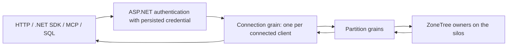
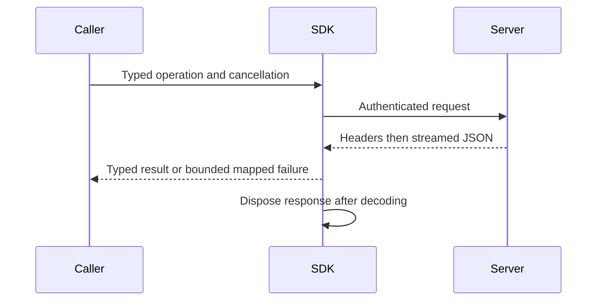
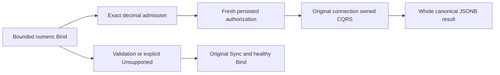
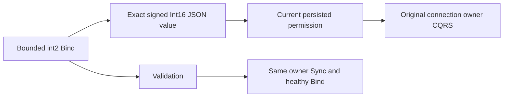

# ClientApi

ClientApi owns the public client boundary: the HTTP routes, the .NET SDK and CLI, the official MCP server with on-demand tool discovery, and the SQL transports. Every request is authenticated against persisted credentials, executed by the caller's connection grain (one Orleans grain per connected client, [ADR-125](../ADR/ADR-125-connection-owned-execution.md)) and authorized freshly for each operation. Clients never supply trusted roles. The cluster concept (Orleans membership, grain calls and silo-local ZoneTree owners) is described in [ADR-136](../ADR/ADR-136-orleans-partition-ownership.md).

[ToolDiscovery](ClientApi/ToolDiscovery.md) and
[ADR-104](../ADR/ADR-104-mcp-gateway-tool-discovery.md): three initial
ManagedCode.MCPGateway search/route/invoke tools form the public default discovery
surface, with MarkdownLd.Kb graph search and unchanged fresh persisted
authentication, canonical schemas and Orleans execution. The complete internal
operation inventory remains independently tested; public gateway composition and
real caller qualification are pending.

REQ-SQLC-005/007/008 and AC-SQLC-005/007/008 extend SQL clients under
[ADR-065](../ADR/ADR-065-full-sql-client-compatibility.md). Existing transport is
HTTP/JSON and official MCP, with a source-integrated bounded PostgreSQL3.0 session whose exact-source Linux qualification remains open. [ADR-130](../ADR/ADR-130-microsoft-scriptdom-tsql.md) selects T-SQL/Microsoft ScriptDOM; PostgreSQL wire/Npgsql interoperability is an independent session contract. General catalog/bootstrap, typed results and prepared/portal completeness remain open; the API-key verifier is not SCRAM and no TDS compatibility is claimed. Fresh persisted credential/policy checks, original execution drain, conservative unknown-write identities and bounded connection state remain mandatory.  Complete execution and interoperability remain required gates. Require real Npgsql/psql/DBeaver bootstrap fixtures, typed results, prepared/portal flows, persisted credential revalidation, original execution drain and bounded state before interoperability qualification. security/transaction/gateway contracts must be frozen before code. [Inventory](../implementation/sql-client-conformance.json)
keeps both and full SQL qualification false until actual evidence exists.

SQL operation invocations (written as CALL in the model contracts below) are admitted only through the selected T-SQL EXEC catalog; ordinary SELECT and independent typed AST requirements keep their separate canonical compiler paths. A CALL description does not prove that a public or session EXEC tool is executable; discovery, canonical compiler admission, persisted authorization and complete original operation gates must verify each one. SDK/official MCP requirements remain mandatory.

## Persistent connection ownership

KeyLoad uses one Orleans grain per actual client connection, with parallel operations and commands and no separately activated request/read grains. [ADR-125](../ADR/ADR-125-connection-owned-execution.md) freezes Kestrel connection identity, typed limits, call isolation and joined teardown. Current HTTP and stateless official MCP execution use the physical transport; SQL sessions remain a separate target under [ADR-065](../ADR/ADR-065-full-sql-client-compatibility.md).

| Requirement | Measurable acceptance | Automated proof / current state |
|---|---|---|
| REQ-CLIENT-CONNECTION-001: each actual server-owned connection reuses one Orleans execution identity and bounded disposable state; operations retain separate signed identities and fresh persisted authorization, with independent operations and commands able to overlap. | AC-CLIENT-CONNECTION-001: real SDK and official MCP operations reuse the same owner on a persistent transport; runtime observations prove one activation and no per-operation read/request activation. Hold one command while a differently authorized independent command completes, cancel only the held call, and verify both actual outcomes and stored state. Credential/policy revocation rejects the next operation; reconnect obtains a fresh owner with no stale identity or result. | ConnectionOperationTests, ConnectionFailureTests, ConnectionSettlementTests and Aspire cluster ConnectionClusterSequentialTests, ConnectionClusterOverlapTests, ConnectionClusterAuthorizationTests. SQL transport conformance is qualified separately. |
| REQ-CLIENT-CONNECTION-002: bound retained state, disconnect/idle expiry and joined cleanup through validated typed options, with no connection or operation count limit, no operation wait queue and no completed history ([ADR-145](../ADR/ADR-145-no-request-throttling.md)). | AC-CLIENT-CONNECTION-002: a second operation on one connection runs while the first is held; a duplicate active request ID fails with `Conflict`; operation failure, cancellation, deadline and early disposal leave the connection reusable. Actual transport disconnect/idle expiry cancels and joins original operations before deactivation, observed before ordinary collection; abrupt silo loss retains original receipt/uncertain-write contracts. The long-running response stream frame ceiling (`GrainRoutingOptions.MaximumStreamFrames`, default 128) is enforced by real flows. | `ConnectionFailureTests.AcCrs053ConnectionRunsAnotherOperationWhileTheFirstIsHeld`, ConnectionOperationTests, ConnectionSettlementTests and Aspire cluster transport, authorization, fault and lifecycle cases under ADR-125. Source/configuration is not acceptance. |

ClientApi owns transport/session registration and lifetime; QueryExecution owns actual SQL statement/portal/transaction semantics. The connection grain routes operations and returns the database owner's actual persisted-copy receipt. The silo-local Grain Service owns ZoneTree handles, and persisted credentials govern authorization. Session routing must not serialize unrelated operations accidentally or introduce blanket reentrancy.

AC-CLIENT-CONNECTION-002 includes error propagation: a duplicate-request-ID conflict and an invalid signed-close scope must preserve KeyLoadException Code, StatusCode and safe message across the actual RPC. ADR-125 freezes `keyload.error` generated serialization with stable Code field0 and StatusCode field1.

A connection parent that needs a child envelope capability (MultiLane receive, Ann, Text and OnlineText maintenance) borrows its own actual `ExecuteStreamAsync` implementation, never an outgoing RPC to the same activation. The delegate is supplied privately by the owner; it is not a public interface, a new dispatcher or an authorization capability. Parent validation, fresh persisted principal, child envelope, original expiry and cancellation, stream frame and byte bounds and joined producer cleanup are unchanged.

Shared authenticated .NET SDK/CLI transport. [ADR-035](../ADR/ADR-035-memory-performance.md)
and [memory/performance acceptance](../ADR/ADR-035-memory-performance.md) govern
the current transport repair. The typed operation contracts and server authority
remain unchanged.
ADR-041 governs the explicit read-only CLR migration and the strict-analysis
query factory move to KeyLoadQuery.From<T>. Generated AST/JSON, cursor, authority
and transport behavior remain exact; all compiled consumers recompile together.

| Requirement | Acceptance | Automated proof |
|---|---|---|
| REQ-CLIENT-001: consume success bodies without a duplicate full HTTP response buffer | AC-MP-009 | Real Kestrel chunked/delayed typed response; cluster SDK public calls |
| REQ-CLIENT-002: bounded error parse, cancellation and disposal preserve caller outcomes | AC-MP-009 | Real server malformed/oversized errors, mid-body cancellation, subsequent request |
| REQ-CLIENT-003: operator profiles are bounded and valid generated profiles preserve semantics | AC-MP-010 | Real temporary profile files in TUnit, oversized rejection before full allocation |

Canonical ownership: transport/helpers in src/KeyLoad.Client/ClientApi;
tests in tests/KeyLoad.UnitTests/ClientApi or the matching integration
slice. Existing KeyLoadClient.cs is the cross-feature transport entry point;
business operation methods retain their typed canonical contracts. CLI profile
adaptation belongs to ClientApi; shared AppHost composition has one integration owner.
Frontend/database/schema changes: N/A, transport decoding only.

CLI composition now lives in `src/KeyLoad.Cli/ClientApi/Commands/CliCommandDispatcher.cs`;
status/profile/help behavior lives in its `Features/ClientApi/CliClientApi.cs` and
original-text resource. The preserving contract and review exception are
AC-CQ-010 in [quality-gates acceptance](CodeQuality.md), under
ADR-033. CLI process behavior is covered by the process tests.

Real ASP.NET/Kestrel network verification avoids fake HttpMessageHandlers or stream doubles. Unknown committed-write outcomes retain existing semantics; an aborted decode never proves that the server rolled back the operation. An HTTP success status carrying JSON null is not an acknowledged typed write result: the shared SDK transport returns `UnknownWriteOutcome` with the safe `WriteResponseUnavailable` message, retaining the caller's command ID and body for retry. Nullable read sites (ordinary/session document GET, message inspection, queue transfer intent/receipt, recurring schedule/saga inspection, blob metadata/upload info) stay explicit; every other result root is nonnullable and a null root maps to the existing safe read `OwnershipLost` or write `UnknownWriteOutcome`.

### MCP framing and rejection diagnostics

REQ-CLIENT-009 / AC-CLIENT-009: the unmodified official 2.2.0 discovery-first SDK succeeds under the default server body limit and MCP execution options, including small bodies of unknown HTTP length. Separate permitted wire bytes from retained buffer capacity: for unknown length begin with at most the existing 16 KiB scratch-sized buffer and grow only as actual bytes arrive, clamped to the same inclusive limit. Known-length declarations, one excess byte, truncated bodies, UTF-8/JSON/shape errors, cancellation, replay bytes and clearing of the retained buffer remain exact. The request state authenticates the persisted principal, takes the canonical payload ceiling from the server body limit, selects the classified control or data reply ceiling and owns the retained body until execution drains; the accepted protocol is unchanged. `McpUnknownLengthAdmissionTests.SmallUnknownLengthDiscoveryAuthenticatesAndSelectsTheControlReplyCeiling` checks these values for a real persisted administrator and an unknown-length discovery frame.

REQ-CLIENT-008 / AC-CLIENT-008: every transport guard rejection carries a closed private stage (revision count/value, session or last-event presence, method/name header shape/encoding, body method shape or mismatch, missing target, parameter/meta revision mismatch or target mismatch). The public Validation detail and every accept/reject predicate remain exact. Only failure paths attach enum metadata. Logging uses only defined stage enums and Discovery/Initialize/ToolsCall/ToolsList/Other method categories; no raw headers, arguments, URI/name, identity, bearer credential, exception text or serialized body can enter the logger. Tests exercise the actual guard and the Microsoft logging EventSource provider with private canaries and invalid enum metadata.

Actors: application developer, operator CLI, durable worker and the required MCP/agent caller. Entry points: the typed [.NET SDK](../../src/KeyLoad.Client/ClientApi/Transport/KeyLoadClient.cs), the [query builder](../../src/KeyLoad.Client/QueryExecution/Queries/KeyLoadQuery.cs), the [CLI](../../src/KeyLoad.Cli/Program.cs) and the HTTP routes. The owning feature defines public capability and operation semantics; the SDK is not a second engine.

| Requirement | Measurable acceptance / flows | Test mapping |
|---|---|---|
| REQ-CLIENT-004: supported typed operations and capabilities mirror the canonical server contracts | AC-CLIENT-004: existing document/event/queue/group/graph/series/query/search/feed/admin calls return typed values and outcomes; an unsupported capability or version gives an explicit error; equivalent query adapters give the same result and authority | Existing `SqlJsonAndCSharpUseTheSameAuthorizedHttpQueryContract` in [ClusterTests](../../tests/KeyLoad.IntegrationTests/StorageReplication/Cases/Cluster/ClusterTests.cs), QueryAdapterTests |
| REQ-CLIENT-005: retry, error and cancellation preserve the stable command identity and the unknown outcome | AC-CLIENT-005: a transient disconnect after a committed write does not cause a second logical operation; replay of the same ID and content is stable and a different payload conflicts; typed errors, cancellation and bounded decode/disposal preserve caller semantics without a fabricated success | Existing ClusterTests replicated-write process-kill case; transport edge/error cases from AC-MP-009 |
| REQ-CLIENT-006: the official MCP SDK adapter performs the same authorized operations | AC-CLIENT-006 and AC-MCP-001–008: a real official MCP C# SDK caller on the Aspire cluster has operation, result, error and cancellation parity with the .NET SDK; AC-MCP-001 independently checks all accepted names, exact schemas and hints, including both GraphPath tools; invalid, forged or revoked grants and unsupported calls fail before effects; search and storage coverage is included only after the owning capability is implemented | IntegrationTests `Features/ClientApi/` MCP parity and adversarial suite; [ADR-039](../ADR/ADR-039-official-mcp-agent-api.md) owns the versioned stateless `/mcp` catalog and request bounds contract |
| REQ-CLIENT-007: the simple agent/worker API has a bounded capability and processing contract | AC-CLIENT-007: versioned agent calls use the same persisted principal, typed operations, quotas and outcome semantics; a stale queue lease, duplicate handler, empty input or cancellation cannot produce unauthorized or duplicate effects | Existing processing semantics in MessagingTests; agent surface tests per ADR-039 |

The MCP and agent surfaces are required; accepted contracts, exact names and wrappers are in
ADR-039. An SDK bearer/API key carries no trusted roles; credentials and authorization are specified in [Authorization](Authorization.md). Every operation runs on the caller's connection grain with its own operation context, which calls the partition grains, which in turn call the silo-local ZoneTree owner;
[ADR-020](../ADR/ADR-020-independent-query-contexts.md) forbids per-client head-of-line blocking and storage ownership in a session facade. The stateless
transport does not capture a session principal. The .NET SDK exposes typed BackupAsync in Features/BackupRestore and
SetDispatchAsync in Features/Messaging through the shared authenticated transport.

Canonical map: Client/Server `Features/ClientApi/` transport and adapters with matching IntegrationTests/UnitTests helpers; business operations and tests keep their owning slice name. The CLI is the operator/worker entry point; there is no separate frontend (N/A). Shared contracts and host composition have one integration owner. A timeout does not imply rollback.

### SDK administrator operations

The .NET SDK exposes two administrator extensions under REQ/AC-CLIENT-004/005/006. Existing signatures and default
transport method inference remain unchanged. `BackupAsync(CancellationToken)`
sends one authenticated bodyless `POST /admin/backup` through the current
transport, returns the canonical `BackupReceipt`, and classifies interrupted
writes as `UnknownWriteOutcome`. It has no command ID or automatic retry: a
further explicit call may create another archive. `SetDispatchAsync(Guid
commandId, bool paused, CancellationToken)` requires a nonempty caller-owned ID,
sends bodyless `POST /admin/dispatch?paused=true|false` with that exact
`X-KeyLoad-Command-Id`, and returns the canonical boolean. The server's persisted
administrator authorization, signed operation on its connection grain, replay
and conflicting-payload semantics are unchanged; no caller role is accepted.

Ownership is `Client/Features/BackupRestore/Transport/BackupClient.cs` and
`Client/Features/Messaging/Transport/DispatchClient.cs`, joined to the existing
ClientApi route constants and internal `KeyLoadClient.Send`/`KeyLoadClientTransport`
method override. Existing callers omit the optional override and retain their
GET-for-null/POST-for-body selection. Business regressions belong to IntegrationTests
BackupRestore `AdminBackupClientParityTests`/`AdminBackupArchiveVerifier` and
Messaging `AdminDispatchClientParityTests`. Frontend is N/A because these are
SDK adapters for existing administrator operations; contracts and server routes
already exist.

## Feature contracts carried by the public API

REQ-MSG-007 / AC-MSG-007 and ADR-026 freeze the new bounded ordered queue receive composition in [Messaging](Messaging.md#multi-lane-receive). The selected canonical SQL adapter, limited to its actual admitted EXEC catalog, at queryDialectVersion1 decodes that same command; it does not extend SELECT dialect2 or full SQL/protocol conformance. Official MCP discovery uses the bounded gateway and explicit typed schema; the initial tool set is unchanged.

REQ-SERIES-024 / AC-SERIES-024 in [TimeSeries](TimeSeries.md) and [ADR120](../ADR/ADR-120-bounded-persisted-series-rollups.md) add only canonical typed `ReadSampleRollupRequest -> SampleRollupResult` at `/series/rollups/read`, SDK ReadSampleRollupAsync and underlying on-demand `keyload_series_read_rollup` schema/read-only hints. Initial discovery catalog remains bounded under ADR114; grants are checked fresh by the owning request/read cut. RefreshSampleRollup / DropSampleRollup use the existing authorized CommitAsync / keyload_documents_commit Batch mutation schema, connection grain and replicated acknowledgement path. SampleRollupClusterTests uses persisted credentials and literal SDK/official-MCP/shared-SQL parity.

[REQ/AC-EVENT-RETENTION-001–003](EventStreams.md) and [ADR-030](../ADR/ADR-030-retention-paused-restore.md) govern PurgeTopic through existing Batch. SDK CommitAsync, official MCP keyload_documents_commit and the selected canonical SQL adapter for keyload_documents_commit use the same typed mutation decoder and fresh authorized operation on its connection grain; no operation catalog/route/SQL dialect expansion. Canonical mutation schema now includes the explicitly frozen purgeTopic discriminator (28 total after the rollup and purge join) with topic, throughPosition and generation. Current raw backup/snapshot includes bounded identity tombstones inside existing topic-event-id family without a format migration. Read-cut/restore authority, receipts, paused groups and other models remain unchanged. Existing AcMcp001EveryCanonicalMutationIsRepresentedAndRoundTripsThroughTypedDecoder plus real TopicRetentionClusterTests and TopicRetentionOperationTests bind this join.

### Document minimum-token reads

REQ-SESSIONREAD-001 / AC-SESSIONREAD-001: document GET accepts optional typed `GetDocumentRequest.MinimumToken` at Id1, preserving Reference Id0 and its existing alias. SDK `GetAsync(EntityRef, CommitToken, CancellationToken)`, HTTP, official MCP `keyload_documents_get` and the selected SQL adapter decode that same request. An absent minimum uses the ordinary document read path.

REQ-SESSIONREAD-002 / AC-SESSIONREAD-002: the connection grain resolves an available canonical storage cut through Orleans calls. The executing owner must reach that cut before reading. Inside the actual storage read view, execution reloads persisted credentials and grants, validates the requested minimum, and applies row/field projection. A token binds the database incarnation, exact atomic partition and positive canonical sequence. A caller-invented position beyond the current cut explicitly refuses rather than waiting speculatively.

REQ-SESSIONREAD-003 / AC-SESSIONREAD-003: existing `TokenInvalidated` reasons distinguish wrong incarnation, wrong scope, future and invalid positions without disclosing records or credentials. Missing or corrupt local applied metadata is `Corruption`. Current authorization precedes token details; cancellation and bounded drain remain enforced. Available copies may serve a valid earlier acknowledged minimum after membership settles, even while another required write copy is stopped.

REQ-SESSIONREAD-004 / AC-SESSIONREAD-004: real local ZoneTree operations verify complete data and canonical-cut preservation after invalid or cancelled reads, successful authorized minimums, later revisions and replay. Actual Aspire SDK/MCP operations retain an original receipt, stop a silo, read its complete seeded document from an available owner, reject invalid tokens and revoked access, restore the silo and verify healthy reads and original replay. Missing every usable owner refuses with no payload; ordinary and duplicate writes still require all configured copies.

MCP transport failures retain the original bounded HTTP problem and privacy checks. A failure before tool invocation is never converted into a successful tool result. These source contracts do not qualify the rewritten runtime until the real operations pass.

### Text freshness wait and maintained text index

Text freshness is the Search freshness contract (product-specification.md), not ANN availability. The wait operation maps REQ-SEARCH-004/005 and new REQ-SEARCH-WAIT-001/002/003 to AC-SEARCH-WAIT-001/002/003, ADR-009 and ClientApi shared-operation ownership.

1. A generated, aliased WaitForIndexRequest contains Partition, Collection, TextField and MinimumToken (existing CommitToken). A generated result contains the actual current applied CommitToken and the authorized resource SchemaVersion and principal PolicyEpoch. It does not expose principal identity, physical node ID, local file paths, document counts, hidden rows, posting counts or an invented persisted index watermark.
2. The standalone read enters the caller's connection grain and the existing fresh applied barrier. In its single canonical read cut, fresh persisted Query|DocumentsRead and field-use authorization precede token/provider diagnostics. Validate exact incarnation and atomic partition plus positive minimum position against actual persisted AppliedBytes. Missing/invalid AppliedBytes is Corruption; future or wrong-scope token is TokenInvalidated. Local ZoneTree Store.Position is used only by the existing TextProjectionScope, never as replicated prefix authority. The returned applied token is constructed from the same witness and AppliedBytes.
3. Selected FTS is mandatory for this operation. Without the selected provider, return UnsupportedCapability; ANN remains gated. Acquire the actual current-generation projection lease. Visit all visible canonical documents using existing budgeted visitor and canonical field tokenizer, BeginRecord/ObserveToken each actual record/token, then complete existing VerifyCandidates with empty terms/candidates to verify complete corpus visitation and publish a newly built generation. Empty verification requests do not rank a fabricated query. Existing generation mismatch/corruption errors and generation quotas remain unchanged.
4. The operation returns only after successful publication/verification and joined lease settlement. A pinned lease protects its generation under existing owner lifecycle. The original shared ReadExecutionBudget bounds admission, raw scan, token work, physical projection, timeout, cancellation and result bytes; no polling, retry, custom timeout or admin privilege. Failure/cancellation returns no partial result. Canonical data, receipts and replication position are unchanged. Projection state is disposable and may be retired/rebuilt under existing failure rules.
5. SDK, HTTP, official MCP discovery/schema/effect hints and the selected canonical SQL adapter invoke this one typed operation. A new discovery-only tool does not widen initial operation exposure or local-image qualification whitelist. No SELECT grammar or window syntax is introduced. Default search behavior and ranking remain unchanged.
6. Actual tests must prove acknowledged prefix success, wrong scope/future token, fresh field denial, elapsed deadline and cancellation after observed real work, full canonical image/cut invariance and subsequent healthy literal text ranks. Actual SDK/official MCP/the selected canonical SQL adapter must use an acknowledged token, compare full typed wait results on an owning node/cut where comparable and then independent literal search results. Node cuts must not be assumed equal across nodes.

REQ-SEARCH-WAIT-001 / AC-SEARCH-WAIT-001 → TextWaitForIndexTests.RejectedMinimumPrefixRetainsCompleteStoreThenPublicationReturnsLiteralHealthy (future/wrong-incarnation two cases); same-cut applied token authority and complete healthy literal Ukrainian/English output. REQ-SEARCH-WAIT-002 / AC-SEARCH-WAIT-002 → TextWaitObservedWorkTests.ActualPublicationWorkCancellationOrDeadlineSettlesWithoutPartialThenLiteralHealthy (original cancellation/deadline two cases); real range-work, exact safe errors/no partial, full canonical bytes/cut and complete healthy output. REQ-SEARCH-WAIT-003 / AC-SEARCH-WAIT-003 → TextWaitClusterTests.AcknowledgedTextPrefixSdkOfficialMcpAndQ1CallRejectDeniedThenPublishHealthyAndExcludeDeleted; actual persisted ordinary identity, protected field denial, SDK/official MCP and both selected SQL-adapter routes, complete result parity and literal deleted-document exclusion. Existing catalog/decode cases verify shared generated schemas and71 operations/30 body read DTOs as supporting controls, not product operation evidence.

REQ/AC-FTS-INC-001–011 in FullTextProjection/ADR078 own `keyload_search_text_maintain` at `/search/text/maintain`, through the connection grain's signed parent operation and fresh signed child operations, SDK, official MCP and the selected canonical SQL adapter. The typed immutable request contains original CommandId, consumer, collection, field, generation, actual persisted node GUID and Build/Restore/Release. Fresh persisted administrator authority is required; caller roles are not trusted. Hints are readOnly=false, destructive=false, idempotent=true; initial discovery remains the same three tools. The additive canonical catalog is 73, with independent exact descriptor goldens; no census identities or qualification counts are inferred.

The typed final result carries actual source observation, bounded tombstone-inclusive map count, complete inventory identity, original checkpoint child receipt or actual released-consumer child result. Id9 IndexedThroughSequence explicitly distinguishes the indexed prefix from fresh Source.ThroughSequence; no fabricated parent atomic token or read-side ACK exists. Release returns no source/index/prefix and joins every exact generation owner before deletion. Same immutable original Build replay is a bounded original-prefix outcome; new canonical changes require explicit Restore. WaitForIndex retains its unchanged read-only publication semantics. Unsupported/public approximate/incremental-query selection and required exact-source Linux/cluster/process/resource/performance gates stay open.

SearchRequest adds optional Id13 `TextIndexSelection` (Consumer Id0, positive Generation Id1), JSON omitted when null. Existing SDK SearchAsync, official MCP keyload_search_execute and the selected canonical SQL adapter share this exact typed request and generated closed schema. Selection grants no authority and adds no tool/catalog entry. Fresh persisted caller Query/DocumentsRead/field/row policy and the original applied read barrier remain before the actual same-cut source/index lookup. Missing/stale/released/nonlocal maintained generations reject HistoryUnavailable; selected reads never build, restore, acknowledge checkpoints or perform implicit fanout. Existing unselected text bootstrap remains the existing API. Explicit protected maintenance Restore is required after source updates,  with its original receipt ownership.

REQ-FTS-SELECT-014 / AC-FTS-SELECT-014: the bounded MCP writer admits exactly ErrorCode.HistoryUnavailable paired with the fixed literal `The text projection does not match the authorized source cut.`. Actual selected stale reads across official MCP and MCP Q1 retain the same error, null result, unchanged canonical state and explicit Restore healthy continuation. Arbitrary/private text, missing detail, or this literal paired with any other code remains the existing generic safe failure. No tool/catalog/admission/resource limits change. The unit writer operation exercises full five-field problem, null result and actual execution identity at the inclusive byte boundary. Direct worker disposal and all reader/slot/session joins are retained.

### Managed ANN maintenance and approximate reads

REQ-ANN-MAINT-001 / AC-ANN-MAINT-001: one admin maintenance parent is dispatched through the connection grain's special-parent boundary; every configure/read/exact-through/checkpoint/release child uses fresh signed CQRS identity and the existing canonical operation. The parent is absent from CoreAtomic payload mappings and standalone Core submit rejects it without effects. Persisted administrator authority is reloaded before any seed or owner access. SDK and official MCP invoke the same bounded generated operation schema via authorized on-demand discovery; ordinary VectorSearch remains unchanged and public ANN remains disabled until AC-ANN-008.

REQ-ANN-MAINT-002 / AC-ANN-MAINT-002: the typed request freezes command, canonical scope, vector space, consumer generation and target NodeId/incarnation. Only bounded generation/cut/digest/status and genuine canonical child receipts leave the node. Existing CQRS started/progress/terminal/error/cancellation/maximum-buffer limits apply; typed closed maintenance stages carry no payload or credentials. A wrong node identity fails OwnershipLost, stale generation/incarnation fails TokenInvalidated, missing/corrupt canonical authority fails Corruption, denied admin fails PermissionDenied, budget/deadline exhaustion returns original BudgetExceeded without partial success.

REQ-ANN-MAINT-003 / AC-ANN-MAINT-003: restart/replay never uses a disposable manifest as durable outcome authority. An active nonempty checkpoint is reauthorized against its genuine canonical ProjectionReceipt; release invalidates prior generation outcomes and empty checkpoints do not gain fabricated expired-token receipts. Cancellation after a canonical child may commit remains UnknownWriteOutcome and original diagnostic; fresh signed read/checkpoint reconciliation is required. Owning maintenance work is joined before node-local owner shutdown; primary and cleanup failures are retained. Unit/process and real SDK/official MCP cluster positive/revoked/wrong-node/cancel/restart/healthy flows are required.

Canonical details and file/lifetime/pin stages: [Managed ANN](Search/ManagedAnn.md), [ADR-019](../ADR/ADR-019-managed-ann.md). Rollout is current first-release generated aliases/IDs only, with no legacy reader/migration/fallback; no SQL language extension or public approximate query eligibility is implied.

REQ/AC-ANN-GEN-004/006 and AC-ANN-007: exact-through replay consumes same-partition putDocument, patchDocument, deleteDocument, putVector and applyVectorProjection entries, including canonical nested Target. Consumer Resources is empty (all same-partition resources) to retain source-document transitions as well as target writes. mutation limits, byte/work admission and signed checkpoint contracts remain unchanged.

Pinned capture records a bounded identity of current resource policy/configuration within the admitted atomic transaction domain; it excludes user documents and credentials, is computed inside the same cut, and is checked under fresh persisted authorization before generation use. Configuration transitions without outbox history explicitly invalidate the generation. Replay never imports fresh U vector values as deltas. It may remove rows excluded by the actual fresh authorized U cut, then verifies complete actual replay corpus bytes/digest against U. Any remaining eligible row absent/different in replay, or unavailable policy/dependency history, fails HistoryUnavailable with exact safe detail "The ANN dependency history is unavailable; explicitly rebuild the generation." No partial generation/results are served.

An explicit Build maintenance request can provision a fresh active generation/canonical cut and publish only after seed/replay verification. Restore validates and loads original arrays and applies actual deltas; it never invokes Build as a fallback. Policy hide/restore must demonstrate invalidation/no partial/full canonical no-effect, then explicitly invoked fresh build and independent literal results. All new public progress/error/owner use boundaries share this rule; public approximate Search remains disabled pending AC-ANN-008.

REQ-ANN-008 / AC-ANN-008: additive vector-only ApproximateSearchRequest v1 owns explicit RequestedMode=Approximate, Consumer and IndexGeneration; AnnSearchPage v1 reports separately requested/actual Mode, CompleteTopK, and the actual same authorized Position, even for empty pages. Default-off centrally bound QueryExecutionOptions.EnableApproximateSearch is a qualification rollout gate, not authority. The connection grain's fresh persisted row+field read admission precedes generation lookup. Existing exact Search remains unchanged. No public corpus count/digest, consumer/admin capability, load/rebuild or self-provisioning occurs on read. Missing/stale/corrupt state fails closed; only actual charged insufficient-candidate exact work reports ExactFallback.

SDK ApproximateSearchAsync, HTTP /search/ann and discovered official MCP and the selected canonical SQL adapter keyload_search_ann_read share one canonical typed descriptor and executor. New generated aliases/field IDs are the explicit version-one request/page/mode contracts; no existing persisted generation format changes or legacy reader.  Initial discovery is unchanged.

### Multi-partition and distributed search

SDK `PartitionQueryAsync`, HTTP `POST /query/partitions` and official MCP `keyload_query_partitions` carry the typed multi-partition request and page defined in [DistributedQueryExecution](QueryExecution/DistributedQueryExecution.md) (REQ-PQUERY-001..006). The connection grain calls the partition grains through Orleans and merges the bounded leaves; the page contains separate scoped leaf witnesses and no global snapshot promise.

The public current bounded profile adds tool literal keyload_query_distributed_search and POST /query/distributed-search, input exactly DistributedSearchRequest {version,partitions,search}, output exactly DistributedSearchPage {version,hits,leaves,statisticsEpoch,complete}. Nested search retains all existing SearchRequest fields/defaults and explicit selected generation is UnsupportedCapability for this new canonical corpus profile. SDK DistributedSearchAsync, official MCP descriptor and the selected canonical SQL adapter keyload_query_distributed_search all delegate to this same read kind through the existing canonical gateway and bounded discovery; no new SQL parser/dispatcher, extra public privileged field, cursor or global-cut claim. Hints are ReadOnly=true, Idempotent=true, Destructive=false. Initial gateway discovery remains unchanged. All old catalog entries retain exact schemas/routes/hints.

### Typed absence and status acknowledgement

REQ-CLIENT-RESULT-001 / AC-CLIENT-RESULT-001 preserves successful absence with fresh persisted authorization, original cancellation, unchanged storage state and exact positive document/message/schedule/transfer/saga values. The producer, API and consumers are one coherent package join; partial wrappers are not deployable.

proof: GrainCoreReadCapabilities has exactly six nullable domain branches: Document, Message, QueueTransfer, QueueTransferReceipt, RecurringSchedule, Saga. SDK GetAsync(two overloads), InspectAsync, QueueTransferClient(two extensions), RecurringSagaClientExtensions(two extensions) all use allowNullResult:true. McpReadCatalog independently declares these exact six output schemas nullable. Other domain reads remain unchanged. Existing OwnedDocumentReadResultV1 private identity data cannot be exposed as a public response.

Named responses (each sealed record, GenerateSerializer, sole nullable domain field Id0; stable new alias below):

| Response | Nullable field | Alias |
|---|---|---|
| DocumentReadResult | DocumentResult? Document | keyload.document-read-result |
| MessageInspectionResult | MessageInspection? Message | keyload.message-inspection-result |
| QueueTransferReadResult | QueueTransferInspection? Transfer | keyload.queue-transfer-read-result |
| QueueTransferReceiptReadResult | QueueTransferReceiptInspection? Receipt | keyload.queue-transfer-receipt-read-result |
| RecurringScheduleReadResult | RecurringScheduleInspection? Schedule | keyload.recurring-schedule-read-result |
| SagaReadResult | SagaInspection? Saga | keyload.saga-read-result |

The storage/capability observations remain unchanged and nullable. The existing CanonicalOperationGateway, after successful original GrainValue decode and before its existing McpBoundedJson serialization, produces the named current public response for these six public read kinds. This single gateway already owns SDK HTTP, official MCP and the selected canonical SQL adapter reply shaping. No underlying private transfer/receipt authority is restamped or wrapped; no changed grain kind, operation ordinal, storage family or request fields. The exact outer wrapper is included in the same MaximumDataReplyBytes check; no response-size exemption. Null value yields nullable field, exact expected type yields its unchanged record, and any other actual type fails closed using existing RecoveryRequired/InvalidRequest. Original error paths never fabricate a successful outer value.

Update SDK generic signatures, remove allowNullResult plumbing, and require every successfully decoded response to be nonnull. Update the six official MCP output schemas to their named nonnullable outer response; preserve field/body privacy and schema validation. Existing the selected canonical SQL adapter output is the same canonical response from this gateway; SQL SELECT domain rows and core query composition remain unchanged. No dual reader or compatibility route for prior unreleased JSON null shape. All current client examples/tests/actual typed CQRS consumers must use the nullable domain field deliberately, preserving prior successful absence versus failures. Execution/core direct reads retain their existing APIs.

REQ-CLIENT-STATUS-ACK-001 / AC-CLIENT-STATUS-ACK-001: ConfigureApiKey public SDK returns nongeneric Result; success carries no public data, original failures retain their exact Problem, and stable command identity/replay/current authorization remain unchanged. Meaningful ConfigurePrincipal/Resource DTOs and all eight nullable read-domain fields remain unchanged. Existing internal durable bool acknowledgement is original ledger evidence, not a fabricated nullable public payload; preserve its original bytes and validate true at the public status boundary before exposing success. No serializer/alias/Id/OperationKind change is proposed.

Exact API: CommunicationEndpointExtensions.WithCommunicationResults(RouteHandlerBuilder) maps genuine nongeneric Result.Succeed() to HTTP204; Result.Fail(Problem) retains RFC7807. HTTP client metadata also has nongeneric SendForResultAsync, but its documented caller cancellation propagation differs from KeyLoad original-write UnknownWriteOutcome, and the exposed overload has no KeyLoad MaximumProblemBodyBytes parameter. Therefore do not blindly replace the current bounded KeyLoad transport or widen problem admission. Reuse the existing KeyLoad transport owner/message construction/bounded problem reader and error mapping, with one nongeneric status branch returning Result.Succeed() only for the exact admitted no-content status; no fake data, default success or alternate dispatcher.

Server status projection must run only after the same CanonicalOperationGateway command completes and after the actual genuine bool ACK is validated. Before effects, current persisted authorization and original signed connection/CQRS checks remain authorities. Unexpected status type or false ACK fails closed; original initiating exceptions and middleware Problem mapping stay unchanged. HTTP response keeps original operation identity headers. Official MCP/SQL status output must be explicitly no-data (JSON null) under their existing success envelopes with genuine RequestId, independently reflected in the status tool output schema; never confuse this with outer-null typed query success. Current command routes/roles/input schemas/effect hints remain unchanged.

### Standard ASP.NET Core authentication and authorization

REQ-AUTH-ASPNET-001: one ASP.NET Core authentication scheme resolves the credential through the existing DatabaseCredentialResolver, actual connection-owned Orleans Authenticate request and persisted authority. Its ticket contains only the actual persisted principal identifier, never role/capability claims.
AC-AUTH-ASPNET-001: genuine SDK/MCP valid, absent, malformed, revoked and expired credentials retain original success/problem/no-effects oracles; standard authentication is observable on the actual public request, credential resolution happens once.

REQ-AUTH-ASPNET-002: standard authorization requires authenticated identity on the existing public database/MCP boundary. Static GET/HEAD allowlist and health retain their exact existing scope.
AC-AUTH-ASPNET-002: supplied role headers or ClaimsPrincipal cannot create database authority; persisted revoke/repair affects the SAME SDK/MCP connection; health/internal visibility cannot grant public data access.

REQ-AUTH-ASPNET-003: existing Core signed authorization, current policy epoch and Orleans RequestContext remain authoritative for every operation.
AC-AUTH-ASPNET-003: exact denied business outcome, unchanged canonical models/receipt, authorized repair, fresh operation, original replay and same-volume cold remain full independent oracles.

No new packages, persisted fields, public routes, issuer, serializer aliases, user store, Azure Identity, parallel policy dispatcher, role authority or deadline.
ASP.NET authentication is HTTP admission only; tickets do not cache persisted permissions. Current operation/receipt authorization is unchanged.

### Safe diagnostic parity between SDK and MCP

REQ-CLIENT-006 / AC-CLIENT-006 and AC-MCP-003/005/007 require the actual SDK and
MCP/the selected canonical SQL adapter safe diagnostics to agree for the accepted owned failures. The closed code/literal pairs are:  `TokenInvalidated` / `The document session token belongs
to another incarnation.` and `Validation` / `The declared vector profile does
not match the configured field.`. The MCP invocation forwards the actual
server-owned KeyLoad detail to this closed selector, which returns a fixed owned
literal; arbitrary, null, mismatched-code and private details retain the existing
generic code-derived response. No roles, model identity, field path, payload or
exception detail is reflected. Wrapper bytes, request identity, status, summary,
resource reservation and joined owner lifetime remain unchanged.

The same closed mapping admits exactly `Conflict` / `The command ID was already used with different content.`, `Conflict` / `A partition-scoped unique index value is already present.`, `PermissionDenied` / `The principal cannot perform this operation in this scope.` and `HistoryUnavailable` / `The text projection does not match the authorized source cut.`. Arbitrary text, suffixes and wrong-code pairs retain the generic safe mapping; persisted authorization precedes any fingerprint or scope disclosure; no caller roles, keys, documents, credentials or private payload enter a diagnostic.

## SQL transports

REQ/AC-SQLC-005/007/008 and REQ/AC-CLIENT-CONNECTION-001/002 retain ADR-065/125 authority. The chosen PostgreSQL3.0 API-key profile uses actual Kestrel ConnectionContext/TLS/Pipelines and the caller's connection grain. Startup accepts only a configured database alias and a subject matching the same persisted API-key verifier. Every Execute reloads the credential and principal and invokes the existing signed canonical CQRS path; HTTP ASP.NET authentication remains unchanged. No caller roles, fake HttpContext, SCRAM store or alternative dispatcher is introduced.

Parse/Bind/Describe/Execute/Close/Sync/Flush/Terminate are bounded to eight statements and portals per session plus the shared byte grant. text/binary JSON/JSONB and closed scalar OIDs are decoded before dispatch. Execution returns one JSONB `keyload_result` carrying the complete canonical result, including QueryPage cut, cursor, access path, source identities and redactions. This profile does not deliver general PostgreSQL column/catalog compatibility, SQL PREPARE syntax, suspended portals, transactions or full SQL.

SQL lifetime correction (implemented source; qualification pending): a single TimeProvider-backed admission budget uses `GrainRoutingOptions.RequestLifetime` across the first SSLRequest byte, TLS, startup, password, fresh persisted verifier and initial authenticated Ready flush. Expiry closes the actual ServerConnectionFeature; all frame/credential/backend/connection resources and original failure/cleanup are joined. Authenticated idle expiry reuses the existing GrainRoutingOptions.ConnectionIdleTimeout owner contract; active canonical operations keep its original scheduling rules.

Execute owns the original CancelRequest scope and the `GrainRoutingOptions.RequestLifetime` transport deadline through fresh verification, CQRS producer completion, complete encoded result delivery, bounded IngressScratchBytes DataRow chunks, terminal flush and reply admission disposal. End joins the actual cancellation task afterwards. Control/error flushes use the same configured bound. If delivery has started and is interrupted, the actual transport closes rather than writing an ErrorResponse into a partial DataRow. Possible-write interruption remains the existing UnknownWriteOutcome; original command GUID replay resolves the retained receipt.

The current language is T-SQL through ScriptDOM under ADR-130 and the [active requirements](QueryExecution/ScriptDom.md).  Preserve original REQ/AC-SQLC-006/007/008 and REQ/AC-QUERY-004/005/006 across selected-language whole operations. Complete source histories, field-use authority, same-cut reads, cursor identity, cancellation, byte/record/result bounds and original receipt/model conservation remain mandatory. parser acceptance does not prove supported lowering.

Close(statement) and unnamed replacement retire portals referencing that exact statement object; identical SQL under another statement name survives. The complete old/new byte grant is validated before metadata changes. Simple Query clears prior portals and unnamed statement; Sync retains named statements. Existing eight statement/portal slots and all byte/frame/reply limits remain. Execute row limit zero or a positive Int32 delivers the same one complete JSONB canonical result; it never truncates QueryPage, allocates by that count or emits PortalSuspended. Negative counts are Validation and repeated completed Execute remains explicitly unsupported. Credential subject verification and fresh persisted authorization still precede every admitted canonical execution. Original cancellation/deadline and reply disposal ownership remain through delivery and flush. If safe ErrorResponse publication fails, the joined ledger retains the original operation failure first followed by actual delivery/cleanup failures; successful safe publication retains normal Sync recovery.

REQ/AC-SQLC-005/007/008, REQ/AC-QUERY-004/006 and ADR-065/125 extend the existing TLS/API-key profile with numeric OID 1700 for exact .NET decimal values. Parse accepts the same bounded parameter slots; Bind decodes text or base-10000 numeric framing before unchanged canonical JSON parameter dispatch. Finite values must fit the 96-bit coefficient and scale 0–28 exactly. No rounding, truncation, floating-point conversion, arbitrary-precision allocation, new dispatcher or retained grant is introduced. Malformed numeric framing/sign/digits/exponent syntax is Validation. NaN/infinities, nonrepresentable finite values and binary dscale hiding nonzero precision are UnsupportedCapability. The last refusal deliberately differs from PostgreSQL's permissive hidden-digit truncation; the closed profile does not advertise general PostgreSQL numeric compatibility. Trailing zero coefficient normalization preserves mathematical value, not original numeric display scale.

REQ/AC-SQLC-005/007/008 and REQ/AC-QUERY-004/006 under ADR-065/125 add PostgreSQL int2 OID21 to the same closed TLS/API-key parameter profile. Bind accepts exactly two big-endian bytes for binary Int16, or invariant signed integral text within -32768..32767. The canonical JSON numeric value is exact; it uses the original parameter dictionary, query normalizer, source policy and CQRS admission. Wrong binary width, malformed integral text and overflow return the existing Validation error; other unsupported OIDs keep their original UnsupportedCapability. Existing frames/slots/retained grants, query read/output budgets and operation/admission/deadlines are unchanged. No new query syntax, lossy conversion, fallback dispatcher, numeric domain expansion or general PostgreSQL compatibility is promised.

Every original generic requirement remains: independently literal complete results and AST parity, type/authorization/malformed/unsupported refusal without effects, same-owner healthy repair, original command identity and full outcome replay, cumulative resource/cancellation bounds, genuine SDK/official MCP/callers and two owned cold continuations. Wire framing and prepared/portal/decimal/Int16 ownership below are separate from grammar. Full SQL remains required and OPEN.

Prepared and simple sessions use the same checked statement inspection before catalog admission or execution. The prepared catalog retains the original SQL, declared parameter OIDs, bounded row/result classification, retained-byte accounting and one ephemeral joined-composition flag; it never retains the ScriptDOM AST. SELECT and a single-source joined INSERT use the server-owned validated query dialect. EXEC and unjoined/reverse INSERT retain the default operation dialect. The typed compiler remains authoritative for the complete supported target, columns, source, join, bound parameters, effect descriptor, authorization and atomicity. A classification flag does not authorize a command.

T-SQL EXEC admits only the canonical persisted read descriptors Query, AstQuery, Document, Message and Traverse, plus the already admitted Batch command. The decoded typed operation and fresh persisted authorization remain authoritative. This is not admission for the complete MCP catalog: private/admin/backup effects and live subscription allocation remain excluded. Prepared and unprepared parameter-bearing Npgsql calls preserve the original bound JSONB request envelope and single bounded result wrapper without SQL text substitution. Pure reads retain PossibleWrite=false and their original terminal failures.

REQ/AC-TSQL-002/003/005 and ADR130 require the session closed command subset to refuse a valid canonical non-Batch EXEC before database dispatch. The principals-configure operation remains available through its existing authorized public SDK and SQL/MCP contracts; this test does not add it to the whitelist. The original request and outer command GUID come from the canonical HeaderCommand descriptor and existing ConfigurePrincipalRequest, with no SQL value substitution.

REQ/AC-SQLC-007/008 and ADR065/125/130 retain the custom bounded PostgreSQL3.0 session carrying selected T-SQL, not general PostgreSQL SQL/session compatibility. The original genuine TLS PortalOwnership wave adds exact trailing-byte malformed unnamed/named Parse and unnamed Bind plus named duplicate Parse/Bind. Each exact Validation/22023 reply and original Sync/Idle recovery is followed by full stored-model conservation and fresh Bind/full Execute of both original retained statements on the same owner. Sync intentionally clears portals; no old portal survival is asserted. Full original public images are checked after every refusal and every healthy Execute. Existing SDK/official MCP documents, original same-GUID receipts, persisted-policy repair, cancellation/disconnect and two cold continuations remain unchanged.

REQ-SQLC-006 / AC-SQLC-006, REQ-REL-001/003 and AC-TSQL-003/006 use the [canonical bounded CREATE TABLE contract](RelationalStorage/CreateTable.md) and [ADR-132](../ADR/ADR-132-create-table-command-identity.md). They define supported schemas, caller-stable command identity, atomic create-only outcomes, the bounded one-shot session bridge and complete real-store/public cluster test flows. Full DDL, ordinary SQL row INSERT and complete SQL/client qualification remain open; source admission does not satisfy those gates.

REQ-SQLC-006 / AC-SQLC-006, REQ-REL-001/003 and AC-TSQL-003/006 use the [canonical ordinary typed INSERT contract](RelationalStorage/OrdinarySqlInsert.md). It defines bounded VALUES/parameter lowering, original command identity, current atomic create-only authority and complete execution/public cold operation gates. General DML/full SQL and Linux/client qualification remain open.

REQ/AC-MCP-001/006/007 and REQ/AC-SQLC-006 require canonical discovery guidance to match the current selected T-SQL compiler. The SQL adapter description retires obsolete CALL/Q1-only/joins-unsupported text and identifies only current bounded SELECT, supported INSERT, CREATE TABLE and EXEC of exact public operations. Values remain bound request parameters and mutations retain caller-original stable command identity. Full vendor SQL and complete client compatibility are not advertised by this description.
