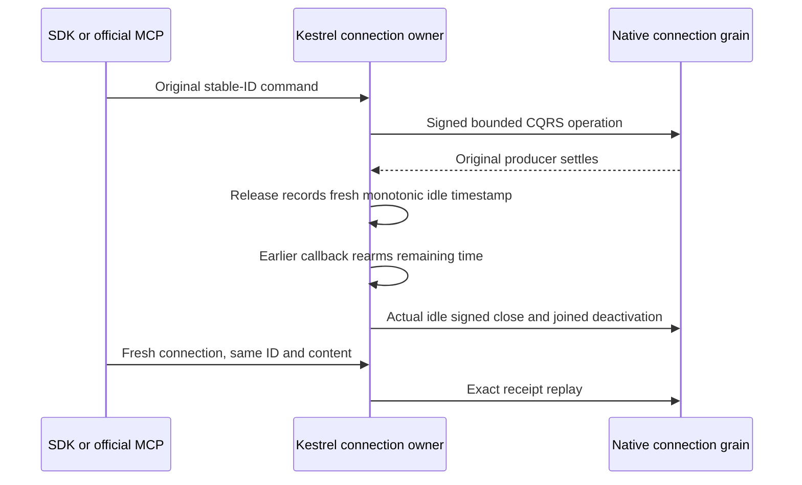

# Native connection idle callback ownership

REQ-CLIENT-CONNECTION-002 / AC-CLIENT-CONNECTION-002 and ADR-125 require bounded
connection lifetime and original producer settlement before native deactivation.
This correction retains the same Kestrel connection, native ITimer, borrowed
TimeProvider and separately authenticated operations. It introduces no provider,
profile, transport, clock substitution or additional timer.

The old callback checked only admission state. A callback selected before an
operation disabled the timer can run after the original operation finishes and
its Release starts a fresh idle interval. It then sees zero active operations
and can close that recently used connection. The selected .NET10 native timer
Change updates/deletes timer scheduling; Fire checks cancellation rather than a
schedule generation: [native source](https://github.com/dotnet/runtime/blob/v10.0.0/src/libraries/System.Private.CoreLib/src/System/Threading/Timer.cs).

The same owner now stores the borrowed clock and a monotonic idle timestamp,
initialized before CreateTimer. Under the existing admission gate, the last
Release records a fresh timestamp before rearming. ExpireIdle retains its active
and closing checks, compares elapsed time, and rearms the SAME timer for the
remaining interval when a callback belongs to an earlier schedule. Explicit
close, cancellation, original close task and native producer joins are unchanged.

## Whole operation and limits

The native TUnit case ConnectionRf3FreshIdleWindowTests has false/true Arguments
for the real .NET SDK and official MCP client. The existing ConnectionRf3Scenario
owns the actual Aspire Docker RF3 wave, persisted credentials, probe controls,
original calls and joined cleanup. No independent WebApplication is created.
RequestStarted/Hold proves actual admission and retains the original producer;
the system timestamp immediately BEFORE releasing that gate is the conservative
observation origin. The original public reply and ProducerDisposed settlement
are joined, and the literal quorum receipt/document are checked. With no further
operation on that caller, the existing immutable closed-witness files are polled
through the unchanged two-minute idle interval. The original native management
witness must then prove zero selected activations. A fresh caller replays the
same GUID/content, preserving every original receipt field and the literal
revision2 document; the independent principal's revision1 document is unchanged.
Its ordinary disconnect is also joined and observed.

A missing witness is only bounded observed absence: asynchronous watcher
publication does NOT establish the exact server close instant. This test does
NOT claim deterministic selection/reproduction of a stale timer callback. The
product correction follows the native scheduling contract; actual runtime,
compiler and exact-source Linux qualification remain OPEN. Default two-minute
idle, one-minute execution, twelve-minute parent and existing twenty-second
closed observation bounds are unchanged. The existing scenario retains every
primary/original producer/cleanup failure and private roots on failure. Public
SDK/MCP, native producer settlement and idle lifecycle evidence do not establish
power-loss durability, measured performance or complete foundation acceptance.
