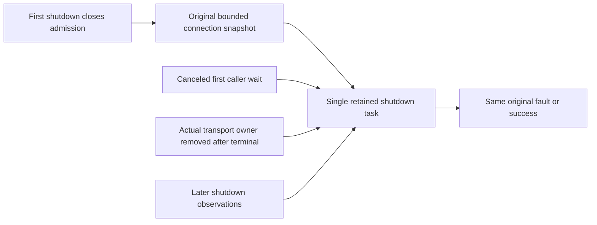

# Connection-owned shutdown: original transport settlement

Status: KL053 narrow SourceN correctness repair; actual compilation and Linux execution OPEN. ADR-125 and original connection-owner/RF3 requirements remain unchanged.

## Requirements and acceptance

- REQ-CONNECTION-JOIN-001: The first host shutdown closes registry admission and captures one bounded original physical-connection snapshot and task. Repeated calls observe that task after owners leave the live dictionary. No resnapshot may erase an original terminal fault.
- REQ-CONNECTION-JOIN-002: Caller cancellation only cancels that observation. It never replaces/cancels original shutdown or releases native transport/operation ownership. Request every original close, join every original completion and retain all primary/cleanup failures through ServerFailureObserver.
- REQ-CONNECTION-JOIN-003: Preserve native Kestrel context, server-generated connection IDs, connection/operation caps, idle timers, per-operation persisted authority and Orleans CloseConnectionAsync/drain. No new dispatcher, wire contract, clock, transport or retained per-request history.

| Criterion | Whole-operation regression | Evidence |
|---|---|---|
| AC-CONNECTION-JOIN-001 | ServerConnectionShutdownOriginalTests.CanceledFirstWaitRetainsRemovedTransportOriginalThenHealthyHostServes: real Kestrel HTTP/1.1 request returns actual native feature ID, first canceled shutdown observation retains token, real aborted transport completes but original callback stays held, pending repeat cannot finish; release terminal original failure, join after registry removal, repeated shutdown emits same exception instance | Source candidate; runtime OPEN |
| AC-CONNECTION-JOIN-002 | Same test opens a healthy independent native host, reuses actual connection for two requests, joins successful shutdown twice and cleanup | Source candidate; runtime OPEN |
| AC-CONNECTION-JOIN-003 | Existing ConnectionNativeOperation/Failure/Settlement/CloseAdmission and SDK/official MCP RF3 sequential/overlap/authorization/query-context cases remain required unchanged | Retained gates; this packet does not execute them |

The new fixture uses actual WebApplication, native TCP/Kestrel connection middleware and HttpClient. Its endpoint borrows the real ServerConnectionFeature ID only; it never calls Acquire or executes a database operation and does not pretend to prove Orleans, SDK/MCP, RF3 or persisted authorization. The controlled terminal fault is injected after actual Kestrel transport completion, on the very original registry RunAsync operation. No fake BaseConnectionContext or TimeProvider is used. Bounded synchronization controls the race, not elapsed sleeps.

Fixture cleanup releases the original hold, disposes actual client, joins the original registry terminal task, observes registry shutdown and stops/disposes the app. The expected injected failure can be claimed only after exact reference proof; any unclaimed original/body/cleanup failure remains in the existing server ledger. No final cleanup exception may replace the primary test failure.

