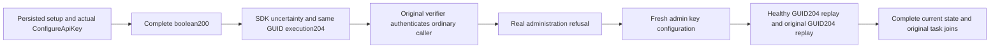

# credential status acknowledgement

Applies to [ClientApi](../ClientApi.md), [SuccessfulResponseAdmission](SuccessfulResponseAdmission.md), [ADR-125](../../ADR/ADR-125-connection-owned-execution.md), [ADR-035](../../ADR/ADR-035-memory-performance.md) and [ADR-117](../../ADR/ADR-117-tunit-ci-entry.md). No production contract or profile change is proposed.

REQ-EXECUTION-CREDENTIAL-STATUS-001 / AC-EXECUTION-CREDENTIAL-STATUS-001: CredentialStatusTests.BooleanStatusRequiresNoDataReplayAndPreservesCredentialDenialAndHealthyProgress executes real ConfigureApiKey through Codec.CreateCommand(OperationKind.ConfigureApiKey), stable server-owned connection InvokeAsync, actual production-hosted Orleans command execution and silo-local canonical ZoneTree storage. Setup only uses direct fixture Submit for persisted admin/ordinary principal and the admin caller credential. The first operation actually stores the original verifier before Kestrel completely delivers the original boolean true as HTTP200. Real SDK SendStatus must return the complete UnknownWriteOutcome Problem. Same GUID, principal, credential, request route and signed content execute again and return the original boolean result under HTTP204; SDK succeeds. Existing canned status-only wire cases remain unchanged and are not counted as database proof.

REQ-EXECUTION-CREDENTIAL-STATUS-002 / AC-EXECUTION-CREDENTIAL-STATUS-002: Verify complete expected stored ApiKeyRecord, both complete PrincipalRecords and actual Authenticate(original secret) equals the ordinary persisted principal. Secrets never enter diagnostic expected strings or artifacts: only verifier-bearing records, outcome metadata and full canonical row key/value SHA256 pairs are compared. The first original payload is the complete generated GrainValue(true); this status operation has no CommitReceipt and no invented receipt/token.

REQ-EXECUTION-CREDENTIAL-STATUS-003 / AC-EXECUTION-CREDENTIAL-STATUS-003: The newly configured original key makes a real SDK call as the ordinary principal to configure a distinct denied key. authorization returns PermissionDenied with the independently fixed cluster-administration detail. Full empty-payload/error/detail and canonical public Problem are checked. The denied credential stays absent; principals, original and caller verifier records remain complete and unchanged; model data stays absent and complete outbox head/status remains empty with no consumers. The actual rejected-command outcome and canonical applied sequence are separately asserted; a stored refusal is not mislabeled as a whole-store no-effect operation. A fresh administrator command then configures a healthy distinct key, authenticates to the same ordinary principal, replays its GUID under204 and replays the original GUID again without resetting either outcome.

REQ-EXECUTION-CREDENTIAL-STATUS-004 / AC-EXECUTION-CREDENTIAL-STATUS-004: Each first command independently validates the pre-operation applied position plus one against the retained canonical sequence, command/principal/kind/input and complete StoredOutcome: canonical fingerprint of known command fields, incarnation, original policy epoch, complete Result<bool> or PermissionDenied and Global scope, with all other authority fields empty. Public status commands use no CommitReceipt. Each first command has a PRE-operation full row-hash map and clock snapshot. The independent expected entire map applies only the actual atomic law: global outcome, applied index, max(previous clock, retained operation evaluation time), and successful credential record; denial adds no credential. Exact whole-map equality refuses unexpected keys/changes before any new baseline freezes. Replay/current checks freeze the full hashed canonical row vector, physical store position and canonical applied sequence after those independent semantic assertions; every response has complete live records/outbox assertions. No comparison of physical position with logical ACK occurs.

The six real Kestrel/signed handlers return the same retained tasks; producer disposal and original handler tasks are joined. Original body failure precedes separate server disposal and remaining task joins. Scenario release requires known successful transport disposal; uncertain startup/shutdown retains it. Existing completion/TUnit cancellation and shutdown policies apply unchanged. No secret logging, new credential store, auth provider, fake HttpMessageHandler/Stream/result, timeout increase or external platform is introduced.

The in-process production-hosted Orleans cluster and actual canonical ZoneTree owners provide a mechanism boundary. Docker/Aspire distributed-process recovery, configured-copy acknowledgement, cold and power-loss behavior, and public authentication gateway acceptance require their own execution evidence. No broader qualification follows from source presence.