# Declared native response premature EOF

Applicable contracts: [ClientApi](../ClientApi.md), [SuccessfulResponseAdmission](SuccessfulResponseAdmission.md), [ADR-035](../../ADR/ADR-035-memory-performance.md), [ADR-125](../../ADR/ADR-125-connection-owned-execution.md), and [ADR-117](../../ADR/ADR-117-native-tunit-ci-entry.md).

REQ-SDK-DECLARED-EOF-001 / AC-SDK-DECLARED-EOF-001 maps to `DeclaredResponseEofTests.NativeDeclaredReceiptAndReadAbortPreserveOriginalCommandThenHealthyReplayAndRead`. Existing CommittedResponseInterruptionTests(false) already owns chunked abort, exact replay/conflict and healthy revision; it stays unchanged. Main independently owns held complete-JSON/EOF coverage. This new-only stage declares the complete genuine receipt/document Content-Length, writes and flushes exactly the first byte, then physically aborts real Kestrel after the actual native operation has settled. It never supplies a fake HttpMessageHandler, Stream, database provider, canned receipt or fabricated failure task.

REQ-SDK-DECLARED-EOF-002 / AC-SDK-DECLARED-EOF-002: real existing ConnectionNativeScenario with nativeReplicaAdmission:true composes one actual Orleans TestCluster and real node-local ZoneTree, journal and materializer. An original persisted principal/API credential is checked by this controlled endpoint before invoking the original signed native connection. The first write must be committed before its response abort. Independently compare its complete receipt against PRE-operation partition scope plus the separately retained native entry.Index, literal mutation/revision and native durability. Never compare physical Store.Position to logical receipt.Position. Independently compare the complete first decoded outbox entry/head/no-consumers, using the separately retained operation timestamp and literal document/access; native payload.Length is accounting only after the complete semantic entry comparison. Only then freeze canonical rows, physical position, journal, exact original outcome bytes and outbox for unchanged-state checks.

REQ-SDK-DECLARED-EOF-003 / AC-SDK-DECLARED-EOF-003: original uncancelled SDK write returns full UnknownWriteOutcome and no value; same GUID healthy replay returns the full expected original receipt with exact unchanged canonical state/outbox. First actual document read receives the same declared-prefix abort, yields full OwnershipLost/no value, then the same SDK/HttpClient performs a healthy fresh read with independently complete DocumentReadResult and unchanged full state/outbox. All SDK response Results are followed by the complete native current observer. Independently require exactly two actual command handlers (original/replay) and two read handlers (aborted/healthy); no retries or extra public operations are hidden in this stage. Caller token is not deliberately cancelled in this stage; read Cancelled would fail its oracle.

REQ-SDK-DECLARED-EOF-004 / AC-SDK-DECLARED-EOF-004: retain the SAME original native SDK/handler Tasks and native RequestAborted registration. Passive TCS signals only coordinate actual retained handler, prefix flush, release and RequestAborted; they do not stand in for an operation result. Observe each original terminal task once with existing ServerFailureObserver, release gates on every path, close the real Kestrel owner, join remaining native tasks, then dispose the borrowed scenario only after known transport settlement. Startup/shutdown uncertainty retains the scenario instead of claiming successful resource release. Body failures precede independent cleanup errors. The existing completion timeout and TUnit-linked token cover the operations that receive that token. Existing scenario shutdown policy is unchanged. No new timeout, retry, resource profile, default, authentication middleware or shared fixture seam is introduced.

```mermaid
flowchart LR
 A[Actual persisted principal and original native commit] --> B[Declared full receipt length then one native byte]
 B --> C[Real Kestrel abort and original SDK UnknownWriteOutcome]
 C --> D[Join native handler then exact same GUID replay]
 D --> E[Full current document outcome journal and outbox]
 E --> F[Declared document prefix then real abort]
 F --> G[OwnershipLost then same client full healthy read]
 G --> H[Original task and native owners cleanup]
```

The same Abort primitive is already used by chunked coverage; this stage is specifically its declared-length framing law and read-failure mapping, not another whole-task completion. A successful flush is native server-side evidence only: source authoring does not prove which private HttpClient/JSON exception arrives, TCP delivery of each prefix, actual pending-state timing or deadline fit. The SDK deliberately exposes safe public classifications rather than private exception text.

A one-silo native TestCluster is not a genuine Docker/Aspire cluster quorum, standard ASP.NET gateway authentication, process restart, two cold owners, power-loss or performance proof. Those product gates remain separate. Main alone may adopt tracked source and run SDK/build/tests/Git.
