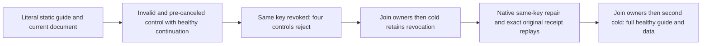

# ClientApi static agent guidance lifecycle

Status: requirements frozen before source-N implementation; source integration, compiler, native UID and actual RF3/Linux qualification remain OPEN.
Parent: docs/Features/ClientApi/ToolDiscovery.md REQ/AC-MCPGW-005/007, ClientApi AC-MCP005, Authorization REQ/AC-AUTH004/009. Existing ADR104/117/125; no new API, dependency or architecture.

REQ-CLIENT-GUIDE-LIFECYCLE-001 / AC-CLIENT-GUIDE-LIFECYCLE-001:
The real official MCP client receives the complete independently frozen resource/list/prompt objects and exact static Markdown, within8192UTF8 bytes, with null list cursors, one user message and no prompt arguments. Caller mutation of returned resource/prompt/content does not change subsequent fresh responses. Discover the real canonical document operation schema before using it. Unknown URI/name, nonempty list cursors and prompt arguments each fail InvalidParams, followed immediately by the same client's full healthy guidance and administrator literal document/outbox observation.

REQ-CLIENT-GUIDE-LIFECYCLE-002 / AC-CLIENT-GUIDE-LIFECYCLE-002:
Pre-canceled official list-resources/read-resource/list-prompts/get-prompt operations preserve OperationCanceledException; each is joined before a healthy same-session full response and full administrator document/outbox check. This proves the native official caller's pre-cancel continuation only, not interruption/draining of already-running SPARQL work, server activation counts or allocation/performance qualification. No fake handler, network adapter, new timeout or detached work.

REQ-CLIENT-GUIDE-LIFECYCLE-003 / AC-CLIENT-GUIDE-LIFECYCLE-003:
Persisted revocation of the SAME generated ApiKey rejects each of the four guide controls on the formerly healthy official session with HTTP401. The SDK returns the native closed Unauthenticated outcome. Each rejection is individually bracketed by complete administrator literal DocumentResult, recorded full authentic OutboxStatus and original seed receipt replay. After owners join, the first actual all-three same-volume cold retains revocation: a fresh official initialization rejects401 and real SDK is Unauthenticated. Do not claim successful guide calls through an unavailable revoked session.

REQ-CLIENT-GUIDE-LIFECYCLE-004 / AC-CLIENT-GUIDE-LIFECYCLE-004:
The administrator repairs the original credential with its original exact verifier/identity, using an actual new repair command identity, without changing principal/grants/epoch/schema. Capture native success and separately replay the original repair through SDK and official MCP; no credential record is serialized in evidence. A fresh joined reader uses the same key, full exact guidance and an authorized literal revision2 command. Verify all receipt fields against authentic placement, complete mutation list, and exact original receipt SDK/MCP replays with literal current state after EACH. Join callers before the second actual all-three cold, then fresh callers recover full guidance/data and original repair/seed/healthy receipts.

Canonical test: GuideLifecyclePublicTests.StaticGuideControlsPreserveCancellationAndCurrentCredentialAcrossRepairReplayAndTwoColdOwners.
Canonical map: Features/ClientApi/Cases, Models, Assertions and Helpers. Durable spec: docs/Features/ClientApi/GuideLifecyclePublic.md.
Frontend/product/SDK contract/schema/provider changes: N/A; existing native APIs only.
Existing McpAgentGuideRf3Tests is a warm partial control oracle and checks only ListResources after revocation. Existing CredentialAuthorityFlow qualifies document credential transitions with cold after repair, not this full static-control lifecycle and revoked cold. This is a bounded source inventory, not a claim that the feature is entirely missing or that a product defect is confirmed.
Public document/outbox brackets are complete observable controls, not a correlated whole-image/read-cut or raw-journal no-effect claim. Actual delivered-source Linux RF3/recovery/endurance/resource/performance gates remain mandatory and OPEN.

