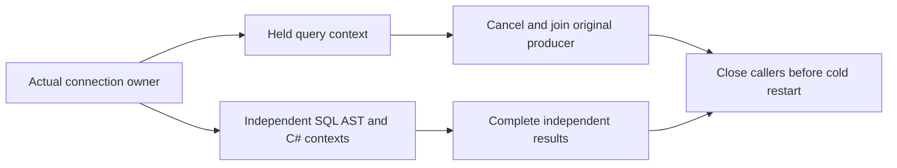

# KL053: independent authorized query contexts on the actual connection owner

Architecture KL053 requires one blocked query not to block all requests of its principal, idle owners not to retain index handles, and interleaving not to alter security context. ADR125 supersedes the obsolete separate per-request activation prose in ADR020: actual physical Kestrel connection owns one bounded ConnectionGrain; every operation keeps its unique signed request ID, caller-local preparation/budget/token, current persisted principal and node-local storage ownership. This operation does not add a SessionGrain or claim a product defect from missing tests.

Existing native AcCrs051 and public AcCrs058 hold COMMAND while a differently authorized command/document completes. The new whole ConnectionQueryContextRf3Tests operation covers the separate actual public SQL Query and JSON/C# AstQuery branches. It reuses the genuine ConnectionRf3Scenario private-probe Aspire RF3, persisted two nonadmin identities in separate scopes, SocketsHttpHandler one physical HTTP2 connection and original deadline/task/probe/producer-settlement owners. New independent literal second documents and complete precommit-placement-bound QPD receipts are retained and replayed; the original Scenario baseline document remains unchanged. Native UIDs/counts are unknown until Root builds and discovers the image.

Hold first subject SQL at actual signed RequestStarted; all second-subject SQL/JSON/C# first and interchangeable continuation pages complete through SAME witnessed connection/grain/activation while the original task remains pending. Cancel only the original linked read token, require Cancelled/null result and independently join original producer disposal/arm retirement before throwing any classification failure. Known-read cancellation never becomes an unknown write. Every response independently conserves four full source documents, complete Outbox and both original new command receipt replays even after primary failure. Public positions/cursors remain opaque; initial position is positive and actual placement scope is frozen before commit, never predicted from a counter.

Same original credential/owner observes foreign-principal cursor refusal, Query-grant epoch3 denial, independent second-principal health, epoch4 repair and old first cursor invalidation followed by fresh literal pages. Explicit close removes the witnessed activation; reconnect through a genuinely new HTTP2 transport has different connection/grain/activation and correct scope for both credentials. Official MCP keeps its ACTUAL HTTP1 sequential profile: second-subject SDK then first-subject official SQL/JSON/C# calls share the same witnessed physical owner, so principal context cannot be borrowed. Epoch5 Query denial and epoch6 repair/stale cursor checks use the actual official safe error envelope, original operation/disposal joins and full conservation, then explicit close. No MCP multiplex capability is invented.

This is not whole KL053 qualification by presence: native code admission, compiler/format, full original Unit/recovery/public RF3/Linux/fault/resource gates remain OPEN. Original ConnectionNativeOperation/Failure/Settlement/CloseAdmission and ConnectionRf3Sequential/Overlap/Authorization whole classes remain mandatory. No production scheduling, trust, limits, aliases, IDs, package, parser, query hash or read-cut contract changes. ConnectionRf3Scenario currently exposes no same-data cold operation; genuine two-cold session recovery and direct idle index-handle/lease measurement remain explicit unresolved whole-task gates, not manufactured API calls or getter-based resource proofs. Root owns any later exact native cold seam integration.

Root-authorized minimal test seams now retain the original profile and actual ContainerRuntimeControl owner. Before EACH genuine cold, join all original tasks/producers, dispose all original clients and administrator, and fail closed if ownership has not settled. Kill the three exact inspected containers with the existing owned incarnation/ordinal receipt namespace; retain partial failures and start every stopped node before health waits, using the existing native Start acceptance owner. Preserve all original receipts across cycles, refresh signed same-voter/cluster/incarnation discovery with changed SiloAddress, reopen the real administrator, then full SDK/official pages/conservation/receipt replay. Both cold attempts settle into one retained original ledger before aggregate throw. No detached child, reset deadline, trusted role, topology relabel or power-loss claim. Direct idle index-handle/lease measurement remains open.

The minimal cold seam would make original ConnectionRf3Scenario201 code lines. Its complete pre-existing signed-discovery array/loop is extracted into a real native batch capture helper, preserving every original node/count/call/await order and defaults. The existing DiscoveryOracle additionally asserts current versions; those checks are intentionally not silently added to original initialization. Cold replacement continues to use the existing stricter Oracle.

