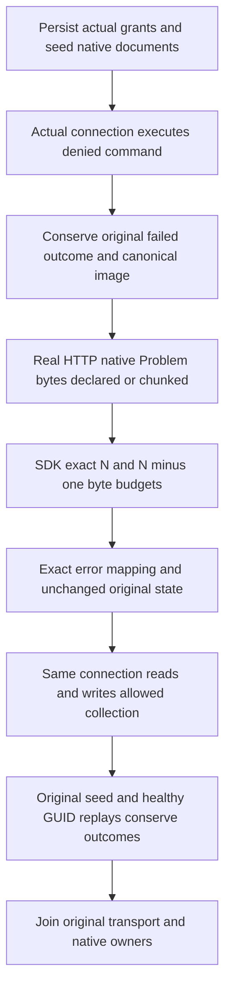

# Native authorization problems at the inclusive SDK byte boundary

Parent: [ClientApi](../ClientApi.md), [Authorization](../Authorization.md), [ADR-117](../../ADR/ADR-117-native-tunit-ci-entry.md), [ADR-125](../../ADR/ADR-125-connection-owned-execution.md).

REQ-CLIENT-CONNECTION-001 and AC-CLIENT-PROBLEM-NATIVE-001..003 map to `SdkNativeProblemBoundaryTests.NativePermissionProblemPreservesExactInclusiveCapAndRejectsOneUnderThenHealthyConnection` with both declared and chunked framing Arguments. Existing real cluster `SdkProblemBudgetPublicTests` remains mandatory and unchanged; its cap1/native+official-MCP/two-cold controls are not replaced.

The fixture persists a real principal and credential with read/write grants for only one allowed collection. Its denied collection is the original ConnectionNativeScenario collection. Every exercised denied/healthy command uses CreateCommand and actual same connection grain execution; arbitrary reads use CreateRead+InvokeAsync. Actual original native reply Tasks are retained and their native observation Disposed is awaited. Direct fixture Submit is used ONLY for persisted root configuration/seeding and independent stored oracles, never to manufacture an exercised caller failure or healthy write. This is a real native TestCluster/private Kestrel supporting fixture, not Docker cluster or standard ASP.NET authentication qualification.

Actual resource authorization produces PermissionDenied, exact known safe scope detail and empty reply Payload. The controlled Kestrel fixture authenticates the real stored credential using the existing native API and serializes THAT actual native reply into Errors.Problem, after asserting its complete code/detail. It adds no padding and never substitutes a canned database error. Controlled Content-Length/chunked framing is a wire-boundary control, not a claim that the official production HTTP server emits both forms.

A raw real HTTP read verifies403, actual declared length versus actual chunked header and exact complete native Problem UTF8 bytes using a bounded N+1 buffer. N is independently serialized from known code/detail under actual public JSON contracts. SDK problem cap N preserves the complete PermissionDenied Problem; cap N−1 returns read OwnershipLost or write UnknownWriteOutcome with exact unavailable Problem. Successful bodies retain the unchanged normal response cap. Credentials/private document bodies never enter error details or persisted diagnostic artifacts.

The selected native coordinator path appends/applies the first denied command through its real normal operation before wire replay. AtomicCommandCommit resets denied effects but retains actual failed outcome and metadata; the fixture requires real retained native entry and exact null Json/NativeValue +PermissionDenied/detail. This is not asserted as universal production pre-append refusal behavior. Only after that actual outcome is established is the complete canonical row/identity/position/journal/outcome baseline frozen. All subsequent wire/read/same-ID retry replies preserve those exact bytes and full independent document/outbox controls. No broad metadata exclusions are made. The failed ID never becomes success.

Healthy read and a fresh GUID write target the separately allowed collection under the SAME unchanged persisted principal and connection. Exact full receipt binds actual retained entry's logical position, caller, partition/incarnation, durability and literal mutations. Full outbox entries/head/byte count/empty consumer list are independently constructed from original immutable commands/literal before/after images, receipts and actual native evaluation times. Replaying the original root seed through the actual grain must return its original receipt without reverting the healthy revision. Full native state checks follow every selected reply.

Cleanup owns real original SDK/native/Kestrel tasks, joins Kestrel before native scenario disposal and preserves original body plus cleanup errors. Unknown transport closure retains native owner resources; it does not authorize root release. No fake provider/task, synthetic fault, replacement dispatcher or extra product API/cap is introduced. No new cold cycles are added: existing whole cluster two-cold qualification remains a separate required Case. Frontend/benchmark changes are N/A.

