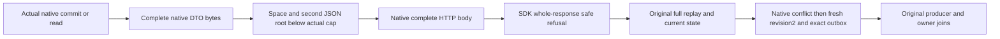

# Complete native response prefix with an invalid JSON suffix

Applies to [ClientApi](../ClientApi.md), [SuccessfulResponseAdmission](SuccessfulResponseAdmission.md), [NativeSuccessBodyRefusal](NativeSuccessBodyRefusal.md), [ADR-035](../../ADR/ADR-035-memory-performance.md), [ADR-125](../../ADR/ADR-125-connection-owned-execution.md) and [ADR-117](../../ADR/ADR-117-native-tunit-ci-entry.md).

REQ-NATIVE-RESPONSE-SUFFIX-001 / AC-NATIVE-RESPONSE-SUFFIX-001: NativeResponseSuffixTests.CompleteNativeDtoWithTrailingJsonRefusesWholeResponseThenReplaysAndAdvancesHealthy executes the exact reviewed NativeSuccessBody whole operation using an actual complete native CommitReceipt or DocumentReadResult prefix followed by one space and a second JSON object. It exercises both explicit declared Content-Length and an undeclared native Kestrel body. Each first faulty body is STRICTLY BELOW the same actual UnitClientOptions.MaximumResponseBodyBytes used by the real SDK. The entire selected body is written and native CompleteAsync returns; there is no abort, withheld EOF, probe-byte overrun or fabricated native DTO. The real SDK must reject the entire single-value response after its valid prefix, never return a partial successful DTO: write UnknownWriteOutcome and uncancelled read OwnershipLost, with complete independent public Problems and no value.

REQ-NATIVE-RESPONSE-SUFFIX-002 / AC-NATIVE-RESPONSE-SUFFIX-002: Reuse the original complete eight-response native operation, assertions and task ownership. A real signed Orleans command commits before the suffix response; original same-GUID replay returns the independently expected full receipt with complete literal revision1/current/outbox. A real signed read precedes its suffix response and healthy read follows. Same original GUID changed-content produces full Conflict with exact original canonical state; a fresh GUID commits literal revision2, its full independently built receipt and complete two-row outbox Before/After/token/time/sequence/head/no-consumer vector; healthy replay and final full document read preserve the complete canonical model and both original outcomes. Every response joins its actual SDK and native handler task, and native ProducerDisposed is observed. No new operation, fixture, provider, transport, model format, clock, resource policy or timeout is introduced.

REQ-NATIVE-RESPONSE-SUFFIX-003 / AC-NATIVE-RESPONSE-SUFFIX-003: The explicit future-only two-image bridge keeps selected R156R2 Flow/Endpoint beforeimages and full postimages. Original null/{ callers use unchanged defaults appendNativePrefix=false and declareLength=true; their literal response bytes, operation order, full original goldens and cleanup remain intact. Nine other parent images remain byteexact. A new feature-local serialization helper owns only complete native DTO/suffix byte composition; it adds no network/provider/fixture. The original literal refused-read branch remains lazy and does not decode its native payload in the default false mode. One captured existing typed UnitClientOptions instance now supplies both endpoint cap and actual SDK, without changing its values. Existing Main held-EOF code and the current tracked files remain untouched.

This is distinct from declared/chunked premature EOF, opening malformed/null JSON, byte-cap overrun, held EOF and non2xx Problem-boundary controls. The invalid suffix is native HTTP response transformation only; the actual database operation remains genuine. Prefix length metadata alone is not advertised as an independent receipt oracle: the unchanged whole operation independently verifies the complete native original receipt and literal read/current model before any baseline freezes. The source bridge retains the exact original body-first error ledger, same original disposalTask, native completion/TUnit token and shutdown policy. One actual Orleans test silo and real journal/materializer/storage are not cluster/multi-copy qualification. No SDK/build/test/parser/analyzer/style/preflight/Git/SourceY execution occurred.
