# Complete unusable native success response bodies

Applies to [ClientApi](../ClientApi.md), [SuccessfulResponseAdmission](SuccessfulResponseAdmission.md), [DeclaredResponseEof](DeclaredResponseEof.md), [ADR-035](../../ADR/ADR-035-memory-performance.md), [ADR-125](../../ADR/ADR-125-connection-owned-execution.md) and [ADR-117](../../ADR/ADR-117-native-tunit-ci-entry.md).

REQ-NATIVE-SUCCESS-BODY-001 / AC-NATIVE-SUCCESS-BODY-001: `NativeSuccessBodyTests.CompleteUnusableNativeSuccessBodyPreservesCommittedOutcomeConflictAndHealthyRevision(null/{)` executes the same whole operation with completely written HTTP200 literal null and malformed JSON. The real Kestrel handler declares the exact selected bytes, writes the entire body and calls native CompleteAsync, recording only completed response status/length metadata. It never aborts, stalls an EOF or fabricates a database receipt. Existing canned-wire null tests remain valid transport-only coverage and unchanged; the declared/chunked abort and Main held-EOF stages remain distinct.

The original persisted principal/API credential owns signed `ConnectionNativeScenario` operations through the production-hosted Orleans connection grain and silo-local canonical ZoneTree storage. The original commit completes before the unusable response body. `DeclaredResponseEofAssertions.FirstAsync` independently compares the complete receipt with pre-operation partition identity, the retained `StoredOutcome.CanonicalSequence`, literal mutation and original command input. Complete canonical rows, applied and physical store positions, exact outcome bytes and outbox are frozen after these semantic checks and checked after every response. Same-ID retries remain scoped to the verified principal and full partition identity; current persisted authorization and the stored fingerprint govern exact replay and changed-content Conflict. A refused changed command leaves the captured canonical state unchanged. Physical `Store.Position` is never compared with logical receipt position.

AC-NATIVE-SUCCESS-BODY-001 also requires same-GUID original exact receipt replay, same-GUID changed-content full Conflict Problem with no canonical changes, and a fresh GUID healthy revision2 plus its exact replay. The new revision2 oracle independently binds its complete receipt to pre-operation partition identity, separately retained canonical sequence and independently required durability/copy count and literal mutation. It independently decodes both complete outbox rows: original Before null/After literal revision1 and second Before that literal revision1/After literal revision2, with separately retained operation times, exact tokens/ordinals/sequence and no consumers. Raw StoredBytes accounting is checked only after semantic entries match. Full original outcome bytes remain exact after revision2. A final genuine SDK read returns the complete literal revision2 DocumentReadResult.

AC-NATIVE-SUCCESS-BODY-002: the first real document read executes before the same completely delivered null/malformed200. The uncancelled SDK must fail with the full OwnershipLost Problem and no value, then the same client/HttpClient returns the full original revision1 on healthy read. Original write failure is the full UnknownWriteOutcome Problem; no failure may become success or return a partial DTO. Caller token remains live after each response. Eight actual HTTP handlers, their exact route/status/full declared and written lengths, actual native handler tasks, SDK tasks and original native ProducerDisposed observations are retained. TCS slots are bounded passive registrations of the actual returned handlers, never replacement result/failure tasks.

```mermaid
flowchart LR
 A[Actual original native commit] --> B[Complete null or malformed200]
 B --> C[Unknown write outcome then exact GUID replay]
 C --> D[Actual read then unusable200 and healthy original read]
 D --> E[Same GUID changed content Conflict]
 E --> F[Fresh GUID native revision2]
 F --> G[Independent full receipt and two outbox rows]
 G --> H[Healthy replay then full revision2 read]
 H --> I[Original task and owner joins]
```

The same existing completion timeout/TUnit token and native scenario shutdown policy apply. Observe original body errors before separately joined real HTTP/handler/native scenario cleanup. An uncertain startup/shutdown retains the borrowed scenario instead of asserting release. Full response completion is server-side native evidence; private transport exception causality is not inferred if the original run fails.

The fixture uses actual production-hosted Orleans hosts and their silo-local canonical ZoneTree stores within one test process. This mechanism contract does not qualify independent-process Docker/Aspire recovery, the public authentication gateway, power-loss durability or performance. Native execution and delivered-source qualification remain separate gates.