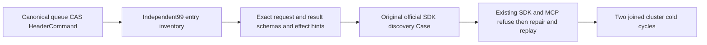

# Queue dispatch operation in the canonical agent catalog

Canonical slice: ClientApi. The queue dispatch catalog entry preserves REQ/AC-CLIENT-006, AC-MCP-001 and AC-MCP-006 under ADR-039 and ADR-104. The canonical persisted queue CAS belongs to Messaging; this correction owns independent catalog consumers only.

| Requirement | Acceptance and automated map |
|---|---|
| REQ-MCP-QUEUE-CATALOG-001 | AC-MCP-QUEUE-CATALOG-001: all99 canonical entries are unique and independently enumerated. The added `keyload_queue_dispatch_control` maps exactly to `/admin/queues/dispatch`, no read kind, and SetQueueDispatch50. Existing McpCatalogTests.AcMcp001EveryFrozenOperationHasItsExactRouteAndOneCapability and BlobAgentCatalogTests.AcBlob006TenExactToolsRetainTheirContractsInThePublicCatalog preserve every prior identity and ten Blob tools. |
| REQ-MCP-QUEUE-CATALOG-002 | AC-MCP-QUEUE-CATALOG-002: that same original catalog Case additionally checks exact closed outer commandId/request fields; all five request fields tenantId/databaseId/queue/expectedSchemaVersion/paused are required, with primitive nonnull types. In particular paused=false cannot come from omitted input. Complete result schema is ResourceDefinition with15 independently named metadata fields, not a CommitReceipt or queue-read summary. Fresh Tool objects retain exact schemas and false/true/true hints after caller mutation. QueueDispatchMcpCatalogAssertions.RequireAsync and existing QueueDispatchRequiredInputTests cover these contracts. |
| REQ-MCP-QUEUE-CATALOG-003 | AC-MCP-QUEUE-CATALOG-003: official SDK discovery inventory independently includes all five request fields, outer stable GUID and full ResourceDefinition fields with false/true/true hints. The original ClientApi full catalog discovery Case remains the execution owner; no unfiltered initial tool catalog is introduced. Existing QueueDispatchCasClusterFlow exercises current persisted administrator success, member refusal, stale schema refusal, original-ID changed-content conflict, paused Receive refusal, resume, full historical replay/current partition state+outbox and two joined all-node cold cycles. No fresh topology, trusted caller role, replacement transport or duplicated operation Case is added. |

The observed Linux failures on source45e855f8 occurred at independent expected98 versus canonical99 before either original Case reached its remaining strict checks. integration added the queue dispatch HeaderCommand; the consumer inventory had not declared it. Increasing a number alone is insufficient: retain exact new identity, schema, effect hints and execution/authorization mappings alongside every original tool. No production permission, schema, operation or discovery catalog change is proposed.

Canonical map: Unit ClientApi/Assertions/Mcp/McpCatalogExpectations and Cases/McpCatalogTests; new ClientApi/Assertions/QueueDispatchMcpCatalogAssertions; Integration ClientApi/Assertions/Mcp/McpCatalogExpectations. Messaging owns the existing QueueDispatchRequiredInputTests, QueueDispatchCasWholeFlowTests and QueueDispatchCasClusterTests. Frontend, benchmarks, product and infrastructure changes: N/A; no new product capability.

## Canonical inventory responsibility and observed enum value

The complete six EventFeedControl catalog entries move as one ordered operation family to ClientApi/Contracts/Mcp/McpEventFeedCatalogEntries. The combined inventory retains all99 entries in exactly the same order and all original identities/capabilities. Queue dispatch checks the actual catalog entry CommandKind against both the frozen SetQueueDispatch enum name and independent numeric50; the numeric assertion observes the returned descriptor rather than comparing two constants. No tuple, schema/hint assertion, original declaration, consumer operation or quality limit is removed or relaxed.
