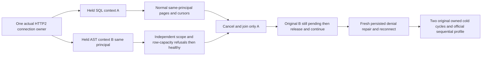

# Same-principal independent query contexts (KL053)

KL053 and ADR125 require actual connection-owned execution to admit independent query contexts without borrowing security/cancellation/budget state. The immutable SDK KeyLoadQuery facade constructs a fresh request; it does not create a client-trusted session or new SessionGrain. The actual Kestrel connection owns the existing ConnectionGrain, and every separately signed operation owns its native ManagedCode CQRS IAsyncEnumerable, RequestContext identity, work lifetime, token and result admission. Existing ConnectionQueryContextRf3Tests covers one held SQL query against a different subject's queries. This separate new whole case adds TWO simultaneously held normal SQL Query and JSON AstQuery contexts for the SAME persisted principal on one witnessed physical HTTP2 connection/activation, without changing any production scheduler, request IDs, aliases, defaults or protocol.

Both original SDK tasks are captured before the existing StartHeld marker wait, retained by the original scenario owner and independently joined. Witnesses prove identical connection/grain/activation, distinct actual signed RequestIDs and the same current principal; already-claimed private arms cannot accidentally hold later contexts because native claim selection excludes arms with a marker. While both originals remain pending, all ordinary SQL/JSON/C# first and interchanged continuation pages for that SAME subject complete with independent whole literal results. An independently authenticated second subject on the SAME transport executes a genuine no-full-scan-consent UnsupportedCapability, then an actual signed AST row-capacity BudgetExceeded at offset1000/limit1 under the frozen native manifest.MaxRows1000. Both full Problems/no partial value and native context witnesses are checked; healthy original sibling contexts follow. This is actual query row-capacity admission, not measured response-byte exhaustion, a changed limit or an invented test error provider.

Cancel ONLY the selected original SQL token. Require its complete independent Cancelled Problem/no page, join the SAME original task, original ProducerDisposed settlement and arm retirement. The original same-subject AST task must remain pending while still more ordinary same-subject SQL/JSON/C# contexts complete. Explicitly release that actual sibling arm, require its original complete literal first page and consume its original cursor through the C# adapter to the exact second page/same cut. Every read/refusal/cancel/continuation independently observes all four original canonical documents, complete Outbox and both original new full placement-bound QPD receipts/replay, preserving current storage state after primary failure.

The existing whole persisted epoch3 Query denial/independent second-principal health/epoch4 repair and stale cursor fence are reused unchanged. Explicit signed close removes the witnessed activation; real reconnect through a newly owned HTTP2 SocketsHttpHandler has distinct connection/grain/activation and correct literal scopes. The official MCP profile remains genuine HTTP1 sequential operation, not invented multiplexing: its existing whole two-subject/current epoch5 denial/epoch6 repair/SQL/JSON/C#/stale-cursor/close flow is reused after all original HTTP2 producers settle. Two independently attempted cold cycles use the Root-owned repaired current native cold seam unchanged: original callers/admin/tasks/producers join before any exact owned container operation; every stopped node begins before health, signed discovery replacement and retained unique restart receipts bind original topology. Each wave repeats current same-owner normal pages, real capacity/refusal→healthy and SDK/official scope checks; final receipt conservation remains independent of earlier errors.

The new operation owner only owns its two linked CTS and original task/settlement references. It records body failure before lexical disposal; on failed unsettled work it cancels both and aborts ONLY its actual owned transport before joining the original tasks/producer owners, preserving every primary and cleanup error. It creates no detached task, timeout extension, cached principal, secondary dispatcher or hidden connection ID. The original scenario retains its actual parent deadline and all infrastructure ownership.

No product defect is inferred from this missing acceptance operation. Source/native UID/compiler/runtime/RF3/Linux gates remain OPEN. Direct idle index-handle/lease accounting, progress-stage response-byte exhaustion and measured CPU/memory/contention fairness remain explicit separate KL053/resource/profiling gates; activation removal or a getter is not proof of released database index leases. Public cuts remain opaque same-operation/same-cursor facts, never ordered against logical receipt positions or other nodes. Existing native Connection* lifetime/admission/replay/close and original public classes remain selected with every original UID. No benchmark execution, optional scalar path, new library or public facade contract is introduced.

