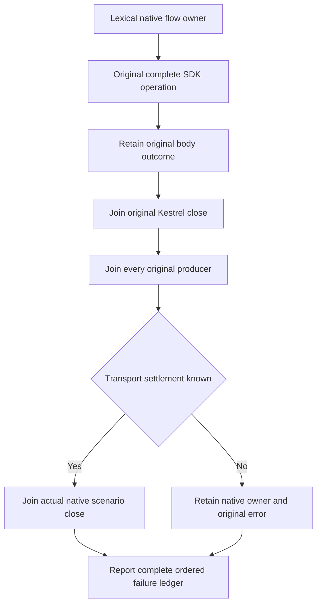

# SDK native boundary compiler ownership correction

The original R310 compiler failure is retained. This finite correction preserves the SDK50 original native success-body, credential-status, declared EOF and inclusive Problem operations and all exact expected values. No product, timing, native50 or transport contract changes.

Retaining the original SDK Task does not consume it: the explicit discard only acknowledges the returned same Task; the existing CompleteAsync later awaits it once and the original cleanup still joins it. The EOF Authorization header uses its existing protocol owner explicitly. The native Problem expectation and serialized byte count are scenario-independent test protocol values, with all actual call sites updated consistently.

The two scenario-owning flows implement memoized IAsyncDisposable. Their static entry uses lexical await-using and independent body/cleanup ledgers. First disposal directly awaits the actual owning Kestrel field, joins all retained original tasks, and directly disposes the actual native scenario only after successful transport join. An unknown or failed transport acquisition/close preserves the native owner/root; subsequent disposal returns the original terminal task, never a second no-op close as proof. Original positive/negative/replay/healthy/cancellation/EOF controls and original errors remain unchanged.

Existing whole-operation declarations remain the runtime regressions. Prepared numeric/source checks do not count as compiler or runtime acceptance; Root owns canonical build and native execution.

## Requirements and whole-operation evidence

This finite compiler/lifetime repair follows [ADR-117](../../ADR/ADR-117-native-tunit-ci-entry.md)
and the original connection ownership in [ADR-125](../../ADR/ADR-125-connection-owned-execution.md).
It preserves the contracts in [DeclaredResponseEof](DeclaredResponseEof.md),
[NativeSuccessBodyRefusal](NativeSuccessBodyRefusal.md),
[NativeCredentialStatus](NativeCredentialStatus.md), and
[NativeProblemInclusiveBoundary](NativeProblemInclusiveBoundary.md).

- REQ-SDK-OWNER-001 / AC-SDK-OWNER-001: retain the same original SDK task, then
  observe it through its original terminal ledger; the existing EOF and native
  body/status cases verify complete results, canonical state, healthy continuation
  and replay.
- REQ-SDK-OWNER-002 / AC-SDK-OWNER-002: join the original transport before releasing
  the actual native scenario; memoize the first disposal task and preserve body
  and independent cleanup failures. The existing whole operations exercise the
  lexical owner; unknown transport settlement remains a retained-root failure.
- REQ-SDK-OWNER-003 / AC-SDK-OWNER-003: independently fixed Problem bytes and exact
  inclusive size ceilings remain covered by both real declared and chunked response
  operations, including preserved canonical state after refusal and a healthy write.

Root's strict Release build, selected native TUnit whole operations, original TRX
and functional coverage are required after source adoption. Compiler, runtime and
Linux qualification remain OPEN until those original results exist. No getter-only
case, disposal substitute, deadline change or native50 qualification claim is added.
