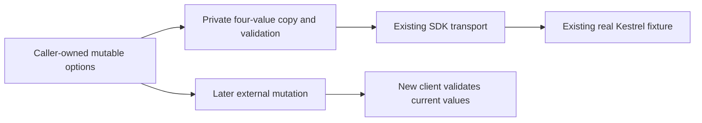

# SDK execution policy retention

Status: source integrated; coherent compiler, census, runtime and Linux acceptance remain open. Canonical slice: ClientApi. Parent: docs/Features/ClientApi.md. Existing decisions: ADR-035 and ADR-113. This is a repair of the existing IOptions lifetime, with no public API, package, dynamic configuration or authorization change.

REQ-CLIENT-POLICY-SNAPSHOT-001 refines REQ-CLIENT-002 and REQ-CQ-013: the canonical ConfigurationOptions owner captures and validates all four supplied KeyLoadClientExecutionOptions values at construction and returns the private retained IOptions instance to the SDK transport. Its internal Snapshot method is the explicitly marked ConfigurationBinding owner for this copy, validation and IOptions publication; the SDK transport consumes that wrapper. Later mutation of the caller-owned object must not alter an existing client's retained error-body ceiling or conservative SQL classification. A newly constructed client consumes the caller's then-current valid values. No setting is replaced by an arbitrary default.

AC-CLIENT-POLICY-SNAPSHOT-001 maps SdkPolicySnapshotTests.CallerMutationPreservesEachRetainedBudgetAndHealthyTransport. Through the existing real Kestrel owner and the public SDK, independently exercise each of the four settings. A one-byte retained error budget maps the real bounded PermissionDenied response to the exact OwnershipLost fallback even after the caller raises its own budget; a new client consumes the same response as full PermissionDenied. For SQL byte, nesting and cadence settings, canceled public ExecuteSql requests retain the exact original read disposition while a new client using the changed valid value conservatively returns UnknownWriteOutcome; the real server sees no canceled request. Use independently written literal SQL and exact safe Problem fields.

REQ-CLIENT-POLICY-SNAPSHOT-002 / AC-CLIENT-POLICY-SNAPSHOT-002: invalid mutated options reject new construction before any HTTP request, but the existing retained client remains valid. Restore the external valid configuration, then consume a complete independent literal successful NodeStatus on the original client and verify the exact real handler request count. The existing Kestrel owner disposes the caller HTTP transport and joins server stop/disposal; no fake message handler, new network implementation, timeout change or database role is introduced.

Canonical map: existing src/KeyLoad.Client/Features/ClientApi/Configuration/KeyLoadClientExecutionOptions.cs and Transport/KeyLoadClientTransport.cs; new tests/KeyLoad.UnitTests/Features/ClientApi/Cases/SdkPolicySnapshotTests.cs and feature-local Helpers/SdkPolicySnapshotFlow.cs, Assertions/SdkPolicySnapshotAssertions.cs; docs/Features/ClientApi/SdkPolicySnapshot.md. Database, RF3, MCP, recovery, frontend and benchmarks: N/A to this local SDK configuration ownership repair; their existing whole-product gates remain mandatory and open. This real transport regression does not claim memory or throughput improvement. Compiler, native test UID, actual original runtime and delivered Linux qualification remain open until Main integrates and runs the exact source.
