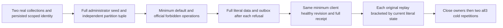

# SDK problem budget across genuine cluster public operations

REQ-CLIENT-PROBLEM-BUDGET-001 refines REQ-CLIENT-002 / AC-MP-009 and ADR-035/125. The existing validated MaximumProblemBodyBytes=1 is an inclusive retained-error budget, not a successful-body limit. An authentic persisted principal has DocumentsRead|DocumentsWrite on one real collection and no grants on a second collection in the same atomic partition. Both collections contain independently known documents published through the genuine administrator SDK. A real denied read whose Problem cannot fit maps to OwnershipLost; the denied write maps conservatively to UnknownWriteOutcome with the existing fixed server-unavailable detail. Neither fallback establishes a rollback or a server authorization defect.

AC-CLIENT-PROBLEM-BUDGET-001 maps SdkProblemBudgetPublicTests.MinimumErrorBudgetPreservesDeniedDataThenHealthyReceiptAcrossTwoColdCycles. On the SAME owned real HTTP client, native minimum-budget and default SDK clients make the same forbidden document read and stable-ID write. The minimum client must return each exact existing fallback; the default client and actual official MCP return PermissionDenied. The principal retains operation capabilities on the allowed collection so official tool discovery is genuinely admitted; no private tool registry, proxy response, fake handler or request header is introduced. After EACH refusal compare both complete independent administrative document results, the exact original seed receipt and current full public outbox through SDK/MCP.

REQ-CLIENT-PROBLEM-BUDGET-002 / AC-CLIENT-PROBLEM-BUDGET-002: the same minimum client immediately consumes the complete allowed document, performs one genuine authorized revision1-to2 write with the original healthy command GUID and consumes the complete receipt. Independently bind receipt atomic partition/incarnation to an administrator-observed SDK/MCP partition tuple captured before publication, positive position, quorum durability and literal full mutation list. Default SDK and official MCP replay EACH original successful command; after EACH replay compare complete current literal documents and public outbox. The forbidden row remains revision1 and retains its original JSON.

REQ-CLIENT-PROBLEM-BUDGET-003 / AC-CLIENT-PROBLEM-BUDGET-003: close original caller scopes before TWO actual all-three Kill/BeginRestart/Restart waves over the original Aspire fixture. New minimum/default/official callers repeat exact refusals, healthy full reads and full original receipts. Joined body/disposal and kill/restart failures remain ordered; the original test/deadline tokens own every await. Public document/outbox parity does not prove a raw journal/image cut, physical disconnect, power-loss durability or memory performance.

Canonical ClientApi roles: Cases/SdkProblemBudgetPublicTests, Models/SdkProblemBudgetPublicState, Helpers/SdkProblemBudgetPublicCallers/Preparation/Flow/Trial and Assertions/SdkProblemBudgetPublicAssertions. Product/server/SDK API/schema/frontend/package changes are N/A: this uses existing contracts only. Existing KeyLoadClientTransportTests verifies valid/malformed/null/oversized real-Kestrel responses and cancellation, but not this persisted-authority cluster whole flow. This source inventory is bounded and is not a global coverage claim.

Requirements precede the source preview. No product defect is asserted from source alone.
