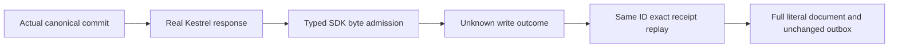

# Successful SDK response admission

REQ-MP-004 / AC-MP-009 and [ADR-035](../../ADR/ADR-035-memory-performance.md) require bounded decoding and owned response settlement. MaximumResponseBodyBytes is an inclusive positive typed SDK policy, default and ceiling 16 MiB, matching the current canonical public JSON reply ceiling. It is independent of the 64 KiB problem budget. Existing large chunked typed-response and cancellation tests remain unchanged. The stream counts bytes delivered by HttpContent, not wire compression, allocations, RSS or physical IO. No full response buffer or automatic retry is added.

A declared excessive length refuses before reading. Chunked input may consume at most the bound plus one probe byte; the excess byte never reaches JSON decoding. Exactly-at-bound JSON must still reach genuine EOF. Response/body retain their original owners; the counting adapter does not close the original body. Failures retain existing safe read OwnershipLost and write UnknownWriteOutcome semantics.

AC-SDK-RESPONSE-001: real Kestrel plus an actual TestDatabase commit produces an original receipt despite caller-side refusal, then the same command ID replays its full original receipt at the exact inclusive byte bound. Full literal document and complete canonical outbox remain unchanged. A bounded document read refuses, and a healthy SDK using the same caller-owned HttpClient reads the full literal record. Both declared-length and chunked transports use genuine HTTP responses. This validates transport/store composition, not server authentication, cluster, restart, Linux resource measurements or delivered-source qualification.

Source-only preview is conditional on shared SDK seam approval. No dependency, storage format, authorization, protocol DTO or transport replacement.

The first complete receipt is independently built from the PRE-operation committed partition scope, actual next embedded Store.Commit position, literal single putDocument revision1 and ProcessDurable contract. This position law is confined to this actual embedded Store.Commit callback, never a cluster ACK/public-cut comparison. The unchanged test-owned clock fixes canonical UpdatedAt/CommittedAt to UnixEpoch. Before freezing replay evidence, the complete initial empty outbox and the complete first entry/head/no-consumer vector are independently checked. stored-byte accounting uses the genuine entry payload length only AFTER its entire decoded semantic vector is compared; reference-sharing layouts are not equated to independently allocated equivalent record graphs. Full canonical Problems, including all fields, are asserted for each transport refusal.

Current intake ownership correction: each original Kestrel request task is joined independently. A throwing startup or shutdown leaves transport ownership uncertain and retains its borrowed store and directory. Once transport settlement is known, the original TestDatabase.JoinOwnedResources runs exactly once; recursive directory deletion requires its actual successful return. TestDatabase.Dispose is not retried or used as a close-success witness. This is a source-known failure-path guarantee; no simultaneous disposal fault was injected or claimed.

The protocol-only declaration is placed in the feature Contracts role with its original namespace, constants and runtime identity unchanged.

The original first typed receipt and decoded original outbox receipt each require CompositionReferences.IsEmpty as a Boolean-only private guard. Full public JSON equality remains unchanged; it does not serialize this internal lineage member. No private reference values are logged or represented as public wire bytes.
