# Successful SDK admission before actual HTTP EOF

REQ-SDK-TAIL-001 / AC-KL052-OUTBOUND-001 extends [SuccessfulResponseAdmission](SuccessfulResponseAdmission.md) and canonical early input/result admission. A real Kestrel handler executes the actual native embedded PutDocument command using the original response-admission fixture, writes its complete original receipt, then writes one whitespace probe byte and withholds HTTP response completion. This is a genuine chunked response, not a fabricated HttpMessageHandler or replacement Stream. The SDK budget is independently derived from the literal expected complete receipt; the original actual receipt is later checked against the same independent expected vector.

The SDK must return the complete safe UnknownWriteOutcome Problem while the original server EOF gate is still unreleased. A full-buffer-then-size-check implementation cannot complete this operation before EOF and fails the bounded original caller wait. The inclusive receipt byte length alone is not sufficient: the actual trailing whitespace is a probe byte, and exceeding the budget must refuse even though the prefix is already valid complete JSON. This is outbound SDK response admission, distinct from incoming slow-body saturation/disconnect and the existing finite whole response two-argument controls.

After refusal, the test releases and joins the original producer (or retains an actual original OCE while the HTTP context is aborted) before same-HttpClient healthy replay and read. It compares the complete independent receipt, full literal document, original persisted outcome bytes, full native outbox bytes and store position. An actual response transport abort is allowed, never required or inferred from elapsed time. Caller-owned HttpClient may choose another physical connection; this case does not claim same server connection identity.

The SAME original SDK CommitAsync task is retained in the operation lifetime before its caller waits. Every cleanup path independently awaits that exact task and all original handler tasks after releasing EOF and attempting transport closure; a canceled caller wait cannot abandon the parser. The existing failure observer retains its actual cancellation exception/token or unexpected failure without replacing it with a retry, timeout task or fabricated successful close.

The original handler tasks are retained and independently joined. Cleanup releases EOF, attempts actual server disposal once and joins every original task; uncertain startup/shutdown retains the borrowed native store/root. Current R244 TestDatabase memoizes original close and deletion outcomes, and only successful join permits deletion. A body failure retains evidence through JoinOwnedResources; all independent primary/cleanup failures remain in the original ledger. No primitive Dispose fault or physical byte/RSS counter is fabricated.

```mermaid
flowchart LR
    Commit[Real native commit and independent receipt] --> Prefix[Complete receipt plus one whitespace probe]
    Prefix --> Hold[Original Kestrel producer withholds HTTP EOF]
    Hold --> Refuse[Original SDK task returns safe unknown outcome before deadline]
    Refuse --> Join[Release EOF and join same SDK task and native producers]
    Join --> Replay[Same HttpClient exact receipt replay and literal healthy read]
    Replay --> Conserve[Raw outcome outbox and position unchanged]
    Conserve --> Close[Actual memoized native close gates root deletion]
```

Actual scenario: SdkResponseTailTests.CommittedReceiptPlusOneProbeRefusesBeforeOriginalHttpEofThenSameClientReplaysAndReadsHealthy. One real native embedded store, genuine HTTP and SDK, original fixed fixture clock and protocol identities are reused; no product body/shared helper change or new clock/provider/dependency is introduced. The feature-owned typed IOptions<SdkResponseTailOptions> snapshot validates its positive OperationTimeout against its30-second ceiling before constructing the real timer; the unchanged default30seconds bounds this operation without redefining production or shared fixture limits. Source-only native parse/numeric/nesting is not compiler/execution proof. Discovery, original execution, cancellation/cleanup faults, full public RF3 SDK/official MCP, Linux/resource and complete KL052 gates remain OPEN.

