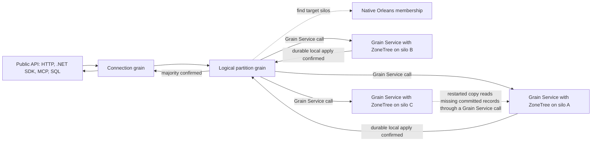

# ClusterReplication

Status: specification of the current concept. Implementation is open: the source still contains replaced mechanisms (see `sourceDebt` in [status.json](../implementation/status.json)), and no requirement below is qualified until its mapped tests pass against source that follows this concept.

Decisions: [ADR-136](../ADR/ADR-136-native-orleans-partition-ownership.md) (Orleans partitions and silo-local ZoneTree; the cluster concept), [ADR-143](../ADR/ADR-143-independent-silo-replica-topology.md) (silo and copy counts) and [ADR-003](../ADR/ADR-003-durability-ack-barrier.md) (durability profile and acknowledgement barrier). Foundation: [ADR-036](../ADR/ADR-036-orleans-foundation.md) and [ADR-125](../ADR/ADR-125-connection-owned-execution.md).

## Goal and outcome

A caller-visible write is stored as `KeyLoad:ReplicaCount` copies on different silos and is acknowledged only after a majority of those copies confirm durable local apply. A copy that was stopped, restarted or left behind catches up from another copy. Callers see the same documents, rows, graphs, queues, events, blobs, search data and command outcomes whichever node serves them.

## The concept

1. Microsoft Orleans does all clustering: membership, silo discovery, failure detection, distributed grain directory, placement, activation migration, internal communication and scaling. KeyLoad adds no cluster mechanism of its own.
2. Every silo hosts one silo-local Grain Service that maintains that node's ZoneTree: it opens and owns the node's ZoneTree stores, WAL/journals, file locks and ordered apply. Other code on the node takes ZoneTree from this Grain Service through DI. Files never move with grain activations.
3. Replication runs through these Grain Services. The writer finds the target silos through native Orleans membership and makes Grain Service calls to the target silos through Orleans, one call per copy on `ReplicaCount` silos. Native Orleans membership APIs are used as they are; a self-written discovery protocol is not.
4. Request flow: public API (HTTP, .NET SDK, MCP, SQL) -> one connection grain per connected client -> the logical partition grain, which serializes and routes the commands of one logical partition -> Grain Service calls to the target silos holding the copies -> results gathered -> returned.
5. A write is acknowledged after a majority of the copies confirm durable local apply. The majority is `floor(ReplicaCount / 2) + 1`.
6. A restarted or lagging copy catches up by reading the committed records it lacks from the Grain Service of another copy through Orleans and applying them to its own ZoneTree in commit order.

| ReplicaCount | Majority | Fault tolerance |
|---|---|---|
| 1 | 1 | None. Losing the single copy stops writes and its data depends on that one node. |
| 2 | 2 | None for writes. Both copies must confirm; either copy being down blocks acknowledgement. |
| 3 (default) | 2 | One copy may be down. |
| 5 | 3 | Two copies may be down. |

`ReplicaCount` is positive and not larger than `KeyLoad:SiloCount`. Three is only the default.

KeyLoad-owned consensus, terms, votes, leaders, replica term metadata, self-written silo discovery protocols or discovery credentials, peer authentication or peer transports, submission-journal protocols, snapshot install/transfer fencing, coordinator RPC deadline protocols and strong-read sessions are not part of this concept.

## Scope

In scope: the number of copies, the majority acknowledgement rule, durable local apply on each copy, idempotent command outcomes, catch-up of restarted or lagging copies, bounded admission and cancellation of replicated writes, persisted authorization on every node, and the tests that exercise these through real Aspire clusters with the .NET SDK and the official MCP client.

Out of scope: cluster membership, discovery, placement and activation movement, which Orleans owns and replication only reads through native Orleans membership (see ADR-136); the model semantics of documents, tables, graphs, queues, events, search, time series and blobs (their own feature specifications); local ZoneTree storage, recovery and backup of a node's files ([StorageRecovery](StorageRecovery.md), [BackupRestore](BackupRestore.md)); live resizing of `ReplicaCount` and movement of data between silos.

## Actors and entry points

- Authenticated callers using HTTP, the .NET SDK, MCP or SQL. Credentials and grants are persisted in the database and checked fresh for every operation; callers never supply roles ([Authorization](Authorization.md)).
- The connection grain and the logical partition grain (ADR-125, ADR-136).
- The silo-local Grain Service on every silo that maintains the node's ZoneTree and receives replication calls.
- The Aspire AppHost, which owns test topology, readiness, fault commands and shutdown ([AspireOwnedFaultCommands](ClusterReplication/AspireOwnedFaultCommands.md)).

## Flows

- Positive: an authorized write reaches its connection grain, the partition grain finds the target silos through native Orleans membership and sends the write as Grain Service calls to those silos, a majority confirms durable local apply, and the caller receives the stored command outcome.
- Negative: when fewer than a majority of copies can confirm, the write is not acknowledged as successful. An unauthorized caller gets a refusal without any stored effect.
- Edge: with `ReplicaCount = 2` both copies must confirm; with `ReplicaCount = 1` the write is acknowledged after the single copy confirms and there is no replica fault tolerance.
- Error: if the response is lost or the caller cancels after admission, the outcome is unknown. Retrying with the same command ID returns the stored outcome and never applies the write twice. A stopped copy catches up from another copy after restart; an interrupted catch-up leaves its local state recoverable and resumes.

## Requirements and acceptance

| Requirement | Acceptance criterion | Mapped tests |
|---|---|---|
| REQ-REP-001: replication traffic between nodes is Grain Service calls to the target silos through Orleans; target silos are found through native Orleans membership. KeyLoad owns no consensus, terms, leaders, votes, self-written discovery protocol, peer authentication or peer transport. | AC-REP-001: in an Aspire three-node cluster, a write accepted on one node is readable on every node through the .NET SDK and the official MCP client; the source and dependency inventory contains none of the excluded mechanisms. | `ClusterTests.ReplicatedAtomicBatchSurvivesLeaderContainerKillAndMinorityRejectsWrites` reads the committed batch through the SDK on all three nodes; `FunctionalDatabaseGateTests.ThreeNodeClusterRunsSameEveryModelScenarioThroughSdkMcpAndSql` covers SDK, MCP and SQL on three nodes. The inventory part currently fails; see `sourceDebt` in [status.json](../implementation/status.json). |
| REQ-REP-002: a copy confirms a write only after durable local apply in the ZoneTree maintained by its silo-local Grain Service: ordered apply and the WAL barrier of the selected durability profile (ADR-003). Files stay with that Grain Service and never move with activations. | AC-REP-002: real process kills after confirmation reopen every confirmed write, and a corrupted complete record fails closed instead of being skipped. | Local process recovery is qualified by [StorageRecovery](StorageRecovery.md). The existing `AC-REP-002` tests under `tests/KeyLoad.RecoveryTests/ClusterReplication/` exercise the KeyLoad-owned replica log and do not qualify this criterion. |
| REQ-REP-003: a write is acknowledged only after a majority of `ReplicaCount` copies confirm. A minority never acknowledges. A write that cannot reach a majority returns an explicit failure or an unknown outcome, never success. Retrying with the same command ID returns the stored outcome without applying the write twice. | AC-REP-003: on a three-copy cluster, killing one copy keeps writes acknowledged and keeps every earlier acknowledged write and stable-ID outcome; with only a minority running, writes are not acknowledged. | `ClusterTests.ReplicatedAtomicBatchSurvivesLeaderContainerKillAndMinorityRejectsWrites` (SIGKILL through the Aspire fault command, then minority rejection). Its name and current path reflect source debt; it must be re-run after the replacement. |
| REQ-REP-004: a restarted, lagging or empty copy reads the committed records it lacks through a Grain Service call to another copy's silo and applies them to its own ZoneTree in commit order before it applies newer writes. | AC-REP-004: a copy stopped while writes continue restarts and then holds the same documents, events, subscription checkpoints, outbox/inbox entries and command outcomes as the other copies; an interrupted catch-up leaves its local state recoverable and resumes. | `ClusterTests.RetainedReplicaCatchesUpThroughNativeSnapshotAndKeepsCommandOutcomes` checks the caller-visible result; its current catch-up path is the replaced snapshot mechanism and must be re-qualified. No test yet covers interrupted catch-up under this concept. |
| REQ-REP-005: principals and grants are database data, copied like every other write, and checked fresh for each operation on whichever node serves it. Callers cannot supply trusted roles. | AC-REP-005: unauthorized and protected-field .NET SDK and MCP requests fail without stored effects before and after one copy is killed and restarted. | Owned by [Authorization](Authorization.md). `ClusterTests.UnsignedPeerRequestsAndClientSuppliedPrincipalAreRejected` covers rejection of an invalid client credential but also asserts KeyLoad-owned peer endpoints (source debt); it does not qualify this criterion. |
| REQ-REP-006: replicated writes use bounded admission, backpressure and cancellation. Count and bytes are reserved before copies are sent; a full budget returns explicit `ResourceExhausted` instead of queueing without bound; shutdown closes admission first and settles queued writes with an unknown outcome. | AC-REP-006: saturating writes on a replicated cluster returns explicit `ResourceExhausted` while earlier acknowledged data stays readable, and a write cancelled after admission is resolved by a same-command-ID retry. | No qualifying test. The existing tests tagged `AC-REP-006` exercise the KeyLoad-owned peer replay and transport code (source debt). |
| REQ-REP-007: `ReplicaCount` is positive, not larger than `SiloCount`, defaults to 3 and is independent of `SiloCount`. Invalid combinations are rejected at startup before any resource is created. | AC-REP-007: configurations such as 1/1, 2/1, 2/2, 3/2, 5/3 and 5/5 are accepted with majority `floor(N/2)+1`; 0/1, 1/0 and 2/3 are rejected. | `IndependentSiloReplicaTopologyTests.SiloMembershipAndPhysicalAcknowledgementAreIndependent` and `IndependentSiloReplicaTopologyTests.InvalidDeploymentIsRejectedBeforeResources` (unit). The first also touches physical owner and shard validation code that is source debt. |

## Durability and qualification limits

- The acknowledgement barrier and profile names follow [ADR-003](../ADR/ADR-003-durability-ack-barrier.md). A replicated write reports `QuorumProcessDurable`: a majority of copies crossed their process-durable local barrier. `LocalDurable` and `QuorumDurable` are not advertised until device-flush semantics and fault evidence support them.
- Process-kill tests (Aspire SIGKILL fault commands and real process crashes) prove process recovery only. They do not prove power-loss durability, storage-controller guarantees or production readiness.
- Production readiness additionally requires the endurance and fault gates.

## Test methodology

Tests are TUnit tests that start the intended topology through the Aspire AppHost and exercise public operations through the real .NET SDK client and the official MCP C# SDK client. Fault injection uses only the AppHost-owned commands described in [AspireOwnedFaultCommands](ClusterReplication/AspireOwnedFaultCommands.md); concurrent kill/restart bookkeeping is specified in [ConcurrentContainerRuntimeReceipts](ClusterReplication/ConcurrentContainerRuntimeReceipts.md); the one-node and three-node functional gates and the physical file cases are specified in [FunctionalDevelopmentTopology](ClusterReplication/FunctionalDevelopmentTopology.md). Required checks: solution build, TUnit unit tests, real process recovery tests and Aspire replicated-cluster tests through the .NET and MCP clients. No mocks or service doubles are used.

## Slice map

- `build/KeyLoad.AppHost/ClusterReplication/` — Docker resource composition, `SiloCount`/`ReplicaCount` options and test fault commands.
- `src/KeyLoad.Clustering/ClusterReplication/GrainServices/` — the silo-local Grain Service that maintains the node's ZoneTree and receives replication calls.
- `src/KeyLoad.Replication/ClusterReplication/` — write replication and catch-up.
- Tests mirror the slice in `tests/KeyLoad.IntegrationTests/ClusterReplication/`, `tests/KeyLoad.RecoveryTests/ClusterReplication/`, `tests/KeyLoad.UnitTests/ClusterReplication/` and `tests/KeyLoad.CrashHost/ClusterReplication/`.
- Node-local storage: StorageRecovery. Public client shapes: ClientApi. Frontend: N/A, replication has no UI.

## Open questions

- The read consistency guarantee across copies is not defined by this specification; the model features own their read contracts.
- The exact native Orleans membership APIs and the rule that selects the `ReplicaCount` target silos of a logical partition are to be specified after research (ADR-136).
