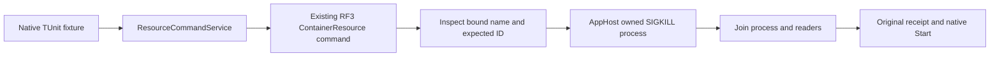

# Aspire-owned abrupt RF3 faults

The existing Aspire `ContainerResource` owns every test lifecycle command under [ADR-034](../../ADR/ADR-034-cluster-comparisons.md), [ADR-117](../../ADR/ADR-117-native-tunit-ci-entry.md) and [ADR-136](../../ADR/ADR-136-native-orleans-partition-ownership.md). Native TUnit fixtures retain startup, readiness, SDK/MCP operations and joined shutdown.

`KeyLoadTests:ContainerFaults=true` explicitly selects the test fault command. Registration refuses non-ephemeral and comparison/benchmark resources. Each command is bound to the existing resource and its original `ContainerNameAnnotation`; the caller supplies only an expected full 64-hex container ID. The AppHost inspects its bound name, refuses a mismatching or non-running container, then issues the original `docker kill --signal KILL` against that exact inspected ID. Metadata inspection is read-only. No caller launches a lifecycle engine command.

The original per-reader 16,384-character bound remains unchanged. Each process observes the existing validated application-cleanup timeout and joins all acquired tasks even when task acquisition fails. The stable Aspire 13.6.1 `WithCommand` callback is invoked through `ResourceCommandService`, without experimental process-command APIs or diagnostic suppression. The existing AppHost process owner bounds original stdout/stderr and joins the original process/readers on failure or cancellation. The typed result contains the actual engine exit code and output. Existing kill/restart receipts, exact source/image identity, accepted restart ownership and native Start remain unchanged. Cancellation cannot prove an unobserved SIGKILL did not take effect; the original fixture shutdown remains responsible for every resource.

REQ-CR-FAULT-001: only the explicitly selected ephemeral RF3 test topology exposes abrupt fault commands; production and comparison resources expose none. REQ-CR-FAULT-002: malformed, stale and foreign IDs refuse before lifecycle effects. REQ-CR-FAULT-003: original process failures, cancellation, reader joins and factual receipt fields are retained.

AC-CR-FAULT-001 maps to `AspireContainerFaultCommandTests`: rejected IDs retain running identities and committed content, followed by real healthy operations and the original kill/restart flow. AC-CR-FAULT-002 maps to existing `AggregateReplayRf3LeaderLossTests.AcEvent008AcceptedRestartCancellationResumesSameReplacementAndPreservesReplay` and original leader-loss cases through actual SDK/official MCP clients. Runtime qualification remains OPEN until Main executes the adopted source through native Aspire RF3. This is SIGKILL process fault evidence, not power-loss durability.

Source ownership is limited to the existing cluster resource composition (`ClusterResources`, `TwoRf3ClusterResources`), feature-local command registration (`Commands/ContainerKillCommand`), typed invocation/result constants (`Contracts/ContainerFaultCommandProtocol`), and delegation to the existing AppHost process owner (`Processes/ContainerFaultProcess`). Integration `Helpers/AspireContainerFaultCommand` owns native invocation; `ContainerRuntimeControl` retains receipts. The three existing argument owners (`ClusterFixtureComposition`, `TwoRf3WaveArguments`, `RequestCqrsRf3WaveArguments`) explicitly enable the profile. The one `Cases/AspireContainerFaultCommandTests` case owns refusal and healthy follow-up coverage. These paths add no resource, launcher, topology, engine provider or package. Comparison lifecycle migration is separately owned and is not qualified by these RF3 tests.

## Namespace isolation fault ownership

REQ-CR-FAULT-004: mutating namespace isolation and restoration execute only through the same original AppHost resource command service. The command is registered exclusively by the existing diagnostic derived-image/NET_ADMIN composition and requires the explicit ephemeral test fault flag. Ordinary product, comparison and ordinary RF3 resources have no namespace command. The existing canonical profile admits only unicast IPv4 peers; no IPv6 profile is downgraded or newly claimed.

REQ-CR-FAULT-005: the caller supplies an expected full container ID and bounded typed rule fields, never executable paths or engine arguments. The AppHost derives the original bound name, checks the existing admitted 3/6 resource cohort, image, service user, fault labels, isolated network and sole CAP_NET_ADMIN capability on each rule, derives actual peer addresses, and builds only the original fixed iptables operation. Original TCP11111, operation-owned KL21I_/KL21O_ chains, 5-second foreground timeout, 1-second kill grace and 4-second iptables wait remain.

REQ-CR-FAULT-006: intent is retained before invocation; actual exit/stdout/stderr are preserved. An unobserved native completion still requires actual AppHost namespace shutdown and original retirement/lock proofs; cancellation is not proof of no effects. Read-only iptables listing/counters, cat and sha256sum evidence remain read-only callers.

AC-CR-FAULT-003 maps to the existing DocumentSessionIsolationRf3Tests whole operation: persisted seed/SDK+official MCP healthy original read, malformed rule and wrong/stale/foreign ID command refusals with exact namespace rules and runtime identities unchanged, healthy follow-up, actual isolation, new majority acknowledgement, former-owner refusal, restoration and exact original replay/read results. Existing six-owner native activation isolation uses the same resource command and retains its original whole operation. All current failures, unknown outcome receipts, cleanup and readiness remain mandatory; qualification is OPEN until exact-source execution.

Ordered source roles: existing Resources/ReplicaIsolationResourceComposition registers the command after its full diagnostic admission; Commands/ReplicaIsolationCommand owns native invocation and actual cohort inspection; Validation/ReplicaIsolationCommandRule owns closed typed rule validation; Contracts/ReplicaIsolationCommandProtocol owns bounded fields. Integration Lifecycle/ReplicaIsolationOwner retains authority and ledger orchestration; Processes/ReplicaIsolationExecution invokes the new Helpers/AspireReplicaIsolationCommand through ResourceCommandService. Helpers/AspireContainerFaultCommand shares the original typed result decoder from the prior SIGKILL packet. Helpers/ReplicaIsolationFlow invokes Assertions/ReplicaIsolationCommandAssertions inside the existing whole SDK/MCP operation. The existing ContainerFaultProcess from the SIGKILL packet is a mandatory unchanged prerequisite.
