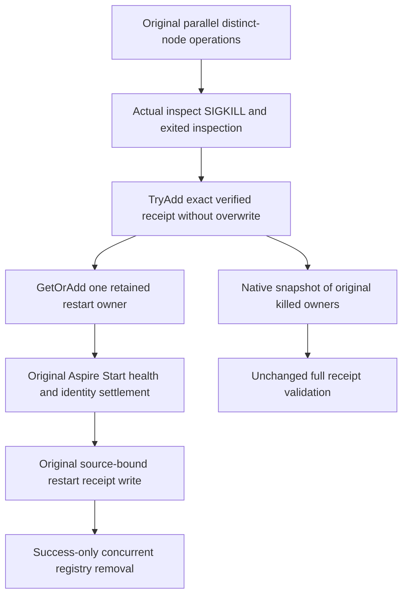

# Concurrent container runtime receipts

The actual ClusterReplication fixture owns real Docker SIGKILL operations and Aspire resource restarts. Distinct node operations deliberately run concurrently in the existing ModelSqlRf3Cold whole flow; metadata bookkeeping must support that concurrency. [ADR117](../../ADR/ADR-117-native-tunit-ci-entry.md) retains native TUnit fixture ownership, and [ClusterReplication](../ClusterReplication.md) retains real RF3, original receipts and joined cleanup.

## Observed failure and source cause

The original R151 source cohort 924e782f1142bdb0487b108cc67ef4e89dab3b1e failed SafeSourceAliasesRoundtripAndCurrentCdcSdkOfficialMcpRemainExactAcrossTwoColdRestarts with IndexOutOfRangeException at Dictionary.set_Item in ContainerRuntimeControl.KillAsync. The bounded original evidence was captured before reading the owning source. Its aggregate also retains unhealthy node1/node2 and missing node3 SIGKILL receipt failures; this repair does not assert that no independent readiness problem exists.

Actual ModelSqlRf3Cold starts three distinct real Kill calls through Task.WhenAll, then three Restart calls the same way. ContainerRuntimeControl previously wrote their verified kill receipts and selected restart owners in two shared ordinary dictionaries without synchronization. Both registries require correction together. ContainerRestartOwnership's constructor owns only its ordinary scalar/reference state; it performs no native Start or external resource acquisition. The shared ClusterFailureReceipts file writer already uses its own brief native Lock and is unchanged.

## Requirements and acceptance

- REQ-RF3-RUNTIME-LEDGER-001: preserve genuine parallel distinct-node kills and restarts. Use native ConcurrentDictionary for metadata operations; do not introduce global async serialization, alter Task.WhenAll, retry native work, widen a timeout or ignore the original exception.
- REQ-RF3-RUNTIME-LEDGER-002: retain each complete verified kill receipt under its ordinal resource key. The original running inspection, full container ID, image identity, stopped inspection, scenario, stdout/stderr and UTC kill interval remain exact. TryAdd publishes once and refuses a competing existing entry with the original pending-owner failure instead of overwriting it.
- REQ-RF3-RUNTIME-LEDGER-003: GetOrAdd returns one stored ContainerRestartOwnership per resource. Its native value factory allocates state only; the returned stored owner alone executes original AcceptAsync. Preserve both existing missing-receipt failure paths, original attempted/StartAccepted/replacement fences and success-only key removal. This does not introduce a same-resource async scheduler or claim concurrent same-resource restart is supported.
- REQ-RF3-RUNTIME-LEDGER-004: RequireKilledOwners captures one native ToArray snapshot, converts it to an ordinal dictionary and applies the unchanged original validator. Its returned receipt set remains stable if the live registry later changes. Original application-reference, resource-count/key, full container ID, running/exited state, image and original start timestamp checks remain mandatory. A receipt snapshot does not establish storage/thread/process joinedness.
- REQ-RF3-RUNTIME-LEDGER-005: keep every actual Docker CLI task, bounded stdout/stderr reader, exit/termination join, Aspire Start/readiness operation, source receipt write, cancellation and failure capture unchanged. Existing body/cleanup ledgers remain authoritative; registry safety does not suppress native failures.
- AC-RF3-RUNTIME-LEDGER-001: rerun the original complete SafeSourceAliasesRoundtripAndCurrentCdcSdkOfficialMcpRemainExactAcrossTwoColdRestarts operation. Its two genuine original-volume cold cycles retain parallel real three-node Kill/Restart, exact public SDK/official MCP/Q1 results, complete raw-image/placement/replay oracles, and immutable earlier receipt file bytes through ModelSqlRf3ColdOwnership. The existing operation is the meaningful regression; no mock concurrent dictionary or per-guard microtest is added.
- AC-RF3-RUNTIME-LEDGER-002: preserve the current R151 six-class selection and all ten metadata-bound cases: SafeProjectorOperationRf3Tests, SqlParserAdmissionRf3WholeFlowTests, GraphSearchLineageRf3Tests, AtomicTriadStagedRf3Tests, CompetingInboxPublicTests and QueueViewLeaseIsolationTests. Their full original public operations, cancellation, receipts, same-root cold and owner teardown remain required. Existing accepted-restart cancellation and killed-owner native controls remain responsible for their original fences. Source review does not count execution, new UIDs or PASS results.

## Source and qualification boundaries

Only ContainerRuntimeControl changes. ModelSqlRf3Cold, its receipt-file ownership, ContainerRestartOwnership, ContainerRuntimeKilledOwnerValidation, Docker process ownership, diagnostic receipt writer and all business test assertions remain unchanged. Snapshot capture uses the native [ConcurrentDictionary.ToArray](https://learn.microsoft.com/en-us/dotnet/api/system.collections.concurrent.concurrentdictionary-2.toarray?view=net-10.0) contract. [TryAdd](https://learn.microsoft.com/en-us/dotnet/api/system.collections.concurrent.concurrentdictionary-2.tryadd?view=net-10.0) refuses an existing key, and [GetOrAdd](https://learn.microsoft.com/en-us/dotnet/api/system.collections.concurrent.concurrentdictionary-2.getoradd?view=net-10.0) returns the stored winner; its allocation-only factory may run more than once without duplicating native Start.

This is an owning test-infrastructure runtime defect repair, with no product API, provider, serializer alias, stored format, UI or benchmark change. Compiler/analyzer/formatter checks, the exact original RF3 case and complete selected cohort rerun, real cancellation/cleanup qualification and exact-source Linux gates remain OPEN until the integration owner retains actual evidence. Original failure and any later readiness failure remain separate evidence; successful source preparation alone does not close whole-task acceptance.
