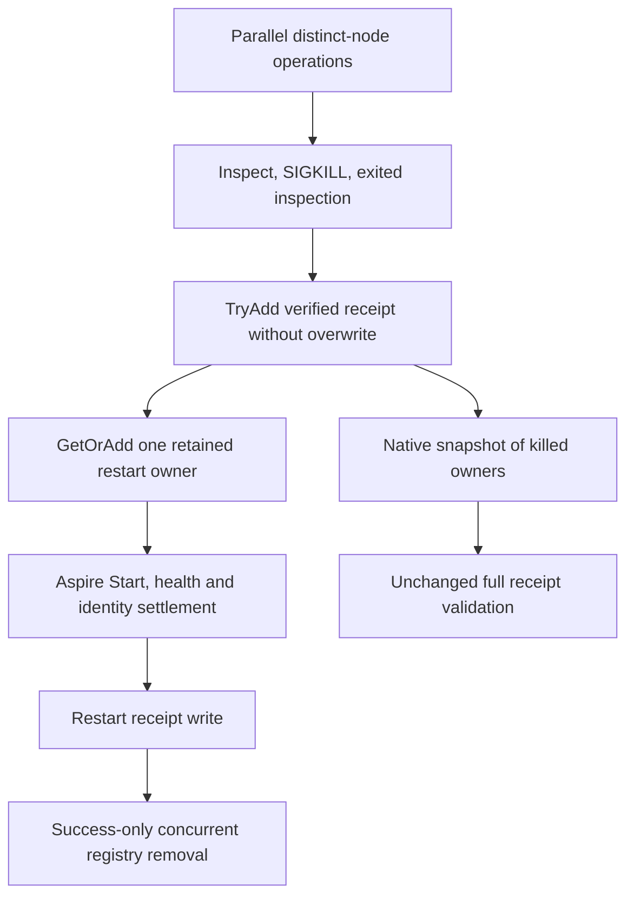

# Concurrent container runtime receipts

The ClusterReplication test fixture owns real SIGKILL operations (through the [Aspire-owned fault command](AspireOwnedFaultCommands.md)) and Aspire resource restarts. Distinct node operations deliberately run concurrently in the `ModelSqlClusterCold` whole flow, so the fixture's kill/restart bookkeeping must support that concurrency. [ADR-117](../../ADR/ADR-117-native-tunit-ci-entry.md) retains native TUnit fixture ownership, and [ClusterReplication](../ClusterReplication.md) retains the replicated-cluster, receipt and joined-cleanup contracts.

`ModelSqlClusterCold` starts three distinct real Kill calls through `Task.WhenAll`, then three Restart calls the same way. `ContainerRuntimeControl` records verified kill receipts and selected restart owners in concurrent registries. `ContainerRestartOwnership`'s constructor owns only scalar/reference state; it performs no native Start or external resource acquisition. The shared `ClusterFailureReceipts` file writer uses its own brief native `Lock`.

## Requirements and acceptance

- REQ-CLUSTER-RUNTIME-LEDGER-001: preserve genuine parallel distinct-node kills and restarts. Use native `ConcurrentDictionary` for metadata operations; do not introduce global async serialization, alter `Task.WhenAll`, retry native work, widen a timeout or ignore an exception.
- REQ-CLUSTER-RUNTIME-LEDGER-002: retain each complete verified kill receipt under its ordinal resource key. The running inspection, full container ID, image identity, stopped inspection, scenario, stdout/stderr and UTC kill interval remain exact. `TryAdd` publishes once and refuses a competing existing entry with the pending-owner failure instead of overwriting it.
- REQ-CLUSTER-RUNTIME-LEDGER-003: `GetOrAdd` returns one stored `ContainerRestartOwnership` per resource. Its value factory allocates state only; the returned stored owner alone executes `AcceptAsync`. Both missing-receipt failure paths, the attempted/StartAccepted/replacement fences and success-only key removal remain. Concurrent restart of the same resource is not claimed as supported.
- REQ-CLUSTER-RUNTIME-LEDGER-004: `RequireKilledOwners` captures one native `ToArray` snapshot, converts it to an ordinal dictionary and applies the unchanged validator. Its returned receipt set remains stable if the live registry later changes. Application-reference, resource-count/key, full container ID, running/exited state, image and start-timestamp checks remain mandatory. A receipt snapshot does not establish storage, thread or process joinedness.
- REQ-CLUSTER-RUNTIME-LEDGER-005: keep every container-command task, bounded stdout/stderr reader, exit/termination join, Aspire Start/readiness operation, receipt write, cancellation and failure capture unchanged. Registry safety does not suppress native failures.
- AC-CLUSTER-RUNTIME-LEDGER-001: `SafeProjectorOperationClusterTests.SafeSourceAliasesRoundtripAndCurrentCdcSdkOfficialMcpRemainExactAcrossTwoColdRestarts` runs two cold cycles over the original volumes with parallel three-node Kill/Restart, exact public .NET SDK/official MCP results, replay oracles and immutable earlier receipt file bytes through `ModelSqlClusterColdOwnership`. The whole operation is the regression; no mock dictionary or per-guard microtest is added.

Native contracts used: [ConcurrentDictionary.ToArray](https://learn.microsoft.com/en-us/dotnet/api/system.collections.concurrent.concurrentdictionary-2.toarray?view=net-10.0), [TryAdd](https://learn.microsoft.com/en-us/dotnet/api/system.collections.concurrent.concurrentdictionary-2.tryadd?view=net-10.0) (refuses an existing key) and [GetOrAdd](https://learn.microsoft.com/en-us/dotnet/api/system.collections.concurrent.concurrentdictionary-2.getoradd?view=net-10.0) (returns the stored winner; its allocation-only factory may run more than once without duplicating native Start). This is test infrastructure only, with no product API, provider, serializer alias, stored format, UI or benchmark change.
