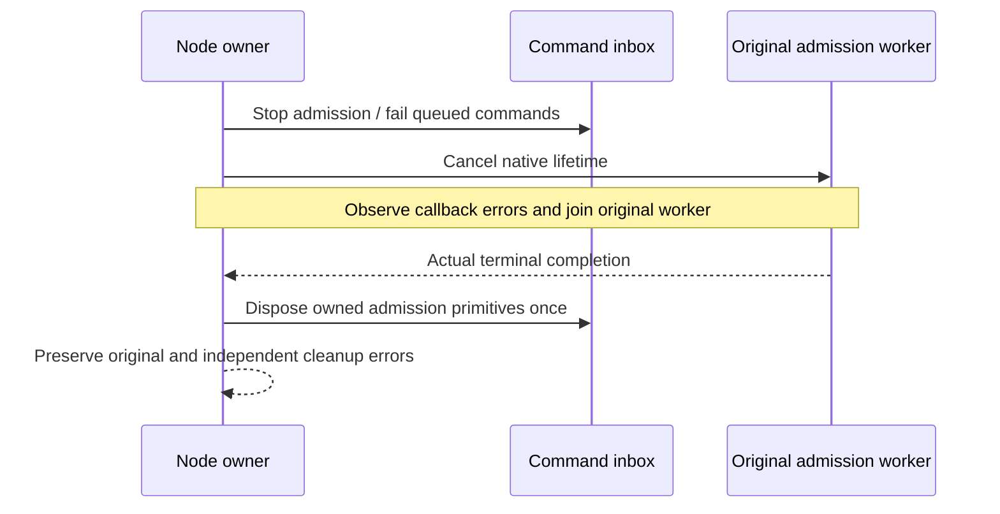

# Native coordinator shutdown ownership

KL-017 / KL-020; architecture-v0.3.uk.md lines611–639; ClusterReplication AC-REP-001/002/004. This change repairs admission-owner lifetime, not consensus provider selection or a durability upgrade. Native Azure Orleans membership, signed discovery, RF3 acknowledgement, node-local PartitionHost ownership and atomic/physical identities remain unchanged.

REQ-CS-001 / AC-CS-001: stopping the node first closes its actual command inbox. Cancellation callback failure must not bypass the original admission worker. Cancellation and worker tasks both settle before shutdown becomes terminal; queued and dequeued commands release their own actual reservations and retain typed unknown outcomes. Caller cancellation only abandons that caller's wait.

REQ-CS-002 / AC-CS-002: concurrent disposal aliases share one original terminal task. Observe the initiating stop error and independently join inbox disposal and lifetime disposal; preserve all original failures. Never dispose the lifetime/inbox while its original worker is still live. If worker completion is unknown, the original task stays pending and physical storage cannot be released by a successful coordinator shutdown.

REQ-CS-003 / AC-CS-003: the native regression uses the actual lifecycle implementation, real admitted commands, canonical ZoneTree state and a real File.OpenRead failure in a native cancellation callback. The original worker is held by test-owned synchronization, not an alternate replica transport or fake provider. Stop must remain pending while that worker is held, even after callback failure. Complete queue/outcome and canonical-image checks precede release, healthy operation/full receipt replay and two genuine same-root cold opens. Cleanup initiates actual cancellation before releasing held work, joins every original operation task and suppresses only already-asserted exact expected error instances. Unknown physical close retains the test root; repeated Dispose is not closure proof.

The same case also constructs actual ReplicaMaterializer/ReplicaConsensus/ClusterCoordinator over the real canonical engine and separate native RF3-scoped replica store, submits an admitted command while no transport is attached, then requires actual coordinator stop, unknown outcome, full admission return, unchanged image and shared repeated disposal. The subsequent healthy receipt uses the configured QuorumProcessDurable enum as a serialization oracle only; no native transport, quorum ACK or RF3 durability credit is inferred. The test's callback-controlled lifecycle worker is not the production RF3 consensus worker; it exercises the exact extracted native shutdown contract and real storage operations without a new product fault seam. Existing ReplicaProcessRecoveryTests original durable ACK/kill cases and ClusterTests.ReplicatedAtomicBatchSurvivesLeaderContainerKillAndMinorityRejectsWrites remain required process/RF3 gates; SDK/official MCP and graceful complete-server restart are separate qualification. The current container fixture provides kill/start, not a native graceful-stop observation, so this packet does not claim that evidence. Compiler, native TUnit, process/RF3, coverage and exact-source Linux gates remain OPEN. No SDK/build/test or benchmark execution was performed by this SourceN author.
