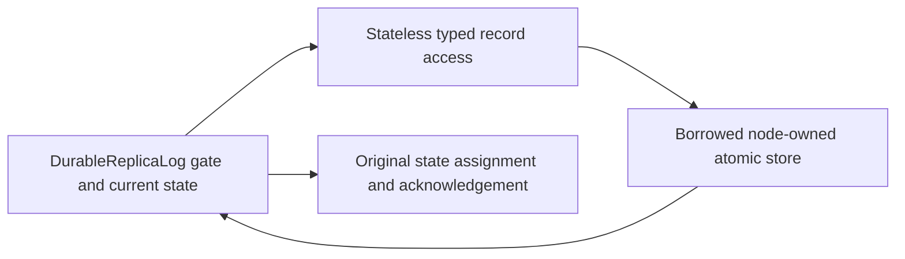

# Durable replica record responsibilities

Canonical slice: ClusterReplication. [REQ-REP-002/003/004 and AC-REP-002/003/004](../ClusterReplication.md), [CodeQuality REQ-CQ-006 / AC-CQ-008](../CodeQuality.md), [ADR-033](../../ADR/ADR-033-code-quality.md), [ADR-036](../../ADR/ADR-036-orleans-foundation.md) and [ADR-061](../../ADR/ADR-061-bounded-replica-term-metadata.md) remain authoritative.

REQ-REP-RECORD-ROLE-001 / AC-REP-RECORD-ROLE-001: DurableReplicaLog retains the public contract, borrowed node-owned store/canonical database, gate, current hard state and term-observation field. A stateless feature-local Storage helper owns the existing synchronous term/entry reads, raw append entry/state writes and hard-state write. The original method64/type200/file400/nesting3 limits apply without exemptions or new partial types.

REQ-REP-RECORD-ROLE-002 / AC-REP-RECORD-ROLE-002: all helper calls retain the existing Log gate. Preserve snapshot/index bounds, exact safe errors, generated binary record format and admitted decoding, bounded cache update, vote/commit state validation, atomic append batch/write order, Begin/commit/ACK order, original fsync/storage durability, state assignment only after successful persistence, crash observer boundaries, ProtocolGate release and disposal. No new lock, task, timer, replay, quorum policy, provider or cleanup ownership is introduced.

Existing replica log/unit, actual CrashHost interruption/reopen and Aspire RF3 whole-operation tests are the regressions; original IDs, fault boundaries, deadlines, full prefix/authority/outcome oracles and joined lifetimes remain unchanged. Source restructuring and build do not prove process recovery, power-loss durability, endurance or performance. These qualification gates require their original exact-source results.

Map: src/KeyLoad.Replication/Features/ClusterReplication/Storage/DurableReplicaLog.cs owns protocol/state/lifetime; Storage/ReplicaLogRecordAccess.cs owns private synchronous record access and exact atomic record writes. Frontend, new public API, serialization-contract changes and topology changes are N/A because this scope preserves the existing replication implementation.
