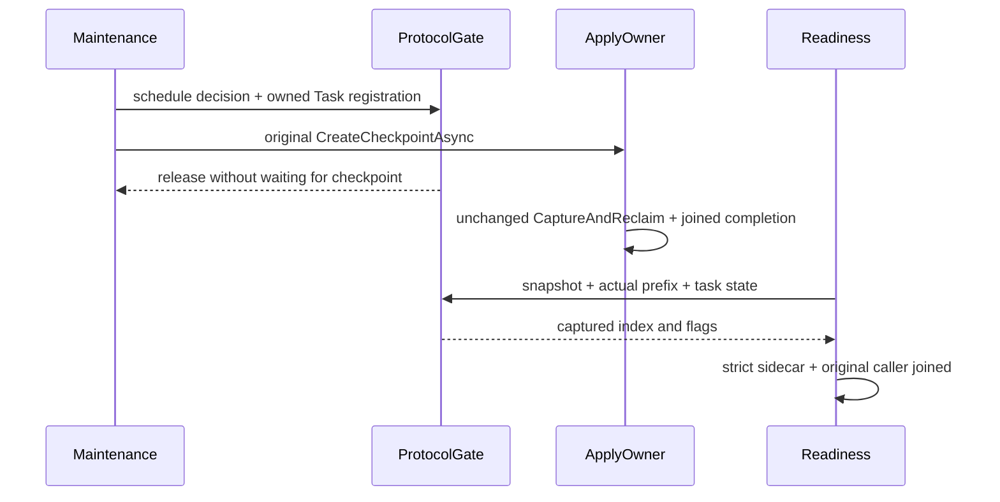

# Empty follower snapshot readiness

Future-stage source proposal; not joined or runtime qualified. Refines REQ-REP-004 / AC-REP-004.

- REQ-EMPTY-SNAPSHOT-READINESS-001 / AC-EMPTY-SNAPSHOT-READINESS-001: schedule decision and original checkpoint Task registration share the existing protocol gate with local StateAsync sampling. Ordinary StateAsync stays unchanged and cheap: nullable flags are null (unsampled). Only existing authenticated armed SnapshotReadiness initial/poll callbacks invoke ReadCheckpointStateAsync under the protocol gate; that deep observation exposes actual HasCheckpointPrefix and CheckpointPending. Null never qualifies. faulted checkpoint retains Poison/RecoveryRequired InvalidSnapshot. Never await checkpoint under protocol gate.
- REQ-EMPTY-SNAPSHOT-READINESS-002 / AC-EMPTY-SNAPSHOT-READINESS-002: append Orleans IDs9/10 while preserving0..8 and aliases. Same-build qualification requires strict JsonRequired sidecar flags at producer and reader; unknown/missing fields refuse. Existing8192 record /1MiB aggregate /400 files /32 arms /8 markers /4 callback caps are unchanged. No mixed-version readiness promise.
- REQ-EMPTY-SNAPSHOT-READINESS-003 / AC-EMPTY-SNAPSHOT-READINESS-003: actual captured index returns only after original status caller, settlement and ProducerDisposed joins. Retain original caller failure and cleanup errors. Remove intermediate restart before original tail, keeping threshold16, full image/checksum/hardstate, exact retained operation/index/term, native prefix verification, healthy/replay/cold oracles and original deadline. Readiness is an observation, never a future capture fence; covered or missing tail fails.

Automated mapping: new native Recovery prefix-state regression plus existing KL079 whole RF3 operation. Pending/cancel/fault scheduler source is supplied below through the separate real3 fixture successor; its original Recovery fixture still starts Materializer directly and does not stand in for maintenance ownership. Runtime proof remains OPEN. Compiler, Linux, genuine RF3 and runtime verification of the final stopped-store prefix scan remain OPEN. The same final closed native view now scans the real checkpoint prefix and refuses any row through currentSnapshot.Index; the obsolete intermediate installed-state read is removed coherently. CaptureAndReclaim and native verified-prefix reclamation are unchanged.

## Native maintenance-owned fixture successor

REQ-EMPTY-SNAPSHOT-MAINTENANCE-001 / AC-EMPTY-SNAPSHOT-MAINTENANCE-001: existing genuine three-silo TestCluster retains production ReplicaConsensus/PartitionReplicaGrainService/ZoneTree owners. Optional typed TEST-fixture setup performs identical native term1/noop log1..2, real applied1/image1/verified fingerprint then applied2 BEFORE transport attach on each owner. No new product hook, threshold, clock, transport or fabricated checkpoint Task. The selected actual Primary voter pauses its original native SnapshotFlushed callback; deep state must observe actual pending/prefix while ordinary state stays unsampled. Original StopAsync cannot complete before flush release and is then directly joined; fixture drains every original owner.

REQ-EMPTY-SNAPSHOT-MAINTENANCE-002 / AC-EMPTY-SNAPSHOT-MAINTENANCE-002: the separate case throws literal IOException from the actual SnapshotFlushed callback AFTER the real canonical file Flush(true), BEFORE ReplicaSnapshotStore describes/verifies/moves/publishes the candidate. The old published verified image remains exact; deep and ordinary state must reject with real RecoveryRequired. Original Stop/Dispose terminal errors must contain ONLY that exact original IOException (aggregate nesting is traversed); any unrelated cleanup failure fails and remains in the primary+cleanup ledger. No synthetic successful cleanup or error normalization.

Tests: ReplicaMaintenanceCheckpointTests two genuine native cases; prior prefix/readiness whole RF3 cases remain. Default cohort constructor/setup remains unchanged for all existing consumers. Test-runner invocation still belongs to the unchanged Aspire-owned Unit entry point. This native TestCluster scope does not qualify Docker RF3 or power loss. Compiler, runtime, Linux, exact original failure/cleanup shape and genuine RF3 remain OPEN.

Optional native fixture startup-failure and general shutdown release the SAME callback pause before awaiting original consensus/host disposal. This does not mark a checkpoint complete: only its actual original task/shutdown join does. Direct cancellation case deliberately observes the original Stop task before explicit pause release.

## Source-proven affected whole-flow mapping

KL079: fresh native references prove EmptyReplicaSnapshotRf3Tests.ErasedFollowerInstallsNativeSnapshotAndOrderedTailBeforeCompletePublicReplayAndHealthyContinuation awaits EmptyReplicaSnapshotScenario.RunAsync; that scenario is the sole current caller of both EmptyReplicaSnapshotReadiness.RequireAsync and final EmptyReplicaSnapshotStorage.ReadReplicaState. Preserve that complete original SDK/MCP replay/healthy/error/image/checksum/hardstate/retained-tail flow and UID.

KL035: retained authenticated run38199970086/job114650995144, sourcebb164763063c88046f094ab101732eb98f5d3d68, selects this SAME EmptyReplicaSnapshotRf3Tests case. Its original TaskCanceledException after3m11.844 at Scenario.RunAsync/ServerFailureObserver is preserved separately from KL079 retained-tail evidence. This proposal directly changes that selected flow, but no inner cancellation phase or repair of that specific failure is proven; both qualification gates remain OPEN. The separate retained-follower case passed in that original run and remains distinct.

Root Storage R2 is selected coherently: original missing-tail refusal is still first. If the actual current snapshot is missing after the original tail is found, record the same bounded HardState/cut evidence (hasEntry=true) before throwing. Otherwise require real checkpoint-prefix absence through the current published snapshot and decode the exact retained native entry. This final closed-store check remains the authority; metadata observation never replaces it.

REQ-EMPTY-SNAPSHOT-MAINTENANCE-003 / AC-EMPTY-SNAPSHOT-MAINTENANCE-003: post-start Entered and fault-fence observations share the existing fixture StartupBound45s with TimeProvider.System, linked to the original caller token. Expiry is an original qualification failure; the SAME pause is released and original Stop(None)/Dispose tasks are directly joined afterward. No product timeout or checkpoint task is replaced. Native configurator registers IReplicaEndpoint as EXACT node.Journal.Consensus and production PartitionReplicaGrainService.Init attaches that same owner.
