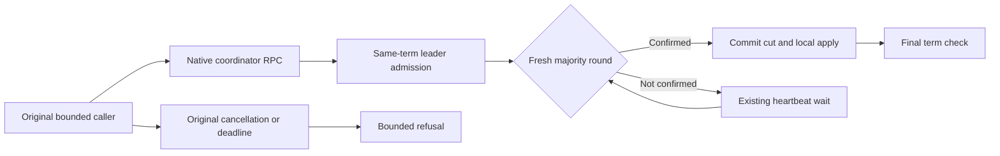

# Native replica coordinator deadlines and same-term read confirmation

This refines REQ-REP-003 and AC-REP-003 in the
[replication contract](../ClusterReplication.md), under
[ADR-036](../../ADR/ADR-036-orleans-foundation.md) and
[ADR-136](../../ADR/ADR-136-native-orleans-partition-ownership.md).

| Requirement | Completion criterion |
| --- | --- |
| REQ-REP-RPC-DEADLINE-001: coordinator RPCs retain the existing enclosing read or command deadline at both transport layers and the receiving endpoint. | AC-REP-RPC-DEADLINE-001: a real three-silo read/control barrier arrives while leader admission is held, remains pending beyond the constituent RPC deadline, then returns the correct committed state and stable-ID replay. |
| REQ-REP-RPC-DEADLINE-002: every successful read confirms a fresh majority in the original term; cancellation and unavailable-majority refusal remain bounded. | AC-REP-RPC-DEADLINE-002: selected cancellation leaves the original operation live; stopping both remote protocol owners refuses at the existing read deadline without canonical effects. |
| REQ-REP-RPC-DEADLINE-003: interrupted forwarding preserves write uncertainty. | AC-REP-RPC-DEADLINE-003: no timeout can turn an uncertain forwarded write into a definite pre-admission refusal; exact-source Linux forwarding/fault qualification remains open. |
| REQ-REP-RPC-DEADLINE-004: the receiving read deadline is independent of the command deadline; read interruption cannot report write uncertainty. | AC-REP-RPC-DEADLINE-004: genuine cross-silo application/control reads with command5s/read10s remain pending beyond5s without a majority, then refuse within the original10s bound as OwnershipLost, with the original caller live and canonical state unchanged. |

The first two criteria map to
[ReplicaCoordinatorBarrierDeadlineTests](../../../tests/KeyLoad.UnitTests/ClusterReplication/Cases/Replica/ReplicaCoordinatorBarrierDeadlineTests.cs).
The fourth criterion maps to
[ReplicaReceiverBarrierDeadlineTests](../../../tests/KeyLoad.UnitTests/ClusterReplication/Cases/Replica/ReplicaReceiverBarrierDeadlineTests.cs).
Actual public-client qualification remains the separate
[functional database gates](../DatabaseComposition/FunctionalDatabaseGates.md).
These mappings record required evidence, not passing results.

The native RF3 read barrier confirms a fresh current-term majority and local ordered apply. Its existing `ReplicaExecutionOptions.ReadBarrierTimeout` is the whole-operation read bound. A forwarded command uses the existing `CommandTimeout`. Both replica RPC layers select those existing bounds for `ReadBarrier`/`ControlReadBarrier` and `Forward`, respectively. Constituent vote, append, read-probe and snapshot RPCs continue to use `ReplicaConfiguration.RpcTimeout`. The original caller token remains linked through both layers, so a nested operation cannot extend the caller's existing whole-operation deadline. No configured limit is increased.

`ReplicaLeader.BarrierAsync` retains the admitted original term and the same exclusive round owner while waiting for a fresh successful protocol round. A false round waits the existing heartbeat interval and attempts another same-term round within the original caller/read deadline. This is native quorum confirmation, not a repeated public SDK/MCP operation. Every successful result still requires a newly acknowledged round, same-term commit position, original local apply and a final same-term leadership check. Term changes refuse through the existing `RequireLeader` checks; an unavailable majority still refuses at the unchanged deadline.

The existing follower admission remains zero-wait. At most one original synchronization RPC holds each remote-voter gate; a busy gate returns false and creates no queued semaphore waiter. A majority-completed round can leave its other original follower task running under its existing RPC deadline. Later attempts do not enqueue another follower behind it. Existing follower gate release and `followers.DrainAsync` retain physical shutdown ownership. No acknowledgment from an earlier round is reused as confirmation of a later read.

Forward interruption remains an unknown write outcome. The outer RPC owner's own timeout now preserves `UnknownWriteOutcome` for `Forward`, matching the native transport's existing contract; pre-dispatch missing transport/leader refusal and genuine caller cancellation keep their existing behavior. Stable command IDs, durable admission, receipts and ordinary replay remain unchanged.

The native transport now requires the existing `IOptions<ReplicaExecutionOptions>` constructor dependency before its optional clock. Product DI already binds that policy. The in-process native Unit cohort passes the exact policy retained by its original replica journal. The process-recovery native fixture passes its existing validated `RecoveryExecutionOptions.Replica()` policy, matching its original node owner. There is no fallback options object or new provider.

Peer envelope freshness is independent of operation deadlines and remains unchanged. A configured envelope lifetime shorter than an operation can legitimately refuse an expired reply. Native generation rediscovery, bounded attempts, authenticated request/reply bytes, readiness and Orleans membership remain unchanged. The receiving endpoint selects the existing read bound for application/control barriers independently of the command bound. All other incoming methods retain their existing command deadline. A canceled forwarded write preserves unknown-write-outcome; other canceled protocol methods return ownership-lost refusal.

R447's retained peer-round failure and observed system stalls motivate this repair, but do not independently prove which timeout fired or an Orleans membership loss. The source establishes the two nested operation/constituent deadline mismatches and the synthetic busy-gate false-round path. Companion genuine native three-owner whole-operation regressions, strict compilation, local one/three functional gates and exact-source Linux qualification remain required. This source change is not a runtime acceptance claim.
