# Native failed-ACK reconciliation across cold owners

KL-017 Consensus provider qualification, REQ-REP-002/003 and AC-REP-002/003. Extend the existing NativeSubmissionFaultRf3Tests.GenuinePostCommitLogFaultReturnsUnknownAndOriginalCommandReconciles declaration for its original SDK and official MCP arguments. Do not introduce another scenario, synthetic transport, clock, trusted role, format, timeout or topology.

REQ-FAILED-ACK-COLD-001: preserve the original actual native local append failure marker, UnknownWriteOutcome response, marker/producer disposal, exact original command retry, full canonical StoredOutcome and original signed replica journal inspection on each of all three stopped database owners. These inspections remain before any new cold continuation, so later elections/checkpoint retention cannot invalidate the original retained-entry oracle.

REQ-FAILED-ACK-COLD-002: resume only after the original clients and original Aspire wave actually stop successfully and native admission owners report joined. Reuse the same original data root, persisted profile, controls, exact captured image map and original local image selection. Track the new acquired wave before acquiring new clients. A failed close cannot reopen; failed startup/operation/cleanup retains the original root and complete independent failures through the original owner cleanup.

```mermaid
flowchart LR
 A[Original native append fault] --> B[Unknown then stable original retry]
 B --> C[Original all-three stopped outcome and journal proof]
 C --> D[First actual same-volume cold RF3]
 D --> E[Both clients original receipt and fresh healthy command]
 E --> F[Second actual same-volume cold RF3]
 F --> G[Both original and healthy exact receipt replay]
 G --> H[Actual joined original-owner shutdown]
```

AC-FAILED-ACK-COLD-001: both actual cold waves preserve physical node/cluster/incarnation/voter identities and replace native silo addresses using signed current discovery. Existing persisted non-admin credentials work through SDK and official MCP; the same identity cannot read cluster-admin placement. Replay returns the complete originally observed public receipt and exposes no private composition references. The original document is independently expected at revision3 with the original baseline JSON, because the retained existing retry helper already performs its genuine healthy update after original revision2; never rerun that helper as though revision2 were still current.

AC-FAILED-ACK-COLD-002: first cold commits a distinct document at revision1 through the real non-admin SDK, checks an independent literal mutation/durability and actual native placement/status bounds, and replays the same complete receipt through both clients. Second cold replays both original and healthy commands and checks both full documents, unchanged placement and current non-admin denial again. Every cold catches up all three original nodes before the actual joined stop. Original first-wave correctness, failed ACK, raw stopped journal and receipt oracles remain byteexact.

These are executable source changes, not runtime evidence. Semantic compilation, original two SDK/MCP RF3 cases, Linux exact-source artifacts and required failure/endurance/power-reset qualification remain OPEN. Process restart does not establish power-loss durability or consensus-provider acceptance by itself.

Client DTO reflection checks cover the public client default only. They do not establish a native stored-private composition invariant or a raw wire-payload privacy gate; those require their own original producer/wire evidence.
