# Native Orleans replica discovery

Canonical slice: ClusterReplication. Parent: [ClusterReplication](../ClusterReplication.md). Decisions: [ADR-036](../../ADR/ADR-036-orleans-foundation.md), [partition movement](../ClusterRouting/NativePeerTransport.md). Source and runtime qualification remain OPEN.

Orleans owns cluster membership and networking. AppHost owns native Azure Table clustering backed by Azurite for actual RF3 development/qualification. Resolve an opaque canonical configured voter using its actual Active Orleans SiloName and full SiloAddress generation. Never infer an address from its public HTTP identity, resolve DNS for peer discovery or use a fixed silo port. Physical RF3 voter groups and incarnation remain distinct from the joined native cluster.

```mermaid
flowchart LR
    Voter[Configured canonical voter] --> Oracle[Bounded Active native membership and exact SiloName]
    Oracle --> Address[Unique actual full silo generation]
    Address --> Service[Addressed existing replica Grain Service]
    Service --> Auth[Current caller and nonce authentication]
    Auth --> State[Actual node-local readiness and protocol metadata]
    State --> Reply[Exact native bytes and bound authenticated reply]
    Reply --> Current[Recheck current native generation before cache]
```

| Requirement | Measurable acceptance | Automated mapping / open gate |
|---|---|---|
| REQ-NATIVE-DISC-001: use unique Active actual SiloName/generation for voter resolution and cached observations. | AC-NATIVE-DISC-001: actual same-name cold replacement yields a different full generation; stale cached generations, ambiguity and missing/dead native rows cannot route an RPC. Recheck after RPC and on cache use. | Native membership/client tests and Aspire RF3 SDK/MCP restart with original authenticated native witnesses; runtime OPEN. |
| REQ-NATIVE-DISC-002: metadata is read from the addressed native replica service, independent of quorum. | AC-NATIVE-DISC-002: preserve exact voter/cluster/incarnation, TransportReady, ApplicationRpcVersion, PeerEnvelopeVersion and RuntimeJournalReaderContract. Signed incompatible protocol or omitted journal contract refuses cohort admission; native presence alone never proves storage readiness. | Existing cohort/startup and armed discovery-omission RF3 oracles adapted to native callbacks; runtime OPEN. |
| REQ-NATIVE-DISC-003: authenticate current caller, exact target, fresh original nonce and deadline before metadata observation. | AC-NATIVE-DISC-003: malformed/wrong group/current caller/address/nonce/MAC requests return no metadata success; original payload/signature substitution and late generation changes cannot enter the cache. | Real native addressed service request/refusal tests; external wrong-caller/MAC RF3 invocation seam remains OPEN and may not be replaced by a fake oracle. |
| REQ-NATIVE-DISC-004: bound native work and join actual shutdown. | AC-NATIVE-DISC-004: retain MaximumRows, MaximumAdmissions, separate ReplayNonceCapacity/ReplayLifetime and original RpcTimeout; <=16384 payload bytes, bounded header strings and signatures. Close admission, cancel and join every actual call before endpoint shutdown/MAC disposal; exceptional startup DI disposal uses the same join. | Native cancellation/admission/replay/lifecycle tests and actual Aspire cleanup; runtime OPEN. |
| REQ-NATIVE-DISC-005: scoped diagnostic observation follows authenticated native work. | AC-NATIVE-DISC-005: original armed omission can change only selected bounded metadata before signing; original actual source/target full generations and nonce bind safe witness files. No incoming HttpContext or artificial IGrainContext represents native RPC. No observer means unchanged actual metadata. | Existing foreground SDK/MCP native omission witness tests; full source-path/caller cleanup oracles remain mandatory. |
| REQ-NATIVE-DISC-006: local native membership health is distinct from database readiness. | AC-NATIVE-DISC-006: ReadActiveMembership returns a bounded immutable current Active SiloName/full-SiloAddress view under the same joined admission owner. Missing names, ambiguous live generations, quota excess, noncurrent local identity or shutdown refuse. The view has no physical registration, journal/cohort or data-readiness predicate; the health handler verifies the exact intended six native silos and fingerprints actual names/generations. | Original six-silo membership profile and physical-owner registration cases retain /health/ready503 and SDK/MCP OwnershipLost while native membership health allows Aspire startup. Actual RF3 execution remains OPEN. |

The existing IPartitionReplicaGrainService appends DiscoverAsync with stable method alias discover. Generated request alias keyload.replica.native-discovery-request.v1 has IDs Version0, CallerVoter1, CallerSiloAddress2, DestinationVoter3, DestinationSiloAddress4, Nonce5, ExpiresAt6, Signature7. Generated reply alias keyload.replica.native-discovery-reply.v1 has IDs Payload0, original DiscoverySignature1, Nonce2, nullable Error3, fresh outer Signature4. Protocol Version1 does not relabel existing application or replica-envelope versions.

Native authentication reuses the existing ReplicaMessageMac discovery primitive and configured fixed-group secret/incarnation. A generated domain frame carries separate request/reply purpose and SHA256 of the exact unsigned generated DTO; all fields and original payload/signature are covered without reducing the existing payload capacity. Requests are immutable; replies are bounded before allocation and owned before verification/cache. Error replies contain no payload, original discovery signature, exception or caller data. Verify successful original discovery bytes with the unchanged original MAC as well as the new bound outer reply.

Signed expiry is UTC; infer its fixed original issuance only as ExpiresAt minus original RpcTimeout and apply the existing freshness policy. Receiver elapsed work is capped by min(RpcTimeout, actual remaining expiry). Native metadata nonces use their separate bounded disposable pool, not consensus replay capacity. Canonical peer option validation no longer requires HTTP endpoint metadata or a socket connection timeout. Transitional constructor fields are not used for routing and must be removed with their complete owning call-site closure; they are not a fallback.

The local read-only membership view uses generated ReplicaNativeMembershipEntry with SiloName0 and SiloAddress1 and stable alias keyload.replica.native-membership-entry.v1. It borrows the actual native oracle, copies at most MaximumRows current Active entries, retains strict UTF-8 MaximumAddressBytes limits and returns deterministic ordinal name ordering. It does not register members, perform remote HTTP queries or replace native provider state. /health/membership-ready consumes that view only; /health/ready retains its original database admission contract.

Orleans/ClusterReplication Discovery, Authentication, Contracts and GrainServices own this code. Server/ClusterReplication owns the optional existing bounded omission observer. AppHost/provider/settings/physical-owner trust and HTTP Authority/Proxy removal belong to the integration owner's concurrent native hosting stage. Unit, process recovery and real Aspire Docker RF3 SDK/official MCP qualification remain mandatory. Frontend N/A; no public client protocol is added. Do not delete old test oracles before their actual native successors qualify. Source/patch checks, compilation and process restart do not prove power-loss durability, performance or production readiness.
