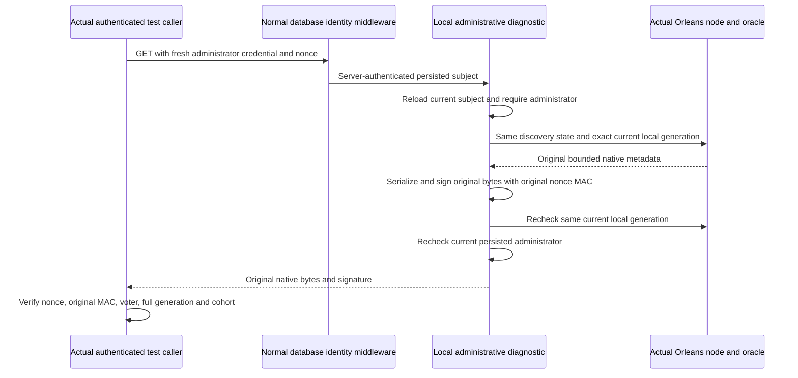

# Native silo discovery fixture diagnostics

This `ClusterReplication` supplement specifies a fixture-only local administrative metadata view. Native Orleans discovery and Grain Services remain the database cluster communication path. The diagnostic source and original reader successors are prepared; compilation and operation qualification are open.

The existing instrumentation enables this route only when `NodeOptions.RequestCqrsProbe.Enabled` or `NodeOptions.NativeDiscoveryOmission.Enabled` is true. Otherwise it is absent and returns 404. Closed profiles retain their native membership/fingerprint evidence. This view has no database effect and cannot qualify a .NET SDK/MCP database operation or RF3 behavior by itself.

| Requirement | Contract | Acceptance |
| --- | --- | --- |
| REQ-NATIVE-DIAGNOSTIC-001 | Map the closed fixture-only GET path `/api/admin/native-silo-discovery` outside middleware's `/health` and `/internal` exemptions. Require exactly one `nonce` containing a nonempty Guid in `D` format and no request body. | AC-NATIVE-DIAGNOSTIC-001: disabled instrumentation has no route; missing, extra, malformed or empty nonce and a body are refused without exposing metadata. The source maps through the original normal admission and database credential middleware. |
| REQ-NATIVE-DIAGNOSTIC-002 | Reload the middleware-authenticated subject through the owning current persisted authority API and require its existing administrator contract before reading and before returning. Caller-supplied roles have no authority. | AC-NATIVE-DIAGNOSTIC-002: real unauthorized, revoked and changed-policy principals cannot obtain accepted metadata; a genuine current administrator can. Healthy Integration callers carry their actual profile administrator credential. |
| REQ-NATIVE-DIAGNOSTIC-003 | Borrow the same `OrleansNode.Discovery.Read()` and authenticator. Require the actual joined node, transport readiness, unique exact local voter name and full current native silo generation before and after serialization. | AC-NATIVE-DIAGNOSTIC-003: original reader checks retain exact voter/full address/cluster/incarnation/reader contracts; stale, missing or changed generation refuses publication. No state is constructed from health counts, public endpoints, DNS or fixed ports. |
| REQ-NATIVE-DIAGNOSTIC-004 | Serialize within the original discovery bound, without omission or transformation, and sign the original payload through `Authentication.SignDiscovery(payload, nonce)`. Return `application/octet-stream` and `X-KeyLoad-Native-Discovery-Signature`. | AC-NATIVE-DIAGNOSTIC-004: actual SDK/MCP marker and ANN fixtures verify the original nonce-bound native signature over the exact bytes. Malformed signature or payload fails their original verifier; endpoint responses do not imply database readiness. |

Implementation lives in `src/KeyLoad.Server/Features/ClusterReplication/{Contracts,Diagnostics}/` with one guarded shared `ServerConfiguration.Build` Map statement. Original Integration reader/callers remain in their canonical test slices and use actual profile credentials; a diagnostic collector without authenticated context must retain explicit unobserved evidence. Frontend, public operation/tool catalogs and persisted database models are N/A.

This view does not receive peer coordination requests, change cluster membership, transform omitted metadata, issue database commands, replace request/connection execution, or own a second credential/runtime instance. Actual native discovery negative tests, original public SDK/official MCP flows, build, process recovery and fixture-owned Aspire RF3 Linux qualification remain mandatory. Private source composition is not a runtime result.
