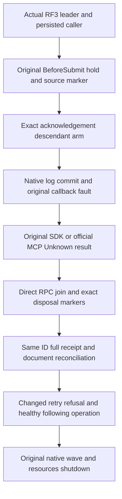

# Native RF3 submission fault qualification

This narrows AC-REP-SUBMIT-004 within the existing RequestCqrs diagnostic file-profile, native Orleans replica communication and PartitionHost physical ownership. It introduces no public database operation, transport, persisted format, trusted caller role, released wire identity or alternate fixture. Main owns shared composition/integration/SDK/Git; all implementation here is a private guarded source packet.

REQ/AC-REP-SUBMIT-FAULT-001: append only the internal diagnostic ReplicaEntryAcknowledged phase, preserving every existing phase identity. This phase accepts only ThrowOrdinary, nonempty command ID, no read kind, a complete actual partition, target voter and distinct nonempty source arm/request IDs. Preserve existing validation branches. The source arm must be a genuine same-session/principal/command BeforeSubmit Hold. Additionally require its actual Observed BeforeSubmit marker with matching source request/arm/command/session, native target voter and full source silo address. Arm metadata alone is insufficient original-request evidence. New phase markers require original positive entry index/term and retain the source request ID; no fabricated request context or grain context.

REQ/AC-REP-SUBMIT-FAULT-002: actual PartitionHost passes an observer to its original DurableReplicaLog constructor only when its already configured RequestCqrs probe is enabled. The original callback invokes only on EntryAcknowledged after the actual store.Commit and state assignment. It reads the genuine retained native last entry through the same owning log, then forwards through the already attached ApplyProbe owner. The observer selects at most one exact Batch command/principal/partition/target-voter descendant arm; no match has no diagnostic effect. Decode the verified native Batch via existing Core NativeCommandPayload.Read<CommandRequest> and the already granted Server friend, without introducing JSON fallback. Preserve all actual entry validation and storage ownership.

REQ/AC-REP-SUBMIT-FAULT-003: the observer synchronously writes its bounded original marker and throws the existing ordinary diagnostic IOException with original private canary/detail. It performs no hold, await, retry, network request, role assignment, task or new resource ownership under the log gate. The existing probe lifecycle EnterCallback/ExitCallback owns callback admission and joined shutdown; retain primary, exit and marker failures. Append a distinct ReplicaEntryObserverDisposed diagnostic marker phase: the matching descendant callback writes it only after its actual lifecycle ExitCallback succeeds, retaining the same original source request, arm, session, voter, full silo and positive entry index/term. It does not manufacture a ProducerDisposed marker or imply that the original grain producer, whole observer, silo, storage or Aspire resources have stopped. The fixture waits for this actual callback marker for the descendant, the original ProducerDisposed marker for the original request, and actual whole-wave resource shutdown independently. Missing callback marker remains a failed gate; an earlier NativeAdmissionOwnersJoined value does not prove process/storage shutdown. Marker creation uses the attached genuine observer's actual voter/full-silo identity, with validated source correlation rather than ambient synthesized context. Preserve originals and exclude credentials, user content, keys and unrelated records from diagnostics. The append can remain durable without canonical apply; that distinction stays explicit.

REQ/AC-REP-SUBMIT-FAULT-004: genuine existing Aspire RF3 integration flows obtain a native current leader through original NodeStatus/discovery, bind the BeforeSubmit hold on that actual voter and retain its source marker. Arm the fixed postcommit descendant while that original operation is held; release it and await the original owned SDK or official MCP call. Require UnknownWriteOutcome, actual log marker index/term and original native log effect. Reconcile the same command ID, verify the original full persisted outcome/document after its genuine commit/apply, and execute a healthy following request. Retain actual replica membership, joined original request/hold/observer resources and owned Aspire shutdown. If the native leader identity changes, report the original evidence/failure rather than fabricate or relabel leadership. SDK and official MCP variants share the same genuine owning flow. Embedded tests, direct raw log calls and old custom ReadRound transports cannot satisfy this gate.

Canonical private implementation scope: Server Features/ClusterRouting Contracts phase; strict Validation arm/marker and actual source-marker validation; new feature-local Execution RequestCqrsReplicaLogObserver; existing RequestCqrsProbeObserver construction/property and RequestCqrsCanonicalApplyBridge forwarding; PartitionHost's original constructor observer argument and narrow callback composition. Matching Integration ClusterReplication Cases/Helpers use the original actual RF3 fixture. Existing public/native RPC, canonical store formats, role identities, source RequestContext and source-arm validator remain unchanged. Root freezes this contract before Ann writes dependent code; Producer owns original fixture-flow implementation after composition APIs are specified.

All source checks remain separate from compiler/analyzer/formatting/coverage and actual native TUnit/RF3 SDK/MCP qualification. A newly added source seam is not a proven fault or a passing runtime gate. No new active case UID or qualification count is advertised before actual discovery and execution evidence. No performance claim follows from this repair.

## Lifecycle evidence boundary

The probe lifecycle count can reach zero before the synchronous callback-disposal marker is published. Its join is insufficient evidence of marker publication or native callback return. The actual fixture directly joins the original RPC, then requires the exact callback-disposal marker and original source ProducerDisposed before arm retirement. Native wave/resource stop and file-owner lock checks remain separate mandatory gates. Preserve this ordering in later fixtures.

## Flow and acceptance mapping

| Requirement | Acceptance | Owned automated source | Required evidence |
| --- | --- | --- | --- |
| REQ-REP-SUBMIT-FAULT-001 | AC-REP-SUBMIT-FAULT-001 | NativeSubmissionFaultRf3Assertions.SourceAsync / DescendantAsync; native arm and source-marker validation | Exact persisted identity, original source correlation, actual voter/full silo and positive entry index/term. |
| REQ-REP-SUBMIT-FAULT-002 | AC-REP-SUBMIT-FAULT-002 | NativeSubmissionFaultRf3Tests SDK/MCP variants; ReplicaAppendBoundaryTests | Actual original native commit boundary and same command; private source alone is insufficient. |
| REQ-REP-SUBMIT-FAULT-003 | AC-REP-SUBMIT-FAULT-003 | NativeSubmissionFaultRf3Flow.JoinAndRetireAsync; RequestCqrsPhaseFaultCleanup | Direct original RPC join, exact callback marker, original ProducerDisposed and independent resource shutdown; retain original and cleanup errors. |
| REQ-REP-SUBMIT-FAULT-004 | AC-REP-SUBMIT-FAULT-004 | NativeSubmissionFaultRf3Tests, original RequestCqrsFaultReceiptOracle and replay continuation | Genuine SDK and official MCP Unknown result, complete original receipt/document and same-ID reconciliation, changed-retry refusal, healthy following operation and genuine native stored outcome/journal evidence. |

The complete scoped raw StoredOutcome inspection and native journal read are explicit remaining acceptance dependencies. The existing C1 boolean receipt does not satisfy either gate. The additive stopped-owner inspector and its independent assertions must retain actual identity, bounded native reads before allocation, process exit, both pipe drains and original storage locks. Compiler/analyzer/format/coverage, real process and exact-source Linux RF3 results remain OPEN until executed against the integrated image.

## Complete native inspection source

The selected successor supplies additive bounded stopped-owner full StoredOutcome and retained replica entry/hardstate readers; see [outcome inspection](NativeSubmissionOutcomeInspection.md) and [journal inspection](NativeSubmissionJournalInspection.md). Every native record is read through the original store observer before copy/decode, and ONE journal owner allowance spans actual canonical constructor reads plus replica lookup. The genuine SDK/MCP whole flows retain original replay/document/conflict/healthy behavior, join actual callback/source/process owners and all9 locks before inspection, and compare complete original native values. Source presence does not close compilation, actual process execution, RF3, full journal inventory, power-loss or endurance gates.
