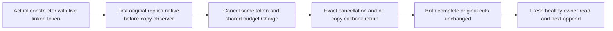

# Shared owner cancellation after constructor

REQ-001: One actual linked TestContext cancellation token owns canonical Database.Open traversal and native replica inspection under the same unchanged8192/32768 budget.
AC-001: Constructor completes while actual token is live. During the actual first borrowed replica-record BEFOREcopy observation, cancel that same token and call the actual shared Charge; exact OperationCanceledException carries that token, callback observes genuine positive native bytes and cannot return. Complete original both-store rows/positions remain unchanged.
AC-002: A fresh original owner token/budget reads exact full native state/entry, then genuine following append/commit reads its complete entry. Original fixture and actual token disposal preserve primary+cleanup failures through ServerFailureObserver.

This differs from Root Source7 canceled-before-Run: cancellation occurs only after actual canonical constructor and actual native replica borrowed-read observation has started. It does not replace clocks/storage/transport or fabricate callback success. It is source-only native kernel proof, not child process/RF3 qualification.

Source map: Unit Features/ClusterReplication/Cases/NativeSubmissionJournalBudgetCancellationCases.cs. Dependencies complete Source88 selected journal-read7r2/child16r2/realfixture plus budget Source4 fullcut helper. All compiler/runtime gates OPEN.

This case closes a source coverage boundary distinct from canceled-before-Run and ordinary observer exception cases. Actual runtime/compilation acceptance remains OPEN.
