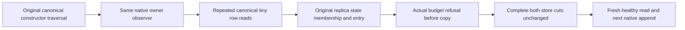

# Shared native submission inspection budget

REQ-001: Actual canonical constructor traversal, repeated canonical reads and native replica state/membership/entry reads share one 8192-byte per-record / 32768-byte cumulative owner budget. No reset or synthetic credit is permitted.
AC-001: A complete genuine native append/commit entry is read through the actual constructor and journal reader using the same budget; exact native state/entry bytes and both-store full cuts are unchanged.
AC-002: Repeated genuine tiny canonical-row reads exhaust that same budget before reader callbacks. Independently measured actual three replica lookups exceed the remaining tiny-row allowance; the actual journal helper then refuses with the owning budget error, without changing either store. A fresh owner read and subsequent genuine append/commit remain healthy.

REQ-002: All original owners preserve primary and disposal failures; cuts observe bounded bytes before copies and retain complete original rows and positions.
AC-003: Cases use the existing ReplicaAppendBoundaryFixture and full two-store cuts, bounded traversal and finite repeated reads. No replacement store, mock, counter precredit, bootstrap, consensus or RF3 claim is made.

Source map: Unit ClusterReplication/Cases/NativeSubmissionJournalBudgetCases.cs; Helpers/NativeSubmissionJournalBudgetFlow.cs and NativeSubmissionJournalBudgetCut.cs. Dependencies: complete Root journal-read Source7r2, child-owner Source16r2 and original fixture Configuration predecessor. Compilation, execution, stopped-child and RF3 gates remain OPEN.

## Both original stores share one owner

REQ-001 maps to AC-001 and AC-002 through NativeSubmissionJournalBudgetCases' two genuine native variants. REQ-002 maps to AC-003 through original fixture ownership and NativeSubmissionJournalBudgetCut. No child cumulative-denial or RF3 result is claimed from these kernel cases.
