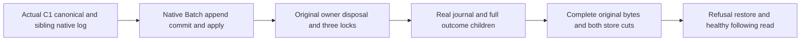

# Stopped-original native submission journal owner — proposal before C#

Private additive CrashHost ClusterReplication mode; Source14 full-outcome modes and original C1 Version2 are immutable predecessors. No Main/SDK/Git change or runtime qualification follows from this proposal.

REQ-JOWNER-001 / AC001: `c1-submission-journal-inspect`, Version1. Strict generated JSON request has exactly Version, NodeDirectory, ExpectedCanonicalNodeId, Incarnation, LocalVoter, Voters (exact ordered three original strings), EntryIndex and EntryTerm. Input <=8192 bytes; positive observed index/term, nonempty identities, unique three bounded voters containing local voter. Directory is the already captured absolute original physical node directory, not a caller-selected replacement root. Reuse C1 directory/regular-file/symlink admission; validate original node.owner.lock scope. Parent launches only after genuine Wave.Stop and all nine locks; same original process lease holds node.owner.lock until native process exit, input join, both drains and process-handle disposal.

REQ-JOWNER-002 / AC002: open original canonical `database` and replica `ReplicaProtocol.ReplicaDirectory` beneath NodeDirectory through `ZoneTreeExistingStore.Open`. Canonical expected ID comes from actual prior NodeStatus. Resolve replica identity through actual `ZoneTreeIdentityFile.Read(Path.Combine(replicaDirectory, ZoneTreePersistenceFormat.IdentityFileName), resolved.MaximumIdentityFileBytes, resolved.StreamBufferBytes)` under outer node ownership. This identity is checksum/native-format validated, then its own NodeId is supplied to replica Open. Never substitute canonical NodeId. Require both original incarnations equal request incarnation and actual stored signing keys constant-time equal privately; neither key is request/receipt material. Do not call PartitionHost, DurableReplicaLog.Open, CrashDatabase.Create, Bootstrap, snapshot recovery or any effect API.

REQ-JOWNER-003 / AC003: construct genuine DatabaseEngine with actual AuthorizationPolicy, existing validated CrashExecutionOptions native domain settings and UnavailablePartitionMovementCheckpointVerifier. Constructor is read-only but its ValidateMovementRestoration uses VisitRange; therefore use a private borrowed read-only IAtomicStore/view adapter forwarding actual native ReadValue/VisitRange with BEFORE-copy StorageReadObserver and cancellation, charging every repeated read <=8192 per record and <=32768 cumulative. Reject Commit, dispatch mutation, backup, snapshot/compact, Scan and unsupported reads. Do not invent movement absence. Root Source7 journal helper retains its own exact three native lookup bounds and original state/membership/entry/current native operation authority validation. Construct exact ReplicaConfiguration(local, original three voters, replica directory, incarnation); no benchmark override or fake policy. No disposal of the borrowed adapter may dispose the actual store twice.

REQ-JOWNER-004 / AC004: receipt exactly Version, CanonicalNodeId, ReplicaNodeId, Incarnation, CanonicalPosition, ReplicaPosition, NativeHardState, NativeEntry. Last two are full original native bytes, each <=8192; strict bounded JSON+LF <=32768. No directory/key/credentials/caller payload diagnostics or generic artifact dump. Decoded hardstate/entry remain private parent verification; raw buffers belong only to fixed fixture channel. Require retained entry after snapshot, committed index coverage and exact observed term through Source7; missing/compacted/corrupt/foreign authority fails, never reconstruct entry from snapshot/public receipt.

REQ-JOWNER-005 / AC005: parent independently binds actual marker index/term/command/principal/partition, native retained original operation/authority and actual public command payload. Receipt node identities/incarnation/positions and complete native state/entry are validated independently, not inferred expected data from child. Public full outcome/replay/document and all unrelated authority-null assertions remain separate Source14+Ann checks. No claim of full journal inventory, power-loss or RF3 qualification from a single retained-entry proof.

REQ-JOWNER-006 / AC006: CLI safe evidence phases bounded fixed names only; preserve primary+disposal aggregation and nested fatal identity using original ServerFailureObserver/C1 failures. Dispose replica and canonical actual opened stores before stdout success. Add `C1OutcomeInspectionProcess.RunSubmissionJournalAsync(input, outerOwnerLockPath, CT)` using SAME native process owner, explicit new-mode stdout32768 and stderr4096. Source14 process mode bounds stay exact; no untrusted receipt-selected budget. Structural existing application/start-info/lifetime/process hunks use Source14 predecessor plus fresh Main declaration guards, never overwrite Session repairs.

Source API evidence: existing solution snapshot c4a6a3e688124a7da4080a503a7f2721. Actual DatabaseEngine constructor calls ValidateMovementRestoration; actual CrashDatabase.Create bootstraps and is forbidden. Actual identity filename literal is `identity.json` but content is generated native envelope, so only owning ZoneTreeIdentityFile parser is valid. Replica operation authority uses canonical Store.Identity/HMAC, not invented administrator role.

Tests: Source7 genuine ZoneTree full native read/no-effects/wrong-term/foreign membership/oversize restoration cases are selected, not duplicated. New child positive/negative actual process flows must retain complete original store cut and healthy original read after refusal. All compiler/process/RF3/endurance gates OPEN. Await Root freeze before new C#.

# Root freeze before C#

Root approved CONTRACT-PROPOSAL.md SHA256 96d885cd8f7b1f2ac4a887ffa87c2e2f15e67cfaba95209be98afbdffb40c8b2 before dependent code. Private stopped-owner child and Source14 structural process supplement only. Root Source7 actual native journal reader is required. Native constructor VisitRange is observer-forwarded through the bounded borrowed read-only store/view; no fake absence, bootstrap, mutation, log open, or canonical-as-replica identity. Preserve original nested fatal/primary/disposal/process/drain/outer lock semantics and all old modes. Root and Ann own actual parent/process regressions. Compiler/process/RF3 gates OPEN; Main/SDK/Git untouched.

Implementation source note: new-mode RunSubmissionJournalAsync verifies bounded request schema and exact original outer-owner path before launching. This admission is not child malformed-schema coverage. Structurally valid wrong owner/incarnation/voters/index/term and actual corrupted/overbound rows remain real child failure flows owned by Root/Ann. Child independently repeats schema, native identity, membership, entry authority and state validations. Native read/receipt/runtime gates stay OPEN.

# Root strengthens shared native owner budget before successor C#

Root freezes ONE actual operation-owned C1SubmissionJournalInspectionReadBudget across both stores: canonical constructor's genuine movement VisitRange and every repeated read plus Root native replica hardstate/membership/entry lookups. Per observed record8192; cumulative32768; no reset between stores/cuts/repeated lookups. Root Source7r2 appends optional StorageReadObserver? additionalReadObserver = null AFTER existing CancellationToken to NativeSubmissionJournalRead.Run, invoking it before copy/decode alongside original local caps. Child passes the SAME budget.Charge to its actual borrowed canonical adapter and this additional observer. All original API callers unchanged via optional argument. Source16 is immutable and superseded for integration by Source16 + this guarded successor. No Main/SDK/Git or runtime claim.

## Original SDK and MCP retained-entry qualification map

Both original NativeSubmissionFaultRf3Tests variants now pass the actual validated native EntryAcknowledged marker into the whole-flow continuation. After original replay/document/conflict/healthy and full raw StoredOutcome checks, all3 real nodes reach the genuine read-cut, actual clients are disposed, and Wave.Stop verifies all9 original locks. NativeSubmissionJournalRf3Inspection launches the same bounded owner process for every actual captured physical node. NativeSubmissionJournalRf3Assertions independently compares complete native hardstate/entry bytes, retained committed coverage, marker index/term, original native Batch payload/fingerprint/authority and genuine canonical receipt position. Snapshot-covered, absent or divergent retained entries fail; the marker is not an RF3 acknowledgement proof. This adds a requested retained-entry gate only. Compiler, current Release child, both RF3 variants, whole journal inventory and endurance remain open.

## Genuine process and shared-budget acceptance source

REQ-JOWNER-007 / AC-JOWNER-007: the original stopped canonical C1 fixture and actual sibling replica log persist one native authenticated Batch, its full committed entry/hardstate, scoped original StoredOutcome and document. NativeSubmissionJournalProcessCases exercises repeat success, five valid-shaped actual child refusals, malformed and8193-byte entry refusal, always restoration and healthy journal/full-outcome children after each refusal. Assertions compare all receipt fields and full original native bytes, all actual process joins and three real locks; full native rows and both positions remain unchanged by child reads. The original phase cap32 is unchanged; the longest case uses19.

REQ-JOWNER-008 / AC-JOWNER-008: [shared owner budget tests](NativeSubmissionJournalBudgetTests.md) run the actual canonical constructor and native state/membership/entry read with one observer. Repeated actual canonical reads and next journal read cannot reset allowance. Actual whole both-store cuts remain unchanged, and a fresh read plus following native append/commit succeeds. Borrowed unit proof is distinct from real stopped child and RF3 evidence.

Source map: Unit ClusterRouting Fixtures/NativeSubmissionJournalProcessFixture.cs, Helpers/NativeSubmissionJournalProcessSeed.cs and NativeSubmissionJournalProcessCut.cs, Assertions/NativeSubmissionJournalProcessAssertions.cs and Cases/NativeSubmissionJournalProcessCases.cs. Shared budget cases and helpers live in Unit ClusterReplication. Private source checks and independent repaired-scope review are complete; compilation, rebuilt Release process execution, actual Unit and SDK/MCP RF3 qualification remain OPEN.
