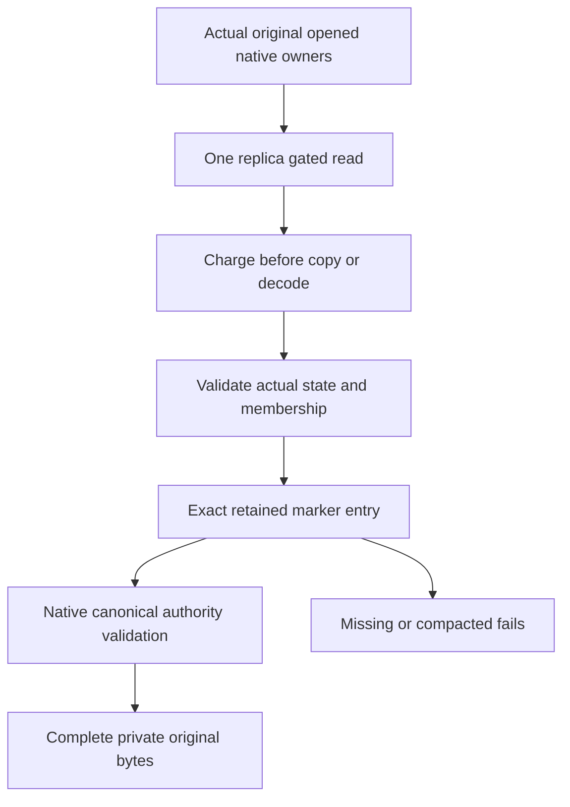

# Root native submission journal read — frozen before C#

Owning ClusterReplication acceptance scope: bounded exact original replica journal evidence. A new CrashHost feature-local reader borrows the ACTUAL opened original replica ZoneTreeStore, ACTUAL canonical DatabaseEngine and frozen original ReplicaConfiguration. It cannot open/create stores, bootstrap principals, issue tokens, apply operations, alter placement, synthesize roles, commit/recover snapshots or claim process/RF3 shutdown. An offline owning process must supply the genuine stopped-existing storage owners before this helper can satisfy RF3 qualification.

REQ-W27-JOURNAL-001 / AC001: one native gated read captures actual original hard state, persisted fixed membership and exact marker-index entry bytes. Native observation runs BEFORE each copy/decode, at most8192 examined bytes per record and32768 cumulative lookup bytes. Missing, corrupted, wrong-scope or excessive values fail; no scan/prefix inference or JSON fallback. Preserve original native formats and native inspector collection bounds through existing ReplicaPersistence/ReplicaAdmittedEntryRead APIs. A scoped CrashHost InternalsVisibleTo grants test infrastructure access only, no new public product API.

REQ-W27-JOURNAL-002 / AC002: actual replica and canonical identities and frozen configuration incarnation/signing key must match; native membership validation uses actual original voter inventory. Validate original hard state and actual index/term with existing native APIs, require original committed index to cover the marker index, and validate the native operation HMAC/authority through the real canonical engine. Return complete original state/entry bytes plus actual node/position; no fabricated entry or authority/receipt flag.

REQ-W27-JOURNAL-003 / AC003: snapshot-covered/missing entry fails explicitly. It cannot substitute a guessed decoded prefix or snapshot boolean. Real snapshot-owner proof is a separate mandatory extension if the qualification corpus actually compacts. Genuine existing ZoneTree/TUnit regression flows cover complete original bytes/no-effects, wrong-term and wrong-membership refusal with healthy following append, and actual oversize row refusal/no-effects/restoration/healthy append. Local kernel tests do not qualify stopped-process/RF3 gates.

REQ-W27-JOURNAL-004 / AC004: all original read/copy/decode/cancellation errors remain original failed evidence; no mutation or fallback. The eventual actual child owns storage open/disposal and actual exit+both pipe drains under original node locks. Complete raw outcome/public replay/document/healthy assertions remain independent. Raw buffers stay private; no paths, credentials, keys or caller content in diagnostic output. No performance/power-loss/delivery claims from source.

Root owns this complete read+native regression scope. Source36 fixture dependency supplies real native stores and operation authority; add only a narrow read-only Configuration property to that private exact helper. Main/SDK/Git are frozen, code and applicability evidence PRIVATE ONLY. Compiler/analyzer/format/coverage/runtime/process/LinuxRF3 gates OPEN.

## Shared stopped-owner inspection budget

The stopped-owner child supplies one original native BEFORE-copy observer across the canonical constructor movement traversal and replica journal lookups. The optional additionalReadObserver on NativeSubmissionJournalRead.Run runs alongside unchanged per-record8192 and per-cut32768 checks, propagates the original refusal and never resets the owner allowance between stores or repeated lookups. NativeSubmissionJournalReadTests.ActualOwnerReadBudgetRefusalPreservesOriginalFailureAndNativeCutAndFollowingRead verifies original external-budget refusal identity, complete native no-effects cut and following healthy read/append/commit. No process or RF3 qualification follows from this source change.
