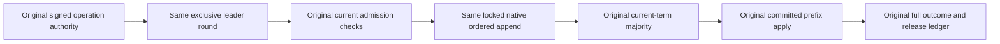

# ReplicaLeader responsibility extraction

Canonical slice: ClusterReplication. [ClusterReplication](../ClusterReplication.md) REQ/AC-REP-001/002/003/005 and [CodeQuality](../CodeQuality.md) REQ-CQ-006/AC-CQ-008, REQ-CQ-MULTILINE-BLOCKS-001/AC001..003 remain required; [ADR-036](../../ADR/ADR-036-orleans-foundation.md) retains routing and node-local durable replication ownership.

REQ-REP-LEADER-RESPONSIBILITY-001 / AC-REP-LEADER-RESPONSIBILITY-001: separate existing submission admission/ordered append from leader round orchestration without changing any protocol or original operation. Nongenerated type<=200, method<=64, file<=400 and nesting<=3, with multiline executable braces; canonical formatter/verify and analyzer-enabled Release build must pass unchanged severities/thresholds.

REQ-REP-LEADER-RESPONSIBILITY-002 / AC-REP-LEADER-RESPONSIBILITY-002: ReplicaLeader retains the SAME exclusive round semaphore, signature authority before round admission, cancellation checks, boundary.IsStarted/terminal-result UnknownWriteOutcome conversion and release/poison/original-first cleanup ledger. Its new feature-local admission helper performs the original movement validation and current ordinary-document admission/leader checks in the SAME order. Conflict rechecks current leader then rethrows the original refusal. No new lock, retry, capacity, clock sample or caller/transport contract.

REQ-REP-LEADER-RESPONSIBILITY-003 / AC-REP-LEADER-RESPONSIBILITY-003: ordered AppendOwned remains inside the original state.LockedAsync gate with original ready-leader check, original two scoped admission probes and absent guards, SAME PrepareQueueRetryOperation clock sample, checked contiguous log index and native DurableReplicaLog.Append with SAME submission boundary/token. Original probe disposal, event-vector identity/outcome projection and source-phase metadata remain intact. Existing current-term majority rounds, heartbeat timing, log commit/fsync, wait-for-apply, read barrier diagnostic stages and recovery/authority/lifetime contracts remain exact.

Original coordinator/replica submission, movement/source-admit, read-barrier, majority/minority, crash/recovery and genuine SDK/MCP RF3 leader/failover suites remain the behavioral mapping. Every original Test/Args/UID/full receipt and independent state assertion is unchanged. No source-text test substitutes for operations. UI, new public APIs, persistence format/migration, dependency adoption, topology and performance claims: N/A, unchanged. Source extraction is authored; canonical formatter/Release, original operation runtime and Linux/RF3/power-loss/endurance gates are independently pending. Main owns these qualification checks and Git.
