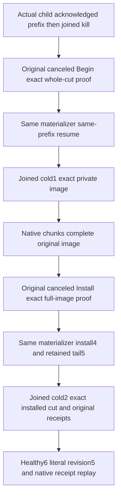

# Native snapshot cancellation preserves the original recovery image

REQ-KL035-CANCEL-001 / AC-KL035-CANCEL-001: the actual acknowledged native snapshot
prefix survives cancellation of the original BeginCheckpointAsync task. Require
its native cancellation token identity and canceled task state. Independently
compare complete canonical and replica rows and positions, full native identity
fields and signing-key bytes, hardstate and published descriptor, and every
owned snapshot filename, length, checksum and exact raw bytes. A successful
retry on the SAME materializer resumes the SAME transfer at the original prefix.

REQ-KL035-CANCEL-002 / AC-KL035-CANCEL-002: close the original materializer and
physical target through their existing owners before cold1. The same-root
reopen and native Recover retain the exact private cut. Real bounded source
chunks complete the original image. Cancellation of the original
InstallCheckpointAsync task preserves the exact FULL private image and both
stores independently from the error assertion. Retry on the SAME materializer
and transfer installs the original cut4 and retains the real ordered tail5.

REQ-KL035-CANCEL-003 / AC-KL035-CANCEL-003: original full receipt/replay/model
oracles apply at installed4 and tail5, including native read generation, local
NodeId and obsolete-row removal. Close through the existing joined owners,
then cold2 must preserve the complete installed-and-tail cut and original image.
Require all original receipts again before healthy6 with independent literal
revision5, original native receipt and replay. The fixed original model is never
asked to fabricate operation6.

All three acceptance criteria map to
[ReplicaSnapshotCancellationRecoveryTests.CancelledNativeBeginAndFullInstallRetainExactTransferThenSameOwnerTailTwoColdAndHealthyReplay](../../../tests/KeyLoad.RecoveryTests/ClusterReplication/Cases/Replica/ReplicaSnapshot/ReplicaSnapshotCancellationRecoveryTests.cs)
and its [whole-operation owner](../../../tests/KeyLoad.RecoveryTests/ClusterReplication/Scenarios/Snapshots/ReplicaSnapshotCancellationRecoveryFlow.cs).
This closes a source regression gap beyond the existing complete-image canceled
install and synchronous transfer-fencing cases. It does not allege a product
defect or change snapshot formats, admission, providers, clocks or bounds.
The original whole native operation uses the existing recovery caller and real
CrashHost acknowledged process boundary. No manual application/container
lifecycle is added. Existing original owner failure and uncertain-close latches
retain evidence; no replacement task is treated as an original join.

KL-035 retains its [original foundation gate](../../implementation/foundation-dependencies.json)
and [transfer-fencing contract](ReplicaSnapshotInstallTransferFencing.md).
[ADR-117](../../ADR/ADR-117-native-tunit-ci-entry.md) owns native TUnit entry;
existing Aspire resources own required deployment/container lifecycle. This is
unexecuted source until original Main-owned discovery and runtime evidence.
A pre-canceled admission task proves refusal before its ownership gate; it does
not prove mid-write interruption or cancellation rollback after installation has
begun. Process-kill is not power-loss durability. Docker/Aspire RF3 through real
SDK and official MCP clients, Linux recovery/fault/endurance, performance and
whole KL-035 qualification remain OPEN.
