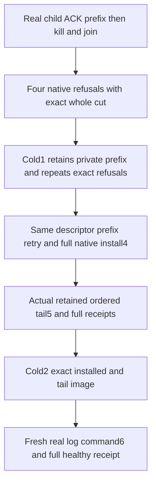

# Replica snapshot private transfer fencing and real process recovery

REQ-KL035-TRANSFER-FENCE-001 / AC-001 supports canonical REQ/AC-REP-004 and architecture KL035. Use the original actual CrashHost process, killed only after its native SnapshotChunkAcknowledged marker, settled readers/locks, canonical cut3 and full actual prefix32. Original source produces a verified cut4 descriptor and retains actual tail5 in target replica log. Every new operation uses existing unchanged bounds, terms, incarnation, paths, clocks and cancellation. No fabricated snapshot bytes/view/receipt or replacement transport.

REQ-KL035-TRANSFER-FENCE-002 / AC-002: wrong transfer Append and Complete return exact NotFound/SnapshotUnavailable. Gap offset beyond acknowledged prefix but within full image length and premature correct-ID Complete return exact Conflict/SnapshotUnavailable. After EACH error require complete canonical/replica rows and positions, all typed identity fields/key bytes, complete hardstate, nullable current descriptor and every owned snapshot file name/length/checksum; incoming descriptor and prefix bytes compare exactly. Error assertion and unchanged-state observation have separate original failure-ledger responsibilities. No hash-only substitution for prefix/manifest bytes and no actual-return-derived failure category.

REQ-KL035-TRANSFER-FENCE-003 / AC-003: first actual same-root cold reopen preserves failed partial cut exactly, native Recover cannot install an incomplete prefix, and all four original negatives remain strict. Same original TransferId/descriptor Begin returns prefix32; exact original prefix retry then real bounded source chunks complete the image. Complete installs native cut4; complete original receipts and literal document plus actual read generation/local NodeID/obsolete-row removal remain checked. Apply the actual retained ordered tail5, full native snapshot and original outcome/receipt replay.

REQ-KL035-TRANSFER-FENCE-004 / AC-004: second actual same-root cold reopen preserves complete installed+tail canonical/replica state and original receipts. Only then append/materialize a genuinely new normalized command6 with independently literal healthy revision5 and complete original native receipt/replay. ReplicaCrashModel.Operation is never called beyond its actual supported maximum5. The two cold cuts are respectively partial transfer and installed+tail; this does not claim a later cold persistence observation of healthy6.

All new roles live in RecoveryTests ClusterReplication, named ReplicaSnapshotInstall*. Existing source case/Args/UID/limits/observers/production files unchanged. Root discovers actual new compiled UID/count only after compile. One genuine process kill is not power-loss, Orleans network/RF3/public SDK/MCP/SQL/persisted-caller authorization, memory/performance or complete KL035 qualification. Existing EmptyReplicaSnapshotRf3Tests complete native snapshot/ordered tail/SDK/official MCP/SQL and persisted-policy assertions plus all crash/install/GC gates remain required. No source-only acceptance.

SOURCE_N only. Full independent peer, native declaration/admission, semantic compiler, actual process/runtime/deadline and all exact-source Linux required suites remain OPEN. Product defect is not alleged: current producers already contain these fences; this fills a missing complete operation regression cell.

## Current native82 ownership continuation

The original complete flow and declaration remain: actual killed acknowledged prefix, four explicit original failures, complete private bytes and both stores/identities/hardstate, same image install4, retained tail5, two distinct cold transitions and independent healthy6. Current native82 read admission is consumed through the original snapshot APIs; no product workaround, new format or fabricated bytes is introduced. The original deterministic evaluated ticks, System process/apply deadlines and fixed model IDs1..5 remain unchanged.

A colocated lifecycle owner now retains actual materializer/node handles until their original Dispose returns. An uncertain materializer construction or close blocks borrowed target closure and subsequent reopen; independently owned source closure still runs. Each original close is attempted once, all body and cleanup errors remain in the existing failure observer, and root deletion is forbidden after uncertain acquisition/close or an earlier operation failure. The sole shared ReplicaProcessTrial overload conditionally retains that directory while preserving its original kill/join/stderr/process-disposal sequence and all existing parameterless callers. No primitive Dispose fault is injected or claimed executed.
