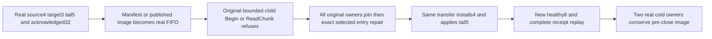

# Snapshot manifest admission and protocol settlement (KL035)

REQ/AC-REP-004 and canonical KL035 require a verified committed cut, interrupted-transfer recovery and an intact latest recovery path. REQ/AC-REP-001/002 retain native Orleans transport and joined physical ownership. This coherent source batch repairs three confirmed KeyLoad-owned source paths. Formats, RF3 configuration, WriteThrough writers, checksums, manifest byte ceiling, journal/apply order and original native provider remain unchanged. The existing real killed acknowledged-prefix and erase/restart cases remain required; neither new case replaces them.

REQ-SNAPSHOT-NATIVE-001 / AC-SNAPSHOT-NATIVE-001: ReplicaSnapshotFiles.ReadManifest previously used File.Exists/path symlink checks followed by File.OpenRead. Those checks do not establish a regular native entry; a FIFO can block that original Begin/recovery read before length/bounds validation. That retained manifest reader and the separately confirmed published ReadChunk image reader now use existing native OfflineRegularFile.Open with Read/Read-share and the current MaximumManifestBytes as buffer (positive and at most existing4096). Descriptor/path identity, regular type and no-follow/nonblocking open are the selected native primitive. Only the exact IO-owned invalid-entry predicate maps to existing Corruption/InvalidSnapshot with its original native cause. Unsupported native capability and changed-entry errors remain distinct. ReadManifest retains its existing length check, native codec and descriptor validation. Published ReadChunk retains original Current/TransferId/offset/chunk bounds and exact Length/ReadExactly, using existing FileBufferBytes for native readonly image IO (at most65536). No private writer, FileOptions.WriteThrough, Describe producer read, provider RangeReader, checkpoint marker or storage format changes.

The exact OfflineNativeErrors.IsInvalidEntry member is supplied once by approved R107 a6660b2e→83a5bb0d, shared with Root's native-storage intake; it is a conditional prerequisite rather than a competing IO postimage. Current OfflineRegularFile is guarded at Root R5 original51dbcfa6. No product dependency or library is introduced.

AC-SNAPSHOT-NATIVE-001 maps to SnapshotManifestEntryTests.ActualRetainedManifestOrPublishedImageFifoRefusesInOriginalChildThenSameTransferInstallsTailReplaysAndTwoColdOwnersRemainHealthy. Real independent source/target stores commit original model cuts4/3, retain target uncommitted tail5 and acknowledge the actual32-byte original snapshot prefix. Actual original owners close before one manifest is renamed and a real native FIFO installed. The original manifest-Begin and published-image-ReadChunk variants are independently declared native arguments; original source image bytes are retained separately. The parent never opens FIFO contents. The new bounded private CrashHost arm invokes the SAME source descriptor and actual target.Snapshots.Begin or source.Snapshots.ReadChunk. The image variant does not invoke source Recover before the targeted read, so a provider verifier cannot replace the actual ReadChunk refusal oracle. It emits a fixed variant-bound marker only after checking exact Corruption/native InvalidEntry cause, original target cut3/tail5/no published snapshot, and joined disposal of both native owners. The parent reuses ExistingStoreInspectorSession's existing original process/input/stdout/stderr/kill/join/disposal ownership, checks its exact marker/exit/stderr, then verifies FIFO identity/mode, hidden original manifest, complete canonical/replica rows/positions/hardstate/native identity and original prefix. This is not a fabricated parent rejection or a new process runner.

After actual child settlement, repair exactly the original selected manifest or published image. Begin resumes the SAME descriptor at32, same-prefix replay remains idempotent, remaining native chunks complete verified installation4 and remove target-only obsolete state. Actual ReplicaMaterializer applies retained tail5 and a genuinely new normalized healthy command6; original fixed model IDs1..5 remain untouched. Full literal document/revision, independent complete receipts including Boolean-only private composition emptiness, immutable original raw outcomes and no-effect replay are checked. Capture the complete canonical/replica/hardstate/physical-cut baseline BEFORE close; two actual joined cold target opens must conserve that baseline and all original receipts/outcomes/current document. No quorum ACK is inferred from directly ordered native fixture logs. Original source published snapshot remains its distinct recovery path; no log GC or provider replacement is added.

REQ-SNAPSHOT-SETTLEMENT-002 / AC-SNAPSHOT-SETTLEMENT-002: ReplicaProtocolDisposal previously used sequential Dispose calls in finally. If an owned cleanup threw, it could replace the initiating terminal failure and skip later independent primitives. ReplicaConsensus owns memoized DisposeCoreAsync directly. It first awaits original StopAsync to actual settlement, then executes direct leader.Dispose, snapshots.Dispose, followers.Dispose and lifetime.Dispose statements in original order, each inside its own existing fatal/nonfatal exception-capture policy. Every independent primitive is attempted and every original error is retained. ReplicaShutdownStage owns the extracted original StopCore choreography and final exact-single/complete-aggregate rethrow; all objects it receives are borrowed and it disposes none. ReplicaProtocolDisposal is removed after its last caller is replaced. The existing control-read cancellation normalization moves to ReplicaReadRoundExecutor, which already owns execution of that barrier; its public wrapper, caller-token filter and error metadata remain equivalent. These cohesive responsibility extractions preserve the type bound without partial declarations or suppressions. R208 showed that owner-local lambdas still failed CA2213 for three fields and produced four IDE0200 diagnostics; this successor uses actual direct statements. Actual compiler closure remains OPEN until Root builds it. The original consensus memoized disposal and protocol activity drain remain unchanged. A still-pending original drain cannot trigger primitive disposal. No new cleanup framework, public seam, fake clock or injected disposal provider is introduced.

AC-SNAPSHOT-SETTLEMENT-002 maps to ReplicaProtocolFileFailureTests.ActualCallbackFileFailureKeepsOriginalProtocolDisposalPendingUntilForwardSettlesThenFreshNativeOwnerIsHealthy. A fresh genuine native consensus endpoint borrows the existing three-silo cohort's actual transport client. Its original real forwarding callback registers a native cancellation callback which opens an actual absent file, retains the real FileNotFoundException and holds the original forward until explicitly released. Actual consensus Dispose stays pending while that original call remains live; canonical full bytes/cut stay unchanged. After release, original callback failure identity, native operation cancellation, exact same Stop/disposal task and original failure replay are conserved. All original caller/endpoint scopes join; a fresh actual native endpoint performs the original operation with an independently complete receipt/document and same-ID no-effect replay. This proves real callback/terminal failure conservation. A native primitive Dispose failure is NOT fabricated or claimed executed: its complete cleanup guarantee is source reviewed, and native fault execution remains open.

The new snapshot fixture retains actual owner references, attempts each original closure once, and latches success only after actual Dispose returns. Unknown materializer close prevents closing its borrowed target stores; independent source closure still runs. Unknown process/acquisition/close blocks reopen, repair progression and recursive root deletion. Original and cleanup errors remain visible; no retry/no-op Dispose is closure proof. Failures retain original artifacts rather than erasing evidence.

This packet is SourceN only. Both real operation classes, private child dispatch and actual APIs are source reviewed; cached native parsing/numeric/nesting is not semantic binding or execution. Compiler/analyzer/style, native discovery and original execution, Linux process recovery, empty-follower catch-up, log-GC recovery-path protection and actual Aspire RF3 SDK/official MCP remain OPEN. Process-kill, power-loss, performance and production readiness are not claimed. Frontend/new provider/new public API are N/A.
