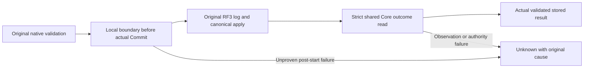

# ClusterReplication native submission outcome

This refines existing REQ/AC-REP-002/003/005, REQ-ROUTE-009 and ADR-036's native Orleans consensus, ordered log/apply and stable command-retry contracts. It is a correctness repair within existing owners: no new transport, storage provider, acknowledgement, serialization identity, public client API or released-format change. Core's shared outcome selection remains one implementation, while Replication owns evidence of its actual log submission.

The confirmed faults are ordinary KeyLoad exceptions after native log Commit (including existing EntryAcknowledged observer), current-leader/source-admit checks after RF3 commit/apply, and Core ResolveOutcome catch-to-result converting current authority/missing/mismatched outcome observation failures into ordinary error values. Those values alone cannot prove an actual persisted terminal refusal.

REQ-REP-SUBMIT-001 / AC-REP-SUBMIT-001: each original leader submission owns one nonserialized local native submission boundary. The actual DurableReplicaLog marks it only after original batch validation and NextState calculation, immediately before its actual IAtomicStore.Commit. Any later nonfatal failure without an exact validated durable terminal outcome retains UnknownWriteOutcome and the original cause through original leader round release and native forwarding/coordinator delivery. The local complete terminal result is assigned only after the original owning submission flow returns successfully, including all required source/first-admit proof construction, or its exact verified original-outcome return. If subsequent round release fails nonfatally, return that unchanged complete terminal result and retain the actual cleanup failure in the existing ReplicaState.Poison owner; the poisoned native replica refuses subsequent admission and reports unavailable readiness. This includes an actual stored refusal and a proven success, without reconstructing either from an error code. Fatal cleanup still propagates; an uncompleted operation plus failed release retains both causes. Pre-append authority, leader readiness, gate admission, operation/log validation and cancellation remain exact under their existing contracts. Existing log overload/public interface behavior remains unchanged for other owners; unsupported native log ownership fails closed before effects rather than using a fallback provider.

REQ-REP-SUBMIT-002 / AC-REP-SUBMIT-002: native leader delivery uses Core's strict internal ResolveSubmissionOutcome, sharing EXACT existing principal/retired-scope/partition-key/policy/incarnation/fingerprint/scope/cached-result validation within one native Store.Read. Only the actual validated StoredOutcome.Result can return as a terminal result; observation/authority failures throw their original cause. Existing public ResolveOutcome retains its exact error-as-result contract through the same shared kernel. Core grants the independently owned KeyLoad.Replication assembly internal access through the canonical csproj friend mechanism, not a new public client contract. No raw data, unvalidated result or supplied error code becomes proof.

REQ-REP-SUBMIT-003 / AC-REP-SUBMIT-003: whole real-store regressions cover a successful original command with strict outcome equality; a genuine current policy/missing-outcome rejection after actual persisted command; exact real persisted terminal conflict; replay with unchanged full native outcome/document and healthy following work. Genuine unstarted coordinator/canceled pre-admission operations retain exact failures with complete canonical/replica rows, positions, applied/hardstate and governor reservations unchanged. No fake context, native election, owner, IAtomicStore, dispatcher, transport or acknowledgement. Embedded/native-core cases do not qualify RF3.

REQ-REP-SUBMIT-004 / AC-REP-SUBMIT-004: actual RF3 fault qualification invokes the owning native log's existing EntryAcknowledged boundary AFTER real native Commit, or a scoped actual current-leader/source-proof failure after original apply, through actual Orleans replica communication and original SDK/official MCP calls. Verify original log effect or canonical applied state as appropriate, signed caller Unknown, exact same-ID reconciliation, healthy following operation and joined original resources. A private Log-only test or manually assigning a leader is insufficient; missing native fixture injection remains an explicit open qualification dependency.

Canonical sources: src/KeyLoad.Replication/Features/ClusterReplication/Execution/ReplicaLeader.cs; Storage/DurableReplicaLog.cs; NEW Execution/ReplicaSubmissionBoundary.cs; shared Core/CommandOutcomes.cs and Core csproj native friend. Root owns the strict Core shared-kernel refactor and durable docs; ann owns native Log/Leader boundary; producer owns meaningful real operation regressions. Tests are under matching ClusterReplication Cases/Helpers. Backend storage/RPC/SDK/MCP schemas and frontend are N/A to this internal failure repair because their exact contracts remain unchanged; actual client fault qualification is mandatory.

Tradeoff: mark immediately before provider Commit, after all immutable original validation, because a thrown provider/observer failure can happen after effects. This conservatively retains uncertainty when commit entry cannot prove no write. Marking endpoint dispatch or treating an error code/result as durable proof was rejected. A strict outcome reader is required; duplicating canonical checks in Replication or swallowing current-authority failures is rejected. Only the current actual DurableReplicaLog implementation exists; native Leader checks that concrete owning capability before its append, no provider alternative or fallback.

Boundaries and the exact completed terminal result reference are per-submission, bounded to the original admitted operation, and share its CT, existing native rounds/state/storage gates and original resource owner. The result reference does not copy or serialize its native payload, is never supplied by a caller, and is not assigned merely because the strict reader returned before later required proof construction. Round release failures are retained by the existing interlocked ReplicaState.Poison owner rather than silently discarded; a proven terminal result does not make a damaged gate healthy. No new task, semaphore, shutdown owner, background loop, retry, deadline, diagnostic payload, captured store view or file handle is introduced. Preserve complete original failure causes privately and the existing bounded public diagnostic text. Existing follower RPC lifetimes are not reclassified as joined merely by a finally; their actual original owner settlement remains required.

Verification: private guards and source review first; Main alone joins the batch, resolves actual compiler/analyzers/formatting, then runs required native TUnit Unit/Recovery and genuine Docker/Aspire RF3 SDK/MCP gates with configured concurrency50. ADR-117 makes C# fixtures own actual Aspire lifecycle. Exact-source Linux, coverage, cancellation/cleanup, endurance and power-loss gates remain independent and OPEN; no performance claim is made.

Native log fault qualification and independent lifecycle/resource evidence: [NativeSubmissionFaultQualification](NativeSubmissionFaultQualification.md).

REQ-REP-SUBMIT-005 / AC-REP-SUBMIT-005: the existing ReplicaLogValidation owns the pure validated term/vote transition; DurableReplicaLog retains its original synchronous gate, disposed check, atomic persistence, in-memory publication and TermSaved observer in that order. Preserve increasing terms, one vote per term, ordinal voter membership, original conflict diagnostics and every unrelated append/submission boundary. This responsibility refactor is covered by the existing complete replication election/vote operation flows and the normal solution build's unchanged type200/function64 limits; it introduces no public or persisted contract and does not itself qualify an RF3 or durability gate.

REQ-REP-SUBMIT-006 / AC-REP-SUBMIT-006: stopped-owner journal inspection uses one disposable inspection adapter and its borrowed read-only DatabaseEngine. Its factory disposes the adapter if native engine construction fails; each existing CrashHost, Unit and Integration caller closes the same adapter after the complete read, while the original fixture or stopped-owner scope retains physical canonical/replica disposal. Cancellation remains the last factory argument. Use the existing validated CrashExecutionOptions.Configuration for the original voter array, directory and incarnation. KeyLoad.Replication grants KeyLoad.IntegrationTests internal access through its canonical csproj friend declaration so the genuine complete Blob journal reader reuses native authority/codecs without exposing a public API. Preserve strict existing-store opens, exact original errors, the single cumulative 8192-byte record/32768-byte owner budget, full rows and both cold continuations. The existing whole journal cancellation/budget/process and native Blob flows are the regression; source closure alone does not qualify RF3.
