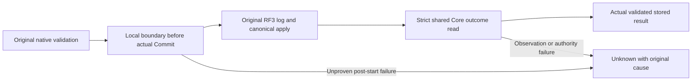
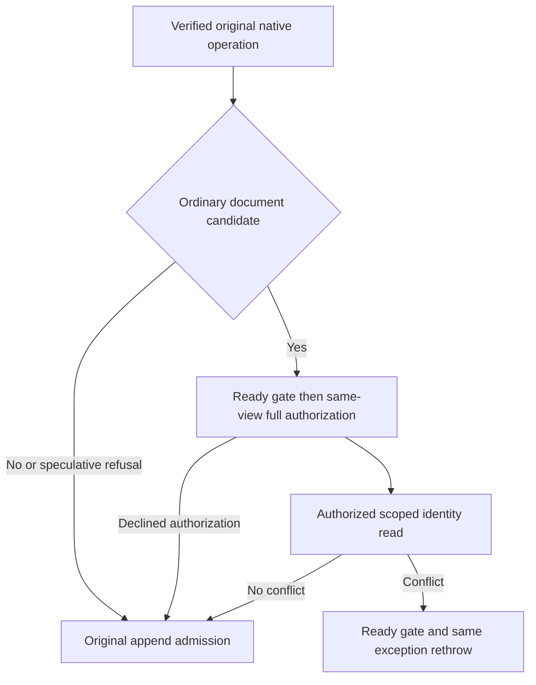

# ClusterReplication native submission outcome

This refines existing REQ/AC-REP-002/003/005, REQ-ROUTE-009 and ADR-036's native Orleans consensus, ordered log/apply and stable command-retry contracts. It is a correctness repair within existing owners: no new transport, storage provider, acknowledgement, serialization identity, public client API or released-format change. Core's shared outcome selection remains one implementation, while Replication owns evidence of its actual log submission.

The confirmed faults are ordinary KeyLoad exceptions after native log Commit (including existing EntryAcknowledged observer), current-leader/source-admit checks after RF3 commit/apply, and Core ResolveOutcome catch-to-result converting current authority/missing/mismatched outcome observation failures into ordinary error values. Those values alone cannot prove an actual persisted terminal refusal.

REQ-REP-SUBMIT-001 / AC-REP-SUBMIT-001: each original leader submission owns one nonserialized local native submission boundary. The actual DurableReplicaLog marks it only after original batch validation and NextState calculation, immediately before its actual IAtomicStore.Commit. Any later nonfatal failure without an exact validated durable terminal outcome retains UnknownWriteOutcome and the original cause through original leader round release and native forwarding/coordinator delivery. The local complete terminal result is assigned only after the original owning submission flow returns successfully, including all required source/first-admit proof construction, or its exact verified original-outcome return. If subsequent round release fails nonfatally, return that unchanged complete terminal result and retain the actual cleanup failure in the existing ReplicaState.Poison owner; the poisoned native replica refuses subsequent admission and reports unavailable readiness. This includes an actual stored refusal and a proven success, without reconstructing either from an error code. Fatal cleanup still propagates; an uncompleted operation plus failed release retains both causes. Pre-append authority, leader readiness, gate admission, operation/log validation and cancellation remain exact under their existing contracts. Existing log overload/public interface behavior remains unchanged for other owners; unsupported native log ownership fails closed before effects rather than using a fallback provider.

REQ-REP-SUBMIT-002 / AC-REP-SUBMIT-002: native leader delivery uses Core's strict internal ResolveSubmissionOutcome, sharing EXACT existing principal/retired-scope/partition-key/policy/incarnation/fingerprint/scope/cached-result validation within one native Store.Read. Only the actual validated StoredOutcome.Result can return as a terminal result; observation/authority failures throw their original cause. Existing public ResolveOutcome retains its exact error-as-result contract through the same shared kernel. Core grants the independently owned KeyLoad.Replication assembly internal access through the canonical csproj friend mechanism, not a new public client contract. No raw data, unvalidated result or supplied error code becomes proof.

REQ-REP-SUBMIT-003 / AC-REP-SUBMIT-003: whole real-store regressions cover a successful original command with strict outcome equality; a genuine current policy/missing-outcome rejection after actual persisted command; exact real persisted terminal conflict; replay with unchanged full native outcome/document and healthy following work. Genuine unstarted coordinator/canceled pre-admission operations retain exact failures with complete canonical/replica rows, positions, applied/hardstate and governor reservations unchanged. No fake context, native election, owner, IAtomicStore, dispatcher, transport or acknowledgement. Embedded/native-core cases do not qualify RF3.

REQ-REP-SUBMIT-004 / AC-REP-SUBMIT-004: actual RF3 fault qualification invokes the owning native log's existing EntryAcknowledged boundary AFTER real native Commit, or a scoped actual current-leader/source-proof failure after original apply, through actual Orleans replica communication and original SDK/official MCP calls. Verify original log effect or canonical applied state as appropriate, signed caller Unknown, exact same-ID reconciliation, healthy following operation and joined original resources. A private Log-only test or manually assigning a leader is insufficient; missing native fixture injection remains an explicit open qualification dependency.

Canonical sources: src/KeyLoad.Replication/Features/ClusterReplication/Execution/ReplicaLeader.cs; Storage/DurableReplicaLog.cs; NEW Execution/ReplicaSubmissionBoundary.cs; shared Core/CommandOutcomes.cs and Core csproj native friend. Root owns the strict Core shared-kernel refactor and durable docs; ann owns native Log/Leader boundary; producer owns meaningful real operation regressions. Tests are under matching ClusterReplication Cases/Helpers. Backend storage/RPC/SDK/MCP schemas and frontend are N/A to this internal failure repair because their exact contracts remain unchanged; actual client fault qualification is mandatory.

Tradeoff: mark immediately before provider Commit, after all immutable original validation, because a thrown provider/observer failure can happen after effects. This conservatively retains uncertainty when commit entry cannot prove no write. Marking endpoint dispatch or treating an error code/result as durable proof was rejected. A strict outcome reader is required; duplicating canonical checks in Replication or swallowing current-authority failures is rejected. Only the current actual DurableReplicaLog implementation exists; native Leader checks that concrete owning capability before its append, no provider alternative or fallback.

Boundaries and the exact completed terminal result reference are per-submission, bounded to the original admitted operation, and share its CT, existing native rounds/state/storage gates and original resource owner. The result reference does not copy or serialize its native payload, is never supplied by a caller, and is not assigned merely because the strict reader returned before later required proof construction. Round release failures are retained by the existing interlocked ReplicaState.Poison owner rather than silently discarded; a proven terminal result does not make a damaged gate healthy. No new task, semaphore, shutdown owner, background loop, retry, deadline, diagnostic payload, captured store view or file handle is introduced. Preserve complete original failure causes privately and the existing bounded public diagnostic text. Existing follower RPC lifetimes are not reclassified as joined merely by a finally; their actual original owner settlement remains required.

Verification: private guards and source review first; Main alone joins the batch, resolves actual compiler/analyzers/formatting, then runs required native TUnit Unit/Recovery and genuine Docker/Aspire RF3 SDK/MCP gates with configured concurrency50. ADR-117 makes C# fixtures own actual Aspire lifecycle. Exact-source Linux, coverage, cancellation/cleanup, endurance and power-loss gates remain independent and OPEN; no performance claim is made.

Native log fault qualification and independent lifecycle/resource evidence: [NativeSubmissionFaultQualification](NativeSubmissionFaultQualification.md).

REQ-REP-SUBMIT-005 / AC-REP-SUBMIT-005: the existing ReplicaLogValidation owns the pure validated term/vote transition; DurableReplicaLog retains its original synchronous gate, disposed check, atomic persistence, in-memory publication and TermSaved observer in that order. Preserve increasing terms, one vote per term, ordinal voter membership, original conflict diagnostics and every unrelated append/submission boundary. This responsibility refactor is covered by the existing complete replication election/vote operation flows and the normal solution build's unchanged type200/function64 limits; it introduces no public or persisted contract and does not itself qualify an RF3 or durability gate.

REQ-REP-SUBMIT-006 / AC-REP-SUBMIT-006: stopped-owner journal inspection uses one disposable inspection adapter and its borrowed read-only DatabaseEngine. Its factory disposes the adapter if native engine construction fails; each existing CrashHost, Unit and Integration caller closes the same adapter after the complete read, while the original fixture or stopped-owner scope retains physical canonical/replica disposal. Cancellation remains the last factory argument. Use the existing validated CrashExecutionOptions.Configuration for the original voter array, directory and incarnation. KeyLoad.Replication grants KeyLoad.IntegrationTests internal access through its canonical csproj friend declaration so the genuine complete Blob journal reader reuses native authority/codecs without exposing a public API. Preserve strict existing-store opens, exact original errors, the single cumulative 8192-byte record/32768-byte owner budget, full rows and both cold continuations. The existing whole journal cancellation/budget/process and native Blob flows are the regression; source closure alone does not qualify RF3.

## REQ/AC-REP-SUBMIT-007/008 — retained ordinary refusal and changed identity

Future guarded proposal: strict ordinary document-only Batch denial is terminal only when the exact actual StoredOutcome passes all original principal/PolicyEpoch/incarnation/fingerprint/scoped-key/cached validators, has no value or specialized authority, and its complete PermissionDenied/detail equals the fresh same-view native authorization refusal. Same-view source-fence absence excludes every movement/retired original; native transfer proof and non-document mutations exclude specialized effects. Preserve public ResolveOutcome behavior and all existing strict authority, corruption, missing-result and post-effect uncertainty exceptions. The apply owner actually Reset before persisting this refusal; never manufacture a result from its exception alone.

Preappend current-authority/scoped-identity validation runs outside the protocol gate after initial current ready-leader admission. It refuses only an already present successfully authorized changed document fingerprint, keeping the original cached success unchanged. All speculative KeyLoadException authorization refusals continue through the unchanged RF3 append/reset/persist path so failed-ID reservation and restored-policy semantics remain. Matching authorized replay still performs the original new RF3 append/apply; it never returns a cached result from preflight. Post-preflight races retain strict Unknown unless the complete durable denial proof validates. The original state.LockedAsync still rechecks leader readiness; no store view escapes its native read gate.

AC-REP-SUBMIT-007 maps to existing ReplicaSubmissionOutcomeTests.ActualStoredDocumentDenialRemainsExactAcrossReplayAndPolicyRestore: genuine native admission, complete stored result/outcome/model, matching denied replay, current-policy restore refusal and healthy fresh write. AC-REP-SUBMIT-008 maps to ChangedExistingDocumentIdentityRefusesBeforeAppendAndLeavesMatchingReplayAdmitted: genuine current-authorized changed identity, full native canonical/journal/position no-effect and unchanged full matching replay. These actual native local fixture cases are not consensus/RF3 proof. Original CompositeUniqueRf3Flow, ColdBootstrapSdkFlow, RequestCqrsFaultReplayContinuation and cross-tenant SDK/official MCP errors remain mandatory exact-result/privacy gates; original cold healthy matching replay must still advance applied state with unchanged full original outcome/model. Current source, compiler, Linux, real leader/cold/resource gates are OPEN. No limits/deadlines/public ABI/format/provider/topology change; rollback removes only the coherent guarded proposal. Root owns integration; no source was applied by this preview.

REQ-REP-SUBMIT-009 / AC-REP-SUBMIT-009: Before speculative ordinary-document metadata selection, the SAME native view runs current Principal plus complete AuthorizeOperation (ClusterPrincipalPolicy, RuntimeJournalIdentity, placement, batch/extended/resource trust). A KeyLoadException from shape/current-principal/authorization only declines speculative preflight; it is never an accepted receipt or translated terminal result. The unchanged append/apply path repeats its own admission and retains original denial/validation failure-ID behavior. Successful authorization alone reaches source-fence absence and scoped outcome/current-policy/incarnation/fingerprint checks. Non-KeyLoad failures remain strict; retired/source-fenced, transfer and non-document eligibility remain excluded. The original public ResolveOutcome and exact retained PermissionDenied proof are unchanged.

ReplicaLeader first checks actual RequireReadyLeader under its original short protocol gate. The native canonical preflight runs outside that gate. If it throws an actual Conflict, a second short LockedAsync callback validates actual ready leader and rethrows that SAME captured exception inside the gate; this does not label every native Conflict as only a fingerprint conflict. No view escapes or store read runs under either new short gate; ordinary AppendOwned retains its final readiness check. Cancellation or readiness failure remains actual native refusal; no new quorum, fence, result or trust flag is created.

AC-REP-SUBMIT-009 maps to ActualStaleOwnershipAdmissionFallsThroughAndRetainsNativeFailureId: a genuine original native Batch uses the actual observed placement plus one to produce stale OwnershipEpoch. Preflight leaves the complete canonical/journal cut unchanged; real native log/apply persists OwnershipLost with the original document unchanged. Strict outcome observation still throws this non-PermissionDenied, while public reader and same-ID native replay preserve exact original result/detail/full outcome. A fresh genuine update succeeds. The fixture owns original storage/log and setup/body/disposal failures remain ordered. This local kernel flow does not prove elected-leader concurrency, malformed-metadata privacy, public SDK/MCP or cold RF3; these gates stay OPEN.

REQ-REP-SUBMIT-010 / AC-REP-SUBMIT-010: the advisory ordinary-document shape filter and preflight live in `src/KeyLoad.Core/Features/ClusterRouting/Execution/NativeDocumentSubmissionAdmission.cs` (the existing DatabaseEngine partial, unchanged namespace). ReplicaLeader passes the already authority-verified native operation to the store-free filter and retains its one decoded candidate; Non-Batch operations return before native candidate decoding; Batch still uses the original native shape/proof decoder to distinguish document from specialized mutations. Ineligible operations receive no advisory canonical read/read lambda, normalization or readiness gate in this production path. Only eligible document Batch proceeds through the short ready gate and complete same-view authorization before protected metadata. KeyLoadException from speculative eligibility/normalization declines this advisory path; original append/apply owns every validation/error cache decision. The final actual Conflict readiness/EDI rethrow and original AppendOwned gate remain unchanged. This is a source work reduction, not a measured performance claim.

AC-REP-SUBMIT-010 retains all three new complete native operation cases and the original four cases. The stale-owner case additionally compares the native candidate's full command bytes and proves a genuine issued ConfigurePrincipal operation is ineligible with the same complete native cut unchanged. This eligibility oracle does not itself measure allocation, elected-leader execution or prove all specialized channels. All three new cases use the original fixture-owned RunAsync: actual construction and body inside visible using, ordered native body/disposal ledger, fatal/nonfatal cleanup captured, ThrowIfAny after scope. Original case bodies/receipt/model/cold obligations are not weakened. Compiler, native TUnit, elected leader/RF3, public SDK/official MCP, privacy races and profiling remain OPEN.

REQ-REP-SUBMIT-011 / AC-REP-SUBMIT-011: never perform the ordinary refusal extension's source-fence read before the original fresh same-view native authority attempt. Catch only the allowed actual PermissionDenied code using a scalar exception filter, then determine ordinary eligibility inside the catch body after CaptureRetiredOriginalOutcomeReadScope/AuthorizeOperation actually refused. Preserve original capability-before-fence order. Ineligible operations rethrow the same original denial; unexpected and fatal native predicate/decode/storage failures propagate rather than being discarded by CLR filter evaluation. The extension admits only the complete exact actual durable denial proof defined above. Normal authorized reads and public strict defaultfalse incur no new fence lookup from this extension. The original four and three added complete native flows remain unchanged; elected-leader malformed-metadata/privacy concurrency and real RF3 gates stay OPEN.

## Current ordinary-document authority before append, 2026-10-12

REQ-REP-SUBMIT-012: for an eligible ordinary document Batch, propagate the original current Principal `Unauthenticated` refusal before metadata selection and before the append boundary. This refines the advisory fallthrough in REQ-REP-SUBMIT-009 only for missing, revoked or expired current persisted principals. It matches the existing no-outcome contract of `SignedWriteReloadsPersistedRevocationBeforeCommit`; active-principal first `PermissionDenied` remains durably appended, and unsupported shape, movement, ownership and specialized paths retain their original handling.

AC-REP-SUBMIT-012 maps to REQ-REP-SUBMIT-012: unchanged genuine SDK and official MCP requests held at AuthorizationReload must observe the actual persisted revocation, return exact Unauthenticated with no database effect or failed outcome, and retain their original joined lifetime and healthy continuation. The existing native signed-write revocation case remains required. The original R24 held-request failures establish a swallowed pre-admission refusal followed by a post-append principal reload; no client error remapping or relaxed terminal proof qualifies the repair.

REQ-REP-SUBMIT-013: after the same-view original current principal and full operation authorization actually return PermissionDenied, a private advisory lookup may select only that same principal/command/canonical scope. A changed fingerprint may trigger a pre-append rethrow of the freshly computed refusal only when the retained record passes canonical scope/locator, current policy/incarnation and exact failed-result checks: the same PermissionDenied and safe detail, null JSON/native value and all five null authority members. Never return that retained record as the incoming outcome, expose its existence/content, or relax the strict terminal fingerprint validator. Missing, matching, stale, malformed or unsupported evidence declines the advisory check; original first-denial caching, same-body denied replay, authorized changed-body Conflict and specialized/ownership behavior remain unchanged.

AC-REP-SUBMIT-013 maps to REQ-REP-SUBMIT-013: a separate genuine ReplicaSubmissionOutcomeFlow case must retain the full first failed receipt and canonical/journal bytes, prove unchanged matching replay, changed-body current denial before append with a complete unchanged cut, exact original denied replay, and fresh healthy continuation after policy restore plus authorized changed-body Conflict. The unchanged CrossTenant public SDK/MCP whole flow remains mandatory. Original R24 changed-body retry reached a strict mismatch after append; current-authority refusal must occur before that boundary. No new persisted/public schema, alias, quota, result provenance or provider is introduced. Compiler, native TUnit, real elected-leader SDK/MCP/RF3, cold/privacy and source qualification remain OPEN.
