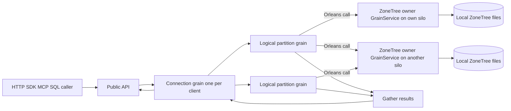

# ClusterRouting

Status: accepted specification (owner direction 2026-10-18); implementation in progress and not yet qualified. Owner: KeyLoad lead. Decisions: [ADR-136](../ADR/ADR-136-native-orleans-partition-ownership.md) (the cluster concept), [ADR-036](../ADR/ADR-036-orleans-foundation.md) (Orleans foundation), [ADR-125](../ADR/ADR-125-connection-owned-execution.md) (one grain per client connection), [ADR-143](../ADR/ADR-143-independent-silo-replica-topology.md) (silo count and replica count), [ADR-082](../ADR/ADR-082-native-cqrs-streams.md) (native CQRS streams), [ADR-110](../ADR/ADR-110-native-orleans-execution-primitives.md) (native execution primitives), [ADR-003](../ADR/ADR-003-durability-ack-barrier.md) (acknowledgement from every configured copy).

## Purpose

ClusterRouting is how a public database operation reaches the data. Microsoft Orleans is the cluster: it owns membership, silo discovery, failure detection, the distributed grain directory, placement, activation migration and repartitioning, internal communication (grain calls, Grain Service calls, Orleans streams), timers, reminders, durable jobs and scaling. KeyLoad adds no clustering of its own. ClusterRouting only composes ordinary Orleans grains and Grain Services around node-local ZoneTree storage.

## Scope

In scope:

- One Orleans connection grain per connected client, and per-operation execution inside it (signed request identity, fresh persisted authorization, bounded admission, cancellation, backpressure, native CQRS result and progress streams, idempotent command outcomes).
- Logical partition grains: ordinary Orleans grains that serialize and route the commands of one logical partition.
- The silo-local ZoneTree owner (an Orleans Grain Service) and its native silo lifecycle: one host, ordered startup, request drain and joined shutdown before files close.
- Copies to `KeyLoad:ReplicaCount` silos through ordinary Orleans calls, with acknowledgement from every configured copy.
- Native per-grain migration eligibility, the grain-call policy, background work on Orleans `[StatelessWorker]` grains, and OpenTelemetry through the native Orleans, ASP.NET Core and ServiceDefaults integrations.

Out of scope (forbidden as self-written clustering, see ADR-136 rule 1): KeyLoad consensus, terms, votes or leaders; membership tables or providers; KeyLoad discovery, peer transports or peer authentication; physical owner directories, shard catalogs, placement or capacity managers; partition movement, transfer, split or merge; ownership epochs and session tokens across movement; coordination-only silos; leader-gated background work. Public HTTP/SDK/MCP/SQL transports are client boundaries owned by [ClientApi](ClientApi.md), not cluster transports. Credentials and policies are owned by Authorization.

## Request flow

1. A public API call (HTTP, .NET SDK, MCP or SQL) is authenticated by the server and handed to the caller's connection grain.
2. The connection grain checks fresh persisted authorization for the operation and calls the logical partition grains the operation needs.
3. A partition grain applies a command in order and sends it through Orleans to the ZoneTree owners of its ReplicaCount copies, on its own silo or on other silos. It returns success after every configured copy confirms durable local apply.
4. Reads call the ZoneTree owner of the relevant node through Orleans; a read spanning partitions is fanned out by the connection grain and merged within the operation's bounds.
5. Results are gathered and returned to the caller.

Storage files never move with grain activations. A migrated grain simply calls the ZoneTree owners again through Orleans.

## Requirements and acceptance

Only tests that exist in `tests/` are named. A criterion without a named test is open.

| Requirement | Acceptance (pass/fail) | Existing tests |
|---|---|---|
| REQ-ROUTE-001: every database operation of a connected client runs through that client's connection grain, which calls the logical partition grains it needs. | AC-ROUTE-001: .NET SDK and official MCP reads and writes reach the connection grain; independent operations on one connection complete independently, each with a unique per-operation request ID and a stable command retry ID. Fails if an operation bypasses the connection grain or a retry produces a second effect. | `RequestIdReceiptTests.SdkResponsesCarryUniqueActorRequestIdsAcrossStableWriteRetryAndParallelReads`; `ConnectionClusterOverlapTests.AcCrs058OneHttp2ConnectionCompletesIndependentCommandAndCancelsOnlySelectedOperation`; `ConnectionClusterSequentialTests.AcCrs057SdkAndOfficialMcpReusePhysicalConnectionAfterFailureAndReplay`; `ConnectionClusterAuthorizationTests.AcCrs059FreshPersistedAuthorizationDoesNotLeakAcrossConnectionOperations` |
| REQ-ROUTE-002: the native distributed grain directory and activation repartitioner are enabled; activation migration never transfers files, file locks or journals. | AC-ROUTE-002: the silo configuration enables both; after a real activation migration of a logical partition grain, SDK and MCP reads and writes return the same data and the same durable outcomes. | `NativeDatabaseMigrationClusterTests.ActualIdleMigrationRejectsForeignTargetAndCancelledCallerThenStableSdkMcpColdHealthyContinuation` |
| REQ-ROUTE-003: membership, discovery and failure detection are native Orleans only (native clustering provider), with no second cluster stack and no primary-node dependency. | AC-ROUTE-003: all configured silos join and become ready; with the default ReplicaCount 3, reads and writes continue when one silo is killed. | Open |
| REQ-ROUTE-004: logical partition identity is distinct from where activations run; it alone scopes transactions, unique indexes and command de-duplication. | AC-ROUTE-004: an equal literal partition key in different domains never shares a transaction; activation placement or migration never changes CAS, unique or de-duplication scope. | `TransactionTests.SameLiteralPartitionKeyCannotCrossTransactionDomains` |
| REQ-ROUTE-006: the grain-call policy is default-deny and permits only declared transitions (client to connection grain, connection grain to the selected partition methods, declared Grain Service to grain methods). | AC-ROUTE-006: an operation succeeds with enforcement on; an undeclared target method or a direct client call to a partition grain is denied. | `ConnectionNativeGraphPolicyTests.ActualServerPolicyAllowsOnlySelectedPartitionMethodsAndPreservesSignedReplay`; Graph package regressions per [GrainServiceGraph](ClusterRouting/GrainServiceGraph.md) |
| REQ-ROUTE-008: rejected requests produce bounded internal diagnostics without private data or changed public errors. | AC-ROUTE-008: the log records request GUID, closed stage/category and typed error code; malformed payload, typed-decode, JSON or argument failures omit payload, identity, credentials and raw exception text; successful calls allocate no diagnostic context; public outcomes are unchanged. | `GrainFailureDiagnosticsTests` (`JsonAndArgumentRejectionsKeepSafeReplyAndPrivateLogs`, `TaggedTypedPayloadFailureReportsItsStageAndSafeValidationReply`, `UnknownMetadataCannotInjectPrivateLogText`) |
| REQ-ROUTE-009: native Orleans RPC failures keep transport/outcome semantics without claiming storage damage. | AC-ROUTE-009: reads report OwnershipLost, possibly dispatched commands report UnknownWriteOutcome; caller cancellation, secret-free details and exactly one dispatch are preserved. | `OrleansRpcFailureTests.AcRoute009NativeFrameworkFailuresUseFixedReadOrCommandOutcomes`; `OrleansRpcFailureTests.AcRoute009ForeignCancellationKeepsReadOrCommandOutcomeWithAnActiveCaller` |
| REQ-ROUTE-010: cancellation replies use the actual incoming grain-call token. | AC-ROUTE-010: only active caller cancellation returns Cancelled; native cancellation with an inactive caller token returns OwnershipLost for reads and UnknownWriteOutcome for commands; typed domain errors stay authoritative. | `GrainReplyCancellationTests` (four `AcRoute010*` cases) |
| REQ-CMD-UNC-001: after the partition submit returns, a failing post-submit observer or reply encoding cannot advertise definitive no-effects. | AC-CMD-UNC-001: such failures return UnknownWriteOutcome with bounded detail; retrying the same command ID succeeds without a duplicate effect. | `ConnectionPostSubmitFailureTests.ReturnedSubmitObserverFailureIsUnknownAndOriginalReplayRemainsExact` (both variants) |
| REQ-CMD-UNC-002: a persisted refusal keeps its exact code and detail; pre-submit authorization refusal never becomes blanket uncertainty. | AC-CMD-UNC-002: a revision conflict returns its persisted error; revoked authorization leaves no outcome or document and a following call succeeds. | `ConnectionPostSubmitFailureTests` (same cases); `ConnectionNativeFailureTests.AcCrs052FailureAndRevocationLeaveNoEffectsAndFollowingCallSucceeds` |
| REQ-ROUTE-NATIVE-CONFIGURATION-001: native Orleans clustering configuration is read only by the ClusterRouting configuration owner and bound once through validated typed options (`OrleansHostingOptions`). | AC-ROUTE-NATIVE-CONFIGURATION-001: feature code reads no raw configuration; invalid settings fail startup validation; local and Aspire cluster startup, readiness and shutdown use the same options. | Open |
| REQ-CRS-NATIVE-SHUTDOWN-002: the native silo hosted service is stopped if and only if its own StartAsync was invoked. | AC-CRS-NATIVE-SHUTDOWN-002: every attempted start, including a failed one, keeps its StopAsync; a never-started silo has no lifecycle to stop; all other hosted-service stop and disposal stays owned. | Open |

### Storage owner, replication targets, background work and identities

| Requirement | Acceptance (pass/fail) | Existing tests |
|---|---|---|
| REQ-ROUTE-OWNER-001: a Grain Service is per silo and always local. Each silo's ZoneTree owner Grain Service opens and maintains that node's ZoneTree stores, WAL/journals, file locks and ordered apply; other code on the same node obtains ZoneTree from it through DI and never opens files itself. | AC-ROUTE-OWNER-001: each silo opens its data root exactly once in the Grain Service's native initialization and closes it once at silo shutdown after its users drain; no other component on the node acquires the store; restarting a silo reopens the same files. | Lifecycle details in [OneHostComposition](ClusterRouting/OneHostComposition.md); open |
| REQ-ROUTE-REPLICA-TARGETS-001: replication uses ordinary Orleans calls to the ZoneTree owner Grain Services. Target silos are selected through native Orleans membership (`IClusterMembershipService` or `IManagementGrain`). | AC-ROUTE-REPLICA-TARGETS-001: a write receives a successful copied acknowledgement only after every required ReplicaCount owner has returned its actual persisted outcome. Reads use an available canonical copy and retain their authorized minimum cut. | Open |
| REQ-ROUTE-WORKER-001: queue (deadlines, due and recurring work, remote transfers), ANN projection and time-series chunk background work runs on Orleans `[StatelessWorker]` grains. Each activation accepts events, buffers them in bounded memory and flushes through the normal database grain and ZoneTree owner on a native timer with a typed interval option. | AC-ROUTE-WORKER-001: buffered events reach the database within the configured interval; each activation flushes its own buffer, and stable command outcomes deduplicate repeated delivery. Recovery uses persisted domain work rather than the activation buffer. | Open |
| REQ-ROUTE-IDENTITY-001: every grain key and every identifier for objects, counters and storage keys comes from one shared helper per identity kind, because Orleans grain keys and ZoneTree keys are case-sensitive ("Tenant" and "tenant" are different keys). | AC-ROUTE-IDENTITY-001: callers on every path (SDK, MCP, SQL, background workers, replication) produce byte-identical keys for the same logical identity; no grain key or storage key is built ad hoc outside its helper. | Open |

### Native per-grain migration eligibility

| Requirement | Acceptance (pass/fail) | Existing tests |
|---|---|---|
| REQ-ROUTE-MIGRATION-001: a grain that needs locality uses the native Orleans `[Immovable]` attribute; every other grain keeps native migration. `ConnectionGrain` and `CommandPartitionGrain` carry `Immovable(ImmovableKind.Any)` with `PreferLocalPlacement`; the global repartitioner and distributed directory stay enabled. `Immovable` never moves or owns files. | AC-ROUTE-MIGRATION-001: against the native runtime, the automatic repartitioner and rebalancer do not move these classes while other grains still migrate. | Open |
| REQ-ROUTE-MIGRATION-002: user-initiated native migration stays permitted (`Immovable` allows it). The only trigger is the opt-in diagnostic hook of the request-probe test fixture; there is no ordinary manual-migration API. | AC-ROUTE-MIGRATION-002: an actual new activation appears on another silo, a foreign target and a cancelled caller are refused, and SDK and official MCP operations continue with the same data and receipts, including after cold restarts. | `NativeDatabaseMigrationClusterTests.ActualIdleMigrationRejectsForeignTargetAndCancelledCallerThenStableSdkMcpColdHealthyContinuation` |
| REQ-ROUTE-MIGRATION-003: the migration policy preserves connection operation and producer ownership, current persisted authority and background-work outcomes. | AC-ROUTE-MIGRATION-003: the listed whole operations keep their results. | `ConnectionClusterOverlapTests`; `ConnectionClusterAuthorizationTests`; `ConnectionNativeProducerCleanupTests`; `RecurringDueClusterTests`; `NativeAnnMaintenanceClusterTests`; `SampleChunkSchedulingClusterTests`; `SampleChunkJobRevocationClusterTests` |

`PreferLocalPlacement` is only a soft initial preference, and `Immovable` does not prevent activation loss and reactivation. Pinned API: [native placement attributes](https://github.com/dotnet/orleans/blob/d114d7522a53b8cce4c6b97d44293e5c7273d766/src/Orleans.Core.Abstractions/Placement/PlacementAttribute.cs#L124-L158), [PreferLocal director](https://github.com/dotnet/orleans/blob/d114d7522a53b8cce4c6b97d44293e5c7273d766/src/Orleans.Runtime/Placement/PreferLocalPlacementDirector.cs#L18-L31).

## Background work

REQ-ROUTE-WORKER-001 is the only accepted pattern for queue, ANN and time-series background work; REQ/AC-ORL-011 in [ExecutionPrimitives](ClusterRouting/ExecutionPrimitives.md) states the same stateless-worker contract. Native Durable Jobs remain valid for persisted, at-least-once scheduled work with idempotent effects ([RuntimeJournal](ClusterRouting/RuntimeJournal.md)). Orleans Streams are native pub/sub; KeyLoad EventStreams are durable database records with cursor and replay contracts and are not Orleans streams.

## Slice map

- `src/KeyLoad.Clustering/ClusterRouting/`: `Grains/ConnectionGrain.cs`, `Grains/CommandPartitionGrain.cs`, commands, queries, native CQRS streaming, identity context and configuration options.
- `src/KeyLoad.Server/ClusterRouting/`: host composition, lifecycle participants (request drain), Grain Services, telemetry and diagnostics.
- Tests: `tests/KeyLoad.UnitTests/ClusterRouting/` (native TestCluster and real ZoneTree) and `tests/KeyLoad.IntegrationTests/ClusterRouting/` (Aspire-owned cluster through the real .NET SDK and official MCP client).
- Frontend: N/A, routing has no UI.

## Subdocuments

| Document | Subject |
|---|---|
| [ExecutionPrimitives](ClusterRouting/ExecutionPrimitives.md) | Orleans execution and scheduling primitives reference (StatelessWorker, OneWay, interleaving, Durable Jobs, Grain Services) |
| [CapabilityReview](ClusterRouting/CapabilityReview.md) | Review of native Orleans capabilities against KeyLoad needs |
| [RuntimeAdoption](ClusterRouting/RuntimeAdoption.md) | Which native Orleans runtime mechanisms are adopted and where |
| [RuntimeJournal](ClusterRouting/RuntimeJournal.md) | Native Orleans Journaling and Durable Jobs provider stored through the ZoneTree owner path |
| [NativeRuntimeJournalLifetime](ClusterRouting/NativeRuntimeJournalLifetime.md) | Construction and shutdown order of the native journal and job manager |
| [NativeCqrs](ClusterRouting/NativeCqrs.md) | Native ManagedCode.Communication CQRS result and operation streams |
| [NativeCqrsRequestV2](ClusterRouting/NativeCqrsRequestV2.md) | Request stream contract: typed frames, bounds, cancellation and terminal failures |
| [NativeOnlineTextProgress](ClusterRouting/NativeOnlineTextProgress.md) | Progress-frame admission for online text index maintenance |
| [NativeProducerDisposal](ClusterRouting/NativeProducerDisposal.md) | Producer enumerator disposal before the connection work lease is released |
| [NativeConnectionCloseRemoval](ClusterRouting/NativeConnectionCloseRemoval.md) | Connection close, deactivation and the exact activation-count witness |
| [ConnectionCallerFactory](ClusterRouting/ConnectionCallerFactory.md) | Test registry rule: a duplicate caller registration never starts a second native operation |
| [NativeRegressionScheduling](ClusterRouting/NativeRegressionScheduling.md) | Native TUnit scheduling of shared and independent connection fixtures |
| [NativeRequestDrainLifecycle](ClusterRouting/NativeRequestDrainLifecycle.md) | Request drain at ApplicationServices stop before storage closes |
| [OneHostComposition](ClusterRouting/OneHostComposition.md) | One WebApplication host, storage Grain Service publication and shutdown order |
| [NativeSingleHostComposition](ClusterRouting/NativeSingleHostComposition.md) | Single-builder registration and deferred storage borrowers |
| [NativeRuntimeConstructorCycle](ClusterRouting/NativeRuntimeConstructorCycle.md) | Native constructors resolve without opening storage |
| [NativeApplicationDisposalBeforeStore](ClusterRouting/NativeApplicationDisposalBeforeStore.md) | Application DI disposal joins before the local store is released |
| [NativeNodeResourceOwnership](ClusterRouting/NativeNodeResourceOwnership.md) | Ownership and shutdown order of one silo's local resources |
| [GrainServiceGraph](ClusterRouting/GrainServiceGraph.md) | Grain-call policy edges from native Grain Services |
| [OrleansTelemetryAncestry](ClusterRouting/OrleansTelemetryAncestry.md) | Bounded Activity ancestry in the OpenTelemetry privacy processor |
| [TestingBuilderOwnership](ClusterRouting/TestingBuilderOwnership.md) | Aspire testing builder ownership before application transfer |

## Qualification

No criterion above is qualified by this document. Qualification requires the Release build, TUnit unit tests, real process-recovery tests and the Aspire-owned cluster suites through the real .NET SDK and official MCP client on exact-source Linux CI. Process-kill tests do not prove power-loss durability, and nothing here claims production readiness.
