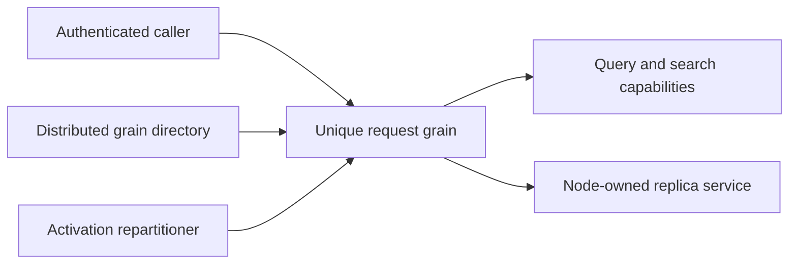
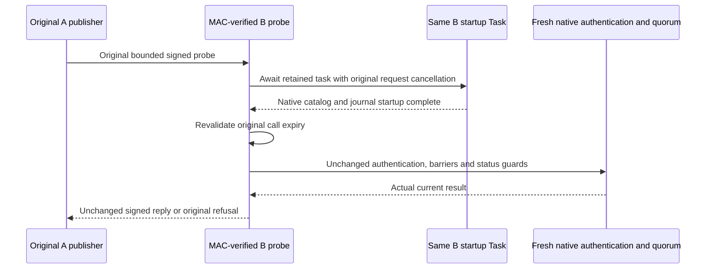
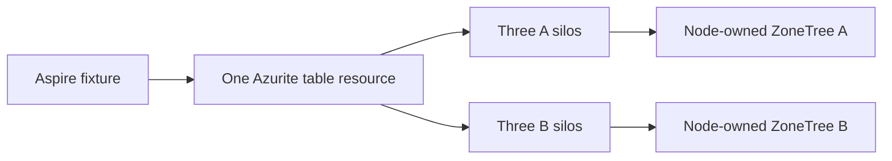
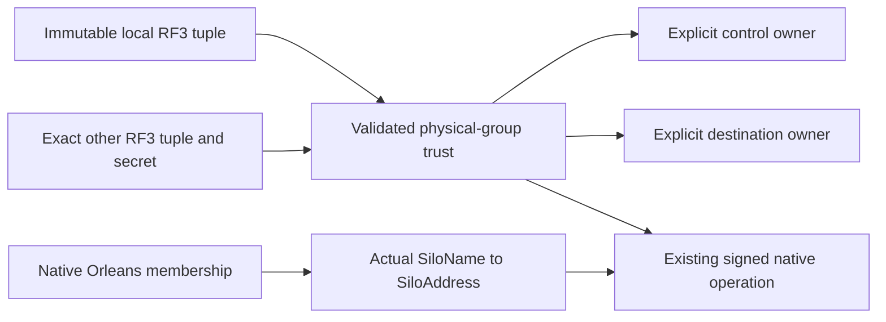
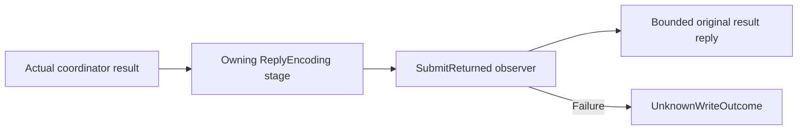
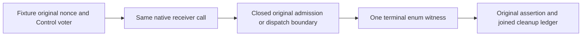
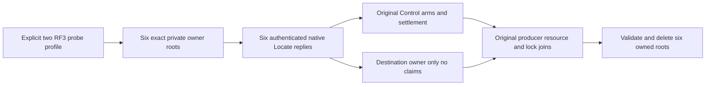
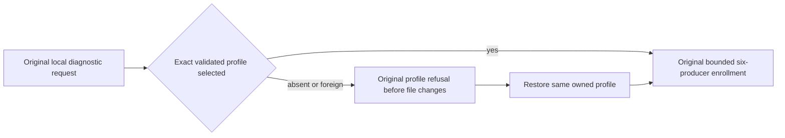
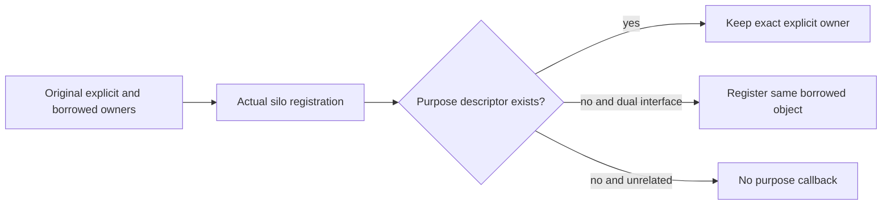

# ClusterRouting

## TASK-KL079-CONSUMPTION-CLOSED-CAUSE-001

REQ/AC-ROUTE-008/009 preserve existing event1003, request GUID, stage/category, public error and safe detail. The private failure-kind enum appends KeyLoad, Json and Format without renumbering existing values. Existing Protocol category and Consumption stage remain unchanged; only the former three-type Kind=Protocol union becomes a distinct closed safe label. No exception object, CLR type name, exception message, stack, inner exception, caller identity, credential, signed request or payload enters the log. No new request, logger resource, metric, provider, retry, timeout or fault seam.

Actual full-operation binding is the original ErasedFollowerInstallsNativeSnapshotAndOrderedTailBeforeCompletePublicReplayAndHealthyContinuation case: acknowledged original work/feed, follower kill and canonical erase, surviving-node commits, genuine native install/readiness/tail, same original receipt replay, SDK/official MCP policy refusal and healthy continuation, joined cleanup. Existing bounded fixture diagnostics collect event1003 before application shutdown and join their collector before the original application shutdown; the retained artifact remains available after all original producer/resource cleanup joins. Run38255628305/source01a9c5eb emitted 660 OwnershipLost read failures between follower stop and original deadline, followed by cleanup restart; its retained Consumption/Protocol/Protocol labels cannot identify the original exception subtype. This diagnostic stage must not label that historical cause or change its failed acceptance result. A fresh exact-source execution must retain the actual new closed kind on a naturally observed failure, or preserve a successful full original operation without manufacturing failure. Existing translator privacy controls remain controls and do not substitute for the real fault/repair/healthy case.

TASK-RUNTIME-RESOURCE-W preserves REQ/AC-ROUTE-001 under ADR-036. The shared RF3
request-ID scenario receives a unique tenant, because persisted resource catalog
identity is tenant/database/name and a random partition key does not isolate it.
Run37005805424 found its orders definition colliding with the prior leader-loss
fixture's domain/indexes. Preserve actual eight parallel SDK reads, stable write
outcome, fresh actor IDs and strict unsupported resource-migration rejection.
Only RequestIdReceiptTests.cs changes; existing failing CI is the baseline and
full exact-SHA RF3 qualification remains required.

Status: implementation in progress. Owner: KeyLoad lead. Decision: [ADR-036](../ADR/ADR-036-orleans-foundation.md).

Owner direction 2026-10-05 adds the native Orleans per-method selection contract
in [ExecutionPrimitives](ClusterRouting/ExecutionPrimitives.md) under
[ADR-110](../ADR/ADR-110-native-orleans-execution-primitives.md), REQ/AC-ORL-001..010.
It audits StatelessWorker, OneWay, Durable Jobs and selective interleaving against
actual request/read/partition/due grains. Candidate runtime/provider adoption and
real-operation RF3/resource/performance qualification remain pending.
The [broad capability review](ClusterRouting/CapabilityReview.md) additionally maps
native Streams/pub-sub, transactions/persistence, local services/lifecycle,
placement, resource settings, telemetry and deployment/testing to concrete joins.

TASK-PLACEMENT-DISCOVERY advances original KL-036/069/070/071/072 toward the
freeze required by ADR-016/017 and AC-ROUTE-004/005, AC-REP-004. Luna
cluster_wave reads the actual node-local host, generated identity/token contracts,
replication recovery and router call paths; writes only a private source-bound
design packet. Identify the minimum catalog, physical group/epoch fencing,
persisted movement intent and snapshot/tail integration points, exact unavailable
prerequisites and measurable real-process/RF3 cases. Existing whole-dataset RF3
and activation movement must not be relabeled as physical placement. Root selects
and freezes the implementation contract before any write-capable implementation;
this discovery does not choose the still-proposed token format, migrate a store,
change a public API or satisfy runtime acceptance. The join requires concrete
current file/method evidence and an ordered, disjoint implementation graph.

The first concrete page stage is frozen in
[PartitionTransfer](ClusterRouting/PartitionTransfer.md), TASK-PMOVE-PAGES and
TASK-PMOVE-PAGE-ORACLES. Exact canonical pages retain an owned native cut;
complete ownership, installation, token and RF3 gates remain explicit.

The owner2026-10-04 native CQRS/result/long-operation requirement is specified in
[NativeCqrs](ClusterRouting/NativeCqrs.md) and [ADR-082](../ADR/ADR-082-native-cqrs-streams.md).
Only the real Graph/native-enumeration compatibility test stage is accepted for
implementation; product RPC/transport and long-operation lifecycle joins remain
pending. Current Task replies do not satisfy the new streamed-result requirement.

| Requirement | Acceptance and observable evidence |
|---|---|
| REQ-ROUTE-001: every database operation runs through a distinct Orleans request grain and calls the relevant database capabilities. | AC-ROUTE-001: .NET/MCP client writes and reads reach request grains; independent concurrent requests have distinct grain keys and stable command retry IDs. |
| REQ-ROUTE-002: distributed grain directory and activation repartitioning are enabled; routing migration never transfers node-owned file locks or journals. | AC-ROUTE-002: cluster configuration enables both services; migration followed by SDK reads/writes preserves replica identity and durable outcomes. |
| REQ-ROUTE-003: silo membership starts without a second cluster stack or a single primary-node dependency. | AC-ROUTE-003: all three Docker silos become ready; the remaining two continue when any configured voter is killed. |
| REQ-ROUTE-006: enforced grain-call policy permits only the declared application transitions and does not route native replica system targets through application telemetry grains. | AC-ROUTE-006: real RF3 authentication/write/read succeeds with enforcement enabled; direct capability calls remain denied; upstream Graph regression proves the default native-system-target exclusion and preserves explicit tracking. |
| REQ-ROUTE-008: rejected requests provide bounded internal diagnostics without private data or changed public errors. | AC-ROUTE-008: actual logging provider records request GUID, closed stage/category and typed error code; malformed payload/typed decode/general JSON or argument failures omit payload, identity, credentials and raw exception text; successful calls allocate no diagnostic context; existing SDK/MCP RF3 outcomes remain unchanged. |
| REQ-ROUTE-009: initial native Orleans RPC failures retain transport/outcome semantics without claiming storage damage. | AC-ROUTE-009 / AC-AISQL-011: server-derived reads report OwnershipLost, possibly dispatched commands report UnknownWriteOutcome; native exception/timeout/noncaller cancellation tests and stopped-replica RF3 replay preserve domain RecoveryRequired, caller cancellation, secret-free details and exactly one dispatch. |

Slice map: `src/KeyLoad.Orleans/Features/ClusterRouting/` owns request routing/membership; Server composition wires it. ClientApi owns HTTP/MCP adapters. Tests mirror ClusterRouting in IntegrationTests. Frontend: N/A, routing has no independent UI. Credentials remain in Authorization's persisted catalog.

Traceability: AC-ROUTE-001/002/003 map to client-visible RF3 scenarios and targeted migration evidence in TASK-REP-TRANSPORT/INTEGRATE/VERIFY. Existing `CommandRouterGrain` and membership files are replaced in the same migration. No result is qualified until the exact GitHub Actions SHA/run/artifacts are recorded.

TASK-ROUTE-MEMBERSHIP preserves the existing database CAS membership record and
monotonic heartbeat updates. Initial membership initialization waits for local
`IReplicaEndpoint.TransportReady`, then retries only transient quorum failures
with `TimeProvider.System` and the silo startup cancellation token. Later provider
calls use independent bounded request deadlines, so cancellation of the startup
token does not prevent membership shutdown. Membership never owns files and never
resolves an Orleans client while constructing its provider. Source ownership is
the new `Features/ClusterRouting/Topology/ReplicaMembershipTable.cs` and cohesive helpers;
the lead replaces the old provider and composes the actual silo. The frozen primary
constructor accepts database, coordinator, replica endpoint, cluster ID, internal
principal ID, TimeProvider, and startup CancellationToken in that order.

## Identity, placement та movement

Актори: caller/request grain, directory/membership provider та future placement operator. Current source: [Orleans project](../../src/KeyLoad.Orleans/KeyLoad.Orleans.csproj), [partition/public contracts](../../src/KeyLoad.Abstractions/Contracts.cs), [Core domain resolution](../../src/KeyLoad.Core/DatabaseEngine.cs). Current deployment — один replicated physical shard, який містить багато незалежних atomic partitions; directory activation movement не переносить файли чи transaction identity.

| Вимога | Acceptance / flows | Test mapping |
|---|---|---|
| REQ-ROUTE-004: atomic partition identity відокремлена від physical placement | AC-ROUTE-004: equal literal key у різних domains не створює shared transaction; server catalog resolution фіксує eligible shared resources; packing/activation placement не змінює CAS/unique/dedup scope | Existing `SameLiteralPartitionKeyCannotCrossTransactionDomains` у [TransactionTests](../../tests/KeyLoad.UnitTests/Features/ResourceExecution/Cases/TransactionTests.cs); expanded placement fixtures PLANNED |
| REQ-ROUTE-005: physical partition movement/split має fenced restartable protocol | AC-ROUTE-005: PLANNED prepare/copy/catch-up/validate/ownership-switch/release tests з process interruption і real RF3 доводять complete cut, stable outcomes and current ownership-session token identity or explicit invalidation, with no old-owner write after switch | PLANNED KL-036/069–072 suites; [ADR-016](../ADR/ADR-016-atomic-physical-placement.md), [ADR-017](../ADR/ADR-017-ownership-session-tokens.md) |

Distributed directory/repartitioning — required in-progress source migration. Automatic physical split/merge, broad placement balancing і migration-aware tokens не оголошені готовими. Resource packing/placement і routing contracts freeze одним integration owner за [ADR-001](../ADR/ADR-001-partition-identity-affinity.md), [ADR-007](../ADR/ADR-007-replica-consensus-bootstrap.md). Target Abstractions/Orleans/replication host/tests mirror `Features/ClusterRouting/` для routing behavior, StorageRecovery owns files, ClientApi owns caller transport. Frontend N/A; placement/operator controls потребують власного accepted API до implementation.

Positive/negative/edge/error proof: distinct request identities, quorum/bootstrap failure, delayed/cancelled membership startup, source/owner epoch mismatch, minority, leader kill, activation move, future interrupted physical move. All tests real TUnit/recovery/Docker-Aspire SDK/MCP in GitHub, exact SHA/jobs/artifacts; current source names не проходження gates.

Stream boundary: current request/response routing uses Orleans grain calls; no
Orleans runtime Streams provider is configured. KeyLoad EventStreams are durable
database records with cursor/replay contracts, not Orleans pub/sub. The owner has
directed that Orleans Streams remain a first-priority architecture and
implementation workstream. The provider, event source, delivery/restart and
backpressure contract still needs to be pinned before source changes or claims
that this path is implemented.

TASK-ROUTE-REQUEST implements AC-ROUTE-001 using one non-reentrant GUID request
grain per operation. It routes writes to canonical atomic-partition actors and reads
to independent GUID read actors. The signed transport binds request ID, incarnation,
kind, persisted identity, stable command ID, exact base64url UTF8 payload and expiry.
Invalid scope, stale expiry, wrong grain key, forged authority and oversized payload
or reply fail explicitly. Each read actor obtains a quorum barrier before loading
the current persisted principal and calling existing Core/Query/Search capabilities.
Storage remains borrowed from the physical host. Admin backup/status/admission use
the local `INodeAdministration` interface only after a persisted admin check.
Real-store protocol tests complement mandatory Docker SDK/MCP and activation-move
tests; neither protocol unit tests nor a development build qualifies movement.

TASK-ROUTE-DIAGNOSTICS implements AC-ROUTE-008 after run36988949282 exposed
undifferentiated request rejections. The exact decoder/downstream branch remains
unknown. Internal enum metadata distinguishes payload syntax, typed decode,
required-null shape, envelope/partition, quorum, authorization, execution and reply
stages. LoggerMessage records only a GUID and closed enums, with no exception object.
The stage variable is a value type and success does not allocate a diagnostic
object, callback or scope. Public error codes/details, authorization, wire/schema,
retry identity and replica ownership remain unchanged. New UnitTests exercise the
actual EventSource provider and caller-visible reply, including private canary omission;
existing full RF3 failure scenarios supply operational evidence in GitHub only.
Ownership/stages/rollback are accepted in ADR-036 and the root delivery task graph.

TASK-AISQL-011 repairs the initial OrleansNode RPC boundary after exact baseline
37065200835 exposed a generic503 during stopped-replica writes. Native Orleans
placement/directory rejection is a possible path; its exact class and dispatch
phase were not captured and remain unproven.
CanonicalOperationGateway supplies trusted command intent; DatabaseCredentialResolver
supplies read intent. Only native OrleansException and TimeoutException map to
fixed transport errors. No internal retry, parsing of caller roles, storage-error
conversion or diagnostic suppression is permitted. New pure classification tests
use actual framework exceptions; real RF3 catch-up remains the operational gate.

TASK-GRAPH-EDGES permits the exact ExecuteAsync transitions from IRequestGrain to
ICommandPartitionGrain and IDatabaseReadGrain. Clients may call only IRequestGrain;
the default-deny graph is retained. TASK-GRAPH-OWNING repairs the independently
owned ManagedCode.Orleans.Graph package before consumer qualification: when
TrackOrleansCalls is false, native system-target identity must bypass application
tracking regardless of the implementing assembly name. Replica Grain Services run
before membership is Active and cannot depend on ordinary graph telemetry grains.
The owning repository's regression, patch release, GitHub publication and intended
NuGet feed verification are mandatory before changing KeyLoad's package pin.

REQ-ROUTE-010 maps to AC-ROUTE-010 / AC-AISQL-013: read cancellation replies use
the actual incoming actor token. Only active caller cancellation returns
Cancelled; inactive-token native cancellation returns OwnershipLost, and commands
retain UnknownWriteOutcome. Typed domain errors, safe details and existing closed-category
logging/privacy remain authoritative. ADR-036 TASK-AISQL-020 owns the sole
classifier and all three actual token joins. Automated evidence: new genuine
GrainReplyCancellationTests plus unchanged retained-replica SDK RF3 catch-up;
exact-SHA qualification is pending. This corrects a concrete source defect without
inferring the prior run's exact internal phase from overwritten fixture logs.

TASK-WAL-CI-RPC-CANCEL refines the same initial-RPC failure boundary under
ADR-036: native cancellation with an inactive incoming caller token maps to the
existing trusted read/write transport outcomes, while active caller cancellation
wins before classification or logging. The existing real framework-exception
tests preserve domain errors, safe fixed detail, stable command identity and
privacy; exact-source stopped-node RF3 remains mandatory. No internal retry or
change to storage/replication outcomes is permitted.

### TASK-MEMBERSHIP-NATIVE-HEALTH-MAPPING-001 (accepted source repair; runtime pending)

REQ/AC-MEMBERSHIP-002/003/008 and NativeTUnitEntry's existing fixture-owned six-silo gate require distinct native states, not generic HTTP availability. Actual local R322 failed1/1 at904.656s with zero4200-source/896-image drift. Group A native HTTP repeatedly returned404 for /health/membership-authority while AppHost WaitForAuthority kept Group B pending;15-minute initiating cancellation then canceled creation of node4-6. Original60-second DCP watch failures and secondary OfflineFileNotFound cleanup remain original separate evidence, not inferred primary causes.

Freeze before code: Server ClusterRouting Transport/ReplicaMembershipHealthEndpoints.cs maps GET /health/silo to200 only after existing OrleansNode.SiloJoined and actual published native Grains factory are present, otherwise503. GET /health/membership-authority returns200 only in validated Authority mode after existing node native join/factory publication and ReplicaMembershipAuthorityOwner.IsReady (real IMembershipTable provider published only after Group A native silo/catalog startup, and admission still open); Local/Proxy/unpublished/closed states return503. No address/catalog/credential/payload is disclosed; boolean routes return empty status only. Owner.IsReady is the same existing native authority endpoint admission gate; no replacement provider, probe/reflection, unconditionalHealthy or application-request dispatch is introduced.

Group A early authority health MUST NOT require six Active rows, or Group B's native WaitFor gate would deadlock. Existing GET /health/membership-ready remains unchanged: actual native ReadAll/proxy path, six exact Active generations/fingerprint, bounded historical rows and local membership presence. Both group database-ready routes remain503 and SDK/officialMCP deny before request-grain dispatch. AppHost dependencies and all original container/image identities, deadlines, cancellation/reader/node/storage/lock/image joins remain unchanged.

Existing real TwoRf3MembershipProfileTests.AcMembership001To003UsesOneSixSiloMembershipAndKeepsBothDatabaseGroupsClosed is the regression: native Group A authority gate permits Group B startup, independent actual six-silo fingerprint/membership and per-node silo200/membership200/data503/authorityA200-B503/publicSDK-MCP-denial oracles remain exact. Source review cannot claim the before-catalog startup observation or runtime success; those existing acceptance criteria remain required. Root owns guarded join, strict solutionbuild, fresh exact native six-silo gate and mandatory full Linux suites. No watch timeout/configuration is raised. Rollback removes both missing route mappings together with this task contract only; existing three-node readiness/ownership contracts remain unchanged.

### TASK-MEMBERSHIP-MCP-CLOSED-INIT-ORACLE: exact earliest official admission denial

Freeze before test correction under REQ/AC-MEMBERSHIP-003/008 and existing ADR-106 Stage1A: actual R347 six-silo run failed1/1 at49.656s after the native authority routes admitted Group B. The real official SDK2.2.0 session creation failed in SendDiscoverAsync, before a tool invocation, with HTTP503 and exactly OwnershipLost / “The physical shard catalog is not ready for public admission.”. Preserve the original failed log/TRX/source-image witness; it is not a passing membership gate.

DatabaseIdentityMiddleware routes every /mcp request through McpHttpPipeline, which resolves persisted credentials through DatabaseCredentialResolver.ReadAsync and OrleansNode.ExecuteCoreAsync before native SDK framing/session processing. Stage1A DatabaseReady=false throws the catalog admission error before Grains lookup and request dispatch. Thus a successful official SDK connection is an invalid Stage1A test precondition. The real official discovery/initialization request must be rejected at that earliest boundary. Do not bypass authentication/initialization to manufacture read/write CallToolResult values. Actual SDK read and command denials remain mandatory at both groups; actual official tool read/write interoperability stays independently mandatory in data-ready RF3 and future Stage1B, and is not claimed from failed session creation.

The owning ClusterRouting readiness assertion must use real McpOfficialClient.ConnectAsync and require the exact native HttpRequestException503, a bounded original native response-body message, precisely five problem fields type/title/status/detail/errorCode with the literal catalog-not-ready values, and no bearer credential disclosure. Any other503, generic server fault, wrong body/extra field, successful connection, timeout, cancellation or cleanup error fails. Unexpected successful native owners are disposed; existing connection failure cleanup preserves primary and cleanup errors. No alternate transport, fake provider/handler, retry, timing change, production seam or successful-session branch is admitted.

The original SDK QueryCapabilities/Commit calls remain and now compare every typed safe problem field. This earliest source-bound pre-grain rejection implies no user data/catalog/outcome effect; this test does not claim a complete persisted-store snapshot from Initialize. Following both group denials, repeat genuine all-six silo/membership/data/authority health and independent signed native fingerprint checks to prove system-control operations remain healthy while data stays closed. All existing image/profile/two-three-voter/membership/privacy/cleanup and Stage1B boundaries remain. Root owns guarded join, full build and actual native six-silo operation proof plus mandatory Linux/recovery/standardRF3 gates. No runtime PASS, movement acceptance or production qualification follows from authored source.

### TASK-CRS-NATIVE-BUILDER-OWNERSHIP-001

REQ/AC-CRS-002/004 and existing joined request/fault lifecycle contracts require the actual native testing builder to remain owned from CreateAsync through every failed setup path and successful wave shutdown. Current RequestCqrsRf3WaveStartup holds it only in a local variable: override/model/build failures and successful ownership transfer omit its DisposeAsync. This is a proven test-infrastructure ownership defect; no causal attribution to historical SCAT cancellation or surviving MCP503 is made.

Freeze before implementation: startup captures the real IDistributedApplicationTestingBuilder immediately after its original CreateAsync completes. Successful transfer moves that exact owner into RequestCqrsRf3Wave; failed setup retains it in startup. Dispose is awaited after original application stop/disposal and diagnostics joins, and before successful node-lock cleanup. Each actual disposal failure remains in the original cleanup evidence; the builder reference is cleared only on successful awaited disposal. There is no detached task, altered startup/read/election deadline, new client, retry, weakened majority or missing-lock suppression. Append the fixture-local lifecycle stage at the end so existing stage numbers retain their meaning. No product or serializer contract changes.

Ordered implementation: freeze this contract; add exact builder ownership transfer/disposal to existing startup/wave; root format/build; execute the existing real SCAT mismatch/corrected waves, C1 two-compatible-voter restart and real guard-cancellation flows. Those whole operations retain their SDK/MCP/read-cut/no-effect/native lock and image oracles. Existing source review proves all setup branches capture the owner, but cannot prove native disposal completion at runtime. Actual original native logs, cleanup failures and exact source/DLL/image receipts are required; all Linux unit/scalar/recovery/RF3 gates remain open. Rollback removes this task and its fixture-only ownership changes together, preserving every original failure artifact. Root owns source join and execution; this private packet claims no passing runtime gate.

RequestCqrsRf3StartupExecution owns startup creation, execution and exactly one awaited disposal in its finally block. It collects the original setup failure and every cleanup failure before throwing their aggregate; the coordinator's RunAsync reports setup failures and transfers successful owners without disposing itself. This preserves explicit disposal on every path and avoids a second disposal replacing the original setup failure. Successful startup transfers every live owner before return; failed startup awaits all original application/diagnostics/builder cleanup in this one execution owner.

### RF3 SDK and due-owner original cancellation evidence

REQ/AC-CRS-002/004 with existing fault lifecycle contract under ADR-082/083 retains original run37666943488 TaskCanceledException failures. Reuse RequestCqrsLifecycleEvidence at both real scenario owners, original token states and closed stages before native/public awaits; capture first failure before cleanup and terminal after all original joins. Startup binds its existing actual readiness/capture observations; first/cold due wave is explicit. Preserve original exceptions as AggregateException inners and all cleanup failures; fatal handling remains existing observer behavior. No payload, secret, endpoint, root or free-form log in lifecycle context, no changed deadline or inferred success. Existing real native diagnostics early-completion/admission cancellation flows validate first snapshot and joined cleanup; both original full RF3 operations remain required, not replaced by a synthetic stage assertion. No new forced-fault seam is introduced; deterministic forced startup failure followed by fresh healthy RF3 needs separately authorized original native observation, not a fabricated fixture.

## TASK-C1-NATIVE-RPC-FAILURE-EVIDENCE-001

REQ-ROUTE-008 / AC-ROUTE-008 retains actual closed OrleansRpcFailure category, request GUID and typed code from existing owned C1 Aspire subscriptions. Separate bounded RPC artifact preserves original MCP-only schema. Save only after original subscription join, attach path to original failure through unchanged ServerFailureObserver aggregation; preserve all cleanup errors. Never retain raw lines, exception text, payload, credentials or binary signed discovery. Original follower-kill failure occurred before official MCP initialize completed, and original captured artifacts contain no RPC category. No membership or root cause is inferred from safe OwnershipLost. Native follower whole-flow must be rerun and actual category/phase bound before behavioral correction; no retry or timeout change.

### TASK-CRS-TWO-RF3-LATE-DATA-ADMISSION-001: Linux59 native startup correction (2026-10-08, source candidate)

Under existing REQ/AC-MEMBERSHIP-003/008 and AC-OWNER-DOC-001..006, the original authenticated required Linux RF3 run37744013727/job113201104531 failed AcOwnerDoc001To006DestinationFreshDenialGrantPublicReadReceiptReplayAndOwnedRestart at its existing15-minute deadline. Group B waited for Group A combined resource health, while Group A had both /health/membership-authority and /health/ready checks. Native Authority DatabaseReady requires verified physical-owner registration, which needs all six joined voters including Group B. This introduces a circular startup dependency. Original Group A503/data checks, Group B health waits, UnknownWriteOutcome registration logs and still-held cleanup locks remain failure evidence; this source correction does not convert that original run to a pass or explain the other original startup/diagnostic failures.

Freeze before implementation: Group A container resource health and Group B WaitFor authority dependencies retain the actual early /health/membership-authority200 gate, without adding late data admission to that dependency. All six retain RemoteDocumentReads configuration; Group B retains its existing actual membership and data-ready resource health checks. The fixture first waits for all six native resources healthy, then independently requires actual /health/ready200 from every one of the six discovered Aspire endpoints before transferring its owned wave. Only503 is pending; every non200 status other than503 fails, and HTTP faults propagate. The same existing initiating token/deadline bounds every request/wait; no timeout, retry budget, assertion, identity or endpoint changes. Native six-silo public SDK/MCP reads, persisted grants, receipt replay, restart and all resource/storage/lock/root joins remain mandatory.

Ordered ownership: AppHost ClusterRouting Resources/TwoRf3RemoteReadResources.cs owns the split health registration; IntegrationTests ClusterRouting Helpers/TwoRf3MembershipWave.cs and TwoRf3MembershipDataReadiness.cs own the final actual six-endpoint data admission. UnitTests ClusterRouting Cases/TwoRf3MembershipEnvironmentTests.cs checks the actual emitted native health annotations for absence of the circular Group A late-ready dependency and preservation of Group B checks. Existing AcOwnerDoc001..006 is the real regression and required delivery proof. [ADR-106](../ADR/ADR-106-partition-owner-movement.md) Stage1A/remote-document admission contracts are clarified for this two-level lifecycle gate without changing the topology, authority or public contract; rollback restores this source correction as one stage. Parent integrator owns solution build, native TUnit and Linux RF3 verification. Source readiness is not runtime success, and original namespace/C1 diagnostics/startup/cleanup failures remain unresolved until exact evidence establishes their causes.

R2 options/clock ownership correction: existing centrally bound, validated and registered `IOptions<TestExecutionOptions>` now owns `DatabaseReadinessPollInterval` (default100ms, existing positive bounded-duration validator). The fixture composition resolves that native options owner and its already registered `TimeProvider`, explicitly passes both to `TwoRf3MembershipDataReadiness`, and the operation uses only those supplied values. No operational constant or System clock selection remains in the wait helper. The original15-minute initiating token still bounds startup, every request and delay; status200/503/other failure rules and all owned cleanup remain unchanged. `RemoteReadAuthorityDependenciesExcludeLateDataAdmission` performs actual native Aspire composition and inspects emitted health annotations; classify it as ordinary supporting infrastructure, without assigning a functional product-contributor claim. Existing full public AcOwnerDoc001..006 remains the mandatory product regression.

### Genuine native terminal movement supporting flow (2026-10-08)

REQ-MOVE-NATIVE-TERMINAL-001: The configured two-owner native supporting fixture submits every immutable target StagePage and Install phase through the actual A grant/MAC admission and independently signed B journal/materializer. Every actual B journal is acknowledged at A before a subsequent authority transition. Terminal Install uses the original Handle.PageCount; A Installed advancement accepts only the actual returned CommitReceipt and ACKed terminal grant. Technical publication does not authorize ordinary target traffic while the public A-authority bridge remains closed.

AC-MOVE-NATIVE-TERMINAL-001: The complete mixed original source corpus is captured with independently checked family/page/resource digests. Every StagePage leaves all destination canonical model families unchanged; same-ID phase replay is byte-identical and preserves complete raw state, canonical position and native journal index. Installation checks full independently expected destination values, storage-incarnation normalization and original integrity incarnation, exact terminal command/token/mutations/durability, original A receipt authority and cold A/B reopening. Finalize/Publish/Retire must use actual preceding grants/journals; no synthesized Installed/MoveReady/receipt.

REQ-MOVE-NATIVE-HISTORY-001: The supporting fixture retains at most64 native entries. The explicitly selected terminal fixture admits at most426 original entries:19 throughCaptured +4*55 transfer pages +2 terminalInstall +3 InstalledAdvance/Finalize/CompleteRetirement +2 Publish +180 source cleanup operations. Native per-append MaxAppendEntries64, MaxAppendBytes, snapshot/materialization ceilings, command timeout, database/cache limits remain unchanged. The actual corpus must fit55 transfer families and one bounded cleanup batch per family; excess is a failure, not a quota adjustment.

AC-MOVE-NATIVE-HISTORY-001: Original command lookup reads actual retained native journal pages bounded by the original configuration; every page and entry checks the original token, exact index continuity and nonempty progress. Actual same-ID result/cut/index remains stable after replay and cold reopen. The final case asserts its independently counted history; no visibility-only history, fake journal or lost reader ownership is accepted.

All cases remain authored and unexecuted until root's genuine native gate. Public six-silo movement, terminal abort and four-child crash acceptance remain separate mandatory criteria; no task/status closure is proposed.

REQ/AC-MOVE-NATIVE-NONE-CORRUPTION-001: The separate real native malformed-control case replaces only persisted current-format control Phase with None0 and submits the original first Install authorization through configured MAC admission and the actual replica log/materializer. Fatal apply preserves complete canonical bytes/cut and produces no receipt. The original waiter exposes RecoveryRequired/corrupt-log; joined original worker shutdown retains Corruption/invalid-state. Exact original row bytes are restored with one native commit, faulted owners fully dispose, and cold new owners/admission replay the original retained command before genuine complete target installation and cold model/receipt checks. Two intentional fault-preparation/repair commits are explicitly counted apart from the replicated index. Production markers1..9, native serializer, quotas/timeouts and all original terminal case assertions remain unchanged. No immediate fabricated corruption receipt or materializer reset.

## Authored active-capture abort native operation

REQ-PMOVE-ABORT-FLOW-001 / AC-PMOVE-ABORT-FLOW-001 binds `ControlledPartitionMovementAbortTests.GenuineActiveCaptureAbortJoinsBothOwnersPreservesOriginalModelAndColdHealthyCommand`: genuine original Capture/page owner remains alive; A BeginAbort, every empty-target bounded cleanup family/ACK, SourceBeginAbort marker, old Capture rejection with full canonical/cut/native-accounting invariance, original producer/page/image join, terminal source/target journals, original exact body-bound ACKs, one actual grant-disposal batch and FinalizeAbort precede cold A/B reopening. Complete original document/vector/topic/queue values, full/partial blob reads and immutable A receipt remain authoritative. A new original-scope document command has full literal token/receipt, exact replay/no effects and cold literal read.

Independent history bound: source starts16 after genuinely authorized active Capture; BeginAbort1, target60*(authorize+ACK)120, SourceBeginAbort3, source terminalAbort3, cancel1 and finalize1 yield source145, target bootstrap1+60=61; healthy source146. All target families are genuinely empty before abort; all grants are actually ACKed except one deliberately unreleased Capture, so a nonterminal grant disposal fails the case. Existing selected terminal history426 covers this strict bound; production per-append64, database/cache limits and timeouts stay unchanged. Actual six distinct native loopback listeners/configured MAC admission are required; unsupported host bind is a failure, not a substitute proof. Source-only authored operation; no native execution, staged-target cleanup, process-cut or public RF3 qualification is claimed.

## TASK-MOVE-NATIVE-COMPOSED-003

This current source candidate composes REQ/AC-MOVE-NATIVE-TERMINAL-001, REQ/AC-MOVE-NATIVE-HISTORY-001, REQ/AC-MOVE-NATIVE-NONE-CORRUPTION-001 and REQ/AC-PMOVE-ABORT-FLOW-001 under [ADR-017](../ADR/ADR-017-ownership-session-tokens.md) and [ADR-030](../ADR/ADR-030-retention-paused-restore.md). Automated whole-flow mappings are respectively ControlledPartitionMovementTerminalTests.GenuineInstalledPublicationRetiresSourcePreservesOriginalReceiptAndBothColdOwners, ControlledPartitionMovementCorruptControlTests.MalformedPersistedNoneControlRejectsOriginalApplyAndRepairedColdOwnersInstallExactly, and ControlledPartitionMovementAbortTests.GenuineActiveCaptureAbortJoinsBothOwnersPreservesOriginalModelAndColdHealthyCommand. The history criterion is checked by all three genuine journal owners; every original complete supporting case remains mandatory.

Ordered integration: retain the current owner-admission, GrantTests cold-read/fence assertions, CaptureFlow.Principal, CapturedPageReader, canonical queue expected JSON and document-prefix paths; apply this docs-first guarded source composition; complete independent full source review; root alone formats, builds and executes the actual native TUnit/MTP focused cases and related normal/scalar gates. The current shared principal helper resolves authority before borrowing the native read view; root has joined the native test-oracle read ownership source correction, with its own execution evidence pending. The abort closed-capture check reuses the current principal helper: resolve authority before borrowing the native read view, never resolve another store read inside that view. Reject changed base/source guards and compose again instead of applying retired candidate bytes.

These are source-authored two-owner supporting operations, with distinct A/B stores/journals and six actual native loopback listeners, not six active Orleans silos. No build, native operation, coverage, RF3, public target read, staged-target abort, four-child fault cut, performance, endurance or power-loss qualification is inferred. ADR status and product acceptance remain open until their complete original evidence exists. Native MaxAppendEntries64 is unchanged;426 is solely the explicitly selected terminal/abort fixture retained-history bound.

## REQ-PMOVE-PROCESS-001 — admitted Fence four-child recovery

AC-PMOVE-PROCESS-001 requires the genuine configured MAC/admission producer and native replica log/materializer to commit mixed documents/vector/topic/queue/blob, Prepare11 and Authorize12 before handing the immutable locally signed source Fence to four owned children. Actual atomic HeaderWritten, PayloadWritten, JournalFlushed, MutationApplied and ApplyCompleted cuts are separate authored cases. Parent must not open stores between fault kill and recovery child. Original Fence13/position14, full literal phase/control/journal, full bilingual model/vector rank/event/head/cursor/queue metadata, full+partial blob, exact original A seed receipt, native payload and unchanged target image must survive native reopen; original replay cannot append or change the full raw read cut. Actual configured ACK14/AcceptFence15 and both cold owners provide healthy continuation.

One existing90s deadline spans producer, children and continuation; cleanup keeps30s and exact database/replica native file-release bounds. History64 remains unchanged (maximum15 entries), with original DB/cache/append caps. Every actual child/stdout/stderr/native node/listener is joined; failures retain all original roots and primary+cleanup outcomes. Native current-format files use CreateNew/Unix0600 and original bounded codec. No synthetic permit, target receipt, aliases for unavailable loopback addresses, skipped cases or expiry rewriting. Full Install/Retire/Abort process and public six-silo evidence, RF3, power-loss/endurance remain separate open gates.

Trace: TASK-KL036; ADR-017; `ControlledPartitionMovementProcessRecoveryTests.OriginalAdmittedFenceSurvivesFourOwnedChildrenWithMixedStateExactReplayAndHealthySettlement` (five actual-cut Arguments). CrashHost ClusterRouting owns producer/contracts/native child; Recovery ClusterRouting owns literal assertions/whole-operation deadline/four-child runner and cleanup. Source-only authoring does not establish native PASS or close KL036.

### TASK-PMOVE-FENCE-PROCESS-002: joined producer ownership

REQ-PMOVE-PROCESS-001 / AC-PMOVE-PROCESS-001 requires the original parent producer to close both actual canonical/replica nodes, MAC/native admission and all discovered native/HTTP listeners before the first of the four original CrashHost children starts. The shared ProcessOperation preparation scope returns only frozen value/configuration/original signed operation evidence after joined disposal; original known source and target native owner locks are checked before child execution. Discovered owner/voter/silo/caller addresses remain immutable original metadata, never claims of a live six-silo deployment. Actual fixed11111 native identity and six distinct IP pins are unchanged; unavailable original host bindings fail and actual Linux process qualification remains necessary.

The child consumes only the bounded current-format original typed CreateNew input, local native signature, persisted original owner/grant/placement/authorization and existing real journal/materializer. It does not issue a permit, configure live DNS/listener owners, create a dispatcher or reconnect to the parent producer. The post-child ACK14/Accept15 continuation invokes current configured MAC/native admission and its original DNS/IP address validation against frozen identities; DNS validation does not require an open original producer listener. No alias, different native port, deadline/expiry extension or bypass is admitted.

The existing five atomic cuts each retain all four joined original children, strict bounded Unix0600 native CreateNew files, one90s parent deadline, original readers/owner checks/primary-plus-cleanup failures, complete literal document/vector/topic/queue/blob/original receipt and unchanged-target images. ProcessRecoveryTests.OriginalAdmittedFenceSurvivesFourOwnedChildrenWithMixedStateExactReplayAndHealthySettlement remains the complete mapped automated flow. Root alone reviews/applies/formats/builds and executes original native TUnit/MTP development and Linux delivered-source gates. This source-only correction has no runtime pass and does not qualify full Install/Retire/Abort process movement, public RF3, power-loss or endurance.

The same Fence recovery flow also replays the genuine original CompleteBlob command, immutable request/evaluation time and complete original outcome in both recovered and final cold owners. Original published blob receipt/token/value are independently checked before handoff, then retained byte-identical after each replay. Existing complete raw-image/cut/index checks reject any new effect or journal entry. This activates the previously unused original blob replay assertion without changing the mixed corpus, canonical queue oracle or process stage.

### TASK-PMOVE-FENCE-PROCESS-003: independent blob oracle

REQ-PMOVE-PROCESS-001 / AC-PMOVE-PROCESS-001 also binds the blob expected reference, upload and original completion IDs, full bytes [1,2,3,4], partial bytes [2,3], part SHA256, published revision and part count to an independent literal recovery corpus. The parent compares the producer's original CompleteBlobUpload request against that corpus and recomputes its integrity from the actual persisted source incarnation plus literal input via the canonical native BlobIntegrity API. Parent, recovered and cold-owner assertions reuse this independent expected corpus, never the producer helper or its expected hash. Original outcome replay remains byte-exact and whole-store/journal-index oracles remain unchanged. This source repair addresses FENCE-PEER-001; it is not a compiler/native runtime pass or any Install/Retire/Abort/public/power-loss qualification.

### TASK-KL036-NATIVE-MEMBERSHIP-HEARTBEAT-001 — operation-specific native heartbeat

REQ-MEMBERSHIP-HEARTBEAT-001 / AC-MEMBERSHIP-HEARTBEAT-001 freeze the native Orleans10.4 UpdateIAmAlive producer: MembershipTableManager.UpdateIAmAlive constructs only SiloAddress and IAmAliveTime. The current signed authority v1 entry remains unchanged; its UpdateIAmAlive use carries canonical empty metadata, default status/port/start, UTC Alive, empty suspects and initial ETag. Validate this closed operation shape independently; InsertRow, UpdateRow and replies retain their exact full-entry validation. The server converts the authenticated heartbeat into a minimal native MembershipEntry and invokes the existing native membership provider, whose CAS changes only a strictly newer Alive on an existing row, preserving every other field, row ETag and table version. Unknown address and duplicate/stale heartbeat cannot insert or replace a row. Existing signed cluster/authority/caller group and exact caller-silo binding, replay admission, byte bounds, deadlines and persisted authority are unchanged. No schema/alias/ID migration or optional full-row metadata is introduced.

Automated supporting operation regression: ReplicaMembershipAuthorityHeartbeatFlowTests.NativeSignedHeartbeatPreservesFullRowRejectsWrongCallerThenHealthyContinuation drives the actual production ClientTable, signed HTTP authority Endpoint, published native ReplicaMembershipTable and real ZoneTree membership CAS/apply; malformed full-row and wrong-caller rejection preserves the cut, unknown/stale heartbeat is a native no-op, and a newer heartbeat continues healthily. Existing mandatory KL036 Aspire two-RF3 SDK/official MCP whole flows (public parent, four cancellation, capacity and three capture-pointer cases) remain the actual six-owner startup/operation/cold qualification; their fresh Linux normal/scalar evidence is required. Authentic556 nine RF3 failures per mode and native UpdateIAmAlive Validation.Entry stacks remain original failures, not qualified repair evidence.

Ownership: Orleans Validation/ReplicaMembershipAuthorityHeartbeat.cs and existing Call operation selection; Topology ClientTable heartbeat call; Server Transport/ReplicaMembershipAuthorityOperations.AliveAsync only; owning Unit native-store case; feature/PartitionTransfer/ADR106 traceability. Delivery order: docs freeze → narrow source/tests → root guarded join/build/native discovery → required Linux normal/scalar and genuine Aspire RF3/cold SDK/MCP. Rollback is source-only current-format revert; no persisted format or authority change. Fresh proof of common startup resolution remains OPEN until those actual suites run. Native source: https://github.com/dotnet/orleans/blob/v10.4.0/src/Orleans.Runtime/MembershipService/MembershipTableManager.cs, UpdateIAmAlive lines230–239.

TASK-KL036-NATIVE-MEMBERSHIP-HEARTBEAT-001 supporting regression ownership refinement: Security owns Cases/ReplicaMembershipAuthorityHeartbeatFlowTests.cs, Helpers/ReplicaMembershipAuthorityHeartbeatHttp.cs and Configuration/ReplicaMembershipAuthorityHeartbeatOptions.cs under owning Unit ClusterRouting. The actual existing native store/consensus fixture supplies ReplicaMembershipTable; its production authority owner publishes that same real provider, an owned ephemeral Kestrel host maps the production authority endpoint, and the production ReplicaMembershipAuthorityClientTable issues the original native minimal UpdateIAmAlive with real signed request/reply authentication. Verify the persisted row's exact metadata/ETag/table version, only a newer Alive mutation, stale/duplicate/unknown-address native successful no-op, malformed full registration and wrong signed caller address refusal with unchanged persisted cut, then a healthy newer heartbeat. All HTTP host/client/reader/provider operations join under existing owning limits/clocks/cancellation and one failure ledger. This supporting single-voter native committed store/signed-wire operation is not Docker RF3 qualification. It refines AC-MEMBERSHIP-HEARTBEAT-001's supporting test mapping without weakening any six-owner SDK/MCP/normal/scalar/cold gate or original556 failure. The earlier NativeStoreTests draft is transferred source work, not a second requirement or runtime evidence.

### TASK-KL019-NATIVE-ACTIVATION-001 — sequential native database activation witness

REQ-KL019-NATIVE-ACTIVATION-001 / AC-KL019-NATIVE-ACTIVATION-001 qualify the SAME native CommandPartitionGrain across actual sequential owned-node loss/restart: opt-in BeforeSubmit observation uses its actual IGrainContext.GrainId SHA256 and native non-default ActivationId with exact public parsable roundtrip. A fresh ingress request GUID alone is not database activation evidence. Separate closed CommandActivation files bind the original session/arm/request/command/voter/silo BeforeSubmit marker. Current probe v2 owner/arm/release/marker bytes remain unchanged; no new public endpoint, caller authority, generated persistence identity or policy change. Existing private modes, no-reparse checks, immutable controls, atomic writer and file/record/aggregate ceilings charge each witness exactly as every other control file. Default/unselected requests do not capture activation evidence.

NativeDatabaseActivationRf3Tests.SameNativeDatabaseGrainReplacesActivationReplaysStableCommandThenColdHealthyContinuation starts the real protected-document six-owner Aspire wave and performs the existing genuine protected setup. It then provisions a separate ordinary persisted C1 document caller and source-owned partition: source3 control mounts cannot be mislabeled as targetB activation proof. Hold the actual SDK command; capture/release/settle its native database witness and full original receipt. Kill/restart the exact observed source owner, capture the identical command through a fresh official MCP ingress request, require equal grain digest and unequal actual ActivationId and ingress request identity, and compare full original receipt and unchanged document revision/content. After all six processes stop and original node/database/replica locks are acquired, each source voter must retain the exact original successful native scoped outcome/receipt and each target voter must lack that unrelated scoped outcome. Reopen the same Aspire roots, verify unchanged exact SDK/MCP command replay, changed-content same-ID conflict, then the existing full fresh healthy command/read/receipt continuation. Original 12-minute parent and all request/hold/cleanup deadlines remain unchanged; initiating/producer/cleanup failures are retained, and a primary failure retains the owned roots before disposal while still joining all resource/lock cleanup.

Ownership: Server ClusterRouting Contracts/RequestCqrsProbeActivation{Record,Protocol}; Execution capture/inventory; Validation exact witness/native identity/marker binding; existing serialization owner remains the only atomic writer. Integration ClusterRouting Cases/NativeDatabaseActivationRf3Tests and bounded witness/held-call/scenario/cold-outcome responsibilities. ADR-106 native probe ownership is reused; no storage migration is needed. Ordered delivery is this docs freeze → guarded implementation → root full build/format/native discovery → actual Linux normal/scalar Aspire RF3 originals. Rollback removes only opt-in observation and its scenario; all current-format data/authority remain unchanged.

This case proves sequential activation replacement and duplicate-command effect fencing only. Simultaneously live duplicate database activations remain explicitly OPEN, as does whole KL019 until every original criterion is qualified. Source implementation/native census/build are not runtime PASS or a task closure, and killed-process cold reopening is not power-loss proof.

Failure evidence retention refinement: primary-failure retention also preserves the separate original private probe file tree. Its fixture first validates all original settled gates and producer-disposal markers after actual resources joined; only file deletion is inhibited. Native host stop/dispose/lock checks and every cleanup failure remain unchanged. Retained private records remain under their original closed modes and bounds, not exported as product telemetry.

### TASK-KL019-SIMULTANEOUS-NATIVE-CONTEXT-001 — actual overlap qualification

REQ-KL019-NATIVE-OVERLAP-001 requires a genuine old/new executing native `CommandPartitionGrain` context for the same canonical GrainId/physical owner. A sequential stop/restart, two request grains or concurrent HTTP calls cannot satisfy this predicate. AC-KL019-NATIVE-OVERLAP-001 requires the original old callback to acknowledge a fresh nonce before isolation, then acknowledge another fresh nonce after an actual distinct replacement ActivationId witness; the new callback must subsequently acknowledge a challenge bound to the original old-after Ack bytes. Both original producers must still be held. Any original cancellation, self-termination, timeout, early completion or missing Ack fails this gate.

The bounded opt-in diagnostic carries only original session/arm/request/command IDs, native voter/silo identity, SHA256 of native GrainId, actual ActivationId, closed step, nonce and original-file digests. It uses the existing immutable file quota, private modes, record bounds, source-probe admission and same original callback/token. It reads no caller payload, credentials or public protocol metadata. TargetVoter is admitted solely for a nonempty command `BeforeSubmit`/`Hold` with no read, partition, source-request or source-arm fields, and matches the exact actual local replica identity. Default untargeted behavior and canonical-journal target admission are unchanged.

Stage A derives a dedicated exact-six namespace model from the original source-bound image; the ordinary fixed-three composition and exact-two-peer rule APIs remain unchanged. The opt-in isolation blocks all five real other silo peers for the selected source owner. Actual signed discovery binds each of the six original Aspire containers to its own source/target incarnation and transport address; native capability/namespace/counter/restoration proofs remain mandatory. No independent containers, private Orleans API or replacement topology is admitted.

Stage B keeps the original native hold, routing and execution deadlines. After causal live overlap, releasing the old callback must produce actual `OwnershipLost` with the closed no-leader/transport-unavailable diagnostic rather than cancellation/expiry or an unknown-write result. Releasing the new callback must return the exact already-committed receipt. All six owners are then genuinely stopped/joined before original native cold receipt inspection, same-source SDK/official-MCP stable replay, conflict refusal and fresh healthy continuation. Uncommitted replication journal changes are not described as unchanged canonical state; no native failed result is reset or fabricated.

AC-KL019-NATIVE-LIVE-CALLBACK-001 maps to `NativeDatabaseLiveCallbackRf3Tests.ActualHeldNativeCallbackAcknowledgesBeforeAfterThenStableColdReceiptAndHealthyContinuation`, a genuine SDK held callback with two actual Ack rounds and original receipt/cold/healthy controls, without duplicate-activation credit. AC-KL019-NATIVE-OVERLAP-001 maps to `NativeDatabaseDuplicateActivationRf3Tests.SimultaneousNativeDatabaseContextsFenceOldAuthorityThenColdStableReplayAndHealthyContinuation`. Both require fresh native discovery, immutable compiled-image binding, Linux Aspire execution, original TRX and all resource/reader/producer cleanup joins. Source implementation, supporting flow, sequential replacement and metadata discovery alone do not close simultaneous duplicate ownership.

Ownership: AppHost `ReplicaIsolationResourceComposition` plus exact-six `NativeActivationIsolationComposition`; Server ClusterRouting `RequestCqrsProbeLive*` and actual held callback; Integration ClusterReplication native rule/identity owners plus ClusterRouting causal witness/producer/scenario/cases. This packet depends on immutable sequential KL019 R3 source, with separate live/prerequisite guards. Root alone joins, formats, builds and delivers. Rollback removes only this opt-in diagnostic stage and its two declared tests; it does not change persisted models, permissions, production directory defaults or ordinary fixed-three fixtures. All original Linux cancellation/startup failures remain immutable evidence; native timing may prevent overlap and remains an explicit failed qualification, never grounds to enlarge limits.

### TASK-KL019-WHOLE-NATIVE-UNION-001 — original acceptance trace

Original architecture KL019's duplicate/stale-epoch canonical-effect and restart-ownership predicates remain mandatory. Immutable sequential R3 plus simultaneous A+B are one source union with original reviewed C# bytes. This union adds REQ/AC-KL019-EPOCH-WHOLE-001 supporting real native stale/future operation refusal, exact failed-outcome repeat with no second cut, then actual current persisted epoch healthy commit/literal document/full receipt replay with no second commit. The ordered failed outcome is retained; it is not a successful original write or unchanged whole raw store.

Source mapping: PartitionOwnershipEpochWholeFlowTests.StaleAndFutureNativeEpochsReplayWithoutSecondEffectThenCurrentEpochIsHealthy; existing PartitionOwnershipEpochTests.CurrentBatchEpochIssuesTokenFromPersistedPlacementWitness / StaleAndFutureBatchEpochsPersistOwnershipFailureWithoutDomainMutation / MissingCatalogFailsClosedBeforePartitionCommit / CorruptPlacementOwnerTupleFailsBeforeOutcomeOrPartitionMutation preserve current positive and malformed authority controls. Actual persisted CAS and signed minimal native producer map to ReplicaMembershipNativeStoreTests.RealStorePersistsNativeSnapshotAndRejectsStaleCompareExchange and ReplicaMembershipAuthorityHeartbeatFlowTests.NativeSignedHeartbeatPreservesFullRowRejectsWrongCallerThenHealthyContinuation. Existing six-owner PhysicalOwnerRegistrationRf3Tests.AcOwnerRegister001To003RegistersConfiguredOwnersThenJoinsAllNodesAndReopensLiteralDirectory preserves actual native owner locks/directory identity and closed public calls after stopped joined owners; its original TaskCanceled evidence remains failed.

Sequential NativeDatabaseActivationRf3Tests.SameNativeDatabaseGrainReplacesActivationReplaysStableCommandThenColdHealthyContinuation and both declared live/duplicate activation cases retain complete actual SDK/official-MCP same-command receipts, no second effect/conflict and new healthy effect, original native cold source3/target3 scope and all-six owner lock/readers joins. Supporting live callback or sequential restart cannot qualify simultaneous duplicate activation. Original ingress request identity remains separate from same canonical database grain/owner identity.

Source mapping is not acceptance. No native UID/count/location or current runtime outcome is inferred; root must compile/discover the union once and qualify normal/scalar actual Linux Aspire originals, all request/reader/resource cleanup and exact source/image provenance. Native overlap remains OPEN until causal live Ack and old-authority refusal occur under original deadlines. Full dependency/mandatory CI and endurance/power-loss/performance gates remain separate; no old report or diagnostic-only proof closes KL019.

## TASK-KL019-NATIVE-MIGRATION-001 — accepted source implementation contract

TASK-KL019-NATIVE-INVENTORY-003 preserves REQ/AC-KL019-NATIVE-MIGRATION-001 and the same signed bounded probe inventory. Original source a73cbc00/run37939456309 failed KLD0033 in ReadSnapshotLocked: the nested Migration/Live/Activation else-if chain exceeds the existing depth3 policy. Flatten only that per-entry dispatch into ordered guard branches with continue; keep each original reader, the same lock, enumeration, owner/quota checks and all final presence/inventory/cross-record validation. Existing genuine migration, request-probe negative/healthy and RF3 flows remain the regression. Root owns this source repair and fresh original Linux checks; no limit, authorization, serialized schema, callback or qualification is changed.

The first original Linux build of source51fbd1c3/run37934301546 found CS8604 at the native previous-hint restore. TASK-KL019-NATIVE-CONTEXT-RESTORE-002 preserves REQ/AC-KL019-NATIVE-MIGRATION-001: capture the actual native RequestContext.Entries pair once and use its key presence and original value for exact finally restoration; do not infer absence from a nullable Get value or remove a present null entry. This uses the pinned [Orleans10.4 native context API](https://github.com/dotnet/orleans/blob/v10.4.0/src/Orleans.Core.Abstractions/Runtime/RequestContext.cs), without null-warning suppression, new context authority, timing or migration behavior. Existing complete actual migration/negative/cold flows remain the required regression; root owns this source repair and fresh original Linux compilation/qualification. The failed build remains immutable evidence.

REQ-KL019-NATIVE-MIGRATION-001 / AC-KL019-NATIVE-MIGRATION-001 refine AC-ROUTE-002 and original architecture621–627. Business identity is the existing canonical CommandPartitionGrain; native activation is disposable and node-local PartitionHost/ZoneTree/journals/file locks remain physical owners. No request-grain movement, kill/restart or placement hint is credited as actual migration.

Pinned Orleans10.4 public Grain.MigrateOnIdle is advisory, asynchronous when no calls execute; it does nothing if placement selects the same location. Current PreferLocalPlacementDirector uses a valid IPlacementDirector.PlacementHintKey with a compatible native SiloAddress before preferring local. Public source URLs and installed XML are in api-evidence.json. No private Orleans API/reflection, replacement placement director, timing/config change or new public endpoint.

Reviewed optional shared seam, accepted before live source integration:
- Orleans new Contracts/IGrainActivationMigrationObserver.cs: optional internal ValueTask<SiloAddress?> PrepareMigrationAsync(identity, borrowed actual IGrainContext, original CT). Ordinary server registration absent; no default migration.
- Existing CommandPartitionGrain.ExecuteAsync: only after successful awaited commands.ExecuteAsync returns (its original finally settles/disposes CommandCapability lease), ask registered test observer for an actual admitted destination. On the actual grain instance, temporarily set ONLY public IPlacementDirector.PlacementHintKey; call this.MigrateOnIdle once; restore exact previous hint/absence in finally. Same original authenticated identity/request/command/CT. No self-management RPC/await for deactivation inside incoming turn; no unconditional migration. Native request remains executing until return, so migration cannot execute earlier. The caller must settle original response/ingress ProducerDisposed before the next operation; advisory return is not deactivation proof.
- Server optional feature-local RequestCqrsProbeMigration owner, registered ONLY with existing validated ephemeral signed/probe profile. It borrows existing probe Files/Lifecycle and current ReplicaSiloDiscoveryClient. Separate immutable Migration request record references a claimed BeforeSubmit/Hold arm, same session/request/command and exact original native GrainDigest/ActivationId. Destination is a DIFFERENT exact configured same physical group's voter. Resolve through existing signed discovery under original CT/deadline/byte/replay/cohort guards; public native placement receives only that authenticated current address. File bytes never authorize an effect or caller role. No arbitrary address/target group, missing claim, cancellation, changed owner/arm/activation or duplicate issuance admitted.
- Feature-local Contracts/Validation/Serialization for this separate private kind and fixed migration-attempt evidence; charge original files/bytes/records/arms quota/modes/no-reparse/atomic writer. Existing v2 arm/action/outcome enum and every generated persisted alias/Id remain unchanged. Do not reuse simultaneous liveness records. One selected request emits actual Requested/Cancelled diagnostic only; Requested is not migrated.
- Integration new NativeDatabaseMigrationRf3Tests + purpose-owned Scenario/Operation helpers reuse existing real6 Aspire wave, persisted synthetic principal, hold/witness helpers and signed discovery. No separate topology or TestCluster substitution.

Exact positive whole flow:
1. Genuine persisted admin provisions C1 resource/principal; SDK issues stable command under original BeforeSubmit/Hold, actual native grain/activation/voter/silo witness captured. Require intended initial state, then release; actual full receipt and literal revision commit once.
2. Same command SDK invocation under a fresh arm requests opt-in idle migration to a DIFFERENT current compatible source-group voter. Actual old native identity must match established witness; original receipt remains byte-identical/no second effect. Join original SDK producer and ingress ProducerDisposed, retire arm. Every other native host remains alive; no isolation/kill/restart to obtain new activation.
3. Official MCP fresh request captures actual before-submit witness. Require exact same canonical GrainDigest, distinct ActivationId AND actual signed SiloAddress/voter equal authenticated selected alternative, distinct request identity. Advisory scheduling, requested hint or changed ingress alone cannot pass. Missing movement/timeout/self-deactivation is original failure under unchanged original bounds; no polling repeated effect/no retry/new grace period.
4. Release new callback; full original receipt byte-identical; literal document/outbox unchanged, actual persisted placement/epoch tuple identical and fresh token scope/current epoch. Same-ID changed-body conflict preserves original result/no second commit. Fresh SDK/MCP healthy operation succeeds once.
5. Stop/join all six original native processes/readers/producers; exclusive node/database/replica locks. Exact captured native NodeIds/incarnations/physical placement/epoch, scoped original successful outcome/locator/receipt and target absence survive actual cold native reopen. Same Aspire roots restart and retain filesystem ownership; actual healthy SDK/MCP original replay and new command/read remain mandatory.

Meaningful negatives: ordinary unselected requests never migrate; malformed/substituted foreign-group target/actual identity or canceled original request is denied before migration intent without canonical effects, then exact legitimate request→actual migration→healthy. Existing real signed-probe mechanism tests supplement, never replace native operation. No mock context/property-only fixture.

Failure/lifetime rules: observer admission owns actual current callback until its resolve/read/evidence operations settle; borrows context only for callback, never retains grain/provider/handles. NativeRequestProducer remains owned across original request/response; CommandCapability has settled before advisory. Every body/construction/cancellation/read/migration marker/client/producer/node stop/disposal/lock failure retained in existing native fatal-priority ledger. A failed/unjoined owner retains roots and cannot become a migration observation. Restore exact RequestContext hint in finally; no changes to USER_CLAIMS, request state or Graph. Original12m parent,60s request/hold, RPC/read/cleanup budgets and all resource ceilings unchanged.

Rollout: root approve/reserve shared files, freeze ClusterRouting+NativeCqrsRequestV2+ADR082/106 append, private guarded implementation, root coherent build/format/native census, real exact-source Linux normal/scalar RF3 originals. Scope strictly diagnostic opt-in, no canonical format/authorization/public API/topology migration; rollback removes optional seam and case together. Whole KL019 remains unqualified until real migration, live duplicate authority, stale epoch, membership/placement CAS and filesystem restart pass. Source-ready existing sequential/overlap bodies stay immutable except separately reviewed genuine failure-ledger defects.

## Implemented source stage; all native qualification remains OPEN

TASK-KL019-MIGRATION-WHOLE-SOURCE-001 reserves the actual optional post-success `CommandPartitionGrain` hook and protected diagnostic owner approved by root. `IGrainActivationMigrationObserver` remains internal using the existing KeyLoad.Server friend visibility only; no new friendship/public route/default registration. Discovery uses the original validated replica IOptions object, same configured source-group VoterIds and actual signed fresh native compatible SiloAddress. Existing settings/bounds/tokens and aliases/IDs unchanged. The temporary native placement-hint key is restored exactly in finally. Current `RequestContext` is captured by pinned native MigrateOnIdle itself; Requested is advisory evidence only, never a migration assertion.

Private Migration/MigrationRequested records have exactly Version, Kind, SessionId, ArmId, RequestId, CommandId, Voter, SiloAddress, GrainDigest, ActivationId, TargetVoter, TargetSiloAddress. Same exact schema/strict reader, original record depth/bytes/aggregate/files/modes/immutable presence ledger. Only the local actual activation-witness voter owns these records. Exactly one request/intent filename pair per actual arm/request; immutable requests persist after retirement for evidence. Migration selection consumes the SAME successful bounded file inventory snapshot, not a racing second filesystem enumeration. No payload/header/role/exception text enters these records.

The genuine whole case first commits an unselected real SDK stable command, then independently refuses a substituted actual fixed foreign-group voter field (genuine source signed address retained, explicitly invalid candidate rather than fabricated discovery). Require TokenInvalidated/existing InvalidRequest, ValueNULL, no intent and unchanged literal/placement/physical identities. A second original held SDK caller is canceled after writing a legitimate request, requiring actual UnknownWriteOutcome, native Cancelled/ProducerDisposed, no intent and unchanged state. Both preceding calls retain the established same real activation. The legitimate request then returns the exact original receipt and genuine ingress disposal/arm retirement before the official MCP request obtains same canonical digest, DISTINCT native activation and exactly the selected signed source voter/silo. No native process dies/isolates to obtain this movement. Actual all6 public authenticated NodeIds/incarnations remain unchanged before/after; same placement/epoch serialized tuple retained. Original all6 cold stop/locks/ZoneTree outcome oracle is reused unchanged except its authorized pre-stop call to the existing source3 EventuallyCaughtUp observer under the original CT. Physical process/silo generations may naturally change only at subsequent explicit cold restart; persisted node IDs/incarnations must remain exact. Existing changed-body conflict, complete original SDK/MCP receipts, literal reads and new healthy operation follow.

TASK-KL019-DUPLICATE-CALLER-FAILURES-001 and TASK-KL019-MEMBERSHIP-CANCEL-HEALTHY-002 are composed byte-exact from their separately sealed source packets. Duplicate body/connect plus caller-disposal failures share the original ledger; membership canceled CAS refuses before row creation then same genuine snapshot/native provider commits, stale CAS leaves authoritative row exact, and healthy provider ReadRow succeeds. Stale CAS may retain its genuine failed/no-op outcome; no false whole-cut invariance claim.

Source-ready does not qualify native migration/overlap, Docker RF3, Linux/scalar, current image/source/PDB binding, fault/endurance or product readiness. Original registration/task cancellations remain immutable failures. Root freezes this contract before live join and performs the coherent compiler/formatter/census/image/native/Linux cycle through GitHub. Existing task acceptance objects untouched.

Frontend: N/A, internal native execution. No public database protocol, storage format or provider change. Ordered rollout: contract freeze; optional native source/probe and actual negative-to-healthy/cold operation cases; coherent Linux compilation/format/analyzers/native discovery; complete normal/scalar-caller RF3; authenticate original source/DLL/PDB/image/outcome/cleanup before plan closeout. Root owns source joins/docs/CI/Git; the whole-task worker owns implementation/regressions/failure repairs. Rollback removes the optional observer/hook/registration coherently; all original qualification gates remain. ADR: [ADR-082](../ADR/ADR-082-native-cqrs-streams.md).

| Exact source/test path |
|---|
| `src/KeyLoad.Orleans/Features/ClusterRouting/Contracts/IGrainActivationMigrationObserver.cs` |
| `src/KeyLoad.Orleans/Features/ClusterRouting/Grains/CommandPartitionGrain.cs` |
| `src/KeyLoad.Server/Features/ClusterRouting/Contracts/RequestCqrsProbeMigrationProtocol.cs` |
| `src/KeyLoad.Server/Features/ClusterRouting/Contracts/RequestCqrsProbeMigrationRecord.cs` |
| `src/KeyLoad.Server/Features/ClusterRouting/Execution/RequestCqrsProbeMigration.cs` |
| `src/KeyLoad.Server/Features/ClusterRouting/Execution/RequestCqrsProbeMigrationFiles.cs` |
| `src/KeyLoad.Server/Features/ClusterRouting/Execution/RequestCqrsProbeObserver.cs` |
| `src/KeyLoad.Server/Features/ClusterRouting/Hosting/OrleansSiloConfiguration.cs` |
| `src/KeyLoad.Server/Features/ClusterRouting/Serialization/RequestCqrsProbeFiles.cs` |
| `src/KeyLoad.Server/Features/ClusterRouting/Serialization/RequestCqrsProbeJson.cs` |
| `src/KeyLoad.Server/Features/ClusterRouting/Serialization/RequestCqrsProbeMigrationJson.cs` |
| `src/KeyLoad.Server/Features/ClusterRouting/Serialization/RequestCqrsProbeMigrationJsonContext.cs` |
| `src/KeyLoad.Server/Features/ClusterRouting/Validation/RequestCqrsProbeMigrationValidation.cs` |
| `tests/KeyLoad.IntegrationTests/Features/ClusterRouting/Assertions/NativeActivationMigrationRf3Ownership.cs` |
| `tests/KeyLoad.IntegrationTests/Features/ClusterRouting/Assertions/NativeActivationRf3ColdOutcome.cs` |
| `tests/KeyLoad.IntegrationTests/Features/ClusterRouting/Cases/NativeDatabaseMigrationRf3Tests.cs` |
| `tests/KeyLoad.IntegrationTests/Features/ClusterRouting/Contracts/NativeActivationMigrationRf3Protocol.cs` |
| `tests/KeyLoad.IntegrationTests/Features/ClusterRouting/Helpers/NativeActivationDuplicateRf3Operation.cs` |
| `tests/KeyLoad.IntegrationTests/Features/ClusterRouting/Helpers/NativeActivationMigrationRf3Attempt.cs` |
| `tests/KeyLoad.IntegrationTests/Features/ClusterRouting/Helpers/NativeActivationMigrationRf3Control.cs` |
| `tests/KeyLoad.IntegrationTests/Features/ClusterRouting/Helpers/NativeActivationMigrationRf3Operation.cs` |
| `tests/KeyLoad.IntegrationTests/Features/ClusterRouting/Helpers/NativeActivationMigrationRf3Scenario.cs` |
| `tests/KeyLoad.IntegrationTests/Features/ClusterRouting/Helpers/RequestCqrsProbeFileValidation.cs` |
| `tests/KeyLoad.UnitTests/Features/ClusterRouting/Cases/ReplicaMembershipNativeStoreTests.cs` |

TASK-CLUSTER-NATIVE-MAINTENANCE-READ-002 retains the existing native request-grain contract and strict64/200 executable-unit/type bounds. Colocate interchangeable text/ANN maintenance capability selection in one typed ClusterRouting Queries helper, behind the same unique request grain. Preserve fresh persisted principal reload, RequireAdministrator before service resolution or payload decoding, exact typed native service/payload pairs, the existing cancellation token, Orleans scheduler continuation and all phase/readiness/admission/disposal behavior. Existing SDK/MCP/RF3 full maintenance flows remain the regression map. ADR: existing request-grain/routing and native-maintenance decisions are sufficient because no public schema, authority, service registration, storage ownership, scheduling attribute or failure contract changes. The caller still owns every lifetime; a helper introduces no dispatcher or request-grain substitute.

### TASK-KL036-NATIVE-PREREQUISITE-FAILURE-OBSERVATION-001
REQ-MOVE-NATIVE-PREREQUISITE-OBSERVATION-001 → AC-MOVE-NATIVE-PREREQUISITE-OBSERVATION-001; ADR-106. Freeze before implementation.
The original aeb3fc2/run37981021139 normal job113991243825 failed node4 startup. Authenticated artifact11643250609 (SHA256 ae979e6a656e0f72e583f1ddc85d12ff6a7fc67e69fbf58d087ecc3c4778a680) contains its cancellation stack but no catalog prerequisite state. Its cause remains UNKNOWN; this diagnostic does not repair or explain that historical failure.
PhysicalShardCatalogStartup may retain only the last native StateAsync observation already obtained by its original prerequisite loop, plus nullable actual cohort/leader confirmation values evaluated at their original short-circuit positions. On the original failure/cancellation it emits one closed NativeReplicaPrerequisite failure record: cancellation flag, closed error code, nullable transport/leader-presence/role/term/committed/materialized/cohort/leader-confirmed facts. Unknown facts remain null. No voter/leader/request/physical IDs, secrets, payload, exception messages or caller values enter the record. The existing resource log associates its node-owned process; no extra lookup is permitted.
The loop uses the SAME catalog ExecutionLifetime, TimeProvider, linked original cancellation, StateAsync call, predicate order and heartbeat delay. No additional reads, polls, retry, authentication attempt, readiness relaxation or deadline reset. Original authentication/catalog/quorum admission stays after successful prerequisite. Logging failure joins the original failure through ServerFailureObserver; the single original exception is rethrown with its identity/stack intact, and additional failures remain in the existing ledger. Ordinary success emits no failure record and performs no additional native call.
Ownership: Server ClusterRouting Hosting/PhysicalShardCatalogStartup.cs and OrleansNode.cs; new Diagnostics/PhysicalShardCatalogPrerequisiteObservation.cs. No public wire/serializer/persisted fields or aliases/Ids change. Rollback removes only this observation and owned logger argument; it cannot change admission or classify old reports as fixed.
Automated whole-flow mapping: PartitionMovementPublicParentFlowTests.ActualPublicParentMovesAllLinkedModelsAndOriginalReceiptsAcrossTwoRf3OwnersAndBackAfterColdReplay (existing genuine Aspire six-owner SDK/official MCP/Q1/cold flow). AC requires unchanged successful operation behavior and one original-stage failure record when this prerequisite actually fails; absent state remains unknown. Root-only fresh compiler/native discovery and exact-source Linux normal/scalar/RF3 evidence are OPEN. No source-derived UID, PASS, startup cause or task-count promotion.

### R32 complete online-current partition inventory oracle (2026-10-10)

AC-PMOVE-001 / REQ-PMOVE-001 and whole KL-039's ADR-095 publication contract retain the complete canonical partition roster, native page values and all original movement/read-cut/authorization gates. Source-proven OnlineTextPublicationProtocol.CurrentFamily is exactly online-text-current; PartitionRecordFamilies.All includes it in ordinal order after message-meta and before outbox. Original R32 inventory test's independently literal expected list omitted this committed authority family and expected62 while actual roster has63.

Ordered source correction in PartitionRecordInventoryTests independently appends that exact literal at its canonical ordinal position and updates the exact expected total to63. Keep every original literal family, ordinal uniqueness/equality assertions, actual native seed of one full key/value per family and real bounded native page read for EVERY family, including online-text-current. Expected keys and raw values remain independently derived from the existing literal fixture corpus; no count-only or production-derived expected inventory is substituted. This component roster/page flow does not itself prove valid publication authority, public movement or RF3; those whole existing flows remain required.

Core production roster, control-owned classification, storage format and canonical online pointer remain unchanged. Existing ADR-017/095 and the feature's original movement ownership suffice; no new boundary. Root owns guarded join, coherent build and authentic native normal/scalar plus full process/RF3 qualification; R32 failure stays immutable. Rollback restores only this test preimage/appendix. No limit, deadline, source-count-to-native UID or PASS inference is admitted.

## TASK-CRS-NATIVE-STARTUP-CALLER-JOIN-001

REQ-CLIENT-CONNECTION-001/002 and AC-CRS-050..056/060 under ADR-125: the genuine native Connection fixture startup belongs to the SAME original operation caller and must settle before its disposal starts. Its existing 30-second startup deadline and the original 20-second whole-operation caller deadline remain unchanged. Link both tokens into actual TestCluster.DeployAsync and await that original task directly; do not detach deployment with WaitAsync. Ordinary shared IAsyncInitializer startup delegates with CancellationToken.None and retains its original bounded behavior. Native host/client initialization, original fatal/nonfatal startup plus cleanup ledger, actual stop/disposal/owner release remain unchanged.

Authentic source059/run38019624472 has RequestCqrs shared67, NativeCqrs6, Connection9 normal/8 scalar cancellation failures. Those are three distinct original stacks. This source repair establishes an actual caller/deployment lifetime defect, not the unproven historical cause: the ZIP has no native silo startup logs, and client First-stage or membership cancellation is insufficient to infer resource contention, port collision or dependency failure. Keep every original failed artifact.

Implementation ownership: Unit ClusterRouting Fixtures/RequestCqrsFixture.cs and ConnectionNativeScenario.cs only; no production, Graph, scheduling, slots, topology, policy, signature, identity, storage, clock, limits or test argument changes. Existing AcCrs050..056/060 whole operations retain all exact receipt/model/replay/revoke/cancel/capacity/management-removal assertions. Root must run original normal/scalar fixtures plus all required suites on coherent binaries, with detailed original startup logging before any startup-cause claim. Source preview/reconstruction is not runtime PASS.

## TASK-KL015-HELD-REVOCATION-FAILURE-BOUNDARY-001

REQ/AC-CRS-002/004 and REQ-ROUTE-008/AC-ROUTE-008 preserve the original SDK/official MCP held-write persisted-revocation scenarios and their full literal document/outbox/receipt/current-authorization/healthy native outcome oracles. Authentic df75 normal UIDs99e08e7d-6bd6-6a90-735a-484a96ec5dc8 and578b9641-9376-b5c1-fb45-43e041a740fa failed after a genuine AuthorizationReload hold, within the old coarse PersistedRevocation phase. Caller/parent/wave token flags were false at first observation; original cancellations and UnsettledGates cleanup remain failures. These facts do not identify a canceled sub-operation, scheduling cause or product deadlock.

Freeze before code: append only internal closed lifecycle phase names after all existing enum members; no old numeric value, public/persisted alias or field changes. The SAME original calls are marked separately at persisted revoke, acknowledgement assertions, complete pre-release no-effects reads, real held release, released/producer-disposed observation, original denied call join, arm retirement and final complete no-effects reads. Staging adds no await, retry, deadline or operation. Preserve original marker/request/command/principal IDs, release order, both UIDs and all initiating/fatal/cleanup errors.

After actual successful owned StopWaveAsync, if an initiating scenario failure exists, reuse the SAME bounded already-owned RequestCqrsRf3Wave.SaveFailureEvidence before controls/root cleanup. Save errors append through the existing AuthorityWaveDiagnosticsArtifact cleanup ledger and prevent root deletion; original primary remains first. Successful stop never marks unobserved probe settlement as proven. No new logger/provider/payload/credential output or accepted cancellation. These source corrections preserve observations, not the unknown initiating product cause.

Ownership: Integration ClusterRouting Models/RequestCqrsLifecycleSnapshot and existing AuthorityFaultScenario/AuthorityFaultCleanup only. Ordered stages: this spec/ADR append; guarded private source; root coherent compilation and actual original native SDK/MCP full cases; authenticated source/DLL/PDB/image/UID/cleanup-bound normal/scalar Linux intake. All RF3/privacy/no-effects/healthy gates remain open until actual results. Rollback removes only these appended phases, stage setters and failure save together; original operations/limits/contracts remain unchanged.

### TASK-KL015-ORIGINAL-OUTCOME-ASSERTION-OWNERSHIP-002
The coherent R75 Release build found KLD0031: the scenario lifecycle owner contains203 code lines against200. Move only its original SDK/MCP denied-outcome join and exact held-request-ID assertion into the existing authority assertion owner. The lifecycle owner continues to await that SAME original task at the SAME JoinOriginalDenied stage before retiring the arm or performing final no-effect reads; preserve every null-owner failure, original error, token, deadline and literal state assertion. Existing ADR125 and the above acceptance contract suffice because no runtime, public or persisted contract changes. Fresh compiler, normal/scalar and genuine Linux RF3 results remain required; this responsibility change does not explain the original cancellation failure.

### TASK-KL094-REGISTRATION-FIRST-CAUSE-025 — bounded original registration discriminator

REQ-XFER-REGISTRATION-DIAGNOSTIC-001 / AC-XFER-REGISTRATION-DIAGNOSTIC-001 add only closed current stage/category and the original linked deadline/stopping cancellation flags to existing registration Event1004. Native controller retains MembershipPrerequisite, TargetProbes, Authentication, MembershipRevalidation, Registration or DirectoryVerification immediately before its existing work, under its existing lock. The same lock captures failure stage and actual monotonic cancellation flags. Domain/Cancellation/Protocol/Unexpected classification exposes no exception text, payload, credentials, request/owner/nonce IDs or new public/configuration/schema surface. Existing error code semantics remain exact.

Worker preserves the original exception identity and combines a genuine logging failure through ServerFailureObserver; original disposal and all native task/collector/root joins remain unchanged. No new IO/read/event/poll/retry/auth attempt, altered readiness predicate, token, ExecutionLifetime, clock, default, quota, signal wait or successful-operation behavior is introduced. Six-resource capture retains immutable original pre-cleanup evidence separately from later cleanup terminals.

Original R59 failed before operations with six pre-cleanup Running/Healthy resources and database health503. Existing1004 UnknownWriteOutcome alone cannot distinguish actual denied Register from a prerequisite deadline; later DurableJobs errors do not establish cause. The signal-only membership prerequisite may wait after a null observation without a later signal, but whether R59 took that path is UNKNOWN. The actual original failure remains retained.

Whole-operation gate is the unchanged zero-argument RemoteTransferDistinctOwnerTests.ActualDistinctOwnersRetainAcceptReceiptAcrossTwoColdRestartsAndBDoesNotResurrectAcknowledgedMessage with original cap1, twelve-minute cancellation, same physical owners and complete SDK/official MCP/Q1 receipts/models/two-cold/ACK/healthy continuation. A discriminator is diagnosis evidence only; it is not transfer acceptance, UID or PASS. Fresh exact-source Linux qualification and all original KL094 gates remain OPEN. ADR088/106/125 govern original transfer, prerequisite ownership and bounded connection execution.

The original passive first-failure classifier also recognizes the exact existing PhysicalOwnerRegistrationWorker[1004] owner/event at its unchanged Warning level. It charges the same original observed lines and retains the same six first-context, twelve tail and1024-byte per-line bounds. No generic warning, fabricated failure, additional subscription/read/task, resource state change or product telemetry is introduced. Later noise cannot displace that original first record.

## TASK-KL094-PHYSICAL-PROBE-DI-OWNER-026

REQ-XFER-PROBE-DI-001: The actual receiver host owns one PhysicalOwnerProbeEndpoint singleton through an explicit composition factory calling its existing internal constructor. Resolve the same centrally validated node/routing/membership IOptions, actual receiver/work owner and TimeProvider from that host. Preserve existing native signed probe validation, admission, current persisted administrator reads, response, original token/deadline and joined singleton disposal. No public constructor, alternate endpoint/dispatcher, trust flag or readiness change is introduced.

AC-XFER-PROBE-DI-001: Actual original R65 Server assembly and Microsoft DI activation reject the previous implementation-type registration with InvalidOperationException because it has zero public constructors. The scoped factory must permit the original protected six-owner public transfer operation to reach its genuine signed receiver and pass full source/target state, SDK/official MCP/Q1, original receipt replay, two same-volume cold and ACK/no-resurrection oracles. The existing ActualDistinctOwnersRetainAcceptReceiptAcrossTwoColdRestartsAndBDoesNotResurrectAcknowledgedMessage case and all its original capacity/deadline/assertions remain unchanged. Native activation evidence alone does not qualify the RF3 operation or establish the full original R65 exception chain.

Implementation: Server/ClusterRouting/Hosting/PhysicalOwnerRegistrationServices.cs only; keep Transport/PhysicalOwnerProbeEndpoint.cs and all receiver security/work/cleanup bodies unchanged. Diagnostics predecessor is TASK-KL094-REGISTRATION-FIRST-CAUSE-025. Rollback restores only the registration factory, preserving diagnostics and original evidence. Exact-source Linux RF3 qualification remains OPEN.

## TASK-KL094-PHYSICAL-PUBLISHER-ROLE-027

REQ-XFER-PUBLISHER-ROLE-001 / AC-XFER-PUBLISHER-ROLE-001 / TASK-KL094-PHYSICAL-PUBLISHER-ROLE-027.

Current source facts: TwoRf3RemoteReadResources.Configure intentionally enables RegisterPhysicalOwners on all six resources. PhysicalOwnerProbeEndpoint.HandleAsync requires that flag plus Proxy mode to serve authenticated target probes. PhysicalOwnerRegistrationRuntime.Attach currently uses only the flag and starts a publisher on both Authority A and Proxy B. PhysicalOwnerRegistrationController.RegisterAsync explicitly permits only Authority; after genuine B native membership becomes ready the Proxy publisher can only return UnsupportedCapability. Its actual original worker failure is later retained by original StopAndJoin. This is a source-backed ownership contradiction, not retrospective R65 or current R68 cause attribution.

Exact owning repair: Hosting/PhysicalOwnerRegistrationRuntime.Attach retains its existing disabled check and additionally refuses to create/start a publisher runtime when MembershipAuthority.Mode is not the existing Authority constant. Do not change flags/profile/endpoint/work owner/controller. Proxy receiver remains registered, authenticated, bounded and drained exactly as before. Authority keeps original membership prerequisite, actual signed probes, fresh persisted administrator, directory command identity/quorum/read barrier and original execution lifetime. Local/disabled modes gain no publisher or authority. No new task, callback, IO, event, retry, readiness, timer, public API, generated alias/field ID, default or enum.

Docs/Features/ClusterRouting.md + Messaging/RemoteTransfers.md + ADR088 append exact owning role separation before source. Implementation one runtime Attach method; rollback restores only its mode guard. Existing original exceptions, failed cohorts, six collector snapshots, unchanged image and original middleware caveat remain retained. Do not discard failed Proxy producer evidence or relabel it a successful publication.

Meaningful regression: original RemoteTransferDistinctOwnerTests.ActualDistinctOwnersRetainAcceptReceiptAcrossTwoColdRestartsAndBDoesNotResurrectAcknowledgedMessage through original public SDK/official MCP/Q1, all six actual membership owners, real persisted directory, original receipts, exact state, both cold cuts, ACK/no-resurrection, current persisted authorization and joined original resource shutdown. Existing PhysicalOwnerRegistrationRf3Tests.AcOwnerRegister001To003RegistersConfiguredOwnersThenJoinsAllNodesAndReopensLiteralDirectory retains literal directory and native lock/cold witnesses. No duplicate field/getter case is required. Fresh source/image compile and exact Linux RF3 full operations are required; source classification alone does not qualify this gate.

During current R68 only this private contract exists; no runtime source/image changes. Original R68 must settle before any private owning producer overlay/build.

### TASK-KL094-PHYSICAL-PROBE-HTTP-STATUS-028 — bounded original response discriminator

REQ-KL094-PROBE-HTTP-STATUS-001 / AC-KL094-PROBE-HTTP-STATUS-001: preserve the original physical-owner registration request, authentication, membership, deadline, cancellation and readiness. The existing event1004 Warning records only the last actual integer HTTP status returned by the original SendAsync; zero means unobserved. Reset immediately before each original voter send and capture immediately after it returns. No additional request, error-body read, identifier, URL, payload, wait, retry or policy change is permitted. The existing stage/category/code and original initiating/logging/cleanup failure ledger remain unchanged. Last status is diagnostic evidence, not an authenticated refusal code or proof of the failing receiver boundary.

Implementation: PhysicalOwnerProbeClient owns a single volatile integer; PhysicalOwnerRegistrationController borrows it within the existing failure snapshot lock; PhysicalOwnerRegistrationWorker forwards it to the existing PhysicalOwnerRegistrationLog event1004. All existing response checks and full-MAC/native reply validation remain in order. The original SDK/official MCP/Q1 distinct-owner whole operation, original cap1/deadline, six owned collectors and two cold cuts remain the acceptance flow. R65 and R68 original failures are retained; R68 lacked the direct receiver exception chain. Role4 is the exact docs predecessor. Native compile and one original whole-case observation are development evidence only; delivered Linux RF3 remains OPEN. Rollback removes only this bounded observation and appendix.

### TASK-KL094-PHYSICAL-PROBE-CANONICAL-NONCE-029 — genuine producer/receiver protocol parity

REQ-KL094-PROBE-NONCE-001 / AC-KL094-PROBE-NONCE-001: the physical-owner probe producer must issue exactly the canonical nonce accepted by the existing native membership authority replay validator: cryptographically random ReplicaMembershipAuthorityProtocol.NonceBytes (16) encoded as canonical unpadded base64url (22 characters). Existing Guid N hex (32 characters) cannot satisfy the native length/roundtrip guard. Only producer construction changes; strict native ValidNonce, full original request MAC, unchanged original RequestId/issuer/expiry/owner/cohort/caller identity, bounded replay and all admission/cleanup remain intact. No old-nonce acceptance, serializer IDs, roles, retry, timer or default changes.

Original R73 actual pre-Stop HTTP401 is retained; it does not retain the exact receiver exception chain, and source-proven deterministic nonce rejection is distinguished from a retrospective assertion that no other guard could fail. Source ownership is only PhysicalOwnerProbeClient; use existing native NonceBytes and existing ASP.NET WebEncoders.Base64UrlEncode, not a copied validator/codec or broadened format. Exact status7 source/doc postimages are the guarded predecessor.

Regression is the unchanged genuine six-owner public RemoteTransferDistinctOwnerTests.ActualDistinctOwnersRetainAcceptReceiptAcrossTwoColdRestartsAndBDoesNotResurrectAcknowledgedMessage with original cap1, original12-minute scope, SDK/official MCP/Q1, exact receipts/no effects/two cold/ACK/no resurrection and all owner/collector joins. Direct original native validation is diagnostic only; a successful local compile or nonce predicate does not qualify this whole flow. Delivered exact-source Linux RF3 remains OPEN until real execution. Rollback changes only the producer and this appendix, never loosens receiver validation.

### TASK-KL094-PHYSICAL-PROBE-RECEIVER-FIRST-CAUSE-030 — protected receiver refusal

REQ-KL094-PROBE-RECEIVER-CAUSE-001 maps to AC-KL094-PROBE-RECEIVER-CAUSE-001: the existing protected Proxy endpoint retains a call-local nonserialized phase and only the predicates actually evaluated by the unchanged short-circuit native guards. Unobserved predicates remain unobserved. No membership refresh, new read, readiness change, caller data, token or authority is introduced. The original caught KeyLoadException keeps the identical HTTP mapping. Existing Event1004 records the closed receiver observation, original code, actual mapped response status and original deadline/shutdown flags; successful protected operations emit no failure record and disabled ordinary profiles allocate no trace. Logger failure joins the original exception in the original ServerFailureObserver ledger. Existing work admission/drain remains the resource owner.

Source ownership: PhysicalOwnerProbeEndpoint/Receiver, existing PhysicalOwnerRegistrationLog/Services, feature-local diagnostic trace and closed model enums; bounded RemoteTransferStartupBuffer recognizes the fixed receiver prefix under unchanged first6/tail12/1024 limits. Rollout is the protected owner profile only; rollback removes this diagnostic branch, preserving strict admission, original mapping and publication. No persisted/public layout, aliases, fields, friend, dependency or configuration changes.

The original ActualDistinctOwnersRetainAcceptReceiptAcrossTwoColdRestartsAndBDoesNotResurrectAcknowledgedMessage remains the operation regression: original cap1, six owners/18 locks, unchanged twelve-minute parent, SDK/official MCP/Q1, no effects on refusal, genuine receipts, two cold cuts and no resurrection. R73 HTTP401 and R77 HTTP503 remain separate authentic failures; 32-character nonce rejection was independently proven and corrected to the native canonical22 producer. R77's exact503 guard remains UNKNOWN until observed. Diagnostic and isolated compiler evidence cannot qualify the whole flow; exact delivered Linux RF3 remains OPEN.

### TASK-KL094-REGISTRATION-LIFETIME-031 — retained required worker completion

REQ-KL094-REGISTRATION-LIFETIME-001 / AC-KL094-REGISTRATION-LIFETIME-001: the application lifetime and existing in-process six-owner fixture await the SAME retained physical-owner registration Task only after original silo startup. Original domain/logging failures enter the original initiating/cleanup ledger promptly. Caller cancellation cancels only its wait; original StopCore still cancels and joins the producer before probe/provider/host/storage disposal. Node startup stays separate because shutdown joins startup before canceling registration.

The worker retains its original membership subscription, bounded channel, execution deadline, stopping token, signed current authorization, exact native directory verification and failure logging. Authority-only/configured enrollment and ordinary unenrolled profiles remain unchanged. No extra readiness read, poll, retry, timer, activation, telemetry, public/persisted field or changed default. Native APIs: PhysicalOwnerRegistrationWorker.Start returns its actual RunAsync Task; Runtime.WaitForRegistrationAsync and Node.WaitForPhysicalOwnerRegistrationAsync borrow completion with Task.WaitAsync under original cancellation. ServerApplication.RunLifetimeAsync and PartitionMovementLateNativeNode.StartAsync are the only added consumers.

Verification maps to original AcOwnerRegister001To003RegistersConfiguredOwnersThenJoinsAllNodesAndReopensLiteralDirectory and actual late-native/distinct-owner full SDK/official MCP/Q1, receipt, no-effect, two-cold and joined-lock flows. Required failure/cancellation gates retain actual original worker and logger exceptions and actual producer settlement; no artificial authority/result is a substitute. Source implementation and isolated compiler evidence do not establish RF3/runtime qualification. Original R81 startup cancellation and earlier HTTP503 remain separate failed evidence with initiating cause UNKNOWN; sealed Receiver10 is unchanged. Exact-source Linux execution and whole KL094 remain OPEN.

Ownership/rollout: existing ClusterRouting Hosting worker/runtime/node and ClientApi Hosting lifetime, existing Integration ClusterRouting fixture. Root alone joins guarded source/docs; private development images remain independent. Rollback removes this unpublished lifecycle wait with no persistence-layout change.

### TASK-KL094-PREATTACH-EVIDENCE-032 — original initiating-only receipt

REQ-KL094-PREATTACH-EVIDENCE-001 / AC-KL094-PREATTACH-EVIDENCE-001: an actual startup failure before collector Attach must retain the SAME original first failure in its existing initiating/cleanup ledger and one immutable bounded type/code/stack receipt. RemoteTransferStartupCapture.Failed uses the existing artifact writer even when its resource window is absent. The writer performs the original CreateNew initiating receipt first, then returns for a null window; it invents no resource state, readiness, health, joined terminal, callback or qualification. Existing six attached snapshots remain unchanged.

Only existing Integration Messaging Diagnostics capture/artifact helpers change. Original bounds, first-failure guard, actual caller cancellation, native stack reader, source-owned artifact path, startup ordering and original disposal stay intact. Save failure enters the existing ServerFailureObserver ledger before cleanup without replacing initiating error. No exception message, credentials, bodies, URLs, new product telemetry/read/poll/retry/deadline/schema/ID or default.

Trace to ActualDistinctOwnersRetainAcceptReceiptAcrossTwoColdRestartsAndBDoesNotResurrectAcknowledgedMessage, preserving complete SDK/official MCP/Q1/no-effects/receipts/two-cold/18-lock flow and original case identity/Args. Before-Attach error requires only real initiating receipt; attached success/failure requires all original six snapshots and genuine joins. Source/native preview/isolated compiler are development proof only. Exact-source Linux whole operation remains mandatory; R77 HTTP503 and R81 startup cancellation keep separate immutable originals and initiating cause UNKNOWN. No blind twelve-minute rerun, absent-window credit or reduced oracle.

Docs/ADR precede source. Rollback removes only the unpublished initiating-only artifact branch. Root owns integration/Git/shared tests; future docs append-union preserves the entire Receiver10/worker8/selector6 predecessors before this finite test-only appendix.

### TASK-KL094-REGISTRATION-GUARD-OWNER-033

Related physical-owner registration REQ/AC and TASK-KL094-WORKER-LIFETIME: keep the same native OrleansNode.StartCoreAsync prerequisite after the original registered task settles and before address resolution, runtime creation or silo start. The existing PhysicalOwnerRegistrationRuntime owns the exact check of RegisterPhysicalOwners and the same borrowed PhysicalOwnerProbeWorkOwner; when selected work is absent, preserve OwnershipLost/PhysicalOwnerProbeProtocol.Unavailable. OrleansNode delegates that prerequisite to its existing registration owner while retaining all of its declarations, lifetimes and ordering. This responsibility extraction keeps the combined lifecycle and optional snapshot-observer composition within the existing aggregate type limit; it changes no readiness, authority, outcome, retry, timer, registration task or original joined shutdown.

Docs precede the two existing Hosting owners. Exact KLD0031 native code-fix lookup returned NotFound; the native same-intent patch is covered by standing owner authorization. Root verifies combined native diagnostics, full canonical Release/format and unchanged original physical-owner/late-node and real distinct-owner SDK/MCP/Q1/cold/lock flows. Required delivered-source Linux qualification remains open; no helper-only test, synthetic cause or relaxed limit is added. Rollback restores this guard placement coherently without changing product state or fault contracts.

### TASK-KL094-REGISTRATION-GUARD-OWNER-033 — authority startup ownership join

The same existing registration runtime also owns the original authority-only membership publication followed immediately by its existing Attach. PublishAndAttachAuthority receives the exact original OrleansNode.Options snapshot and the existing membership authority, services, clock, partition and runtime settings. It returns for the same non-authority modes BEFORE provider resolution/publication, then performs the same GetRequiredService<IMembershipTable>, Publish and unchanged Attach in their original order. Attach retains its original configured-enrollment guard, worker task and ownership. The call stays immediately after original catalog/journal initialization; the prerequisite RequireProbeWork stays after registered settles and before address/runtime/silo creation.

This is one responsibility extraction into the existing Hosting owner, retaining every node/runtime declaration, authority exception, cancellation and joined shutdown path. It introduces no timer, wait, ready probe, task, provider, permission, state, transport or new observation. Related physical-owner registration REQ/AC and ADR-088 apply; verify unchanged enrolled, unenrolled, proxy and local startup/shutdown flows and genuine original distinct-owner SDK/official MCP/Q1/cold/lock operations. The exact native KLD0031 lookup returned NotFound; standing owner authority covers the native patch. Original R2 compiler/formatter cancellation and IMPORTS refusal remain immutable failed evidence; they are not acceptance. Whole task and delivered-source Linux gates remain open until their actual receipts exist. Rollback restores the same coherent original startup ownership without changing data or topology.

## TASK-KL043-PROBE-STARTUP-021: retained native startup before fresh probe authentication

REQ-KL043-PROBE-NATIVE-STARTUP-001 / AC-KL043-PROBE-NATIVE-STARTUP-001: the existing MAC/call/nonce/pinned physical-owner probe borrows the SAME actual B OrleansNode startup Task before its original fresh persisted administrator authentication. MembershipReady does not prove completion of the native catalog prerequisite, catalog bootstrap/verification and runtime-journal admission. Await under the original linked request cancellation only; cancellation does not cancel or detach the retained producer, which original StopCore still joins. Missing startup fails closed; actual startup fault retains its original exception. Revalidate the SAME original call expiry immediately after awaiting. Preserve all authentication/quorum/status/incarnation/placement/discovery/current-administrator predicates, original deadlines and response/error ledger.

Native dependency audit: Proxy StartCore completes its native local catalog and runtime-journal work, while PublishAndAttachAuthority and WaitForRegistration return immediately for Proxy. Native journal cohort uses only its configured original three voters; it does not require A physical-owner publication or this probe. No new wait/poll/retry/timer/provider/readiness read or authority is introduced. Append only diagnostics-only PhysicalOwnerProbeStage.NativeStartup=21 after unchanged0..20. Source ownership: existing OrleansNode private retained lifecycle fields, the existing Connection partial forwarding and feature-owned OrleansNodeStartupWait, original PhysicalOwnerProbeReceiver and existing diagnostic enum. No public/persisted API/alias/field/format/default change. Rollback removes these exact source changes together.

Original R158 SDK/MCP normal2FAIL remains failure: first immutable phase SixHealthy, timeout=true/caller=false and original cancellation plus cleanup. Actual active MCP B original logs independently show Authentication/OwnershipLost503 and QuorumRead/OwnershipLost; those observations do not prove the SDK cause or every underlying readiness cause. Full native normal/scalar controls and the SAME genuine SDK/MCP purpose-refusal/no-effects/exact repair/receipt/Q1/two-cold flow must verify a fresh candidate. Delivered Linux whole KL043/KL094 remains OPEN; no retrospective PASS or clock/health weakening.

## TASK-KL043-STARTUP-CAPTURE-022: first original startup bounded evidence

REQ-KL043-PUBLIC-STARTUP-OBSERVATION-001 / AC-KL043-PUBLIC-STARTUP-OBSERVATION-001: the existing capability/purpose Trial composes its immutable original phase failure with the existing RemoteTransferStartupCapture/Window/Buffer callbacks for ONLY the first original startup. Attach the six actual ResourceLoggerService/ResourceNotifications streams before original application start; preserve existing6 first failure records/12 tail records/1024-byte line bounds. Capture the immutable actual pre-Stop state/error snapshot on original failure, then separately capture joined terminal. Existing no-op later armed/healthy/cold Attach/Ready callbacks remain no-ops; no extra collector window or product telemetry is admitted. Retain original failure and logger/collector/cleanup failures through ServerFailureObserver; capture failure cannot replace initiating failure. Original resource/lock/root cleanup remains genuine, and uncertain joins retain ownership. Rollback removes only this test-owned adapter/composition; no case identity/Args/default50/deadline/assertion or protocol changes. Existing real public whole cases are the regression; diagnostics-only evidence never qualifies signed-purpose or RF3.

Implementation responsibility extraction after original private SDK KLD0031: OrleansNode forwards to internal OrleansNodeStartupWait with the SAME lifecycle Lock and ref to its SAME retained startup field. The helper captures under that original lock, rejects missing Task, and only cancels the caller wait. No copied startup, ownership transfer, new producer or public surface.

The forwarding method is colocated in the existing OrleansNode.Connection partial (no extra partial-class shell), with the retained Task capture owned by OrleansNodeStartupWait. Existing CloseConnection/ReplicaSnapshotObserver remain byte-exact. Original private build R2 KLD0031 202>200 is preserved; no analyzer policy or formatting-based suppression.

## TASK-KL043-PURPOSE-ENROLLMENT-023: readonly protected startup enrollment

REQ-KL043-PURPOSE-ENROLLMENT-READ-001 / AC-KL043-PURPOSE-ENROLLMENT-READ-001: AttachPurposeObserver inspects enrollment under the SAME local sync and complete bounded native Snapshot/immutable record validation; it does not acquire the cross-process publication writer lease. ReadPurposeEnrollment returns only the original fully decoded closed arm with exact session/voter validation, or absent observer when no arm exists. The owner retains exact receiver enrollment. No publication, claim, effect or authority is granted. Fixture arms remain owned immutable controls installed only after original owners join. Missing required records, partial/malformed/foreign/changed enrollment and unfamiliar files retain original refusal. Original publication.lock remains fully mode/zero-length/inventory validated. Every actual witness/BeforeSign/rejection writer retains unchanged exclusive LockedCore, atomic file publication, token and full native trust checks. No retry/sharing mode/default/deadline/schema/API change.

Owning files: Server ClusterReplication Serialization/NativeDiscoveryOmissionFiles.cs and Execution/NativeDiscoveryOmissionOwner.cs; StorageRecovery complete native enrollment/purpose/refusal/repair/receipt/two-cold regression plus unchanged public SDK/MCP Boolean methods. Rollback is one coherent source/docs unit. R159 original active A node3 exact startup IOException chain is retained separately; do not infer R158/old503 causes. New private source/image normal/scalar controls and genuine six-owner public/Linux gates required; no source-only acceptance.

The unchanged public signed-purpose Boolean operation now holds the SAME exclusive publication.lock across its original RestartArmed after genuinely stopped-owner ArmPurpose publication. Complete bounded file/byte/mode inventory (including unchanged zero-length lock) is compared before acquisition and after joined release; a second real exclusive writer is refused while held. Only readonly Attach can proceed. The lease is released before the original public command, causal MAC/decode/purpose witness, complete no-effects cut, exact owned repair, original receipt replay and both cold continuations. Original restart, inventory, lease-disposal and later fixture failures share the existing initiating/cleanup ledger. The capability-omission branch remains unchanged. No new case/Args/UID or assumed runtime success.

Readonly enrollment R2 retains every original held-lease guard/restart/guard failure before lexical lease disposal, and records an unexpectedly successful competing writer before its own disposal. Existing ServerFailureObserver composes the real initiating and cleanup failures; a failed pre-restart guard prevents restart. This changes only fixture error ownership, preserving all guards and full original operations. R1 remains immutable.

### TASK-KL043-REGISTRATION-MARKER-LOG-001 — protected original marker enrollment

REQ-KL043-REGISTRATION-MARKER-LOG-001 / AC-KL043-REGISTRATION-MARKER-LOG-001: the existing protected NativeDiscoveryOmissionProfile enrolls ONLY its original A1..3 registration worker category at Information so the original Event1005 prerequisite is observable. Default Warning, B and ordinary/null profiles stay unchanged. PhysicalOwnerRegistrationRf3Observation still requires the SAME completion marker then SAME native registration-health success under original token/deadline; no marker synthesis, new read/poll, readiness or authority bypass. Current R161 actual SeedCreate cancellation and source-proven Information-versus-Warning contradiction are retained; the existing model missing-enrollment/no-file-mutation/repair control proves exact resource settings only, never RF3. Original SDK/MCP Boolean purpose/omission full refusal, exact repair, receipts and cold operations plus delivered Linux qualification remain required. AppHost owns category enrollment; Unit ClusterRouting owns the complete profile model control; root owns ordered integration after readonly enrollment R2 and actual execution gates. Rollback removes only this protected category override/supporting oracle; no schema/public/ID/default/quota/clock change.

### TASK-KL036-REGISTERED-MARKER-001 — original registered profile prerequisite

REQ/AC-MOVE-REGISTERED-MARKER-001: all existing validated ephemeral two-RF3 profiles selecting registerOwners preserve visibility of the original A1..3 Information Event1005 awaited by PartitionMovementPublicParentRf3Seed before its original native health GET and persisted SDK/MCP setup. TwoRf3RemoteReadResources owns the SAME standard worker category Information setting inside its existing registerOwners branch; Default Warning, B and unregistered profiles stay unchanged. NativeDiscoveryOmissionProfile delegates this concern through the original graph ordering and no longer duplicates a setter. No new marker, telemetry, I/O/readiness read, polling, field, schema, default, timeout, authority or case/Args changes. The existing complete local profile refusal/no-owned-file-mutation/repair operation independently verifies all six default values and A-only setting for protected and general registered profiles, plus all-six absence when registration and its dependent selectors are disabled. This is configuration support, never RF3 credit. Original marker plus health, all public no-effects/receipts/models/Q1/two-cold and joined cleanup remain required. Old059 failures are retained as count failures and not assigned this cause; root current236/165/166 ledger repairs are untouched. ADR106 ownership: AppHost ClusterRouting Resources/TwoRf3RemoteReadResources; original profile selection and Unit ClusterRouting complete model oracle. Rollback is this coherent feature-local setting/ownership/docs unit; integrated current-source and Linux gates remain OPEN.

## TASK-KL015-RELEASE-DISPOSAL-BOUNDARY-003

REQ/AC-CRS-002/004 and REQ-ROUTE-008/AC-ROUTE-008 retain the same original SDK and official MCP held-write revocation cases. Authentic 8e4 job evidence (SHA a34010a20bbb73e021b47f9cb0bcd8f542e078fd62718d6dac883266de723127) first failed at ReleaseAndProducerObserved, before cleanup cancellation and HTTP resets. That stage currently combines two original marker awaits: AuthorizationReload/Released followed by ProducerDisposed/Observed. The original bounded lifecycle context cannot distinguish the missing boundary. IndependentConsumerMove=NotAdmitted is not a missing authority-wave consumer: that optional diagnostics owner is not bound in this scenario. No product or scheduling cause follows from these observations.

Freeze before source: append only AuthorityReleasedMarkerWait and AuthorityProducerDisposedMarkerWait after all existing internal lifecycle enum values. Pass the existing lifecycle SetStage method into the existing assertion helper as an optional synchronous callback and set it immediately before each SAME original marker wait. Default null preserves the other genuine TimeSeries caller. Preserve original released/disposed identity, command, producer-settlement assertions, cancellation, polling, operation order, bounded context, initiating/fatal/cleanup ledger, failure-only artifact capture and every document/outbox/native outcome/no-effect/healthy oracle. No new public/persisted field, logger, endpoint, read, task, timeout, retry or authority is added.

AC-KL015-BOUNDARY-003: both original SdkWriteHeldAcrossPersistedRevocationIsUnauthorizedWithoutEffects and OfficialMcpWriteHeldAcrossPersistedRevocationIsUnauthorizedWithoutEffects remain complete regressions under the canonical native50 SIMD-enabled RF3 runner. Successful release and disposal proceed to original denial/no-effects and current-authorized healthy work; failure before either marker retains that exact last-started phase and original exception before joined cleanup. Original method declarations/UIDs and deadlines remain unchanged. Existing SampleChunkJobRevocationHeld retains its unchanged default callback path. Runtime, compiler, formatter and exact-source Linux qualification remain OPEN; source preview is not PASS.

Ordered ownership: docs/Features/ClusterRouting.md and ADR-082 append first; Integration ClusterRouting Models/RequestCqrsLifecycleSnapshot.cs appends enum values, Assertions/RequestCqrsAuthorityFaultLifecycleAssertions.cs marks original waits, Helpers/RequestCqrsAuthorityFaultScenario.cs supplies its original lifecycle callback. Root joins guarded source, compiles/formats and executes the original whole cases, then binds original source/DLL/PDB/UID/artifact/cleanup receipts. Rollback removes only this observation addition; no original failed evidence or acceptance criterion is removed.

## TASK-NATIVE-AZURE-CLUSTERING-001 — native membership metadata ownership

REQ-ROUTE-AZURE-001 maps to AC-ROUTE-AZURE-001: RF3 and two-RF3 startup uses published Microsoft.Orleans.Clustering.AzureStorage10.4.0, with the provider's genuine AzureBasedMembershipTable and TableServiceClient. Aspire.Hosting.Azure.Storage13.6.1 supplies one fixture-owned AddAzureStorage/RunAsEmulator/AddTables resource per topology; every actual silo references the SAME table resource and waits for its native health prerequisite. Both physical RF3 groups share the same Orleans ClusterId/ServiceId and table provider, while their fixed voters, physical shard identities, database incarnations and canonical ZoneTree roots remain distinct. Azure membership metadata is disposable Orleans infrastructure, never the canonical KeyLoad database or an RF3 receipt authority. Missing connection selection fails closed, with no custom IMembershipTable or inferred public-origin silo address fallback. Native SiloOptions.SiloName equals the exact configured ReplicaConfiguration.LocalId.

AC-ROUTE-AZURE-002: the existing complete three- and six-silo SDK/official MCP movement, restore and cold cases must reach actual native membership, execute retained original outcomes and auth/no-effects controls, then join silo/resource/collector shutdown. Original voter-to-physical-owner checks, signed native grain calls, configured timing/count/byte limits, distributed directory and activation repartitioning remain. Removing bespoke authority HTTP membership also removes its A-before-B startup dependency; existing database readiness predicates are retained. AC-ROUTE-AZURE-003: genuine missing/unavailable table startup refuses before public database work and preserves canonical data/receipt files; restore the same backing selection then healthy/cold operations pass. These runtime/compiler/Linux gates are OPEN; source previews are not acceptance.

Implementation order: this contract and ADR036 append first; native resource/package/options/provider proposal; Root composes Source67 movement service registration and native discovery plus complete bespoke authority/settings retirement; one coherent build/format/native discovery; original complete SDK/MCP RF3 and cold/refusal operations, source/image-bound Linux reports. Do not qualify a partially composed provider transition. No public/persisted alias/Id change, migration, alternate dispatcher or credentials in diagnostics. Native provider failures remain original startup failures; fixture shutdown owns Azurite.

## TASK-NATIVE-PHYSICAL-TRUST-001 — provider-independent foreign RF3 trust

REQ-ROUTE-TRUST-001 / AC-ROUTE-TRUST-001 replace unreleased MembershipAuthority authority/proxy provider roles with explicit PhysicalGroupTrustOptions and PhysicalGroupTrustRole.Disabled/Control/Destination. The role selects the physical control owner, never membership storage. The current configured immutable local group remains authoritative; one symmetric ForeignPhysicalShardId/ForeignIncarnation/ForeignVoterIds/ForeignPeerSecret records the exact other fixed RF3 group. Active role requires original private nonbenchmark own-three admission, distinct physical/incarnation/secret, exact disjoint distinct three foreign voters and canonical bounded identities/secret. Disabled forbids all foreign fields and remote/registration flags. Unknown keys/shapes/roles fail closed; no old settings reader/alias/default authority is admitted.

AC-ROUTE-TRUST-002 preserves complete original physical registration, movement, signed request/reply, current persisted authorization, readonly foreign document/blob/query/transfer operations and refusal→exact repair→healthy/cold oracles. Control and destination tuples derive from explicit physical role; selecting a secret requires the exact current configured owner first. Native SiloName membership supplies actual silo address/generation; no configured TrustedGroupSiloEndpoints or HTTP+fixed-port inference remains. A and B use the same native Azure clustering provider and equal Orleans cluster/service identity, independent of this trust. Existing native50/SIMD whole operations and RF3 SDK/official MCP/cold/cleanup/source-image/Linux gates remain OPEN.

Order: docs before options/validator/config; Root composes native semantic consumer renames with external Source67/discovery and retires old HTTP/bootstrap/provider declarations; original genuine3/6-silo SDK/MCP whole operations, wrong group/node/credential/role no-effects→same-authority repair, exact receipt replay and two cold cuts then qualify. No alias/Id/schema migration, default policy, caller roles, new dispatcher, extra retries or widened deadlines. Source-only proposals are not passing acceptance.

### TASK-NATIVE-PHYSICAL-TRUST-CLOSURE-001

The same original NodeOptions configuration admission explicitly refuses any nonempty retired MembershipAuthority section before binding observation or node startup; removing the old property alone is insufficient because ordinary configuration binding ignores unknown fields. This is closed-shape refusal, not a compatibility reader. The actual all-six emitted-resource operation adds retired section input, observes the exact new trust validation error, then revalidates the unchanged original configuration and full NodeOptions. No identity, credential, config default, provider or runtime authority is synthesized. Native compiler/whole RF3 qualification remains required.

## TASK-NATIVE-SIX-SILO-FIXTURE-001 — membership and public admission are separate

REQ-ROUTE-NATIVE-FIXTURE-001 / AC-ROUTE-NATIVE-FIXTURE-001: every actual Aspire-owned two-RF3 resource uses the same native Orleans `/health/membership-ready` prerequisite. Its native observation must prove all six actual active SiloAddress/generations. A membership-only or register-only profile intentionally refuses public database admission (`/health/ready` 503 and exact OwnershipLost); that data predicate cannot be the fixture startup prerequisite. Remove the retired A-only authority-health dependency. Preserve native Azure/Azurite ownership, fixed two database RF3 groups, all six genuine silos, current typed PhysicalGroupTrust, original image/source/endpoint checks, cancellation and joined shutdown. No Boolean health surrogate replaces the full native membership fingerprint.

AC-ROUTE-NATIVE-FIXTURE-002 retains the original whole-operation declarations/Args: `TwoRf3MembershipProfileTests.AcMembership001To003UsesOneSixSiloMembershipAndKeepsBothDatabaseGroupsClosed` verifies actual silo and native membership health, all-six complete SiloAddress/generation fingerprint, wrong cluster/incarnation/credential rejection and exact SDK/official MCP read/write OwnershipLost; reobserves the unchanged original native membership after refusals. `PhysicalOwnerRegistrationRf3Tests.AcOwnerRegister001To003RegistersConfiguredOwnersThenJoinsAllNodesAndReopensLiteralDirectory` retains actual registration observation, full native fingerprint, both public refusals, joined shutdown/lock exclusion and independent complete reopened directory. Existing `PartitionMovementPublicParentFlowTests.ActualPublicParentMovesAllLinkedModelsAndOriginalReceiptsAcrossTwoRf3OwnersAndBackAfterColdReplay` retains all SDK/official MCP/Q1 linked models, signed original receipts, omitted-authority refusal/exact repair, two real same-volume cold cuts and healthy reverse move. Its public-data readiness remains the existing separate all-six `TwoRf3MembershipDataReadiness` operation. No case is removed, replaced or credited by the configuration control.

Source packet order: native Azure11→typed trust15→closed section5→this fixture port; Root integrates the current native membership view/DiscoveryRuntime handler. Original two emitted-resource Unit methods prove all6 actual annotations and strict symmetric trust configuration; positive annotation is membership-ready, public ready and retired authority health are excluded. Preserve original fifteen-minute membership/control lifetimes, original public-parent deadline, native50/SIMD and every image/provenance/no-effects/receipt/replay/cold/disposal oracle. Compiler, native discovery/UIDs, actual Docker Aspire SDK/MCP and exact delivered-source Linux gates remain OPEN; source inspection is not runtime qualification.

## Native membership HTTP retirement (2026-10-11)

REQ-MEMBERSHIP-NATIVE-PROVIDER-RETIRE-001 / AC-MEMBERSHIP-NATIVE-PROVIDER-RETIRE-001 supersede the Authority/Proxy HTTP table publication, signed membership wire, route and authority-health owner. Native Azure Table clustering owns silo membership; PhysicalGroupTrust owns only independently configured physical database trust. The existing registration worker, authenticated physical roster/catalog, canonical journal/storage/receipts and native membership-ready/full six-SiloAddress+generation cut remain separate and unchanged. OrleansNode attaches the original Control registration worker after native silo/catalog/journal startup; it no longer publishes an IMembershipTable to an HTTP owner. Destination/register=false/remote=false admission and exact public503/OwnershipLost remain closed. Shutdown retains original request/probe/worker/remote/native-host joining.

The removed exclusive HTTP composition/codec/heartbeat declarations tested a retired wire, not the selected native provider. Their original history is retained; replacement acceptance is the original complete TwoRf3MembershipProfileTests, PhysicalOwnerRegistrationRf3Tests and PartitionMovementPublicParentFlowTests methods recorded in CONTRACT.md, including native six-member/generation fingerprint, wrong physical/incarnation/credential refusal, real SDK/official MCP/Q1, original receipt/model and two-cold continuation. Their runtime/Linux qualification remains OPEN. Direct ReplicaMembershipNativeTests/NativeStoreTests and canonical MembershipRecord remain pending the separately reviewed provider-storage reference closure. Deletion is conditional on the exact external native probe/discovery replacement and feature-owned original16-byte EventVector nonce; no guessed HTTP-to-11111 mapping or legacy authority fallback remains admissible.

### Native provider storage separation (2026-10-11)

REQ/AC-MEMBERSHIP-NATIVE-PROVIDER-RETIRE-002 remove the custom ZoneTree IMembershipTable and its exclusive snapshot/store/initialization/codec owners after native Azure registration and HTTP retirement. Native silo membership is not canonical database placement or the database-owned membership mutation family. Preserve Core MembershipRecord/MembershipMutation/OperationKind and aliases/IDs, existing internal-principal refusal/healthy controls, backup source authority, full atomic WAL/recovery and every movement receipt/cut/clock assertion. PartitionMovementNativeMembershipRf3Cut independently fixes its original key to literal membership/orleans-membership; no observed key or implementation-derived oracle replaces it. No canonical family/inventory deletion or legacy provider fallback.

The custom provider's seven exclusive declarations are retired with that implementation (exact list in packet manifest), not accepted as Azure proof or replaced with getter tests. Actual replacement acceptance remains genuine three/six-silo native Azure membership/generation and healthy/refusal/cold SDK/official MCP/Q1 operations; complete joining of native silo, backing resource and fixture remains mandatory. Compiler/runtime/Linux gates OPEN until the complete dependency union executes.

## Native Orleans movement transport, owner correction 2026-10-11

[NativePeerTransport](ClusterRouting/NativePeerTransport.md) freezes the generated
GrainService contracts, actual native discovery, independently authenticated
current sender and immutable historical operation bytes, typed failures,
resource/replay bounds, lifecycle and real Aspire RF3 regression gates. The
owner selected native Orleans Azure Storage/localhost membership for Aspire;
the actual RF3 topology uses AppHost-owned Azurite and Azure Table clustering.
The replaced custom HTTP/TCP peer transport, bootstrap and inferred silo
addresses must be retired without an active fallback. Public SDK/SQL/MCP
protocols retain their client contracts. Source is being authored; no new
compilation, native execution, Linux coverage or qualification pass is claimed.

## Explicit native localhost movement fixture prerequisite (2026-10-11)

REQ-ROUTE-LOCALHOST-FIXTURE-001 maps to AC-ROUTE-LOCALHOST-FIXTURE-001: only the actual Unit/CrashHost controlled-movement owner may explicitly borrow an internal immutable NativeLocalhostClusteringOptions with an actual allocated IPv4 loopback primary silo endpoint. Defensive copies and valid nonzero port checks precede ownership. Internal optional-last construction passes the same explicit seed through ServerConfiguration, OrleansNode and OrleansSiloConfiguration; native UseLocalhostClustering uses named siloPort, gatewayPort, primarySiloEndpoint, serviceId and clusterId arguments. Null keeps the existing Azure Table path unchanged. No NodeOptions public mode, global environment, custom membership table, guessed public-origin native address or fallback is admitted.

AC-ROUTE-LOCALHOST-FIXTURE-002 requires six genuine production hosts in one Orleans cluster/service and two distinct fixed physical RF3 groups, each with its original private canonical/replica roots, native sender/receiver, MAC validation and persisted authority. SiloName is the opaque configured voter. Capture the running native discovery SiloAddress including generation. Issue all original starts before quorum/catalog readiness waits; close/join original request and movement work, silo, HTTP/application and PartitionHost before same-root cold reopen. Preserve initiating and cleanup failures; unjoined work retains physical ownership.

AC-ROUTE-LOCALHOST-FIXTURE-003 preserves direct-store fixture journal64/426 controls and their independently specified Prepare11/Capture19 as supporting storage evidence. Genuine addressed native RPC must separately prove complete original result, observed committed entry/term/receipt, bad-MAC/wrong-owner no-effects, fresh-nonce exact replay, changed-body conflict, healthy continuation and same-root cold. Never transplant local literal indices as production quorum evidence. Original cases/deadlines/bounds/assertions remain; local host proof does not replace Aspire Docker/Linux RF3 qualification.

### Native controlled-movement fixture initiating failure retention

The unpublished six-host fixture retains the actual initiating Create/Start exception in its owner before joining the same cached shutdown. A successfully joined cleanup must not delete the owned root after that initiating failure. The outer failure observer retains that original exception exactly once together with all cleanup failures; ordinary successful shutdown still deletes only fully joined owned roots. This is fixture lifecycle evidence, not database authority or a production recovery API. REQ-ROUTE-LOCALHOST-FIXTURE-002 and AC-ROUTE-LOCALHOST-FIXTURE-002 retain their existing deadlines, readiness and complete cold/RPC oracles.

## Controlled movement fixture native API correction (R46, 2026-10-11)

The fixture borrows the existing `IAtomicStore` exposed by its genuine `PartitionHost.Database`; complete bounded raw-image pagination remains under one gated read, with unchanged row, identity and position oracles. It does not cast to a concrete provider or create another storage owner. The process issuer borrows the existing configured `PartitionMovementPeerAdmission.CreateControlMac()` instead of retired membership configuration. Current physical tuple/role validation, original native bytes/signature, admission, fresh persisted administrator checks, original operation identity and joined failure/disposal semantics remain unchanged. Existing direct-store controls and native six-host quorum evidence remain distinct; compiler and runtime acceptance stays open until actually executed.

## R45 complete process companion (source-only)

REQ-ROUTE-NATIVE-PROCESS-001 maps to AC-ROUTE-NATIVE-PROCESS-001: the new genuine six-host native movement process companion issues the original mixed-model and full blob corpus through signed request-grain commands. It independently reads each actual committed entry/index/term under the existing scan/read grants before comparing the complete QuorumProcessDurable receipt; local direct-store indices11/19 are not production expectations. A genuine signed outer request with invalid inner MAC must refuse with the complete six-owner raw images, cuts and journals unchanged before the healthy original Prepare.

AC-ROUTE-NATIVE-PROCESS-002 preserves the once-encoded original Prepare/envelope/first expiry. After joined warm shutdown, a real CrashHost starts the same six native owners, is killed at its original ready marker, then a second real child opens those same roots and observes the original native outcome without effect redispatch. Only current actual caller SiloAddress and fresh read-query nonce/expiry change. Complete original models, blob full/partial bytes, receipts, private rows and signing identity remain; joined cold election no-ops are permitted only as independently inspected contiguous positive-term operation-null entries and their exact applied-row/cut delta. No generic row exemption is admitted.

AC-ROUTE-NATIVE-PROCESS-003 requires original outcome and same-ID seed/blob replay without new effects, a distinct healthy authorized command with its complete independently expected receipt, and a second same-root cold replay. Native processes, both original pipe readers and all six request/silo/HTTP/PartitionHost owners join before lock checks and root deletion. Initiating plus cleanup failures retain the owned root. Original five direct-storage process cases and all deadlines/readiness/quota/MAC predicates remain unchanged. These are scoped local process/host controls, not Docker/Linux RF3, power-loss or task-closure evidence.

The companion is connected at RecoveryTests.Features.ClusterRouting.ControlledPartitionMovementNativeProcessTests.GenuineSixHostOriginalPrepareSurvivesKilledOwnerAndColdOutcomeObservationWithoutRedispatch and the two exact CrashHost process modes controlled-movement-native-hold/controlled-movement-native-observe. Generated fixture-only aliases use IDs: host-input0..5, process-input0..1, process-snapshot0..4, process-result0..3. Captured arguments remain in bounded owner-only native files and never become public authority/diagnostics. The original configured owner tuples, current persisted authorization and real native sender/receiver still validate each protected request.

# Retirement of HTTP/DNS pin controls and native address admission port

REQ-ROUTE-NATIVE-ADDRESS-001 maps to AC-ROUTE-NATIVE-ADDRESS-001: the deleted ReplicaMembershipAuthorityAddressPins HTTP/DNS publication invariant has no active native equivalent and remains retired. The three former pin cases are ported to actual six-silo TestCluster discovery via the existing NativeSixSiloMembershipReadinessFixture, real ISiloStatusOracle and ReplicaNativeDiscoveryMembership.Resolve/IsCurrent. Configured native names resolve to the actual running handle's complete SiloAddress/generation; an actual different active silo cannot be adopted as that configured voter's current address. Positive native admission must independently prove the full six-handle fingerprint and exact native view. No mocked oracle, DNS answer, custom IMembershipTable or localhost11111 is retained.

AC-ROUTE-NATIVE-ADDRESS-002 maps the former pre-cancelled pin flow to actual bounded ReplicaMembershipReadiness.ReadView admission: preserve original caller cancellation and prove the complete original native active rows/fingerprint unchanged, then an independent authorized configured-name resolution/readiness succeeds. AC-ROUTE-NATIVE-ADDRESS-003 maps twelve former concurrent pin calls to twelve actual concurrent native resolution/admission calls, all started before their original join. Every call resolves the same current full native address/generation and independently verifies the actual six-silo fingerprint; complete active membership remains unchanged and a healthy follow-up succeeds. These are transport/membership controls, not database effects, RF3 quorum or coverage contributors.

The original15-second operation deadline is retained for native admission after fixture deployment; deployment/shutdown use the original TUnit lifetime token and the fixture's actual native provider. Initiating failures and every original StopAllSilos/Dispose failure are retained through ServerFailureObserver. Existing genuine restart/current-generation-fence case is unchanged. The old three names map to new NativeCallerAddressMatchesConfiguredVoterAndRejectsAnotherActualSilo, PreCancelledAdmissionLeavesNativeMembershipUnchangedThenIndependentResolutionSucceeds, and TwelveConcurrentNativeResolutionCallsObserveOneCurrentFullAddress. Native discovery must supply their real UIDs; no legacy UID or skipped/PASS assertion is inferred from this source port.

Owning paths: Unit ClusterRouting Cases/ReplicaMembershipAddressPinTests.cs, Fixtures/NativeSixSiloMembershipReadinessFixture.cs (existing Read helper internal visibility only), Helpers/NativeMembershipAddressAdmissionFlow.cs. Root native full builds and actual operation execution remain open.

# R47 fixture Retire observer and joined-stop prerequisite

REQ-ROUTE-NATIVE-RETIRE-FIXTURE-001 maps to AC-ROUTE-NATIVE-RETIRE-FIXTURE-001: the existing six-owner native test fixture adds CreateAsync(observerFactory, cancellationToken), preserving CreateAsync(cancellationToken). The factory is evaluated once per configured owner during initial creation and its six nonnull original observers are reused for same-root restart. The existing Host.CreateAsync optional observer passes only to the actual ServerConfiguration.Build sealedObserver parameter. Production BorrowAsync eligibility remains Retire plus actual ReceiverEffectAdmission; no Prepare gating or caller authority is added.

AC-ROUTE-NATIVE-RETIRE-FIXTURE-002: StopAsync retains the existing roots/settings and joins the original pending restart before stopping all six actual hosts. Success requires actual IsJoined for every host. Restart joins that cached original stop before recreating the same six configured owners. Final disposal observes pending restart/stop plus original six disposals, retaining initiating and cleanup failures; it cannot delete roots with failed/unjoined work. The existing first close retaining-root/deletion decision remains immutable. The same original CT/runtime shutdown budgets apply. No new lock/queue/product dispatcher or public composition setting is introduced.

This prerequisite connects only to Movement's real Retire cancellation/Stop companion, with original source/target cuts, inner/outer authenticated bytes, retained original outcome and two cold continuations. Source readiness is not runtime acceptance. R45 process-companion Cold postimage is an explicit predecessor; every Root composition/current Nodes/Root property remains intact.

AC-ROUTE-NATIVE-RETIRE-FIXTURE-003: an assertion/producer failure outside creation calls fixture RetainRoots() before the first close. This disposition preserves the exact six original roots even when native shutdown subsequently succeeds; cleanup still fully joins and propagates its own failures. This flag authorizes no effect, suppresses no failure, and creates no product recovery API. The test owner retains the initiating exception separately.

# Genuine canceled native host stop and same-root continuation

REQ-ROUTE-NATIVE-HOST-LIFETIME-001 maps to AC-ROUTE-NATIVE-HOST-LIFETIME-001: one complete original signed mixed/blob/Prepare operation on the six actual native owners independently captures original entries/receipts/full images before a selected caller's already-canceled Stop wait. Preserve the actual initiating TaskCanceled/OperationCanceled exception tree; do not relabel another native failure as caller cancellation or fabricate a no-effects return. The original cached six-host shutdown continues; final close observes its original failure and joins each actual node disposal. Every node must report genuine IsJoined and both canonical/replica ownership locks must be released before same-root native reopen. Roots are retained on the expected canceled wait and on unexpected initiating/cleanup failures.

AC-ROUTE-NATIVE-HOST-LIFETIME-002: same six original configured roots/identity/MAC secrets/native ports reopen. Only independently proved contiguous positive-term election no-ops and their exact Applied-row/cut delta may differ. Original Prepare outcome observation, complete seed/blob receipts, original models/full-partial blob bytes and all other raw rows remain unchanged without redispatch. A genuine distinct healthy signed operation and exact same-ID healthy replay follow, with full six-owner no-effect images. Final successful disposal deletes only after all genuine native owners join; unexpected failure retains evidence. Existing deadlines, physical ownership, signed purpose, admission and production Retire observer eligibility remain unchanged. The regression does not qualify Docker/Linux RF3 or power loss.

Source prerequisites R45 READY31 and R47 READY5. It reuses the existing full WarmAsync test producer/oracles (internal fixture helper visibility only), not a synthetic NativeOperation, fake issuer, Boolean-authority hook or replacement dispatcher. New actual case: ControlledPartitionMovementNativeHostLifetimeTests.CanceledOriginalStopJoinsAllSixOwnersThenOriginalColdOutcomeAndHealthyReplayRemainExact.

### Native session semantic compiler closure, 2026-10-11

REQ-ROUTE-NATIVE-COMPILER-COHERENCE-001 maps to AC-ROUTE-NATIVE-COMPILER-COHERENCE-001: producer-disposal notification requires the actual original ConnectionGrain context and its nonnull native SiloAddress. A missing address refuses with the existing InvalidFiles failure before notifying the same relay; no default or fabricated address is permitted. The original identity, callback, leased work and joined lifetime remain unchanged. Native remote model calls use the pinned Orleans.Runtime.Services.GrainServiceClient and its existing IServiceProvider constructor/addressed GetGrainService overload. Recovery discovery uses existing ReplicaRpc and Orleans.Serialization APIs; Microsoft.Orleans.TestingHost remains the existing pinned project dependency, requiring genuine restore rather than a substitute type.

Controlled document/blob exchange catch-local names must not collide with the subsequent typed refusal pattern. UnknownWriteOutcome retains the same original nonfatal cause and every current signature/owner/expiry/budget check. The queue-transfer branch retains the actual existing Core.Features.Messaging.RemoteTransferPeerProtocol.Unavailable diagnostic through explicit qualification; it does not substitute a different model diagnostic or introduce an endpoint. The existing native discovery disposed-owner/concurrent signer flows and original controlled read/producer cleanup flows remain unchanged. Native previews establish source applicability only; Root's coherent build and actual operation verification remain open.

### Native Server contract and trust compiler closure

REQ-ROUTE-NATIVE-OWNER-CLOSURE-001 maps to AC-ROUTE-NATIVE-OWNER-CLOSURE-001: Server-only generated request/claim/reply contracts and closed enums are internal coherently with their native grain-service interfaces. Frozen aliases, all field IDs and enum values remain exact. Existing RequestCqrsProbeWireTests and PhysicalOwnerProbeNativeMacTests preserve full original fields, generated roundtrips, purpose/nonce/generation mutations and disposal checks.

REQ-ROUTE-NATIVE-OWNER-CLOSURE-002 maps to AC-ROUTE-NATIVE-OWNER-CLOSURE-002: native authentication and trust borrow the same centrally validated Node/Replica IOptions wrappers. Null/empty signatures remain distinct; configured physical-owner tuples, full native generations, replay and original expiry ordering are unchanged. Original genuine request-CQRS producer disposal and physical-owner operation controls remain required runtime gates.

REQ-ROUTE-NATIVE-OWNER-CLOSURE-003 maps to AC-ROUTE-NATIVE-OWNER-CLOSURE-003: named nonce alphabet, padding, unique-match and strict three-index configuration constants preserve canonical decoding and all refusal semantics. Constructor cleanup retains original and disposal errors; no analyzer suppression or weakened bound is permitted. Source preview is separate from compiler/runtime/process/RF3/Linux acceptance; those gates remain open.

### Native silo configuration and borrowed runtime responsibilities

REQ-ROUTE-NATIVE-RUNTIME-ACCESS-001 maps to AC-ROUTE-NATIVE-RUNTIME-ACCESS-001: keep startup, same original host, request-work ownership, physical routing, stop, joined cleanup and activation boundaries in OrleansNode. Colocate its borrowed runtime-service access and verified identity-scope construction in the owning ClusterRouting execution helper; existing callers retain the same operation and exact original registered services. The running-host guard must refuse OwnershipLost before borrowing when host or grain factory is unavailable. No helper owns or disposes borrowed services. Preserve actual persisted identity, RequestContext restoration and original cancellation.

REQ-ROUTE-NATIVE-CONFIGURATION-001 maps to AC-ROUTE-NATIVE-CONFIGURATION-001: read OrleansMembership connection configuration only in the explicit ClusterRouting configuration owner, registering the same centrally validated OrleansHostingOptions and original startup validation. This configures native cluster membership; standard ASP.NET Core authentication/authorization and verified ManagedCode.Orleans.Identity propagation remain their separate existing owners. Original localhost/process and Aspire native RF3 membership, readiness, recovery and shutdown flows are the verification targets. Source/compiler applicability is separate from executed and exact-source Linux qualification.

### Native command post-submit delivery uncertainty

REQ-CMD-UNC-001 refines REQ-ROUTE-009: after the owning `SubmitCommandAsync` returns its actual coordinator `OperationResult`, a failing `SubmitReturned` observer or reply encoding cannot advertise definitive no-effects. The executor establishes `ReplyEncoding` before this observer and replaces only its private failure-stage metadata in this verified post-return stage, preserving the original exception, cause and all other metadata. Pre-submit decoding, admission and authorization retain their original stages and typed refusals.

AC-CMD-UNC-001 maps to `ConnectionPostSubmitFailureTests.ReturnedSubmitObserverFailureIsUnknownAndOriginalReplayRemainsExact(false)` and `(true)`: the genuine native Connection fixture holds actual `SubmitReturned` after a committed document and canonical outcome exist. Fresh domain and previously tagged typed-payload observer failures must both return `UnknownWriteOutcome` with bounded private-data-free detail. The original document and complete native outcome remain exact; retrying the same command ID succeeds without duplicate effect on the same native connection, whose original producer disposal is joined.

REQ-CMD-UNC-002: when post-submit observation succeeds, an actual persisted refusal `OperationResult.Error` retains its exact code/detail; pre-submit authorization refusal must not become blanket uncertainty. AC-CMD-UNC-002 maps to the same two cases' genuine subsequent revision-conflict command and exact persisted error/detail comparison, plus existing `ConnectionNativeFailureTests.AcCrs052FailureAndRevocationLeaveNoEffectsAndFollowingCallSucceeds` for revoked authorization, absent outcome/document effects and a healthy following call.

Canonical ClusterRouting slice: [GrainCommandExecutor](../../src/KeyLoad.Orleans/Features/ClusterRouting/Commands/GrainCommandExecutor.cs) owns the control-flow marker; existing [GrainReplyFactory](../../src/KeyLoad.Orleans/Features/ClusterRouting/Serialization/GrainReplyFactory.cs) owns bounded reply classification. [ConnectionPostSubmitFailureTests](../../tests/KeyLoad.UnitTests/Features/ClusterRouting/Cases/ConnectionPostSubmitFailureTests.cs) and [ConnectionPostSubmitFailureObserver](../../tests/KeyLoad.UnitTests/Features/ClusterRouting/Helpers/ConnectionPostSubmitFailureObserver.cs) reuse the genuine fixture construction seam, actual context, coordinator, ZoneTree and disposal callbacks; [existing failure cases](../../tests/KeyLoad.UnitTests/Features/ClusterRouting/Cases/ConnectionNativeFailureTests.cs) retain the pre-submit refusal oracle.

Resources and cleanup: ordinary native scheduling remains unchanged, with no blanket serialization or new topology. The original bounded fixture deadlines, request work leases, same connection identity, producer disposal, context restoration and joined native shutdown remain required. These authored cases reuse the real native TestCluster with its embedded coordinator; they do not qualify Docker/Aspire RF3. Compilation, analyzers, native TUnit execution and exact-source Linux RF3 gates remain **OPEN**. The separate coordinator gap—forwarded consensus `KeyLoadException` after possible append/commit/apply without terminal proof—remains **OPEN** for an owning boundary repair and genuine fault qualification; this stage does not alter coordinator admission or completion.

## Native membership private file operation owner closure (R62)

REQ/AC-ROUTE-NATIVE-ADDRESS-001..003 and ADR036/117 preserve the existing genuine six-node private diagnostic fixture and every original owner/schema/session/voter/no-effect/cleanup assertion. Unix call-containing async delegates and the fixture creation routines enforce the existing exact Windows PlatformNotSupportedException/PrivatePermissionsUnsupported refusal before native Unix operations; no fallback, skip, suppressed analyzer or platform qualification is introduced. Original outer guards remain before scope acquisition. The eight read/write callsites use the same native awaited byte operations with unchanged paths, contents, ordering, original default file cancellation and actual failures. Capture all six initial owner files sequentially in native node order before cleanup refusals; await the same scope action before unconditional failure-preserving cleanup. Native permissions and atomic owner-file creation remain unchanged. Original eight filesystem cases retain declarations and complete assertions and remain transport/filesystem controls, not database contributors or RF3 PASS. The separate Recovery CancelAsync correction belongs to Movement. This source-only authored packet requires Root strict compilation and original owning runtime gates; delivered qualification remains Linux only.

## Native probe relay joined resource ownership (2026-10-12)

REQ-ROUTE-PROBE-OWNERSHIP-001: the configured native RequestCqrsProbeNativeRelay owns its original trust MACs, incoming/outgoing admission semaphores and stopping source. Its memoized ReplicaDiscoveryLifetime rejects new admission, cancels the original token and joins every original operation before resource release. The existing Release callback remains at that exact joined cut. DisposeAsync must explicitly await the same lifetime and expose deterministic release after successful joined completion; an atomic once guard prevents duplicate disposal across Stop, the callback and concurrent/repeated DisposeAsync. No synchronous blocking, premature cleanup, alternate lifetime or caller-controlled authority is added.

AC-ROUTE-PROBE-OWNERSHIP-001 maps to the existing genuine native producer-disposal/relay flows and original host shutdown: RequestCqrsProbeGrainService.Stop and OrleansNodeHostShutdown.JoinProducerDisposalAsync join the same retained Stop task before DI disposal of the same singleton. Active cancellation/stop must join the original caller; repeated/concurrent Stop/Dispose retain the same terminal failures and attempt each of the four resource disposals exactly once, after drain. Trust release and all fatal/nonfatal cleanup failures retain their original exception instances and original aggregation. Following unauthenticated/refused requests and healthy same-owner operations keep original MAC, identity, generation, nonce, expiry, receipt and budget contracts. This finite ownership source correction does not change any public/persisted schema, alias, ID, cap, deadline or operation result. Root strict analyzer/compiler and original meaningful runtime/shutdown gates remain OPEN until executed; code review and native patch preview are not PASS.

## Native physical-owner probe consensus prerequisite (R80, 2026-10-12)

REQ-PHYSICAL-PROBE-PREREQUISITE-001: Native Orleans membership and completion of destination silo startup do not imply that its independently owned replica consensus can authorize a quorum read. Before the existing physical-owner receiver authenticates its persisted administrator, await the same native replica prerequisite used by catalog startup: transport ready, configured current leader, positive term and committed entry, materialized committed cut, genuine compatible cohort, and actual current leader confirmation when local role is Leader. Extract the existing algorithm into one feature-local owner; catalog keeps its original observation/failure wrapper. Probe uses its original linked request cancellation, immutable call expiry, existing execution deadline, actual TimeProvider and configured heartbeat cadence. Revalidate the same original call immediately afterward. No Authenticate retry, new timeout, public admission, synthetic membership, receipt or readiness authority is introduced.

AC-PHYSICAL-PROBE-PREREQUISITE-001: Preserve the original native six-owner process and host lifetime case declarations/UIDs, full original Prepare/blob/model/receipt/replay/no-effect assertions and same-root cold operations. The R8 original selected Recovery run executed 10 cases: 8 discovery PASS, 2 physical-owner startup FAIL. Both original logs bind quorum-read OwnershipLost to subsequent authenticated receiver Authentication/OwnershipLost; original deadline/stopping cancellation flags are false. Source review establishes the missing prerequisite; successful execution of the repaired two whole operations remains OPEN until fresh owning build and canonical native50 execution. Preserve original primary and cleanup aggregates. Caller/receiver MACs, exact full native address/generation, nonce replay, current persisted administrator checks, original Stop/drain/disposal and retained roots remain unchanged.

## Canonical cut outcome validation read charging (2026-10-12)

REQ-LIVE-CUT-READ-001 refines REQ/AC-LIVE-CUT-003: every actual native point read used to validate selected original outcomes and scoped locators contributes its examined key/value bytes and record observation to the same cumulative capture Charge before decoding/copying. Re-reading a validation key remains charged; absent lookups charge their actual key bytes. Exact persisted scope/orphan-locator/locator-match Corruption checks remain mandatory. Native Select and locator verification forward one optional StorageReadObserver, and the original native GetRecord propagates it to ReadValue. Existing null-observer callers retain their native reads, authorization and outcome semantics. No new authority, provider, schema, cap, clock, default or public caller flag is added.

AC-LIVE-CUT-READ-001 maps to CanonicalOutcomeReadBudgetTests: a genuinely committed native document/outcome/locator encounters record-bound or byte-bound refusal during its third real validation read, preserves the complete raw store and original position, then succeeds under the exact complete charge; canceled observation preserves the original caller token and no effects. Exact original outcome replay, complete literal document/receipt and two same-root current-format cold reads follow, then a fresh healthy native write. These are native Unit storage/operation controls, not RF3 acceptance. Sealed106 remains immutable; its exact capture-reader post is the successor dependency. Root native compiler/analyzers/TUnit and complete public six-owner/Linux gates remain OPEN.

## Native movement failed-construction root attribution (R81, 2026-10-12)

REQ-NATIVE-HOST-FAILURE-ROOT-001: The fixture captures its actual allocated absolute root and six actual node directories before original startup or cold reopen. Attach that typed private locator to the SAME original initiating exception, retaining every original object, stack, cancellation token and ordered cleanup failure. No public diagnostics, logger, wire field, credential or new execution authority is added. Original factory/reopen cleanup still joins original tasks and closes the same owners; failed roots remain retained. Failed locator attachment joins the original failure ledger and never replaces the initiating exception. Discovery/host/probe deadlines and existing memoized Stop remain unchanged.

AC-NATIVE-HOST-FAILURE-ROOT-001: Extend ONLY the original native host lifetime operation, without new case/UID: construct all six genuine node/store owners, pre-cancel its selected startup caller and require the original cancellation and typed retained root after original failed construction cleanup. Verify each actual outer node-owner lock plus canonical and replica store-owner locks by exclusive native Open (18 independently expected owner locks); also preserve existing WAL readiness checks and exact complete retained-file hashes before/after inspection. Continue the full original healthy Prepare, selected Stop cancellation, same-root cold outcome, literal receipt/model/blob, replay and healthy operation assertions under the unchanged original deadline. A root path or metadata flag alone never proves handles settled. Failure of any original or new assertion retains all original initiating/cleanup errors and artifacts. Fresh compilation/canonical native50 operation proof remains OPEN.

### TASK-ROUTE-NATIVE-STREAM-FAILURE-R82

REQ-ROUTE-NATIVE-STREAM-FAILURE-001 refines the original physical-owner prerequisite contract. The existing OrleansNode Event1003 records the closed stage of the same original DrainAsync call (preparation or awaited consumption), and a closed standard original exception-kind enum in addition to its unchanged category/error code. No exception text, stack, credential, payload, configured inventory or dynamic type name is emitted. This is observation only, not readiness or dispatch authority.

AC-ROUTE-NATIVE-STREAM-FAILURE-001 maps to the original ControlledPartitionMovementNativeHostLifetimeTests and ControlledPartitionMovementNativeProcessTests full flows. A refused original startup preserves its exact result and exception tree and original failure/cleanup chronology. Fresh diagnostics must distinguish original native stream preparation from consumption without executing extra reads, authentication, retries or operations. Terminal failure does not qualify the later retained receipt, cold replay or locks.

R81 independently maps the same existing host-lifetime declaration to real failed partial construction, retained actual roots, original cancellation, complete original file hashes, actual eighteen exclusive owner-lock opens and original WAL readiness. Its unchanged full healthy Prepare/cancel-stop/cold/replay operation remains required. There is no new UID or case declaration.

The new enums are internal nonpersisted diagnostic values with sequential ordinals only. Original public/persisted schemas, aliases/field IDs, error translation, Category classification, safe details and log event ID remain unchanged. Original fatal/nonfatal filters, deadlines, cancellation, enumeration join and exception ownership remain unchanged. Root owns additive publication into ClusterRouting/ADR036; this private contract precedes source drafting and is not runtime acceptance.

### TASK-CRS-WITNESS-RESPONSIBILITY-001 — bounded current native witness ownership

REQ-CRS-WITNESS-OWNERSHIP-001 / AC-CRS-WITNESS-OWNERSHIP-001: RequestCqrsProbeRecords retains immutable known-arm, retirement and control inventory. RequestCqrsProbeMarkerRules owns the same marker shape, purpose, group, producer-claim, adjunct and outcome predicates. RequestCqrsProbeJson retains generated typed reads/writes and enum options; RequestCqrsProbeJsonShape borrows the same strict UTF8 object and validated options for the closed bounded JSON shape, and RequestCqrsProbeArmRecordValidation performs the same semantic checks after native typed deserialization. Every original predicate, serialized field, ordering, phase, limit and safe failure remains unchanged.

REQ-CRS-WITNESS-OWNERSHIP-002 / AC-CRS-WITNESS-OWNERSHIP-002: RequestCqrsProbeSnapshotFiles owns native directory/owner-byte validation, bounded file enumeration and checked record/aggregate-byte admission. RequestCqrsProbeFiles retains the original synchronization gate, ordered per-entry read and cross-record validation/commit sequence. Admission occurs before reading each witness, with identical regular-file, private-mode, known-name and byte limits; extraction adds no per-read inventory object or retained storage owner. TwoRf3MembershipWaveFactory creates the existing genuine six-owner profiles through the same readiness and joined shutdown path. Constructor flags, callbacks, limits, connection ownership and cold-root operations are unchanged.

The current AcCrs004 codecs/private-files flows, query/read-cut and WaitForIndex witness flows, producer cleanup, remote ANN publication and RF3 membership/cold flows remain the automated contract. Native source preview and a code-line estimate establish source preparation only. Full compiler/analyzer, native TUnit, actual Aspire SDK/MCP RF3 and exact-source Linux qualification remain open until their original results are recorded.

### TASK-MOVE-NATIVE-ISSUER-OBSERVATION-001 — original native refusal witness

REQ-MOVE-NATIVE-ISSUER-OBSERVATION-001: An optional internal observer is registered by the actual native host fixture through ServerConfiguration.Build, borrowed by the existing OrleansNode native constructor and forwarded by PartitionMovementRuntime.Initialize to its same silo-owned PartitionMovementNativeReceiver. The normal product path has no registered observer and creates no observation scope. The test arms only its original outer nonce and configured receiving Control voter. Actual admission, outer MAC, caller identity/active state, native caller discovery body/voter/MAC/contracts, expiry/replay, inner dispatch and outer signing advance a closed stage on the same original call. One immutable terminal observation after the original runtime call joins records that stage, original ErrorCode and authenticated/dispatched flags; a later runtime failure has its distinct RuntimeCompletion boundary. Escaping exceptions retain their original object and propagation, and observer failures join that original ledger. The observer cannot authorize, duplicate authentication, redispatch, retry or change an existing wire, MAC byte, error, deadline or storage effect.

AC-MOVE-NATIVE-ISSUER-OBSERVATION-001: The unchanged ControlledPartitionMovementNativeHostLifetimeTests and ControlledPartitionMovementNativeProcessTests whole flows retain original bad16 InvalidProof and outer-signed bad64 Unauthenticated/Unavailable with null InvalidReplyStage, before/after complete canonical images, genuine Prepare, same-root cold receipt/replay and healthy continuation. The actual fixture joins exactly one terminal witness per armed original nonce/voter, reports only nonce, closed stage, enum error, matching-voter boolean and authenticated/dispatched booleans, and joins missing/duplicate observer failures with the same original assertion and cleanup ledger. Payloads, signatures, credentials, private endpoints and free-form exception text are excluded. Recovery13 retains its native census UIDs and native50 route; original discovery/disposed-owner/ownership and five persisted CommitStage full flows remain controls.

R38 bounded issuer attribution refines REQ-MOVE-NATIVE-ISSUER-OBSERVATION-001 / AC-MOVE-NATIVE-ISSUER-OBSERVATION-001 without adding a qualification case. The same armed original nonce/receiving-voter call retains its first actual failure object and closed stage through signing and runtime completion, plus any distinct subsequent failure in the original local ledger. Its terminal report adds only nullable closed first-failure stage and closed primary/secondary categories (None, KeyLoad, Cancelled, Timeout, Aggregate, Other). Report the actual closed terminal before asserting expected bad16 AdmissionShape or authenticated/dispatched bad64 InnerDispatch; retain both actual native failures when this original expectation fails. Clear terminal exception references when the armed owner is disposed. Do not export exception messages, stacks, signed packet bytes, credentials or endpoints. The normal product path has no observer; admission, native MAC/serialization, wire IDs, error/detail, deadlines, storage effects and the complete original process-kill/cold/replay/healthy flows stay unchanged. Historical R21/R22/R24 failures occur in Warm before the kill-child/input write, with no retained issuer terminal or raw outer reply; their cause remains unknown. R22 also retains its excluded mixed target-image closure. A future original recovery run is required; this diagnostic source packet is not a repaired or qualified gate.

The coherent R24 development run has stable source and target DLL/PDB closure, eleven passing originals and two outer-signature-length failures during Warm. It does not identify an issuer rejection cause or prove this observer changes behavior. Fresh compiled execution and exact-source Linux qualification remain open.

### TASK-MOVE-NATIVE-COMPLETED-FAULT-CLEANUP-001 — retained original shutdown ownership

REQ-MOVE-NATIVE-COMPLETED-FAULT-CLEANUP-001: ControlledPartitionMovementNativeHost retains the actual memoized OrleansNode.StopAsync(None) task and applies its unchanged original shutdown deadline only to WaitAsync. A canceled wait proxy is not the original owner task. Existing native application and Partition disposal may continue after a completed original task, including a fault, only when HasJoinedRequestWork is true and the existing Silo.Discovery getter proves the native host was released. Observe this getter through the existing failure ledger. An incomplete original stop, unjoined request work or unreleased native host still refuses storage cleanup and cannot qualify joined shutdown.

Owner invariants: OrleansNode.StopCoreAsync awaits native model discovery lifetimes, blob callback lifetime, movement/remote-document/graph owners and physical registration/probe work. Its existing request-work guard precedes native host shutdown. OrleansNodeHostShutdown.JoinAsync records original native IHost.StopAsync errors, closes scheduling/discovery, awaits consensus stop, clears the native host and awaits native host disposal; request work is disposed before the original ledger throws. ReplicaDiscoveryLifetime awaits its actual drained task before disposal. PartitionHost.DisposeAsync owns coordinator/consensus/materializer joins before journal and store close. The fixture retains both original shutdown and subsequent native Dispose/HTTP/Partition errors; it adds no force-dispose API, retry, timeout increase or error suppression.

AC-MOVE-NATIVE-COMPLETED-FAULT-CLEANUP-001: Preserve the same original six-owner HostLifetime cancellation/stop/cold/replay and NativeProcess Prepare/kill/cold/healthy declarations, canonical images and receipts, exact original deadlines, all process/output/error/disposal joins and every failure. Verify actual completed-fault cleanup only with a genuine native original-stop failure that reaches host release and request join, then prove HTTP/Partition closure and exclusive owner-lock release while retaining the primary fault. No existing deterministic native completed-fault stop arm is established; this subcase remains an explicit qualification gap rather than a fake host or synthetic task test. Coherent R24 did not reproduce the earlier mixed-image canceled-proxy/owner.lock aggregate; this change does not claim that historical cause repaired.

### Native two-RF3 health dependency completion, 2026-10-12

REQ-ROUTE-NATIVE-FIXTURE-001 / AC-ROUTE-NATIVE-FIXTURE-001 require all six native membership-ready annotations without late database-ready admission in the resource startup dependency. The authenticated Linux original run38255628305/source01a9c5eb Unit flow RemoteReadAuthorityDependenciesExcludeLateDataAdmission refused the actual destination ready annotation. Native TwoRf3ClusterResources already emits membership-ready for every resource, but enabling RemoteDocumentReads in TwoRf3RemoteReadResources additionally inserts /health/ready for the three destination resources. Remove that insertion and its exclusive path/endpoint constants; retain all six remote-read environment flags, owner registration, native clustering, protected movement limits and query settings. The existing complete emitted-resource/trust/admission Unit flows retain their strict false-ready/false-retired-authority/true-native-membership oracles. Actual public data admission remains separately verified by the original SDK/MCP RF3 operations and ready endpoint; no membership predicate authorizes data. This source repair is not a passing Linux, RF3, coverage or performance gate.

### TASK-MOVE-ABORT-HEALTHY-INDEPENDENT-JOURNAL-001

REQ/AC-MOVE-001/004: the original active-capture abort whole flow MUST independently require the complete healthy CommitReceipt and journal index after every original ordered cleanup operation. The fixed control prefix is accepted fence15, capture authorization1, begin abort1, source marker authorization/apply/ack3, source terminal authorization/apply/ack3 and cancellation/finalization2. The independent literal83 portable families, one target-page cleanup family and one terminal batch produce85 target batches; each commits authorization and acknowledgement on source and one apply on target. The original healthy signed document Batch is one additional source entry, yielding195 after abort and196 for its full receipt. This expected formula MUST use the independent test inventory and named per-phase counts, never an observed receipt/index or production family inventory to set the expected result.

Preserve every original full receipt, native byte replay, complete source/target image and position, original mixed-model/blob/canonical authority, same-root cold open and literal healthy DocumentResult assertion. All six original R26 abort/terminal failures and original run artifacts remain failed evidence. The stale healthy literal186 omitted10 current source entries: the actual82-to83 BM25 family addition accounts for2; the remaining8 were already missing at the82-family cut. This assertion repair is not a product durability change, an accepted failure, a passing test or RF3 qualification. Fresh shared image, original exact native case binding, full runtime flows and Linux acceptance remain OPEN.

### TASK-CRS-SIX-OWNER-PROBE-COVERAGE-001 — native service coverage in one two-RF3 cohort

REQ-CRS-SIX-OWNER-PROBE-COVERAGE-001: The explicitly selected ephemeral two-RF3 request-probe profile enrolls owner-only private roots on all six actual silos in the single Orleans cluster. Native producer disposal resolves each voter of both configured physical groups through the existing authenticated native Locate call. The pinned Orleans GrainServiceClient SiloAddress overload addresses that exact SystemTarget; it does not remap to a consistent-ring owner. Conditional native service registration must therefore be enabled on every addressed owner. Ordinary three-voter profiles remain exactly three, and no default product observer is enabled.

REQ-CRS-SIX-OWNER-PROBE-COVERAGE-002: Control arms, marker inventory, signed discovery validation, broadcast, record quotas and gate limits remain scoped to the original three Control voters. Destination roots contain exact original owner bytes only, with no arms or markers and no foreign claim authority. Fixture creation validates the fixed six node names and retains partial-creation failures. After original native producer, resource and eighteen owner-lock joins, cleanup validates and deletes all six exact owned roots; every primary and cleanup failure remains retained. Separate native-discovery-omission Control roots keep their original three-voter schema and enrollment.

AC-CRS-SIX-OWNER-PROBE-COVERAGE-001: The unchanged ClusterRestoreRf3Tests original declarations and complete linked-model SDK/official MCP capture, restore, refusal, original receipt and cold continuation flow must reach SixHealthy through actual six-owner native Locate replies. Assert exact Destination owner-only bytes and entries after startup and after the original complete scenario. Preserve Control producer-disposal settlement, original deadlines and joined cleanup. Existing NativeCapabilityLocalProfileTests and EventVectorReservedLocalProfileTests retain their complete refusal, unchanged-file and repair sequence and assert exact six-member producer enrollment while keeping a separate three-member omission root.

The authenticated original Linux KL042 run38255628305, attempt1, source01a9c5eb01016336daab31b8a4ea76ef13f2918d failed its first restore case at SixHealthy with caller and deadline cancellation both false. Original node4 reported unknown IRequestCqrsProbeGrainService SystemTarget at13:36:56.9973772Z, before Control native startup read failures and the earliest fatal node3 at13:36:57.6770022Z. Archive11753879752 SHA2569898311a0c93094172fa63e49c3e799f8bc84a671b80d2378d245ea2ce29f5b1 preserves these originals. This source correction does not admit KL042 acceptance, identify an erased original Orleans subtype, or infer CPU/RAM exhaustion. Fresh compiled full flows and exact-source Linux qualification remain required. ADR-106 owns the private probe and ADR-125 owns producer settlement; no public wire, MAC, role, storage authority or protocol changes.

## Exact local diagnostic producer enrollment

REQ-CRS-LOCAL-ENROLLMENT-001 → AC-CRS-LOCAL-ENROLLMENT-001: a local-development image with both remote-document and remote-query selectors and a request probe must not enroll six producers through a generic branch. It requires the exact existing validated NativeDiscoveryOmission or EventVectorReservedProbe selection. Removing a selection refuses with the original membership-invalid detail before owned-file mutation. False/foreign/nested settings keep their existing fixed profile refusal, and restoring the original owned profile admits exactly six members. This is test-profile admission, not public capability or runtime authority.

Canonical owner: AppHost ClusterRouting Helpers/TwoRf3QueryProbe.Create; existing native option validators and RequestCqrsProbeProfile.ReadDiagnosticSix retain all file/privacy/bounds checks. Automated mapping: EventVectorReservedLocalProfileTests.ExactEventVectorReservedProfileRefusesForeignEnrollmentWithoutEffectsThenAdmitsSameOwnedProfile and the original NativeCapabilityLocalProfileTests local-profile declaration (Root/A owns its exact native selector mapping). Preserve no-probe, exact diagnostic selections, no-remote registered probe enrollment and authenticated image selection, plus original unchanged-file and healthy-profile continuation. No selectors, limits, images, timeouts, provisioning, arming or resource lifecycle are added.

Original R27 local development failure is retained as a missing expected enrollment refusal; it is not a signature/storage/movement issuer failure. Source-only native check does not qualify runtime or Linux RF3. Exact-source compiler and original complete TUnit operation execution remain OPEN until Main-owned evidence.

## Native borrowed purpose-observer registration

REQ-SILO-PURPOSE-REGISTRATION-001 / AC-SILO-PURPOSE-REGISTRATION-001: actual OrleansNativePeerServices.RegisterSiloOwners borrows the SAME sealed-operation observer as IGrainRequestPurposeObserver only when it implements that existing interface and no explicit purpose-observer descriptor is registered. An original explicit observer wins when both owners are supplied; an unrelated sealed observer does not enroll a purpose callback. Registration invokes no callback, selects no borrow and grants no authority. Existing ownership, startup, native request validation and joined shutdown remain unchanged.

Automated mapping: KeyLoad.UnitTests.Features.ClusterRouting.SiloOwnerPurposeRegistrationTests.ActualSiloRegistrationPreservesBorrowedAndExplicitPurposeOwnerIdentity, Arguments(0), Arguments(1), Arguments(2), verifies real ServiceProvider reference identities and exact interface-descriptor counts after actual registration. It reuses existing functional observer owners. These are three DI unit cases, not authenticated producer, scope refusal, lifetime, RF3 or Docker qualification. Compiler/runtime execution remains OPEN. The privacy-safe original Move failure ledger is mapped separately in Search/Bm25PortableMovement.md REQ/AC-BM25-MOVE-006 and does not retain arbitrary purpose text or claim independently retained signed terminal replies.

## Owned local image for the six-voter query probe

REQ-CR-LOCAL-SIX-PROBE-001 / AC-CR-LOCAL-SIX-PROBE-001: the ephemeral owned two-RF3 diagnostic profile admits exactly one existing image owner, either a verified RuntimeContainerImage or the fixture-owned LocalDevelopmentContainerImage. Both owners together and neither owner are refused. Remote document reads and remote partition queries must still be enabled together. ReadDiagnosticSix retains its exact six configured voters, non-benchmark ephemeral mode, confined probe roots, original owner files and session identity validation. Ordinary production and benchmark composition do not acquire this diagnostic profile.

The original R35 OriginalCommittedFenceKillRollsBackThroughSdkMcpTwoColdCutsThenHealthyTransfer failure reached TwoRf3QueryProbe.Create before cluster startup: its final predicate rejected every non-null local image, although the existing ReadDiagnosticSix contract already validates that owner. The correction replaces only that inconsistent image-owner predicate. The original signed request, member readiness, move fencing, physical node-local ownership, rollback, original receipts, SDK/official MCP clients, two cold cuts, healthy continuation and full cleanup remain the regression flow. No retry/deadline/resource increase or acceptance credit follows from this source correction. Actual runtime and exact-source Linux qualification remain OPEN.

## Capacity-aware whole-partition placement

ADR-129 and [CapacityAwarePlacement](ClusterRouting/CapacityAwarePlacement.md) freeze the additive capacity policy/plan/intent contract. Original signed current-six-owner samples, Control RF3 outcomes, immutable native Move IDs/receipts and per-Control-silo admission (2 active, 16 pending; current RF3 aggregate 6/48) remain distinct authorities. Native activation movement does not move storage handles. This source proposal is not compiler, runtime, Linux or performance acceptance; whole KL070 future tenant-exclusive enrollment and automatic dispatch remain OPEN.
