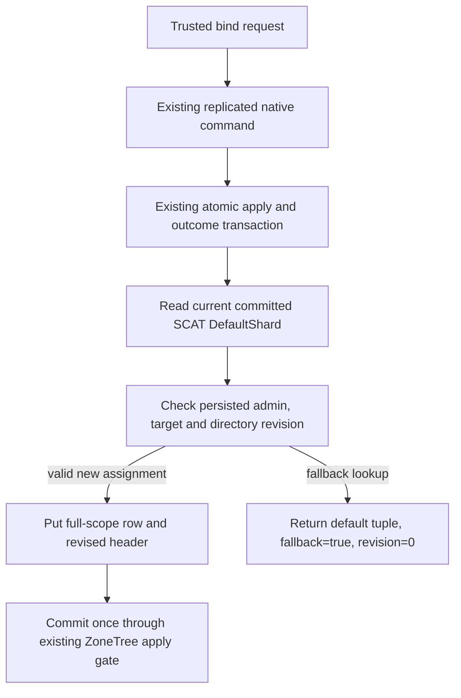

# Atomic partition placement prerequisite

Status: proposed prerequisite contract; implementation and qualification pending. Canonical slice: ClusterRouting. Related: [PhysicalShardCatalog](PhysicalShardCatalog.md), [ADR-016](../../ADR/ADR-016-atomic-physical-placement.md), [ADR-017](../../ADR/ADR-017-ownership-session-tokens.md), and [ADR-101](../../ADR/ADR-101-explicit-atomic-partition-placement.md).

This prerequisite persists explicit atomic-partition assignments while every assignment still resolves to the existing committed `DefaultShard`. It does not move data, change ordinary request routing, or complete KL-036, KL-037, KL-038, KL-071, or KL-072.

## Authority and data contract

The committed SCAT V1 `PhysicalShardCatalog`, its alias, field IDs, key, default record, bootstrap protocol, and startup fence remain byte-for-byte unchanged. Placement is separate additive native state. The directory header and per-assignment rows use new generated Orleans contracts and new KeyCodec spaces; they never replace or reinterpret SCAT V1.

`AtomicPartitionPlacementDirectoryV1` contains `Version=1`, monotonic `Revision`, and `ExplicitAssignmentCount` in `[0,4096]`. Its one header is keyed independently of any partition. An `AtomicPartitionPlacementV1` row is keyed by the complete four-field `PartitionRef` (`TenantId`, `DatabaseId`, `TransactionDomainId`, `PartitionKey`) and carries that same full identity, the complete committed physical-owner tuple (`PhysicalShardId`, `Incarnation`, exact ordered `VoterIds`, `PlacementEpoch`), and positive row `Revision`. The full identity is verified against the key after decode. The physical-owner tuple is copied from the committed SCAT V1 `DefaultShard` in the same transaction/view; a 32-byte atomic-partition digest alone is not an assignment key.

| Generated contract | Stable alias | Field IDs |
|---|---|---|
| `AtomicPartitionPlacementDirectoryV1` | `keyload.contract.atomic-partition-placement-directory.v1` | 0 `Version`; 1 `Revision`; 2 `ExplicitAssignmentCount` |
| `AtomicPartitionPlacementV1` | `keyload.contract.atomic-partition-placement.v1` | 0 `Version`; 1 `Partition`; 2 `PhysicalShardId`; 3 `Revision`; 4 `Incarnation`; 5 `VoterIds`; 6 `PlacementEpoch` |
| `BindAtomicPartitionPlacementRequest` | `keyload.contract.atomic-partition-placement-bind-request.v1` | 0 `Version`; 1 `ExpectedRevision`; 2 `Partition`; 3 `PhysicalShardId` |
| `AtomicPartitionPlacementReadRequest` | `keyload.contract.atomic-partition-placement-read-request.v1` | 0 `Version`; 1 `Partition` |
| `AtomicPartitionPlacementResolution` | `keyload.contract.atomic-partition-placement-resolution.v1` | 0 `Version`; 1 `Partition`; 2 `PhysicalShardId`; 3 `Incarnation`; 4 `VoterIds`; 5 `PlacementEpoch`; 6 `DirectoryRevision`; 7 `Revision`; 8 `IsFallback` |

`BindAtomicPartitionPlacementRequest` carries only version, expected directory revision, the full `PartitionRef`, and the requested `PhysicalShardId`. The server obtains the physical identity tuple from the committed SCAT V1 `DefaultShard` inside the same `IAtomicTransaction` and persists the entire tuple into each row; callers cannot supply incarnation, voters, or placement epoch. Existing-row validation compares every persisted tuple component, including exact voter order, with that same-transaction `DefaultShard`. A mismatch fails as `Corruption`; it never refreshes the stored tuple or falls back. In this prerequisite the only permitted target is that committed default shard. No assignment may establish an unverified second owner.

Header and row encoded values are each limited to 8192 bytes. Directory revision and row revision use checked positive `Int64` increments; counts use checked arithmetic. Malformed persisted shape, noncanonical identity, any mismatch between a row owner tuple and the same-view committed `DefaultShard`, impossible count/revision, oversized value, or an assignment without its required directory header fails closed as `Corruption`. Invalid request shape/version fails `Validation`; encoded request or assignment capacity excess fails `BudgetExceeded`; stale revision or command-content reuse fails `Conflict`; targeting a physical shard other than the committed default fails `UnsupportedCapability`.

A missing assignment resolves in one gated read to an explicit `IsFallback=true`, row `Revision=0` witness plus the validated current default shard tuple. It does not write a row. `DirectoryRevision` is zero when the directory header is absent; otherwise it is the validated current global header revision from this same read view, including for a fallback partition. Existing explicit rows resolve as `IsFallback=false` with their row revision and the row’s complete owner tuple after exact same-view validation against `DefaultShard`. The result is the generated public/native witness returned by Core from that one read; callers must not combine separately observed catalog, row, or directory state. This remains descriptive routing metadata only; no current data-operation path consumes it.

## Requirements and acceptance

- **REQ-PMAP-001 — Atomic bounded native directory.** Persist a generated header and full-scope rows through the existing replicated native command and `IAtomicTransaction` apply gate. **AC-PMAP-001:** real ZoneTree-backed tests prove keyspace isolation for partitions with equal suffixes but different tenant/database/domain, native generated-contract roundtrip of every owner-tuple field, exact create and reopen bytes/values, header/row/count consistency, 4096 assignment ceiling, 8192-byte limits, checked overflow, and rejection of malformed version/shape/key identity or any persisted owner-tuple mismatch without partial mutation.
- **REQ-PMAP-002 — Persisted authority and CAS/idempotency.** Only current persisted cluster administrators may bind an assignment; compare the expected directory revision under the same transaction. **AC-PMAP-002:** real native command tests prove absent fallback has no write, first assignment creates row revision 1, same command/body retry and exact same-target no-op preserve directory/row revisions, stale expected revision and same-ID/different-body conflict leave bytes unchanged, non-admin is denied, unsupported non-default target leaves state unchanged, and healthy follow-up still commits. Reopen proves the committed row and header remain consistent.
- **REQ-PMAP-003 — Public catalog caller surface.** Expose placement binding and same-view resolution through the real typed SDK and official MCP catalogs while preserving the persisted administrator trust boundary and native one-request-grain CQRS path. **AC-PMAP-003:** genuine Aspire RF3 calls through actual SDK and official MCP prove unbound fallback (including directory revision zero before any row), SDK bind with stable command ID, MCP read of the explicit witness, fallback for another unbound partition after the header exists, exact full owner tuple/order, and SDK/MCP agreement on all logical witness fields. Persisted non-admin reads and binds fail `PermissionDenied` without changing the witness. A non-default target remains `UnsupportedCapability`; stale global CAS remains `Conflict`; command-ID exact replay and changed-body conflict retain the native command/outcome behavior. No roles or physical tuple fields are accepted from the caller.
- **REQ-PMAP-004 — RF3 voter reopen.** Demonstrate that public resolution survives every voter process reopen within the existing physical RF3 group. **AC-PMAP-004:** use only the Aspire-owned three-node fixture; sequentially restart each actual voter, awaiting healthy readiness before the next restart, then query all three discovered node endpoints using the real SDK and official MCP clients. Every result carries the same committed partition/owner tuple, explicit/fallback state, and independently valid directory/row revisions. Do not assert equal read-cut positions across separate requests, claim power-loss durability, or count physical replicas as separate owners.

Traceability: REQ-PMAP-001 → AC-PMAP-001 → ADR-101 stages 1–2 → `AtomicPartitionPlacementNativeContractTests`, `AtomicPartitionPlacementResolutionTests`, and `AtomicPartitionPlacementCorruptionTests`; REQ-PMAP-002 → AC-PMAP-002 → ADR-101 stages 1–2 → `AtomicPartitionPlacementCommandTests`; REQ-PMAP-003/004 → AC-PMAP-003/004 → ADR-101 stage 3 → new `AtomicPartitionPlacementPublicRf3Tests` and feature-local SDK/MCP assertions. Native unit tests alone are not RF3 or SDK/MCP qualification.

## Ordered implementation and remaining qualification

1. Add new Abstractions generated contracts and Core feature-local native keys, serializer, validation, same-view resolver, and command handler. The Core read returns the public generated witness directly. The integration owner appends the operation enum values and wires native normalization/dispatch; existing numeric values remain unchanged.
2. Add actual ZoneTree UnitTests using the existing test database/fixture patterns, including raw native corruption setup, generated roundtrip of the full public witness, and reopen.
3. Add typed Server routes and MCP catalog entries that use the existing `ApiGrainDispatch`/`CanonicalOperationGateway`, plus SDK extension methods over shared `KeyLoadClient.Send<T>`. Both read and write reload the caller's persisted principal; both require persisted `ClusterAdministrator`. The binding route dispatches the existing PMAP native command; the read route dispatches through the existing `DatabaseReadGrain` and returns the same-view generated Core result.
4. Add real Aspire RF3 SDK and official MCP cases, including sequential voter restarts. Root retains the required build, formatter, unit, recovery, and complete RF3 gates. No source-stage or qualification status is asserted by this private amendment.

The future physical transfer requires its own fenced source cut, target ownership, replication/catch-up, publication, rollback, and token-lineage contracts under KL-036/071/072. Until those stages are accepted and qualified, all current configured work remains on `DefaultShard` and this directory is not a routing authority.

## Persisted placement corruption correction, 2026-10-08

TASK-PMAP-CORRUPTION-ORDER-001 preserves REQ/AC-PMAP-001 and REQ/AC-PQUERY-003 under ADR-101. Validate a decoded row's version, full key identity, nonempty physical owner, positive revision and present voters before resolving its registered owner. A persisted row selecting an unregistered owner is `Corruption`; a new bind request proposing an unregistered owner retains `UnsupportedCapability`. Valid registered owners retain their complete incarnation, ordered voter and epoch checks. Each actual metadata read remains charged before decode; no budget, read cut, authorization, fallback or stored bytes change.

Root owns the existing Core ClusterRouting row validation/serialization, registered and authorized placement readers, bind selection and GraphTraversal placement call site. The unchanged real-store `AcPmap001OwnerTupleMismatchFailsReadAndBindAsCorruption` and `AcPquery003MalformedCatalogDirectoryAndRowFailClosedWithoutMutation` are the regressions. Preserve their exact failure categories and unchanged-state assertions, then run the broader placement, registered-owner, graph and query flows. The original Linux b68 normal/scalar failures remain evidence until a later exact-source required run qualifies the repair; no task closure is asserted here.

## TASK-PMAP-REQUEST-BUDGET-001 — native admission correction

Proposed correction to existing REQ/AC-PMAP-001; source application and qualification remain pending. The genuine `CreateNativeOperation(BindAtomicPartitionPlacement, ...)` admission must report `BudgetExceeded` when the incoming encoded payload is admitted within the existing outer native command budget and exceeds the existing 8192-byte placement ceiling, before decoding or copying that payload. A negative length remains `Validation`; ordinary request shape/version validation and persisted-corruption categories retain their current contracts. Existing RequireNativeBudget retains its first-priority ResourceExhausted refusal for a body above MaxBatchBytes. This correction preserves the ceiling, global admission priority and generated contracts.

The real-store `AtomicPartitionPlacementCommandTests.AcPmap001OversizedNativeRequestLeavesPlacementUnchangedThenSameIdBindsAndReopens` must submit an 8193-byte native body, require exact `BudgetExceeded`, compare the original complete catalog, placement row/header bytes and native serialized same-view witness, then use the same command ID for a valid bind and verify its complete literal witness before and after cold reopen. Preserve the primary assertion/operation failure and each genuine fixture cleanup failure through the existing ServerFailureObserver ledger and joined Dispose. Existing invalid-version, capacity, CAS/replay, malformed-row and public SDK/MCP RF3 controls remain required. Local Unit evidence is a development gate; exact-source Linux and genuine public RF3 qualification remain open.

## TASK-PMAP-REFUSAL-REPAIR-001 — same-view admission and original operation recovery

REQ-PMAP-REFUSAL-REPAIR-001 refines existing REQ/AC-PMAP-001 and REQ/AC-PQUERY-003. A malformed explicit row selecting a foreign physical owner must fail Corruption immediately after the catalog, directory and row point reads, before a registered-owner-directory lookup. The authorized-query and administrator placement readers reuse the existing ValidateRowShape before selecting an owner from the decoded row; no validator, authority or lookup bypass is added. Exact native read-grant admission proves the order: its three-record/actual-encoded-byte grant covers those three records only; a fourth owner lookup would instead fail BudgetExceeded. A well-shaped row with a different positive persisted placement epoch requires the existing charged published-movement-lineage read. The original three-read grant correctly refuses BudgetExceeded before that extra read; a separate exact grant for the three original records plus the actual lineage key/value must reach Corruption for the absent lineage. Neither refusal performs fallback, tuple refresh, owner substitution or write. Healthy published movement still requires its complete original lineage.

AC-PMAP-REFUSAL-REPAIR-001 maps to AtomicPartitionPlacementAuthorityFlowTests.MalformedPlacementRefusesBeforeOwnerLookupThenSameGuidRepairsReplaysColdAndContinues. The genuine ZoneTree-owned trial first binds one full four-field partition through the actual native operation and persists its authorized query resource. It then installs (a) wrong version plus foreign selected owner, (b) wrong full partition identity plus foreign selected owner and (c) stale physical epoch using the existing fixture-owned native atomic corruption setup. The two malformed version/full-key-identity queries retain Corruption, exactly three charged metadata records and their actual encoded byte charge. The positive stale-epoch variant separately proves the original three-record grant returns BudgetExceeded with exactly its original three-record byte charge, then proves Corruption under a new grant computed from exactly those three records and the genuine fourth published-lineage key/value. Require that lineage absent in the corrupt fixture, exactly four charged point reads and their actual encoded bytes; the ordinary database limits and budgets remain unchanged. After exact row restoration, the healthy query again uses only the original three-read grant. No record is omitted from charging. Applying the same original valid bind GUID/body against each corrupt row throws the original Corruption before publishing an outcome. Complete bounded canonical records and local journal position stay byte-identical, including after joined cold reopen and original failed Apply. Only the exact saved row bytes/tuple are restored; the original operation then succeeds, returns the same native bool outcome on retry and cold replay, and preserves its full canonical image/cut. A fresh second full-scope partition with the same suffix but another tenant is subsequently bound at global CAS1, yielding literal directory2/count2/row1 witnesses for both partitions, original healthy outcome replay, another cold image/cut equality and healthy persisted resolution.

The original coherent R29 failure expecting Corruption under the three-read grant is retained in current-stage64-r29-cluster-runtime-completion.original-bound.json, with its original TRX and stable source/image identities; it is not rewritten or qualified. This correction preserves the same authored case declaration/UID and all original Apply, rollback, exact repair, replay, cold and healthy controls while separating actual budget admission from native movement-lineage validation. The wrapper retains the original assertion/operation failure and all fixture disposal failures through the existing ServerFailureObserver ledger. Capture uses the existing database MaxScanRecords bound and rejects an incomplete image; no new product bound or storage/provider API is introduced. Existing corruption declarations/UIDs and every original registered-owner, query, bind, SDK/MCP RF3, movement, receipt and cold control remain unchanged. This new local unit full operation qualifies only native admission, atomic rollback/replay and cold storage ownership. It does not establish six-owner RF3 placement, Linux qualification or the whole KL069/KL070 task. Root owns fresh native census, coherent build and required exact-source Linux evidence; all runtime gates remain OPEN.

REQ-PMAP-HEADER-ADMISSION-001 refines REQ/AC-PMAP-001 and REQ/AC-PQUERY-003: after the authorized query charges and decodes the committed placement directory, validate its native version/count/revision before reading a row or resolving its physical owner or published movement lineage. A known malformed header refuses Corruption; insufficient budget for either required catalog/header read still refuses BudgetExceeded. Reuse the existing validator and preserve persisted authorization, every actual byte/record charge, limits, row/tuple/lineage fences and the no-write query contract.

AC-PMAP-HEADER-ADMISSION-001 extends the existing MalformedPlacementRefusesBeforeOwnerLookupThenSameGuidRepairsReplaysColdAndContinues declaration and UID. Install a native-decodable invalid-version directory alongside a well-shaped foreign-owner row in the genuine ZoneTree fixture. A grant calculated from exactly the catalog/header key and actual value bytes must produce Corruption after exactly two point reads, before the row or foreign-owner read. The original valid bind GUID/body must also refuse Corruption without publishing an outcome; complete canonical image and journal cut stay unchanged before and after cold reopen. Restore only the saved valid directory and row, then apply that same GUID/body successfully; exact committed image/cut protects the persisted receipt on replay and a second cold reopen. The pre-existing malformed-row, actual charged lineage, separate original GUID, second-partition and healthy continuation controls remain intact. Existing native ServerFailureObserver owns primary and joined fixture cleanup failures. This unit operation is local development evidence; exact-source Linux and public RF3 acceptance remain open.
