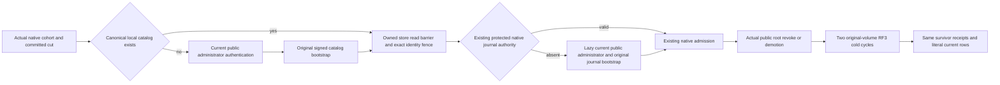

# Current catalog bootstrap authority lifetime

Canonical owner: ClusterRouting foundation, KL-018 / KL-061. Public authentication and persisted RBAC remain owned by [Authorization](../Authorization.md). This stage corrects the lifetime of an existing catalog readiness dependency; it creates no public administrator, credential, role, endpoint, read kind, dispatcher, storage format or provider.

## Frozen contract and actual gap

REQ-CATALOG-AUTH-001 / AC-CATALOG-AUTH-001: after the existing native RF3 startup prerequisite admits the actual compatible voter cohort, leader and materialized committed cut, an existing catalog is validated through the SAME node-local PartitionHost, its actual Coordinator.ReadBarrierAsync and canonical Store.Read. The bounded native catalog reader and existing catalog validation/fence must preserve exact physical shard, incarnation, ordered voters, version, revision and placement epoch. Missing catalog alone may use the original signed bootstrap command and a currently valid configured public administrator. Corrupt or mismatched current catalog fails closed; no reset, overwrite, substitute authority or retry fallback repairs it.

REQ-CATALOG-AUTH-002 / AC-CATALOG-AUTH-002: readiness of an existing valid node-local catalog must survive public bootstrap-key revocation and bootstrap-principal revocation/demotion. Runtime readiness does not retain a public principal ID. Every public operation still authenticates the actual credential through the existing signed native connection execution and freshly persisted principal/grants. Public ReadPhysicalShardCatalog and placement/admin APIs retain current administrator checks; local startup validation is an internal node-owner capability, not a public authorization bypass.

REQ-CATALOG-AUTH-003 / AC-CATALOG-AUTH-003: protected runtime journal authority remains the exact persisted nonadministrator with its closed signed RuntimeJournalPurpose and existing marker/quota/catalog checks. Startup first runs the existing real TryVerifyAsync and compatible-cohort admission. Only an absent protected authority invokes the lazy original public administrator authentication and original signed bootstrap command. Initial creation and authorized recovery between catalog creation and journal creation remain possible. Revoked public credentials cannot create absent authority. The bootstrap retry conditions, command identities, polling, deadlines, body serialization, cancellation and native stream ownership remain unchanged.

The actual prior PhysicalShardCatalogStartup unconditionally authenticated configured AdminKey before observing an existing catalog and rechecked a captured administrator ID for each admission. Public ConfigurePrincipal accepts ordinary root revocation/demotion at an advanced epoch; ConfigureApiKey accepts ordinary root revocation/rotation/expiry. The protected private journal principal is the separate immutable identity. Therefore this was a source-confirmed coupling: key revocation blocked cold startup; root revocation/demotion also blocked unrelated surviving public credentials at catalog admission. No runtime reproduction is claimed by this source packet.

## Whole-operation regression

REQ-CATALOG-AUTH-004 / AC-CATALOG-AUTH-004 maps to CatalogBootstrapAuthorityRf3Tests.CurrentNativeCatalogAndOriginalReceiptsSurvivePublicBootstrapAuthorityRevocationAndTwoFullColdRestarts with three genuine Args: key-revoked, principal-revoked, principal-demoted. Each owns an independent actual Aspire ClusterFixture and configures a separate persisted surviving public administrator and a read-only data subject through real SDK and official MCP principal/key calls. These are ordinary test-owned public identities, not production bootstrap identities or caller-trusted roles.

The survivor acknowledges a real document command. Its receipt is independently checked against literal mutation/revision, original GUID, actual configured placement incarnation/partition/epoch, positive observed position, quorum durability and Boolean-only empty hidden CompositionReferences. Every voter must expose the complete literal document and complete independently expected fallback placement through SDK and official MCP; the fallback fields are the observable current default catalog identity, not a claim to read raw catalog bytes. Current actual node identity, compatible ready RF3 count and applied cut are checked; original physical owner IDs remain exact across cold starts. Dynamic status cuts/terms/process IDs are not invented or frozen.

The survivor then actually revokes configured root key, revokes root principal, or demotes root with empty grants at epoch2. The SAME already connected original-root official MCP client and SDK must observe the actual failure: 401/Unauthenticated for revocation and authenticated PermissionDenied for demotion. A read-only persisted client still cannot configure an administrator through either adapter; its SAME original denied GUID and payload replay through both clients and both cold waves under unchanged reader policy. Other surviving credentials remain healthy. All callers are disposed before each cold transition.

Two actual ModelSqlRf3Cold cycles kill/restart all three original Aspire Docker resources on their original volumes and retain the real container/source/runtime receipts. Surviving clients reconnect after each wave; original complete receipt replays and literal models/placement/physical owners remain unchanged. A fresh survivor write after the first cold advances the document to literal revision2, then both original successful command IDs replay without reverting the later row. Original root remains revoked/demoted through both cold waves and fixture disposal; no restoration permits startup. Cold root negatives use actual SDK failure and official MCP initialization/call behavior, not a fabricated MCP error envelope. This flow uses the already declared RequestCqrsRf3Protocol.ParentDeadline, linked once to the native TUnit lifetime.

## Scope and evidence

All original operation/primary and independent SDK/MCP/fixture cleanup failures retain their ordering through existing ServerFailureObserver. Actual diagnostic source intentionally records authenticated discovery Unobserved when configured root is rejected; it does not require restoring root for shutdown. Native Docker/Aspire cold receipts do not depend on the public bootstrap key. Optional Control-group PhysicalOwnerRegistration still has its own explicit public-administrator dependency and is not qualified or silently altered by this default RF3 stage. Remote destination trust, additional physical-owner registration, catalog mutation, public grant changes, protected journal contracts and authorization dispatch remain outside this finite correction.

Backend: the four reserved existing Server ClusterRouting hosting seams plus new Queries/PhysicalShardCatalogLocalRead. Tests: matching ClusterRouting Contracts/Models/Helpers/Assertions/Cases roles above. Frontend N/A, no user interface. New infrastructure/transport/format N/A, existing native topology and APIs only. [ADR-036](../../ADR/ADR-036-orleans-foundation.md), [ADR-022](../../ADR/ADR-022-policy-epoch-revocation.md), [ADR-125](../../ADR/ADR-125-connection-owned-execution.md) and current ClusterRouting/Authorization requirements remain in force.

Prepared-source native parse/numeric/nesting preflight is separate from semantic binding. No SDK build, test, Docker or Git command was run by this lane. Independent full-source peer, Root integration, native discovery and exact-source Linux Unit/process/RF3 execution are OPEN. No real simultaneous failure injection, power-loss, performance, complete task or production-readiness claim follows from source review. Original failures and predecessor packets remain retained; source rollback removes this coherent finite stage without migrating persisted data.
