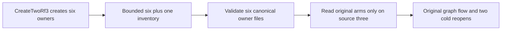

# Canonical model-cut probe owner inventory

REQ-ARM-OWNER-COUNT-001: Canonical model-cut admission validates the six owners actually created by RequestCqrsProbeFixture.CreateTwoRf3 using TwoRf3MembershipProtocol. Detect one extra entry through the existing bounded count-plus-one enumeration; reject missing or extra owners.
AC-ARM-OWNER-COUNT-001: The existing GenuineSixOwnerCurrentSourceRightsRefusalRestoresOriginalGraphRequestThenFullReceiptsSurviveTwoColdReopens reaches its original graph operation with all six owned directories. Missing, extra, foreign owner/session/voter and invalid-directory predicates remain strict. Same Case/UID/deadline and two original cold reopens remain unchanged.
REQ-ARM-OWNER-COUNT-002: Owner inventory includes destination node4/5/6, while original arm bytes remain written and verified only on source node1/2/3.
AC-ARM-OWNER-COUNT-002: RequireOwners uses six for both bounded enumeration and exact count, and validates all six owner files. Read retains its source-three arm-file loop byte-identically; no arm is required on destination owners.
REQ-ARM-OWNER-COUNT-003: Preserve all current owner byte/session/origin checks, existing callers, filesystem admission/cleanup and per-operation oracles.
AC-ARM-OWNER-COUNT-003: Only the two count expressions and the RequireOwners loop inventory change. No Test declaration, fixture replacement, filesystem filtering/recreation, health workaround or timeout widening is added.

The authenticated fa680 RF3 failure occurred in 193 ms at RequireOwners's line14 count predicate. The original CI log did not record the directory entries or their count. Current exact native proof confirms CreateTwoRf3 invokes the factory with includeDestination=true and creates six canonical nodes; the current RequireOwners uses Take(three+one) and requires three. This deterministically explains the confirmed current-source inventory defect, without claiming an observed historical four-entry capture. Container health failures in other cases are separate evidence. The initial proposed shared Nodes.Count substitution was rejected after exact protocol bodies proved that shared inventory also has only three entries.

Canonical slice map: IntegrationTests ClusterRouting/Helpers owns the repaired existing role; AppHost's existing two-RF3 topology is unchanged; contracts/product/backend/SDK/MCP/frontend are N/A because their operation contracts are unchanged. Existing whole graph case is the required runtime regression and preserves real SDK/official MCP/Aspire owners; original private missing/extra owner controls are required acceptance checks whose qualification remains OPEN and was not executed in this repair. Source repair and native admission do not qualify the whole RF3 gate. Compiler/runtime/Linux qualification remain OPEN.

