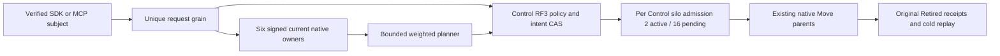

# Capacity-aware tenant placement

Status: authored source N for original KL-070/KL-071; no compiler, execution, Linux qualification, fault or performance pass. Owner: ClusterRouting. Decision: [ADR-129](../../ADR/ADR-129-capacity-aware-tenant-placement.md).

| Requirement | Acceptance and evidence |
|---|---|
| REQ-CAPPLACE-001: server-authenticated capacity from every actual voter of the two registered RF3 owners. | AC-CAPPLACE-001: six unique original query IDs/nonces, native silo generations and physical/incarnation tuples; original cohort, sample time and expiry remain unchanged. Missing member, stale sample, unknown container limit or host domain refuses before a new placement effect. |
| REQ-CAPPLACE-002: deterministic bounded tenant classification and capacity/failure-domain eligibility. | AC-CAPPLACE-002: versioned policy CAS, 64 whole-partition ceiling, key+value byte accounting under native charged reads, integer weighted rendezvous, fixed promotion/demotion hysteresis; no partial atomic partition or storage-handle migration. |
| REQ-CAPPLACE-003: authoritative policy/intent records use existing Control RF3, native serialization and full-scope outcomes. | AC-CAPPLACE-003: native ZoneTree complete image, original outcome bytes, stale CAS refusal, same-GUID replay after repair and two real cold opens; fresh persisted administrator authorization precedes effects. |
| REQ-CAPPLACE-004: apply is a bounded per-Control-owner service using existing native Move parents. | AC-CAPPLACE-004: two active and sixteen pending per Control silo (actual RF3 ceilings six/48), durable same-intent revision/claim CAS, immutable original Move IDs and Retired receipts, no whole-tenant atomic claim. |
| REQ-CAPPLACE-005: cancellation, resource closure and uncertainty preserve original operation semantics. | AC-CAPPLACE-005: original CQRS request token/progress backpressure, native work leases, grant settlement, retained shutdown tasks and all primary/cleanup failures; missing phase/pause ACK leaves pending original Move unknown, never a new GUID. |
| REQ-CAPPLACE-006: actual public interoperability preserves scope, ownership and cold replay. | AC-CAPPLACE-006: genuine six-owner Aspire with .NET SDK and official MCP; unavailable policy then CAS repair, administrator denial retained after permission repair, healthy distinct GUID, signed plan/persist/native transfer, same Apply GUID replay, changed request Conflict, two dirty and two healthy cold cuts, exact complete raw bytes on successive real offline opens, original canonical policy/intent/outcome/header bytes after native runtime restart, and all-model continuation. |

Policy defaults are promotion 64 MiB and demotion 32 MiB of bounded committed partition key+value bytes, reserve 256 MiB and 20% disk, at most 80% finite container memory and 85% finite CPU quota, weights 1..16. Sampling uses an owned 5-second PeriodicTimer; original samples expire after 15 seconds. Private admission shares existing routing/read limits and never resets the public request expiry. Unknown resources are unavailable, not host-memory substitutions.

Policies and intents commit through native generated Orleans records and existing ZoneTree transactions. Keys are existing KeyCodec string namespaces tenant-placement-policy-v1 / tenant-placement-intent-v1; capacity observations are disposable and never authoritative. Additive aliases use keyload.cluster-routing.; Root reserves operations 46..49 and reads 81..84. OwnerCapacity81 and PlacementIntentPhase49 remain private and excluded from generic public issue/catalog paths.

Persist47 has a native server-derived admission record: original public request plus fresh complete signed capacity. Its canonical fingerprint remains original GUID/kind/principal/public request, excluding refreshed observations. A retained outcome still traverses ordinary verified submit and original RF3 acknowledgement; it is never returned early. New permission denial stays an ordinary retained database outcome. New authorized persistence verifies the original plan's expiry/nonces/generations and current complete cohort without refreshing its original witnesses. Apply preserves the original typed public request once and uses internal current revision CAS for later phases.

Plans retain the complete original tenant/database partition set and stable ControlPartition. Current roster, registered physical owner, incarnation, global directory revision and destination exclusivity are checked before each new Move; existing parent header/terminal receipt is replayed with the original Move ID. This does not reserve an owner against future tenant enrollment. Implicit first writes do not advance PMAP directory revision. Automatic future enrollment/exclusive-tenant reservation remains a separate unqualified authority requirement; this bounded current-set intent must not be advertised as whole KL-070 acceptance.

Public read/configure/plan/persist/apply APIs expose existing SDK Result and official MCP canonical schemas. Public admission requires the actual configured Control role; Destination silos expose only private capacity. Each real database operation retains the separate native request grain and fresh persisted subject. No caller-supplied role, new transport, compatibility parser, scalar profile, blanket scheduling attribute or physical file migration is introduced.

REQ-CAPPLACE-001/006 and AC-CAPPLACE-001/006 also cover denied public plan creation, independently from denied intent persistence. The existing TenantCapacityPlacementRf3Authorization whole-flow helper uses its genuine persisted nonadministrator at epoch one to call the same complete tenant/database/partition/Control plan through both SDK and official MCP. The literal PermissionDenied / cluster-administration-required problem and complete original all-model/Control receipts are required before continuing its unchanged denied Persist GUID. Native TenantPlacementPlanner reloads the persisted principal and requires administration before the private six-owner capacity collector; this source order is not replaced with a fabricated collector counter.

Repair that same persisted principal to administrator at epoch two through both original physical groups. The existing retained denied Persist GUID still refuses; a fresh official-MCP plan and the existing fresh SDK plan/persist flow must succeed under current authorization. Require native complete plan fields, original Pending receipt equality and unchanged original all-model data. All original capacity whole-flow callers retain their exact declarations, native50 scheduling, unavailable/membership/dirty-cold controls, transfer/changed-content/Move receipts and two healthy cold cuts. There is no new credential store, caller role, permission cache, scheduling attribute, selector or product patch. Actual compiler/native census/runtime and Linux qualification remain mandatory and are not implied by this source-only extension.

Automated authored whole flows:
- TenantPlacementPolicyOutcomeTests.OriginalStalePolicyCasRetainsFullScopeOutcomeAcrossRepairReplayAndTwoColdCuts (real store Unit).
- TenantCapacityPlacementRf3Tests.OriginalSignedCapacityPlanPersistsAppliesReplaysAndSurvivesTwoColdOwnerCuts (six-owner SDK/official MCP).
Original deadlines and cleanup ownership are reused. Fresh native census must supply actual UIDs; none are inferred. Local RF3 requires the genuine verified-image session and exactly the new whole-class selector, with every existing receipt/hash/container/environment guard unchanged. The guarded closed-selector N is included for Root review; no local admission exists until it is integrated. Linux qualification remains separate. Source N and native checkOnly do not imply compiler/discovery/runtime PASS.

Frontend: N/A, administrator routing has no separate UI. Server/Core/Orleans/Abstractions/SDK/MCP/AppHost/tests apply. Required remaining gates: coherent native compiler/analyzers, canonical formatter, Release, complete native census, Unit/process/RF3, exact-source Linux fault/resource/endurance and measured performance. Required interruption/claim-ACK-loss and missing-member cohorts remain qualification flows rather than inferred healthy evidence.

## Persisted capacity enrollment binding

REQ-CAPPLACE-001 / AC-CAPPLACE-001 require the signed live owner cohort to agree with the current Control physical-owner directory before issuing a plan, before a new intent persistence effect, and before each new Move. The existing directory ceiling is two owners; equality covers physical ID, incarnation, placement epoch and ordered voter IDs, not merely destination ID presence. Original signed query IDs/nonces, native generations and sample expiry remain unchanged. Fresh persisted administrator authorization precedes these reads; charged native views and existing budgets remain authoritative.

The enrollment check uses the existing native directory decoder. Missing or changed enrolled membership refuses OwnershipLost with the original complete-cohort detail; malformed committed directory/control authority remains Corruption. No record, operation kind, alias, public wire, transport, registration-update API or lifetime is added. Retained persistence outcomes still use ordinary verified submit/RF3 acknowledgement. Apply has already crossed its durable claim boundary when later validation runs; a refusal must not be described as removing that claim or refreshing its original Apply/Move IDs.

PlacementCapacityEnrollmentTests.OriginalPersistedEnrollmentFencesOwnerTupleAcrossRepairReplayAndTwoColdCuts is a real-store Unit control: missing directory, native registration repair, changed incarnation/epoch/ordered voters and incomplete enrolled selection, original registration replay, exact complete raw image/position and two genuine cold opens. It supplies native owner tuples as bounded validator inputs; it does not claim a signed-capacity or six-silo trust proof. TenantCapacityPlacementRf3Tests retains the original SDK/MCP signed plan/persist/native Move/replay/cold/healthy whole flow on the affected product path. Exact-source Linux execution, actual missing-member/signed-metadata refusal and claim-ACK-loss flows remain qualification gates.

## Original single-member capacity refusal

REQ-CAPPLACE-001 / AC-CAPPLACE-001 and REQ-CAPPLACE-006 / AC-CAPPLACE-006 extend the original TenantCapacityPlacementRf3Tests.OriginalSignedCapacityPlanPersistsAppliesReplaysAndSurvivesTwoColdOwnerCuts operation. First verify all six native membership health snapshots against the actual returned fingerprint, then inspect and SIGKILL only the owned node6 container. Retain its original running/exited ID, image and completed kill receipt. Await the existing Aspire membership health event and require actual node1 membership HTTP 503; the current readiness contract returns six or unavailable, never a manufactured five-member snapshot.

While both physical groups retain a majority, the original SDK and official MCP placement-plan calls must refuse OwnershipLost with the unchanged complete-cohort detail. No new placement effect is admitted. Compare original canonical policy/outcome bytes, parent absence, exact outstanding grants and complete all-model receipts, then join all original owners, verify exact native offline images, perform two real cold owner opens/replays and restore genuine six-member health before continuing the original healthy policy CAS, signed plan, intent persistence, transfer, Apply receipt replay and healthy cold flow. Original test declaration, GUIDs, parent deadline, cleanup bounds, native SIMD and native50 scheduling remain unchanged. This source/test addition is not Linux qualification, power-loss durability or complete KL-070 acceptance; exact-source Linux execution, signed metadata refusal and claim-ACK-loss gates remain open.

### Same-tenant partial publication and original receipts

REQ-CAPPLACE-002/003/004/006 and AC-CAPPLACE-002/003/004/006 additionally require TenantCapacityPlacementRf3Tests.SameTenantTwoMovesRetainRowCasAndOriginalReceiptsAcrossPartialPublicationAndTwoColdCuts. Two genuinely seeded partitions share the original persisted tenant/database/schema and borrowed verified administrator credential; the sibling does not reconfigure policies or create another principal epoch. The original class and preceding operation remain unchanged, with the original parent deadline and native50 scheduling.

An SDK/official-MCP Control bind produces literal directory one with both target rows still fallback zero. The original signed two-Move plan retains directory one and two separate native row CAS zero values. The real existing ControlPrepare SubmitReturned hold for the second immutable Move proves its committed original journal receipt on the actual Control voter/incarnation while an authenticated intent read retains Applying, exactly one original Retired receipt, original Apply GUID/body and original complete plan/claim. Literal first-row two/global two, second fallback zero/global two and unchanged Control-row one/global two distinguish the completed-publication count from per-row CAS. Release and join the same original caller, native marker/producer/settlement/retirement resources; completion must retain both original Retired receipts, with second row three/global three. No product observer, callback, wire or signing contract is added.

The original unavailable policy refusal and genuine policy-CAS repair precede the operation. Same original Apply and individual Move GUIDs replay through both SDK and official MCP; changed Apply content refuses Conflict while the complete retained outcome and model images remain unchanged. Two dirty and two healthy six-owner stopped cuts independently reopen each native full raw image, preserve canonical policy/outcome/intent/parent rows and exact outstanding grants, then reacquire both official clients and verify complete literal all-model data/receipts. Distinct-GUID healthy writes on both moved partitions finish the operation. This NEXT source-only test requires the reviewed per-row/global CAS product correction and original committed-claim lifetime packet; it is not an executed Linux/RF3 gate, private phase ACK-loss proof, physical anti-affinity proof or complete KL-070/KL-076 qualification.

## Committed Applying claim race

REQ-CAPPLACE-004 / AC-CAPPLACE-004 and REQ-CAPPLACE-005 / AC-CAPPLACE-005 extend the existing TenantCapacityPlacementRf3Tests.OriginalSignedCapacityPlanPersistsAppliesReplaysAndSurvivesTwoColdOwnerCuts declaration without a new test argument or scheduling attribute. Arm the existing private SubmitReturned hold for the deterministic ControlPrepare command of the actual signed plan Move. A successful original journal record binds that exact command, Move, partition, principal, original physical owner/incarnation and positive applied position. The source commits Applying before executing that Move; an authenticated SDK read while the original producer is held must expose the original public Apply GUID/request, complete plan, policy epoch, Control owner, revision step, no completed moves or receipts and a live original claim nonce.

Read the genuine signed discovery of all six current native owners through the existing AppHost-owned credentials and generated serializer, zero temporary peer keys, and verify every actual membership health fingerprint. Match claim voter/silo and journal voter/silo separately against this complete cohort and the original Control owner; different native child and parent activations need not choose the same voter. The journal position belongs to committed Prepare, not an invented claim journal position.

The official MCP same-GUID/same-request Apply while that claim remains live must refuse dispatched Conflict with the original stale-authority detail. Its ordinary private failure outcome is legitimate; do not assert that the entire physical image stayed byte-identical. Instead compare the complete authoritative Applying intent and exact observed Prepare witness before/after that competing request, with the first producer still held and no additional completed Move/receipt. Release and join the original SDK producer, original marker reader, settlement and ProducerDisposed observation, then retire the arm before cold restart. On any failure retain roots and the original primary plus every cancellation/output/cleanup failure using the existing sixty-second cleanup contract.

Continue the original unchanged completed receipt, SDK/MCP same-Apply replay, changed-content refusal, original Move receipt replay, all models and two healthy offline cold owner cuts. Existing dirty cold cuts and unavailable/repair controls remain unchanged. This is a test-owned committed-cut witness, not a new production callback, wire schema, duplicate dispatcher, throughput assertion or Linux acceptance. Lost-ACK and active-owner loss qualification remain distinct outstanding gates.

### Row CAS and global directory fences

REQ-CAPPLACE-002 / AC-CAPPLACE-002 and REQ-CAPPLACE-006 / AC-CAPPLACE-006 distinguish the selected partition row revision from the global PMAP directory revision. An original signed plan retains its same-view global DirectoryRevision. Each immutable native Move request carries that partition's actual row Revision as ExpectedPlacementRevision; a fallback retains row zero even after another assignment advanced the global directory. Before a new parent exists, apply requires both the original row CAS and the global plan revision plus the number of completed native publications. Existing retained parent replay, physical owner/lineage validation, current persisted authorization, policy/cohort/enrollment/eligibility and original receipts remain unchanged.

The original TenantCapacityPlacementRf3Tests.OriginalSignedCapacityPlanPersistsAppliesReplaysAndSurvivesTwoColdOwnerCuts operation first binds its existing ControlPartition through SDK and official MCP under the original stable command GUID. Literal Control row/directory one and primary fallback row zero/directory one witnesses discriminate the two authorities. The fresh signed capacity plan must retain directory one and native Move row CAS zero, then execute the unchanged original persist/apply/changed-content refusal/receipt replay/all-model and two healthy cold flows. Replay the original Control bind through SDK and MCP after those real cold cuts. All preceding unavailable-policy, dirty cold, persisted authorization and genuine single-owned membership-loss controls remain mandatory. This NEXT N regression has not executed and does not close Linux RF3, power-loss, overload or complete KL-070/KL-076 gates.

The native plan shape validator retains nonnegative per-row CAS values and the checked complete publication count while keeping every existing scope, mode, identity and bounded-plan check. A newly persisted signed intent compares both actual same-view row revision and original global directory revision; a global equality alone cannot admit a stale row. The already-read native resolution supplies both fields, so no metadata read is skipped, added or granted a larger budget. Existing immutable retained scopes are not rewritten.

### Committed ControlPrepare response loss and original intent recovery

REQ-CAPPLACE-004..006 / AC-CAPPLACE-004..006 require the original public Apply GUID and typed body to survive loss of its owner after a genuinely observed committed ControlPrepare. TenantCapacityPlacementRf3Tests.OriginalCapacityApplyResumesSameGuidAfterObservedCommittedPrepareOwnerLossAndTwoColdCuts reuses the complete original six-owner unavailable-policy, dirty-cold, membership-refusal, fresh persisted authorization, policy repair, signed-plan and SDK/MCP persist flow. Its exact existing SubmitReturned Hold is armed on the deterministic native Prepare phase ID. Before any kill it requires the actual successful journal receipt, matching principal/partition/request/native voter/silo/control incarnation and unexpired authoritative Applying intent with no completed Move receipts; same-GUID concurrent Apply remains Conflict without changing the witness or intent.

Kill the actual original SDK HTTP owner node1 first through the existing full-container-ID inspected fault path, then join all six original owners, original response/marker tasks, AppHost and exclusive storage locks. The native write transport must return the literal UnknownWriteOutcome problem for an unavailable write response; unexpected original results remain failures. Joined-killed-owner gate settlement uses the observed original journal/marker/producer and does not fabricate ProducerDisposed. Two independent offline opens compare each owner's complete raw rows/cut/grants and the unchanged Applying intent on all three Control replicas; the actual scoped Prepare outcome must retain its original receipt and physical owner.

Restart the same owned six resources, preserve physical owner incarnations and voters, verify genuinely different native silo addresses and full cohort fingerprint, and require the original claim still unexpired. Official MCP reuses the exact original Apply GUID/body to reclaim after the actual old canonical silo is absent; no synthetic generation or elapsed-time fallback is admitted. The completed intent retains principal/policy/plan/control and original Move ID, a fresh actual claim, exact retired receipt, SDK/MCP replay and changed-content Conflict. Two healthy offline cold cuts, original all-model/Control receipts and a distinct healthy document operation complete the flow.

This test uses unchanged native50/SIMD and parent/cleanup deadlines and introduces no product observer, wire or serializer. It proves external original response loss at committed ControlPrepare and actual owner-loss reclaim only after genuine execution. Private Claim/Paused/Completed phase acknowledgement loss, continuously serving five-node capacity, physical anti-affinity, overload/endurance/performance and Linux qualification remain separate open gates.

### Persisted Pending intent and fresh administrator revocation

REQ-CAPPLACE-003 / AC-CAPPLACE-003 and REQ-CAPPLACE-006 / AC-CAPPLACE-006 additionally require TenantCapacityPlacementRf3Tests.OriginalPendingIntentSurvivesAdminRevocationButEpochRepairRequiresFreshIntentAndTwoColdReplays. This whole operation reuses the original unavailable policy, two dirty cold cuts, genuine missing-member refusal, Control bind and original persisted administrator/credential denial-to-repair setup. A separate named test-only branch owns this flow; original normal, committed-owner-loss, expiry and multi-Move declarations and semantics remain unchanged. No public protocol or product authorization change is made.

The original repaired administrator at literal policy epoch two signs and persists a complete Pending intent through SDK and official MCP. Join all six owners, independently reopen each native image and retain the exact original intent and successful scoped Persist outcome key/value rows on all three Control replicas with absent claim, original Apply identity, original parent and grants. Persistently revoke only that administrator on both actual physical groups at epoch three. The same original public Apply GUID/body must return the complete native PermissionDenied problem through SDK; official MCP retains that code/dispatched state and its canonical permission-denied safe detail before intent/claim effects. A genuine cold stop/reopen must keep the original Pending row bytes and all-model receipts unchanged; legitimate authorization and ordinary outcome records are not described as a byte-identical whole store.

Restoring administrator permission at epoch four does not restore the old intent's authority. Reusing the old Apply GUID/body must return the complete SDK TokenInvalidated/scope-mismatch problem; official MCP preserves that code/dispatched state and the canonical generic safe detail. Original Pending and successful outcome raw rows and claim absence remain unchanged through another genuine cold cut. Replaying the original successful Persist GUID/body after epoch repair must refuse the exact SDK PermissionDenied / principal-policy-changed problem and canonical MCP permission detail; it never returns the old Pending success. The original successful StoredOutcome itself remains byte-identical, including its original policy epoch and complete Pending result. The existing intent read checks the fresh persisted principal epoch before any new claim. This is an existing contract acceptance gap, not a claimed product defect or an authorization normalization.

Only a genuinely fresh SDK/official-MCP signed plan and distinct intent under epoch four may proceed. Execute its immutable original Apply and Move IDs through the existing native service, require the actual Retired receipt, exact source/destination/incarnation/positive source cut and literal row/directory publication two. Preserve complete Pending and Completed results, original terminal claim, exact policy/principal/plan/control scope, unchanged old Pending raw bytes, same-GUID fresh epoch-four Persist/Apply/Move replay, old epoch-two Persist denial with unchanged successful outcome bytes, and changed-content Conflict. Two healthy joined six-owner cold cuts independently reopen full native images, preserve canonical policy/outcome/intent/header rows and exact grants, reconnect the actual official client under the same persisted credential, and finish a distinct literal healthy document operation.

The official/HTTP caller belongs to this test lifetime and its original body plus every cleanup failure remain in the shared failure ledger. Actual Aspire restores the original owned endpoints; no fabricated host, replacement client transport, role claim, deadline increase, new phase observer, whole-store no-effect assertion or selector expansion is introduced. Native compiler/formatter/build/discovery, original client execution/cleanup and exact-source Linux RF3 remain open gates.

### Genuine hysteresis retention and equality demotion

REQ-CAPPLACE-002 / AC-CAPPLACE-002 and REQ-CAPPLACE-003/006 / AC-CAPPLACE-003/006 additionally require TenantCapacityPlacementRf3Tests.OriginalCapacityHysteresisKeepsDedicatedOwnerThenEqualityDemotesAndReplaysAcrossTwoColdCuts. Reuse the entire original six-owner SDK/official-MCP unavailable-policy, two dirty cold cuts, membership refusal, persisted authorization repair, signed promotion, immutable Move/Apply receipts and two healthy cold cuts before exercising the reverse placement direction. The original declarations, native50 scheduling and parent/cleanup deadlines remain unchanged.

Join the actual owners and independently reopen each native full raw image. Count exact committed partition key plus value bytes with the existing PartitionRecordFamilies/KeySpace prefixes on all three genuine destination replicas; the replicas must agree. A real policy CAS sets demotion to bytes minus one and promotion to bytes plus one. Fresh SDK and official-MCP signed plans must retain directory two, the complete original partition/cohort and zero Moves because the current dedicated owner remains inside the hysteresis interval. Persisting that actual empty plan returns the complete original Validation/Invalid outcome through both clients; this is a legitimate retained failed command outcome, not a claim of unchanged whole-store bytes. A further genuine cold stop/reopen preserves the complete literal all-model receipts, actual dedicated owner and independent partition byte total.

The next policy CAS sets demotion exactly equal to that independently recorded byte total. The original refused GUID/body still replays its original Validation outcome after policy repair. Fresh signed SDK/MCP plans now require exactly one whole-partition Transfer to the actual registered Control owner, native row CAS two and directory two. A distinct persist GUID and the original ensuing Apply/Move GUIDs must return Pending then Completed with the exact original plan, scope, principal/policy, retained terminal claim and Retired receipt. Require actual source/destination owner/incarnation, positive original source cut, target ownership epoch and literal publication/directory three; activation movement is not physical storage migration.

Replay the complete original pending Persist result, completed Apply intent and Retired Move receipt through SDK and official MCP, retain changed-content Conflict, independently open two healthy stopped owner cuts, verify canonical policy/intent/outcome/header bytes and exact outstanding grants, and finish a distinct healthy document operation with its literal receipt. No product API, observer, codec, threshold default, grant budget, selector or timing switch changes. The current source-only operation is not an executed no-effect proof, complete deterministic weighted-rendezvous coverage, Linux RF3 qualification, anti-affinity, endurance or a performance claim.

### Original signed-plan and sample expiry before intent persistence

REQ-CAPPLACE-001/006 and AC-CAPPLACE-001/006 additionally require TenantCapacityPlacementRf3Tests.OriginalExpiredSignedPlanRefusesWithoutClaimingGuidThenFreshPlanMovesAndReplaysAcrossColdCuts. Reuse the original real six-owner unavailable-policy, dirty-cold, single-member refusal, authorization repair, native row/global CAS and all-model controls. Capture a complete stopped baseline, independently reopen each native image and restore genuine six-owner health before issuing the original signed plan. Retain its actual public ExpiresAt, observed return instant and complete signed native discovery.

The plan deadline is the minimum of original call expiry and original sample expiry; waiting only for the public plan deadline does not prove the original samples expired. Await the later of that exact deadline and the observed return instant plus the existing typed maximum original sample freshness. The native fifteen-second freshness ceiling is unchanged, as are the parent and cleanup deadlines. This is an expiry operation, not a sleep used to infer a committed fault cut. Require all six canonical silo identities, voters and incarnations remain equal across the wait. Both SDK and official MCP must refuse the same original Persist GUID/body with the literal TokenInvalidated / original-plan-expired problem. Seal validates those expired original witnesses before collecting replacements or appending a new persistence operation; no original nonce, sample deadline or generation may be refreshed.

Compare every owner's complete raw rows with the pre-plan baseline, prove the original intent and scoped command outcome keys absent, retain parent/header/pending/last-issued absence and exact outstanding grants, and independently reopen both stopped cuts. Reconnect original SDK endpoints and reacquire the official MCP client after each genuine cold cut. A newly signed healthy plan may then persist under that still-unclaimed original GUID and IntentId through both clients; the original normal Apply/changed-content refusal/Move receipt replay and two healthy cold owner flows remain unchanged. After those cuts both clients replay the original successful Persist request and its original Pending receipt despite elapsed signing freshness, then a distinct healthy document operation proves continuation.

This test introduces no product API, observer, codec, scalar profile or local-image selector expansion. Actual native discovery UIDs, compiler/analyzers, local development RF3 runtime and Linux/fault/endurance qualification remain unproved until their original gates execute. Public plan-expiry-only retained-failure precedence, private phase ACK-loss, anti-affinity and overload remain separately identified criteria.

### Native Control-owner admission and joined shutdown

REQ-CAPPLACE-004/005 and AC-CAPPLACE-004/005 additionally require PlacementCapacityAdmissionTests.OriginalControlAdmissionBoundsCancellationAndJoinedShutdownPreserveHealthyContinuation as a genuine native Unit admission/lifecycle control. Use the actual PlacementIntentAdmissions and its owned native ConcurrencyLimiter: acquire both original leases, enqueue exactly sixteen original calls and assert the next call's complete ResourceExhausted problem. Cancel the original oldest queued caller with its own token, join that same task and preserve the token, fill the freed queue slot, and prove the same overflow refusal. Release an original active lease and require only the oldest remaining native caller is admitted.

Start the original retained DisposeAsync task while two original leases remain active. Closing admission must join every queued task's original typed refusal and reject future calls with ObjectDisposedException, while the disposal task remains incomplete until those two actual leases are disposed. Then join the same disposal task and all native queue tasks. The owning test ledger retains primary and every output/disposal failure; a distinct healthy native owner admits two active calls and promotes its original queued caller after release. No synthetic producer, scheduling delay, limiter replacement, product callback, public API or forged Control authority is used.

This is bounded per-instance native admission evidence only. It does not establish actual cluster-wide six/48 admission, signed Apply authority, RF3 overload or endurance, nor does it replace existing SDK/official-MCP committed claim/movement/cold tests. Fresh native case identity, compiler/analyzers, canonical execution and Linux qualification remain open. Existing original deadlines, native50/SIMD and two-active/sixteen-pending per-Control-silo product defaults remain unchanged.

### Original signed-plan policy CAS and retained failed outcome

REQ-CAPPLACE-003/006 and AC-CAPPLACE-003/006 require OriginalSignedPlanPolicyCasRefusalRetainsFailedGuidThenFreshIntentMovesAndSurvivesDirtyAndHealthyColdCuts on the existing TenantCapacityPlacementRf3Tests class. Reuse the original six-owner SDK/official-MCP unavailable-policy, two dirty cold, single-native-member refusal, fresh persisted administrator authorization and literal row/global placement controls. Retain a genuinely signed revision-two plan. A real expected-revision policy CAS commits disabled revision three; while its original witnesses remain valid, persistence of the old plan must produce exact native Conflict / authority-revision-changed and canonical MCP safe detail. This is a retained failed scoped outcome, not unchanged whole-store bytes or an absent command receipt. The rejected intent, original Move parent and claim remain absent on every owner, with zero outstanding grants. Both original stopped images are independently opened under exclusive native locks; complete raw cuts are preserved.
Repair through actual policy CAS to enabled revision four. The same original Persist GUID/body remains the exact failed outcome; repair does not promote an old signed plan. A fresh SDK and official MCP signed plan must name revision four and retain original complete tenant/partition/cohort scope. A distinct genuine intent persists and runs the existing native claim race, immutable Move/Retired receipt, original Apply GUID/body replay, changed-content Conflict and complete all-model operation. Preserve independently captured original failed-outcome bytes on all three Control copies through two additional real healthy cold cuts, full successful Apply/Move replay and healthy continuation. No extra public API, policy relaxation, sample refresh, scheduling attribute, topology or deadline changes. Policy changes after Pending are a different contract: current Apply commits its claim before revalidating policy for a new Move, so this case does not advertise unchanged Pending or no Apply effects. Source-only N does not close compiler/native census/local/Linux RF3, fault, endurance or performance gates.

### Occupied dedicated owner and original foreign-tenant receipts

REQ-CAPPLACE-002/006 and AC-CAPPLACE-002/006 require a real current-owner eligibility operation, distinct from the manual dedicated placement flow. The original unavailable policy and two genuine dirty cold cuts precede packing two differently authenticated tenants on the Control physical group. Persist the foreign tenant schema/principal/credential on the actual Destination group through existing privileged configuration APIs, retaining the original subject, epoch and credential. Fresh persisted ordinary permission still denies its public Move. A privileged separately scoped original GUID genuinely transfers that tenant to Destination, with literal native owner/incarnation/voters, retained complete public parent receipt and both clients reading the original document.

The original primary tenant retains its source placement and all-model data. SDK and official MCP signed Plan both refuse ResourceExhausted / native scope detail while the only dedicated candidate is occupied by the foreign tenant; MCP retains its canonical safe detail. Two independently reopened stopped images retain policy and original scoped outcomes, the complete retired parent, no pending phase and exact zero grants. Genuine reverse Move, rather than rebinding nonempty storage, repairs occupancy. Original forward/reverse receipt replays remain independently authorized; they do not become current consistency tokens.

A fresh signed primary plan pins global directory five and primary row one, then the unchanged public Persist/Apply/claim/retired receipt/replay/change-content/cold flow publishes primary row/global six. The foreign tenant remains on Control, with literal current owner and preserved original successful receipt. Distinct healthy writes on both tenants survive two additional complete stopped opens and SDK/official MCP replay. All six original node-local replica identities and the two enrolled physical-shard owner tuples are conserved. Existing declarations, native50/SIMD, parent/cleanup bounds and failure ledger remain unchanged. This source-only whole flow does not reserve dedicated owners against future enrollment or close Linux/fault/endurance/performance acceptance; compilation, actual native discovery, execution and exact-source Linux qualification remain required.

### Immutable Pending IntentId and separately scoped command outcomes

REQ-CAPPLACE-003/006 and AC-CAPPLACE-003/006 require a genuine signed-plan identity collision operation. Persist an original Pending intent and independently retain its complete SDK/MCP result and native raw intent/success outcome on all three Control replicas through a stopped cold reopen. After restart collect a new genuine signed plan and use a different command GUID with the original IntentId. While those new witnesses are still valid, the native authority must refuse Conflict/Stale after fresh principal, policy, owner/cohort and enrollment validation. The official MCP detail remains its existing canonical generic failure; SDK preserves the complete native problem. No Apply, claim or parent movement may be created for either refused plan.

Retain the failed full-scope command outcome separately from the original successful Persist outcome, preserve the original Pending bytes, and reopen a second full dirty image. Replay both original GUIDs without recollecting witnesses: ordinary retained replay still checks current persisted authorization and policy epoch and acknowledges through the existing RF3 path. Repair uses a fresh signed plan, new IntentId and new command GUID rather than replacing the original Pending or relaxing its create-only ExpectedRevision. Actual Apply/Retired movement, complete original operation receipts, changed-content refusal, two healthy cold cuts and a distinct healthy continuation must preserve both original retained outcomes and unchanged old Pending/absent claim. No product bug, local PASS or Linux qualification follows from this authored scope; actual native census, compiler, bounded execution and Linux RF3 gates remain required.

### Public whole-partition selection ceiling before private collection

REQ-CAPPLACE-002/006 and AC-CAPPLACE-002/006 require the actual SDK/official-MCP plan boundary to refuse a held request containing sixty-five distinct well-shaped same-tenant/database PartitionRefs under the existing sixty-four limit. These request references are deliberately unseeded: actual native count admission precedes private collection and complete-roster lookup, so the literal error is Validation/Invalid rather than a manufactured signed roster or a later owner failure. Fresh persisted administration precedes that bound. SDK keeps the full native problem while official MCP uses its unchanged canonical generic validation detail. Source order proves no collector invocation; no speculative network counter is claimed.

Reuse the complete original unavailable-policy, dirty-cold, membership and authorization setup, then retain a stopped canonical baseline. Require unchanged original all-model/Control receipts and policy/scoped-outcome bytes, absent movement parent/pending/last-issued and exactly settled native grants through two additional genuine cold cuts. Each full raw image is compared independently during stopped reopen, not falsely equated across live restarts. No persistence or Apply GUID is minted for the refused query. Repair selects the genuine complete one-partition live roster, issues independent SDK/MCP signed plans, persists a new Pending through both clients and executes the existing immutable Apply/Move/Retired/changed-content/replay/two-healthy-cold flow plus a literal healthy continuation. This does not prove successful maximum-size sixty-four-partition throughput, global scheduling bounds or Linux qualification; those gates remain explicit.

### Complete live tenant roster before original two-Move persistence

REQ-CAPPLACE-001/003/006 and AC-CAPPLACE-001/003/006 require the existing SameTenantTwoMovesRetainRowCasAndOriginalReceiptsAcrossPartialPublicationAndTwoColdCuts full operation to reject an actual omission. Both partitions are genuinely seeded with the same persisted tenant/database/schema and borrowed administrator, not synthetic capacity records. After the original unavailable-policy and two dirty owner cuts, healthy policy CAS and SDK/MCP Control bind, request only the first real partition through both actual clients. The current native complete-roster length/set check must return OwnershipLost/ScopeMismatch after fresh complete signed collection; SDK retains its full problem while MCP preserves the unchanged canonical generic detail. This source order does not claim pre-collector refusal or introduce a diagnostic counter.

Require the complete original all-model contents/receipts for both partitions, absent parents/pending/last-issued and settled grants across two further native cold owner cuts, independently reopening complete raw images and retaining policy/scoped-outcome bytes. No Pending/claim or public Apply GUID is minted for this failed query. Repeat that exact held query after reconnect, then continue the original full two-partition plan/Persist/Apply and original first-Retired/second-committed-Prepare held witness, immutable GUIDs/Move IDs/claim CAS, all original receipts, changed-content refusal, two healthy cold cuts and distinct continuation. The original case declaration/UID, deadline, native50 scheduling, real six-owner image admission and cleanup ledger remain unchanged. There is no product or public protocol change, stale-Pending roster inference, Linux PASS or complete KL-070 claim.

### Persisted administration and public placement reads

REQ-CAPPLACE-003/006 and AC-CAPPLACE-003/006 extend the original Pending administrator revocation whole operation with the actual public Policy and Intent reads. Under the same persisted credential after epoch-three revocation, both SDK and official MCP must refuse Policy and Intent reads before returning authoritative placement content. Require the exact public read execution's cluster-administration-required problem: its native Orleans administrator gate precedes the Core reader's separate defence. SDK preserves the complete native problem; official MCP preserves its permission-denied safe detail and dispatched state. All original Pending/retained successful outcome bytes, all-model data, absence of claim/parent, original Apply refusal and joined cold cuts remain unchanged.

After epoch-four administrator repair, both clients may read the unchanged healthy policy, while the original epoch-two intent remains TokenInvalidated/scope-mismatch rather than regaining authority. Preserve the separately retained old Persist epoch-fenced denial. The existing fresh epoch-four signed plan/new intent makes both original clients read the complete independently asserted Pending. After actual Apply/Retired and both healthy stopped cold opens, read the complete original Completed intent and healthy policy through both clients and continue every original receipt replay, changed-content refusal, old Pending/raw-outcome preservation and distinct healthy operation. This adds no product path, permission cache, credential, observer, protocol or new test declaration. Exact current native read API/detail proofs, compiler, original bounded real six-owner execution and Linux qualification remain mandatory.

### Original partial publication and second committed Prepare owner loss

REQ-CAPPLACE-004/005/006 and AC-CAPPLACE-004/005/006 require a distinct complete operation after one native Move is already Retired. Seed two genuine same-tenant partitions through the original borrowed verified administrator and complete six-owner capacity roster. Keep every original unavailable-policy, two dirty cold, live roster omission, policy/Control bind, signed-plan and scoped Persist assertion. Preserve the original healthy Multi case unchanged. A separate named test-only mode drives the same original Apply GUID/body and immutable ordered Move array.

Hold only the second original native Prepare after its receiver's actual committed ControlPrepare journal receipt and marker agree on original principal, phase GUID, MoveId, partition, Control incarnation, voter and native silo generation. The persisted Applying intent must retain CompletedMoves one, its first exact complete Retired receipt, original Apply identity, full signed plan and current claim. Replay that first real Move through SDK and official MCP before the fault and verify the complete current first-published/second-unpublished placement image. No elapsed timing or advisory signal substitutes for the committed cut.

Kill the actual original SDK HTTP owner node1 through the existing inspected owned-container fault and join all original owners, caller/marker/producer, AppHost, private arm and storage locks. Require the unchanged native UnknownWriteOutcome response for the unavailable original write reply. Independently reopen complete offline images twice and retain the exact Applying bytes, first Retired authority/receipt and second Prepared authority/journal on the actual physical owners. Do not equate a live restart image with a stopped cut or skip legitimate retained outcomes.

Restart the original six owners at their original ports. Prove all original native silo generations and the old claim owner are absent while the original physical incarnations remain. Before the original still-live claim expires, official MCP resumes the same Apply GUID/body through the existing fresh-cohort reclaim. Complete only the second original Move and preserve the first receipt byte-for-byte/equivalent canonical complete typed receipt, the signed original plan, principal, policy epoch and original Apply identity. Require both immutable Retired receipts, no orphaned movement/admission/read grants, same GUID replay and changed-content Conflict. Keep both existing healthy cold cuts, original policy/Control receipts, complete source-target all-model operation and a distinct healthy continuation. No public protocol, private phase, observation hook, timeout, caller authorization or whole-tenant atomic claim is added. Native source/compiler, exact fresh case binding, bounded local execution and Linux/fault/endurance/resource qualification remain open.

### Completed placement receipts and current policy CAS

REQ-CAPPLACE-003/006 and AC-CAPPLACE-003/006 require the original successful placement history to remain distinct from the current placement policy. Extend the original Pending administrator-revocation operation only after its genuinely fresh epoch-four intent completes the native Move and both healthy cold cuts. Keep the original principal at epoch four; update only the placement policy with expected revision two to disabled revision three through actual SDK and official MCP Configure. Independently assert the full returned policy, complete current policy/Completed reads, exact original successful Pending Persist receipt and complete Completed Apply/Retired Move receipt. A disabled policy must refuse a new Plan with its current consumer-specific complete problem, without minting an intent or Move.

Preserve the original old epoch-two Pending/success rows through both complete six-owner stopped cold opens using the existing old-intent oracle and current policy revision three. Reusing the successful epoch-four Persist/Apply identities remains history, not permission to issue another Move. A real revision-three CAS repairs to enabled revision four. Both original clients collect genuine fresh signed plans for the now-dedicated complete one-partition live roster: current policy revision four, global directory two, original Control scope/current six native identities and no new Move. Do not persist an empty Move plan or label it a second physical transfer.

Replay the original successful disabled-policy Configure GUID/body after repair: its original full revision-three result must not replace current revision four. Require complete current Policy/Completed reads and original Persist/Apply/Move receipts, then preserve policy-four/intent/outcome/parent/raw old-Pending rows across two further joined healthy cold opens. Keep every preceding unavailable-policy, membership, dirty-cold, administrator denial/epoch fence, changed-content refusal and original receipt replay assertion and finish the existing distinct healthy all-model operation. No credential epoch, public API, product branch, observation hook, resource limit, token deadline or test declaration is changed. A completed Apply replay follows its actual retained native reader/service path; this scope does not claim a new append or RF3 acknowledgement that the owning source does not perform. Exact current disabled-policy and keep-owner planner semantics, native N/new-role proofs, coherent compiler/runtime and Linux qualification remain mandatory.
